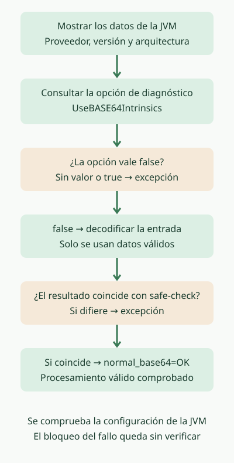

**Java4Shell es una vulnerabilidad de corrupción de memoria en la ruta que OpenJDK utiliza en determinadas CPU x86-64 para acelerar la decodificación Base64. En ciertas condiciones puede provocar la exposición del contenido de la memoria o permitir la ejecución remota de código. Comprueba el entorno de ejecución, las características de la CPU y si los datos externos pueden llegar a esa ruta. Instala después el JDK corregido de tu proveedor.** Si no puedes desplegar el parche de inmediato, puedes evaluar la opción temporal `-XX:-UseBASE64Intrinsics` que propuso el equipo investigador.

Java4Shell es el nombre que le dio Calif, el equipo que descubrió la vulnerabilidad. Su identificador es **CVE-2026-114938**. La documentan el [aviso de seguridad de Oracle (2026-11)](https://www.oracle.com/security-alerts/cspunov2026.html) y el [aviso de OpenJDK](https://openjdk.org/groups/vulnerability/advisories/2026-11-17). Las versiones que se indican aquí se contrastaron con información pública consultada el 18 de noviembre de 2026.

## Por qué puede corromperse la memoria en Java

HotSpot optimiza las operaciones frecuentes mediante compilación JIT. Para algunas operaciones usa implementaciones especializadas llamadas intrínsecos, que aprovechan instrucciones de la CPU. Según Calif, **el intrínseco x86-64 de Base64 calcula mal la máscara que selecciona los bytes que se van a escribir al procesar el relleno y acaba escribiendo fuera del búfer de salida**. La memoria ya puede estar dañada cuando la capa Java rechaza la entrada incorrecta con una excepción `IllegalArgumentException`. Capturar esa excepción no corrige el problema.

Oracle identifica el componente `Compiler` y OpenJDK lo clasifica como `hotspot/compiler`. La exposición no exige que la aplicación compile código fuente Java externo. La decodificación habitual de Base64 también puede usar esa ruta optimizada dentro de la JVM.

Calif especifica como requisito **compatibilidad con AVX-512 VBMI en una CPU x86-64**. En Linux recomienda comprobar que están presentes `avx512f`, `avx512bw`, `avx512vbmi` y `bmi2`. La ruta descrita no afecta a ARM64. Que la CPU cumpla esos requisitos no confirma por sí solo que se pueda ejecutar código remotamente en cualquier aplicación. La forma en que llegan los datos y las condiciones de explotación varían según la aplicación, por lo que una misma entrada maliciosa no permite tomar el control de todos los productos. En máquinas virtuales y contenedores, comprueba las capacidades de CPU que la JVM realmente tiene a su disposición.

Para interpretar la gravedad, ten en cuenta quién emite la evaluación y qué versión de CVSS utiliza.

| Fuente de la evaluación | Puntuación | Significado |
| --- | --- | --- |
| Oracle CNA | CVSS 3.1 **8.1, High** | Ataque por red de complejidad alta que no requiere autenticación ni interacción del usuario |
| Calif | CVSS 4.0 **9.2, Critical** | Puntuación publicada por el equipo investigador con otra versión del sistema |

El vector de Oracle es `CVSS:3.1/AV:N/AC:H/PR:N/UI:N/S:U/C:H/I:H/A:H`. Las puntuaciones corresponden a autores y versiones de CVSS diferentes. [Registro original del CVE](https://www.cve.org/CVERecord?id=CVE-2026-114938).

## Qué versiones del JDK hay que sustituir

La tabla recoge las versiones con soporte que Oracle identifica como afectadas y las versiones corregidas que se han confirmado. Para otras distribuciones, consulta los avisos de sus proveedores.

| Producto | Versión afectada según Oracle | Versión corregida de Oracle confirmada |
| --- | --- | --- |
| Oracle Java SE 17 | `17.0.21.0.3` | [17.0.21.1+4](https://www.oracle.com/java/technologies/javase/17-0-21-1-relnotes.html) |
| Oracle Java SE 21 | `21.0.13.0.3` | [21.0.13.1+4](https://www.oracle.com/java/technologies/javase/21-0-13-1-relnotes.html) |
| Oracle Java SE 25 | `25.0.5.0.3` | [25.0.5.1+4](https://www.oracle.com/java/technologies/javase/25-0-5-1-relnotes.html) |
| Oracle Java SE 27 | `27.0.1.0.3` | [27.0.1.1+4](https://www.oracle.com/java/technologies/javase/27-0-1-1-relnotes.html) |
| Oracle Java SE 8 Performance Pack | `8u511b33-perf` | Aquí no se confirma la compilación exacta que incluye el arreglo |
| Oracle GraalVM for JDK | `17.0.21.0.3`, `21.0.13.0.3` | Consulta la actualización de seguridad del producto |
| Oracle GraalVM Enterprise Edition | `21.3.20.0.3` | Consulta la actualización de seguridad del producto |

**La lista no abarca todas las versiones vulnerables anteriores al arreglo.** Oracle indica que algunas versiones anteriores también podrían verse afectadas y recomienda actualizar a una versión con soporte. Distingue las compilaciones estándar de Java 8 de Performance Pack. [Matriz de riesgos de Oracle](https://www.oracle.com/security-alerts/cspunov2026.html#AppendixJAVA).

Para Temurin, Corretto, Zulu u otra distribución basada en OpenJDK, consulta el aviso de su proveedor sobre este CVE y comprueba la compilación corregida. Un número de versión distinto del que figura en la tabla de Oracle no garantiza que la distribución esté protegida. El alcance que describe Calif se refiere a un hardware y una ruta de ejecución concretos. En las versiones que ya incorporan un arreglo, comprueba el estado del parche con tu proveedor.

## En qué orden aplicar el parche y la mitigación temporal

Empieza por identificar **el JDK que usa el proceso del servicio**. En la terminal, `java -version` muestra el ejecutable que figura en el PATH actual. Puede ser distinto del que usa un servicio que ya se está ejecutando. Registra la ruta de arranque, la imagen del contenedor, la versión de la JVM y el proveedor.

Para corregir la vulnerabilidad, sustituye el entorno de ejecución por el JDK actualizado de tu distribución. Reconstruye el contenedor con una imagen base corregida y vuelve a desplegarlo. Tras la sustitución gradual, comprueba la versión en ejecución y verifica que no queden instancias con la JVM anterior. Cambiar el archivo de dependencias de la aplicación o limitarse a instalar un JDK nuevo en el host no basta.

Si el parche tarda en llegar al entorno de producción, evalúa la siguiente **opción de arranque de la JVM** que propone Calif. Sustituye el nombre del JAR por el de tu aplicación.

```sh
java -XX:-UseBASE64Intrinsics -jar app.jar
```

Esta mitigación temporal desactiva la aceleración por hardware de la codificación y decodificación Base64. El aviso de Oracle consultado para este artículo recomienda aplicar la actualización de seguridad. Añade la opción a la configuración actual de la JVM, reinicia el proceso y comprueba el valor efectivo. En servicios que procesan mucho Base64, observa el volumen de trabajo procesado, el uso de CPU y la latencia. Aquí no se midió el efecto de la opción en el rendimiento.

Calif también propone `-XX:UseAVX=2` como alternativa **solo para x86-64**. Es posible que OpenJDK en ARM no la reconozca y falle al arrancar. Evita aplicarla de forma general en despliegues con distintas arquitecturas. El almacenamiento en búfer del cuerpo de las solicitudes en Nginx tampoco garantiza el bloqueo de todas las vías de explotación.

## Cómo comprobar que se aplicó la opción temporal

El ejemplo comprueba **en JDK 17 o posterior con HotSpot el valor de la opción de la JVM actual y la decodificación de un dato Base64 válido**. Detectar la vulnerabilidad y verificar el bloqueo de ataques requiere comprobaciones aparte. Si la interfaz de diagnóstico o la opción no están disponibles, consulta las herramientas de administración de tu entorno de ejecución.



El programa se detiene con una excepción si falta la interfaz de diagnóstico o si la opción no está desactivada. Solo cuando se supera esa comprobación se decodifica una cadena válida y se compara el resultado con el esperado.

Guarda el código como `Base64MitigationCheck.java`.

```java
import com.sun.management.HotSpotDiagnosticMXBean;
import java.lang.management.ManagementFactory;
import java.nio.charset.StandardCharsets;
import java.util.Base64;

public class Base64MitigationCheck {
    public static void main(String[] args) {
        System.out.println("java.vendor=" + System.getProperty("java.vendor"));
        System.out.println("java.runtime.version="
                + System.getProperty("java.runtime.version"));
        System.out.println("os.arch=" + System.getProperty("os.arch"));

        HotSpotDiagnosticMXBean diagnostic = ManagementFactory
                .getPlatformMXBean(HotSpotDiagnosticMXBean.class);
        if (diagnostic == null) {
            throw new IllegalStateException("HotSpot diagnostic interface unavailable");
        }
        String enabled = diagnostic.getVMOption("UseBASE64Intrinsics").getValue();
        System.out.println("UseBASE64Intrinsics=" + enabled);
        if (!"false".equals(enabled)) {
            throw new IllegalStateException("Base64 intrinsic is not disabled");
        }

        String decoded = new String(
                Base64.getDecoder().decode("c2FmZS1jaGVjaw=="),
                StandardCharsets.UTF_8);
        if (!"safe-check".equals(decoded)) {
            throw new IllegalStateException("Unexpected Base64 result");
        }
        System.out.println("normal_base64=OK");
    }
}
```

Ejecuta estos comandos con `javac` y `java` del mismo JDK que quieres comprobar.

```sh
javac --release 17 Base64MitigationCheck.java
java -XX:-UseBASE64Intrinsics Base64MitigationCheck
```

Esta es la salida obtenida con Zulu `21.0.1+12-LTS` en macOS con ARM64. La compilación antigua se utilizó para comprobar el ejemplo y no se recomienda para producción. Con Corretto `17.0.8.1+8-LTS` también se confirmó que la opción estaba desactivada y que la decodificación era correcta.

```text
java.vendor=Azul Systems, Inc.
java.runtime.version=21.0.1+12-LTS
os.arch=aarch64
UseBASE64Intrinsics=false
normal_base64=OK
```

En los dos entornos, al ejecutar el ejemplo con `-XX:+UseBASE64Intrinsics` se obtuvo la excepción `Base64 intrinsic is not disabled` y el código de salida `1`. En ARM64 se comprobaron **la lectura de la opción, la decisión que toma el código y el procesamiento de datos válidos**. No se hicieron pruebas de corrupción de memoria, eficacia de la mitigación ni rendimiento en las CPU x86-64 afectadas.

Ejecutar el ejemplo como proceso independiente solo confirma la configuración de ese proceso. Para comprobar la aplicación en producción, necesitas una herramienta de diagnóstico compatible y permisos para acceder al proceso. Si la consulta falla por la implementación de la JVM, porque Attach está deshabilitado, por permisos o por el espacio de nombres de PID del contenedor, el estado queda sin verificar.

```sh
# JCMD는 대상 런타임과 호환되는 도구의 경로, PID는 서비스 JVM의 PID다.
"$JCMD" "$PID" VM.version
"$JCMD" "$PID" VM.flags -all | grep 'UseBASE64Intrinsics'
```

Tras desplegar la compilación corregida, comprueba la versión efectiva, la sustitución de las instancias, las funciones clave de inicio de sesión, carga de archivos e integraciones, y la tasa de errores. Antes de retirar la opción temporal, confirma la aplicación del parche del proveedor y que el servicio funciona con normalidad. Compara los indicadores antes y después del cambio.
