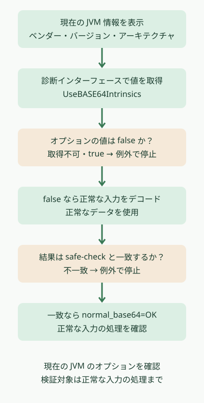

**Java4Shell は、特定の x86-64 CPU で使われる OpenJDK の Base64 デコード最適化経路にあるメモリ破損の脆弱性だ。条件がそろうとメモリの漏えいやリモートコード実行につながり得る。影響を受けるランタイム、CPU の条件、外部入力がその経路に到達するかを確認し、ベンダーの修正版 JDK を適用する。** すぐにパッチを配備できない場合は、発見者が提案した `-XX:-UseBASE64Intrinsics` を暫定措置として検討できる。

Java4Shell は発見者の Calif が **CVE-2026-114938** に付けた名称だ。詳細は [Oracle のセキュリティ情報 (2026-11)](https://www.oracle.com/security-alerts/cspunov2026.html)と [OpenJDK のセキュリティ情報](https://openjdk.org/groups/vulnerability/advisories/2026-11-17)で公開されている。以下のバージョン情報は、2026年11月18日に確認した公開資料に基づく。

## Java でメモリ破損が起きる理由

HotSpot は頻繁に実行される処理を JIT で最適化し、一部の演算には CPU 命令を活用する専用実装（intrinsic）を使う。Calif が公表した原因は、**x86-64 用の Base64 intrinsic がパディング処理で書き込むバイトを選ぶマスクを誤って計算し、出力バッファの外側へ書き込むこと**だ。Java 側で後から不正入力を `IllegalArgumentException` で拒否しても、その時点で既にメモリが破損している可能性がある。この例外を捕捉するだけで対策が済んだと判断してはいけない。

Oracle の資料でのコンポーネント名は `Compiler`、OpenJDK での分類は `hotspot/compiler` だ。外部の Java ソースをコンパイルする機能がないアプリケーションにも影響し得る。通常の Base64 デコードでも JVM 内部の最適化経路を使うことがある。

Calif は影響条件として **AVX-512 VBMI に対応した x86-64 CPU** を挙げ、Linux では `avx512f`、`avx512bw`、`avx512vbmi`、`bmi2` がすべて存在することを確認するよう案内している。公開された説明では、ARM64 はこの脆弱な経路の影響を受けない。CPU の条件が合うだけで、どのアプリケーションでもリモートコード実行が可能だと確定するわけではない。入力経路や悪用条件はアプリケーションごとに異なり、単一の攻撃入力で全製品を制御できるという根拠にはならない。VM やコンテナでは、実際に JVM から見える CPU 機能を確認する。

深刻度を見るときは、評価主体と CVSS のバージョンも確認する。

| 評価主体 | 評価 | 意味 |
| --- | --- | --- |
| Oracle CNA | CVSS 3.1 **8.1、High** | ネットワーク経由で悪用可能。攻撃条件の複雑さは高く、認証やユーザー操作は不要 |
| Calif | CVSS 4.0 **9.2、Critical** | 発見者が別の評価体系で公表したスコア |

Oracle のベクターは `CVSS:3.1/AV:N/AC:H/PR:N/UI:N/S:U/C:H/I:H/A:H` だ。評価主体と CVSS のバージョンが異なるため、両スコアを区別する。[CVE の原記録](https://www.cve.org/CVERecord?id=CVE-2026-114938)

## 交換が必要な JDK

Oracle が示した影響を受けるサポート対象バージョンと、確認済みの修正リリースを以下に示す。別のディストリビューションについては、そのベンダーの情報でビルドを確認する。

| 製品 | Oracle が示した影響バージョン | 確認済みの Oracle 修正リリース |
| --- | --- | --- |
| Oracle Java SE 17 | `17.0.21.0.3` | [17.0.21.1+4](https://www.oracle.com/java/technologies/javase/17-0-21-1-relnotes.html) |
| Oracle Java SE 21 | `21.0.13.0.3` | [21.0.13.1+4](https://www.oracle.com/java/technologies/javase/21-0-13-1-relnotes.html) |
| Oracle Java SE 25 | `25.0.5.0.3` | [25.0.5.1+4](https://www.oracle.com/java/technologies/javase/25-0-5-1-relnotes.html) |
| Oracle Java SE 27 | `27.0.1.0.3` | [27.0.1.1+4](https://www.oracle.com/java/technologies/javase/27-0-1-1-relnotes.html) |
| Oracle Java SE 8 Performance Pack | `8u511b33-perf` | 本記事では具体的な修正ビルドを確認できていない |
| Oracle GraalVM for JDK | `17.0.21.0.3`、`21.0.13.0.3` | 製品ごとのセキュリティ更新情報を参照 |
| Oracle GraalVM Enterprise Edition | `21.3.20.0.3` | 製品ごとのセキュリティ更新情報を参照 |

**この一覧は修正前の影響バージョンを網羅していない。** Oracle は古いリリースも影響を受ける可能性を示し、サポート対象バージョンへの更新を勧めている。Java 8 の通常のビルドと Performance Pack も区別する。[Oracle のリスクマトリックス](https://www.oracle.com/security-alerts/cspunov2026.html#AppendixJAVA)

Temurin、Corretto、Zulu など OpenJDK ベースのディストリビューションでも、ベンダーが出した当該 CVE の情報と修正ビルドを確認する。Oracle の表とバージョン番号が異なるという理由だけで、安全とは判断できない。Calif の説明は特定のハードウェアとランタイムの経路に関するもので、修正済みのリリースまで影響が続くという意味ではない。

## パッチと暫定措置を適用する手順

まず、**実際のサービスプロセスが使う JDK** を確認する。シェルで `java -version` を実行しても、その時点で PATH が指す実行ファイルのバージョンしか分からない。既に稼働中のサービスのランタイムとは異なる場合がある。サービスの起動パス、コンテナイメージ、JVM のバージョンとベンダーを合わせて記録する。

恒久対策は、そのディストリビューションの修正済み JDK でランタイムを置き換えることだ。コンテナは修正済みのベースイメージで再ビルドして配備する。ローリング更新後に稼働バージョンを調べ、古い JVM が残っていないことを確認する。アプリケーションの依存関係ファイルを変えたり、ホストに新しい JDK を入れたりするだけでは不十分だ。

パッチの配備が遅れる場合は、Calif が提示した以下の **JVM 起動オプション**を検討する。JAR 名は実際のアプリケーションのものに置き換える。

```sh
java -XX:-UseBASE64Intrinsics -jar app.jar
```

この暫定措置は、Base64 のエンコードとデコードのハードウェアアクセラレーションを無効にする。今回確認した Oracle のセキュリティ情報では、セキュリティ更新の適用を推奨している。既存の JVM オプションを保ったまま追加し、JVM の再起動後に値を確認する。Base64 の処理量が多いサービスでは、スループット、CPU 使用率、遅延の変化も観察する。本記事では性能変化を測定していない。

Calif は代替案として `-XX:UseAVX=2` を提示し、**x86-64 に限って適用する**よう注意している。ARM 上の OpenJDK ではこのオプションを認識できず、起動に失敗することがある。複数のアーキテクチャを混在させた環境に一律に適用しない。Nginx のリクエストボディのバッファリングも、すべての悪用経路を遮断する対策としては示されていない。

## 暫定措置の適用状態をコードで確認する

次の例は、**HotSpot ベースの JDK 17 以降で、現在の JVM のオプション値と正常な Base64 デコードだけを確認する**。脆弱性の検出や攻撃の遮断は検証の対象外だ。診断インターフェースやオプションが使えない場合は、この例では確認できないため、ランタイムに対応する管理ツールを使う。



診断インターフェースを取得できない場合やオプションが無効になっていない場合は、例外を投げて停止する。確認を通過した場合だけ正常な文字列をデコードし、期待する値と照合する。

`Base64MitigationCheck.java` として保存する。

```java
import com.sun.management.HotSpotDiagnosticMXBean;
import java.lang.management.ManagementFactory;
import java.nio.charset.StandardCharsets;
import java.util.Base64;

public class Base64MitigationCheck {
    public static void main(String[] args) {
        System.out.println("java.vendor=" + System.getProperty("java.vendor"));
        System.out.println("java.runtime.version="
                + System.getProperty("java.runtime.version"));
        System.out.println("os.arch=" + System.getProperty("os.arch"));

        HotSpotDiagnosticMXBean diagnostic = ManagementFactory
                .getPlatformMXBean(HotSpotDiagnosticMXBean.class);
        if (diagnostic == null) {
            throw new IllegalStateException("HotSpot diagnostic interface unavailable");
        }
        String enabled = diagnostic.getVMOption("UseBASE64Intrinsics").getValue();
        System.out.println("UseBASE64Intrinsics=" + enabled);
        if (!"false".equals(enabled)) {
            throw new IllegalStateException("Base64 intrinsic is not disabled");
        }

        String decoded = new String(
                Base64.getDecoder().decode("c2FmZS1jaGVjaw=="),
                StandardCharsets.UTF_8);
        if (!"safe-check".equals(decoded)) {
            throw new IllegalStateException("Unexpected Base64 result");
        }
        System.out.println("normal_base64=OK");
    }
}
```

次のコマンドは、同じ対象 JDK の `javac` と `java` を使用して実行する。

```sh
javac --release 17 Base64MitigationCheck.java
java -XX:-UseBASE64Intrinsics Base64MitigationCheck
```

以下は ARM64 macOS の Zulu `21.0.1+12-LTS` で得られた実際の出力だ。この古いビルドは例の動作確認に使用したもので、運用環境への導入は推奨しない。Corretto `17.0.8.1+8-LTS` でもオプションの無効化と正常なデコードを確認した。

```text
java.vendor=Azul Systems, Inc.
java.runtime.version=21.0.1+12-LTS
os.arch=aarch64
UseBASE64Intrinsics=false
normal_base64=OK
```

同じ環境で `-XX:+UseBASE64Intrinsics` を指定したところ、どちらも `Base64 intrinsic is not disabled` の例外で終了し、終了コードは `1` だった。ARM64 上で確認したのは、**オプションの取得、条件分岐、正常な入力の処理**だ。影響を受ける x86-64 でのメモリ破損の再現や、暫定措置の効果や性能の検証は行っていない。

別プロセスで実行した例の結果を、本番アプリケーションの設定の証明には使えない。本番では、プロセスへのアクセス権限と互換性のある診断ツールがあれば、以下のように対象 JVM を直接確認する。JVM の実装差、Attach の無効化、権限、コンテナの PID 名前空間などで確認できなかった場合は、状態を未確認とする。

```sh
# JCMD는 대상 런타임과 호환되는 도구의 경로, PID는 서비스 JVM의 PID다.
"$JCMD" "$PID" VM.version
"$JCMD" "$PID" VM.flags -all | grep 'UseBASE64Intrinsics'
```

修正ビルドの配備後は、実際に稼働中のバージョン、インスタンスの入れ替え、ログイン・ファイルアップロード・システム連携などの主要機能、エラー率を確認する。暫定オプションを外すときも、まずベンダーのパッチが適用されて正常に動作していることを確かめ、変更前後の指標を比較する。
