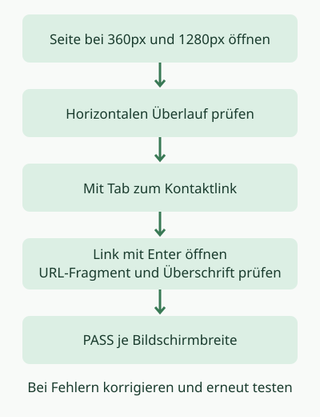

---
{
  "schemaVersion": 1,
  "state": "draft",
  "language": "de",
  "translationKey": "2026-11-19-website-building-agent-skills",
  "title": "Websites mit Claude Code und Codex bauen — Skills von der Planung bis zur Bereitstellung",
  "description": "Welche Skills helfen bei Websites und Web-Apps mit Claude Code und Codex? Ein Beispiel führt von der Umsetzung über Playwright-Tests bis zur Prüfung der Bereitstellung.",
  "sourcePath": "src/content/posts/en/2026-11-19-website-building-agent-skills.md",
  "sourceSha256": "5a054cc2358bab13553028e7a2e4183feefa7849d49e57e026c8849e15dd65df"
}
---

Bei einer kleinen Firmenwebsite beginnen Sie damit, **Texte und Seitenstruktur festzulegen, die Oberfläche zu bauen und den Weg zur Kontaktaufnahme im Browser zu prüfen**. Für eine Web-App mit Anmeldung oder Bezahlung planen Sie zuerst auch Berechtigungen, Datenspeicherung und den Umgang mit Fehlern. Über die Art der Website lässt sich konkreter festlegen, welche Skills Sie brauchen und woran Sie das Ergebnis messen.

Die Empfehlungen für die einzelnen Phasen basieren auf den offiziellen Skill-Quellen von Anthropic, OpenAI und Vercel, geprüft am 19. November 2026. In den Beispielen übernehmen Agenten in Claude Code und Codex CLI einzelne Aufgaben. [Anthropic Skills](https://github.com/anthropics/skills) · [OpenAI Build Web Apps](https://github.com/openai/plugins/tree/main/plugins/build-web-apps) · [Vercel Agent Skills](https://github.com/vercel-labs/agent-skills)

## Skills passend zur Website auswählen

| Vorhaben | Zuerst klären | Typische Abfolge |
| --- | --- | --- |
| Firmenwebsite, Portfolio oder Blog | Zielgruppe, wichtigste Aktion, öffentliche Seiten und Pflege der Inhalte | Seitentexte → Umsetzung → Browserprüfung → Bereitstellung prüfen |
| Web-App für Buchung, Zahlung oder Verwaltung | Nutzerberechtigungen, zu speichernde Daten, Erfolgs- und Fehlerbehandlung sowie Betriebsprotokolle | Oberflächen und Zustände entwerfen → Oberfläche und Server umsetzen → Normal- und Fehlerfälle testen → Vorschau → Produktion prüfen |

Falls es bereits ein Repository gibt, prüfen Sie zuerst dessen Framework und Bereitstellungsverfahren. Einen Beitrag und einen Kontaktlink können Sie zum Beispiel innerhalb des vorhandenen Astro-Blogs ergänzen. Wählen Sie Performance-Skills für React und Next.js oder Zahlungs-Skills, wenn Sie die jeweilige Technik oder Funktion tatsächlich brauchen.

| Phase | Empfohlener Skill oder Leitfaden | Aufgabe und Prüfung |
| --- | --- | --- |
| Planung und Texte | Projektinterne Anleitung `website-copywriting` | Zielgruppe und zentrale Aktion festlegen und Überschrift, Beschreibung und Kontakttext schreiben. Auf dem ersten Bildschirm prüfen, ob verständlich ist, wem der Dienst was bietet. |
| Oberflächenentwurf | Projektinterne Anleitung `frontend-architecture-design` | Seitenpfade, Zuständigkeiten für Komponenten und Zustände sowie Erfolgs- und Fehleransichten festlegen. Bei Buchungen auch Mehrfachklicks beim Absenden und Wiederholungen nach einem Speicherfehler einplanen. |
| Oberfläche umsetzen | [`frontend-design` für Claude Code](https://github.com/anthropics/skills/tree/main/skills/frontend-design) oder [`frontend-app-builder` für Codex](https://github.com/openai/plugins/tree/main/plugins/build-web-apps/skills/frontend-app-builder) | Abgestimmte Texte und Struktur mit den vorhandenen Projektkomponenten umsetzen. Prüfen, ob Überschrift, Aktionsschaltfläche und Inhalt auch auf schmalen Bildschirmen in der vorgesehenen Reihenfolge lesbar sind. |
| Im Browser prüfen | [`webapp-testing` für Claude Code](https://github.com/anthropics/skills/tree/main/skills/webapp-testing), [`frontend-testing-debugging` für Codex](https://github.com/openai/plugins/tree/main/plugins/build-web-apps/skills/frontend-testing-debugging) | In der mobilen Ansicht Kontaktlink, Formularfehler und Konsole kontrollieren. Geprüfte URL, Bildschirmgröße, konkrete Schritte und Ergebnis festhalten. |
| Barrierefreiheit prüfen | [`web-design-guidelines` von Vercel](https://github.com/vercel-labs/agent-skills/tree/main/skills/web-design-guidelines) | Beschriftungen, Kontrast und Fokus im Code prüfen. Im Browser die Tab-Reihenfolge und den sichtbaren Fokus kontrollieren. Automatische Ergebnisse und manuelle Prüfungen dokumentieren. |
| React-Performance | [`react-best-practices` aus Build Web Apps](https://github.com/openai/plugins/tree/main/plugins/build-web-apps/skills/react-best-practices) | In React- oder Next.js-Projekten aufeinanderfolgende Datenanfragen und das initiale Bundle untersuchen. Vor und nach der Änderung unter denselben Bedingungen messen und erst dann die Wirkung bewerten. |
| Bereitstellung | [`deployments-cicd` für Vercel](https://github.com/openai/plugins/tree/main/plugins/vercel/skills/deployments-cicd) oder Projektanleitung | Vorschau- oder Staging-URL beim verwendeten Hoster kontrollieren und die freigegebene Version bereitstellen. Endgültige URL und Version für einen Rollback festhalten. |

Die ersten beiden Zeilen zeigen Rollen, für die Sie eigene Vorgaben im Projekt anlegen können. Öffentliche Skills installieren Sie über die vom jeweiligen Anbieter genannten Wege. In Claude Code enthält `example-skills` im offiziellen Anthropic-Marketplace Skills für Umsetzung und Tests. In Codex bündelt das Plugin **Build Web Apps** Skills für Oberflächen, Tests und React-Optimierung. Den Vercel-Skill verwenden Sie bei einer Bereitstellung auf Vercel. Für GitHub Pages richten Sie sich nach den Actions und dem Vorschauverfahren des Repositorys. [Claude-Code-Installationsanleitung](https://github.com/anthropics/skills#claude-code) · [Inhalt von OpenAI Build Web Apps](https://github.com/openai/plugins/blob/main/plugins/build-web-apps/README.md)

## Skills für eine kleine Website aufeinander abstimmen

Ein kurzer Auftrag genügt. Wenn Sie Informationen zum Dienst, die Seitenstruktur und die zu prüfenden Aktionen gemeinsam angeben, gelten für Planung, Umsetzung und Tests dieselben Kriterien.

> Erstelle eine Seite für ein fiktives Fotostudio.\
> Die Besucher möchten wissen, wo fotografiert wird und wie sie sich beraten lassen können.\
> Zeige die Vorstellung und die Beratung auf einer Seite. Verlinke den Kontaktlink\
> im ersten Bildschirm mit dem Beratungsabschnitt. Halte die Reihenfolge Vorstellung, Kontaktlink, Beratung ein.\
> Berücksichtige eine schmale Ansicht mit 360px und die Bedienung per Tastatur.\
> Prüfe nach der Umsetzung bei 360px und 1280px, ob es horizontalen Überlauf gibt.\
> Erreiche den Kontaktlink mit Tab und öffne den Beratungsabschnitt mit Enter.\
> Halte das Ergebnis jedes Schritts und die ungeprüften Punkte fest.

Übergeben Sie die Vorstellung und den Kontaktlink an die Umsetzung. Verwenden Sie Bildschirmbreiten und Tastaturbedingungen als Prüfkriterien. Wenn der Test fehlschlägt, geben Sie dem Agenten für die Umsetzung die betroffene Breite und die fehlgeschlagene Aktion. Wiederholen Sie nach der Korrektur den Test unter denselben Bedingungen. Prüfen Sie bei der Barrierefreiheit zusätzlich Kontrast, die von Screenreadern ausgegebenen Namen und die Fokusposition nach einem Seitenwechsel.

## Übung — den Weg zur Kontaktaufnahme mit Playwright prüfen

Die Übung enthält eine Seite im Testskript und prüft sie im Browser bei zwei Breiten. Bereiten Sie in einem neuen Verzeichnis Node.js 22 und Chrome vor. Führen Sie `npm init -y` aus und installieren Sie die Abhängigkeit mit `npm install --save-dev playwright-core@1.64.1`. Speichern Sie den folgenden Code als `website-check.mjs` und starten Sie ihn unter macOS mit `node website-check.mjs`. Wenn Chrome an einem anderen Ort installiert ist, setzen Sie `CHROME_PATH` auf den Pfad zur ausführbaren Datei. [Playwright-Optionen zum Browserstart](https://playwright.dev/docs/api/class-browsertype#browser-type-launch)



```js
import assert from 'node:assert/strict';
import { chromium } from 'playwright-core';

const html = `<!doctype html>
<html lang="ko">
<meta charset="utf-8">
<meta name="viewport" content="width=device-width, initial-scale=1">
<title>봄 사진 스튜디오</title>
<style>
  body { margin: 0; font: 1rem/1.6 system-ui; }
  main { max-width: 42rem; margin: auto; padding: 1rem; }
  section { min-height: 74vh; }
</style>
<main>
  <section>
    <h1>봄 사진 스튜디오</h1>
    <p>프로필 사진과 가족사진을 촬영합니다.</p>
    <a href="#contact">문의하기</a>
  </section>
  <section id="contact">
    <h2>상담 안내</h2>
    <p>촬영 목적과 희망 일정을 준비해 주세요.</p>
  </section>
</main>
</html>`;

const browser = await chromium.launch({
  executablePath: process.env.CHROME_PATH
    ?? '/Applications/Google Chrome.app/Contents/MacOS/Google Chrome',
});

try {
  for (const width of [360, 1280]) {
    const page = await browser.newPage({ viewport: { width, height: 700 } });
    try {
      await page.setContent(html);
      const overflow = await page.evaluate(
        () => document.documentElement.scrollWidth > window.innerWidth,
      );
      assert.equal(overflow, false, `가로 넘침: ${width}px`);

      await page.keyboard.press('Tab');
      const focused = await page.evaluate(
        () => document.activeElement?.getAttribute('href'),
      );
      assert.equal(focused, '#contact', `문의 링크 포커스: ${width}px`);
      await page.keyboard.press('Enter');
      await page.waitForURL(/#contact$/);
      const heading = await page.getByRole('heading', { name: '상담 안내' }).boundingBox();
      assert.ok(heading && heading.y >= 0 && heading.y + heading.height <= 700);
      console.log(`PASS ${width}px: no overflow, keyboard link reaches contact`);
    } finally {
      await page.close();
    }
  }
} finally {
  await browser.close();
}
```

Das Ergebnis ist unten zu sehen. Jedes `PASS` bedeutet, dass nichts horizontal überläuft, der Kontaktlink per Tastatur erreichbar ist und die Überschrift des Beratungsabschnitts im sichtbaren Bereich erscheint.

```text
PASS 360px: no overflow, keyboard link reaches contact
PASS 1280px: no overflow, keyboard link reaches contact
```

Starten Sie im eigentlichen Projekt einen lokalen Server und rufen Sie die implementierte Seite mit `page.goto()` auf, statt einen HTML-String zu verwenden. Für ein Kontaktformular ergänzen Sie eigene Prüfungen für leere Pflichtfelder, erhaltene Eingaben nach einem Sendefehler und die Erfolgsmeldung. Als das Linkziel auf ein anderes URL-Fragment gesetzt wurde, schlug die Linkprüfung bei 360px fehl. Das Beispiel prüft eine HTML-Übungsseite bei zwei Breiten in Chrome.

## Prüfungen nach der Bereitstellung

Rufen Sie die wichtigsten Seiten und den Kontaktweg unter der Vorschau- und Produktions-URL erneut auf. Prüfen Sie die Serverantworten und statischen Ressourcen. Kontrollieren Sie bei Seiten, die in der Suche erscheinen sollen, Titel, Beschreibung, kanonische URL, interne Links und Sitemap. Ob die Suchmaschine die Seite tatsächlich gefunden und indexiert hat, prüfen Sie separat in der Search Console. [Googles SEO-Leitfaden](https://developers.google.com/search/docs/fundamentals/seo-starter-guide)
