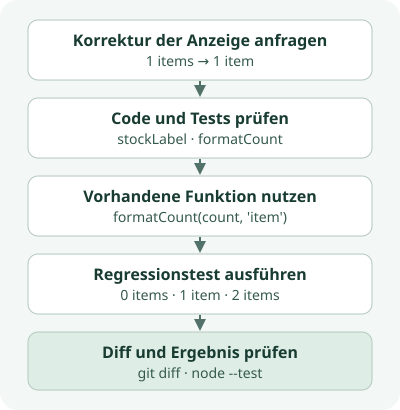

---
{
  "schemaVersion": 1,
  "state": "draft",
  "language": "de",
  "translationKey": "2026-11-20-ponytail-skill-guide",
  "title": "Der Ponytail-Skill in Codex und Claude Code — kleine Änderungen mit Regressionstests",
  "description": "So rufen Sie Ponytail in Codex und Claude Code auf, wählen zwischen Lite, Full und Ultra und testen in Codex CLI eine kleine Korrektur mit Node.js.",
  "sourcePath": "src/content/posts/en/2026-11-20-ponytail-skill-guide.md",
  "sourceSha256": "7b1777565ade628aa9381193123b7b19f84ba4c91e57779cba53f40b8b19b6de"
}
---

**Ponytail hilft einem KI-Programmieragenten, das gewünschte Verhalten mit bestehendem Code umzusetzen.** Steht bei einem einzigen Artikel `1 items`, prüfen Sie zuerst, ob es im Projekt bereits eine Funktion für Singular und Plural gibt. Verwenden Sie sie erneut und testen Sie, ob sich die Anzeige bei 0 oder 2 Artikeln weiterhin wie bisher verhält.

## Einstieg in Codex und Claude Code

Wenn der eigenständige Ponytail-Skill bereits in Codex installiert ist, rufen Sie mit `$ponytail-help` die Namen und Modi auf. Schreiben Sie nach `$ponytail full`, was sich ändern soll, welche Bedingungen weiter gelten und mit welchem Befehl Sie das Ergebnis prüfen. Die folgende Übung verwendet den eigenständigen Skill unter `~/.agents/skills/ponytail/SKILL.md`. In dieser Konfiguration gilt der Modus als Arbeitsvorgabe für das aktuelle Gespräch. Mit `$ponytail off` schalten Sie ihn aus. [Codex-Dokumentation zu Skills](https://learn.chatgpt.com/docs/build-skills)

Das Ponytail-Projekt bietet auch ein Plugin an. Führen Sie für Codex CLI die beiden folgenden Befehle in der Shell aus. Öffnen Sie anschließend Codex und prüfen Sie unter `/hooks`, was die beiden Hooks ausführen. Wenn Sie die Hooks verwenden möchten, stufen Sie sie nach der Prüfung als vertrauenswürdig ein und starten Sie ein neues Gespräch. Die Hooks benötigen `node` im `PATH` ihrer Ausführungsumgebung. [Installationsanleitung für Ponytail](https://github.com/DietrichGebert/ponytail/blob/main/INSTALL.md#codex)

```bash
codex plugin marketplace add DietrichGebert/ponytail
codex plugin add ponytail@ponytail
```

Geben Sie in Claude Code die beiden folgenden Befehle einzeln ein und wählen Sie danach den Modus mit `/ponytail full`. Zum Plugin gehört der Prüfbefehl `/ponytail-review`. Beim Codex-Plugin erscheint der Prüf-Skill mit dem Namen des Plugins, etwa als `$ponytail:ponytail-review`. Die Angaben zur Installation und zu den Hooks beider Plugins stützen sich auf die öffentliche Dokumentation. [Installation in Claude Code](https://github.com/DietrichGebert/ponytail/blob/main/INSTALL.md#claude-code) · [Ponytail-Befehle](https://github.com/DietrichGebert/ponytail#commands)

```text
/plugin marketplace add DietrichGebert/ponytail
/plugin install ponytail@ponytail
```

## Welcher Modus passt? Lite, Full oder Ultra

Beim eigenständigen Codex-Skill aktiviert `$ponytail` ohne Zusatz den Standardmodus Full.

| Aufruf | Vorgehen | Beispiel |
| --- | --- | --- |
| `$ponytail lite` | Bearbeitet den Auftrag und nennt kurz eine kleinere Lösung, sofern sie einen spürbaren Vorteil hätte. | Einen bereits abgestimmten Oberflächentext ändern. |
| `$ponytail full` | Prüft Aufrufstellen und bestehende Tests und setzt das gewünschte Verhalten mit der kleinsten vollständigen Änderung um. Meldet geprüfte Ergebnisse und verbleibende Risiken. | Einen Fehler in der Singularanzeige beheben und die bisherigen Eingabewerte mitprüfen. |
| `$ponytail ultra` | Erledigt die Aufgabe und weist auf unnötige Ausweitungen hin. | Einen Fehler auf einer Seite beheben und getrennt davon beurteilen, ob ein Umbau der gemeinsamen UI nötig ist. |

Halten Sie im Auftrag fest, **was sich ändern soll, was erhalten bleiben muss und wie das Ergebnis geprüft wird**. Zu den Bedingungen gehören etwa Berechtigungsprüfungen, Eingabevalidierung und Datenschutz, sofern aufrufender Code darauf angewiesen ist. Der Skill beeinflusst das Vorgehen des Agenten. Seine Berechtigungseinstellungen regeln, wo er Dateien schreiben und welche Befehle er ausführen darf.

## Übung — `1 item` anzeigen, wenn ein Artikel auf Lager ist

Die Übung lief in einem leeren Übungsrepository mit Node.js 22.17.0 und Codex CLI 0.169.0. Für den Ausgangszustand verwenden Sie in `stockLabel` die folgende Rückgabezeile. Der erste Test in `stock.test.mjs` war bereits vorhanden. Der zweite kam bei dieser Änderung hinzu.

```javascript
return `${count} items`;
```

**Beispielprompt** `$ponytail full` Behebe den Fehler, dass stockLabel(1) den Text 1 items zurückgibt. Für 0 und 2 soll items erhalten bleiben. Verwende formatCount erneut, ergänze einen Regressionstest für stockLabel und führe `node --test` aus. Ändere keine Dateien außerhalb dieses Übungsrepositorys und erstelle keinen Commit.



In `stock.mjs` änderte sich nur der Rückgabeausdruck von `stockLabel`. Er ruft `formatCount` auf, das Singular und Plural bereits berücksichtigt.

```javascript
export function formatCount(count, noun) {
  return `${count} ${count === 1 ? noun : noun + 's'}`;
}

export function stockLabel(count) {
  return formatCount(count, 'item');
}
```

Prüfen Sie in `stock.test.mjs` die Anzeige für 0, 1 und 2 Artikel. Legen Sie beide Dateien in dasselbe Verzeichnis und führen Sie `node --test` aus.

```javascript
import assert from 'node:assert/strict';
import test from 'node:test';
import { formatCount, stockLabel } from './stock.mjs';

test('formatCount handles singular and plural', () => {
  assert.equal(formatCount(1, 'item'), '1 item');
  assert.equal(formatCount(2, 'item'), '2 items');
});

test('stockLabel handles zero, one, and two items', () => {
  assert.equal(stockLabel(0), '0 items');
  assert.equal(stockLabel(1), '1 item');
  assert.equal(stockLabel(2), '2 items');
});
```

Mit dem ursprünglichen Code schlug der ergänzte Test bei der Menge 1 fehl. Erwartet wurde `1 item`, tatsächlich kam `1 items` zurück. Nach der Korrektur ergab sich die folgende Ausgabe.

```text
ok 1 - formatCount handles singular and plural
ok 2 - stockLabel handles zero, one, and two items
# tests 2
# pass 2
# fail 0
```

Die Übung umfasst zwei Tests und Änderungen an zwei Dateien. Vergleichen Sie nach der Abschlussmeldung des Agenten den tatsächlichen `git diff` mit den Testergebnissen. So sehen Sie, ob er die vorhandene Funktion wiederverwendet und den Auftragsumfang eingehalten hat.

## Nach der Änderung den Prüfumfang festlegen

Wenn die ergänzenden eigenständigen Skills installiert sind, stehen die folgenden Aufrufe zur Verfügung. Benennen Sie den zu prüfenden Bereich, damit die Ergebnisse leichter nachvollziehbar sind. [Ponytail-Befehle](https://github.com/DietrichGebert/ponytail#commands)

| Aufruf | Einsatz |
| --- | --- |
| `$ponytail-review` | Prüft den aktuellen Diff und den zugehörigen Code. Vor einem PR lassen sich damit Aufrufstellen und fehlende Regressionstests untersuchen. |
| `$ponytail-audit` | Untersucht das gesamte Repository im Lesemodus und ordnet die gefundenen Probleme nach Priorität. |
| `$ponytail-debt` | Sammelt vorhandene `shortcut:`-Kommentare und ältere `ponytail:`-Kommentare zur Prüfung. |
| `$ponytail-gain` | Zeigt den veröffentlichten Benchmarkbericht des Projekts. Einsparungen bei Zeit oder Kosten im eigenen Repository erfordern eine eigene Vergleichsmessung. |
| `$ponytail-help` | Zeigt die Modi und Aufrufe der installierten Skills. |
