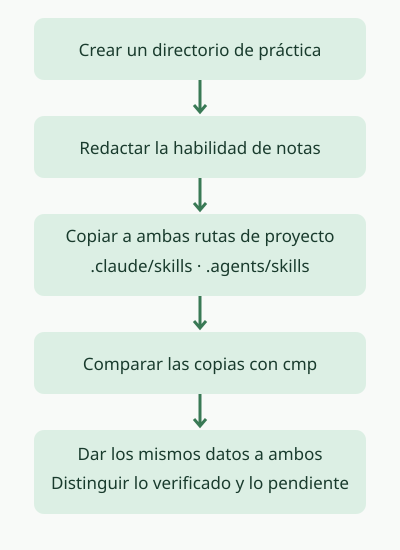

---
{
  "schemaVersion": 1,
  "state": "draft",
  "language": "es",
  "translationKey": "2026-11-18-claude-code-codex-skills-top-10",
  "title": "Diez habilidades recomendadas para Claude Code y Codex y cómo usarlas",
  "description": "Compara diez habilidades prácticas para Claude Code y Codex CLI. Aprende a instalarlas, invocarlas y usar la misma habilidad de notas de versión en ambas herramientas.",
  "sourcePath": "src/content/posts/en/2026-11-18-claude-code-codex-skills-top-10.md",
  "sourceSha256": "9338932f68b3342b8eee987674b733a84d8f24684b44e978ff027618dab08d68"
}
---

Si repites una solicitud, conviértela en una habilidad. Guarda las entradas admitidas para el resumen de cambios, el formato de salida y los criterios de verificación. Así, en cada tarea solo cambias los archivos de destino. Un equipo de desarrollo puede empezar por `skill-creator` y `webapp-testing`. Si su trabajo gira en torno a documentos, puede empezar por la habilidad para el formato que utiliza.

La guía se centra en **Claude Code** en la terminal y en **Codex CLI**. El 18 de noviembre de 2026 comprobé las opciones en fuentes oficiales y las ordené por **frecuencia de uso repetido, facilidad para verificar el resultado y esfuerzo de instalación e integración**. El orden es una recomendación práctica basada en estos criterios, sin tener en cuenta el número de instalaciones ni las estadísticas de rendimiento. OpenAI recomienda dejar de usar su catálogo anterior, por lo que, para Codex, las rutas de instalación se basan en su documentación y sus complementos vigentes. [Documentación de habilidades de Claude Code](https://code.claude.com/docs/en/skills) · [Documentación de habilidades de Codex](https://learn.chatgpt.com/docs/build-skills) · [Aviso sobre el catálogo anterior](https://github.com/openai/skills) · [Repositorio de complementos de OpenAI](https://github.com/openai/plugins)

## 10 habilidades para el trabajo diario

La columna «Fuente y entorno» indica dónde se ofrece o distribuye oficialmente cada habilidad. Al pasar un ejemplo de Claude Code a Codex, puedes reutilizar el formato común `SKILL.md`. Revisa por separado los scripts incluidos, los nombres de las herramientas y la configuración específica de cada entorno.

| Puesto | Habilidad | Fuente y entorno | Ejemplo de solicitud y criterio de verificación |
| --- | --- | --- | --- |
| 1 | `skill-creator` | Integrada en Codex / [ejemplo de Claude Code](https://github.com/anthropics/skills/tree/main/skills/skill-creator) | «Crea una habilidad para redactar descripciones de PR. Prepara un ejemplo de entrada para un PR de corrección y otro de documentación». Prueba una solicitud que deba invocarla y otra en la que deba omitirse. |
| 2 | `webapp-testing` | [Ejemplo de Claude Code](https://github.com/anthropics/skills/tree/main/skills/webapp-testing) | «Comprueba con Playwright el envío correcto y la ausencia de un campo obligatorio en la pantalla local de pedidos». Conserva el estado real de la pantalla y el registro de la ejecución. Se requieren el navegador y un entorno donde ejecutar la aplicación. |
| 3 | `frontend-design` | [Ejemplo de Claude Code](https://github.com/anthropics/skills/tree/main/skills/frontend-design) | «Diseña la vista móvil de un panel de respuesta a incidentes. Muestra primero el estado y la siguiente acción». Comprueba los estados vacíos, los textos largos y la navegación con teclado. |
| 4 | `openai-docs` | Integrada en Codex / [guía de OpenAI Developers](https://developers.openai.com/learn/developers-codex-plugin) | «Consulta la documentación oficial para confirmar dónde se guardan las habilidades de proyecto de Codex CLI y cómo se invocan». Verifica que las fuentes respalden lo que ves en la CLI y la función descrita. |
| 5 | `xlsx` | [Habilidad de documentos de Claude Code](https://github.com/anthropics/skills/tree/main/skills/xlsx) | «Convierte el CSV de pedidos en un libro con totales mensuales. Separa los pedidos cancelados y calcula los totales con fórmulas». Contrasta el recuento de filas, el rango de agregación y los totales, y comprueba si hay errores de fórmula. |
| 6 | `pdf` | [Habilidad de documentos de Claude Code](https://github.com/anthropics/skills/tree/main/skills/pdf) | «Extrae los requisitos y las excepciones de entrega de este PDF, con los números de página». Compara el orden de filas y columnas y comprueba posibles omisiones en las páginas originales. Si son escaneos, revisa por separado la calidad del OCR. |
| 7 | `docx` | [Habilidad de documentos de Claude Code](https://github.com/anthropics/skills/tree/main/skills/docx) | «Redacta la documentación de traspaso en la plantilla de Word adjunta. Conserva los estilos de título y la estructura de las tablas». Abre el resultado en Word o en un editor compatible y revisa los saltos de página y si se cortan las tablas. |
| 8 | `pptx` | [Habilidad de documentos de Claude Code](https://github.com/anthropics/skills/tree/main/skills/pptx) | «Prepara una retrospectiva de operaciones de 6 diapositivas. Indica el periodo de medición y la unidad junto a cada cifra». Renderiza las diapositivas para comprobar las cifras, los ejes y si se corta algún texto. |
| 9 | `openai-api-troubleshooting` | [Complemento OpenAI Developers para Codex](https://github.com/openai/plugins/tree/main/plugins/openai-developers/skills/openai-api-troubleshooting) | «Acota la causa a partir de este mensaje de error de la API sin la clave. Adjunto la versión del SDK y el ID de la solicitud». Distingue las hipótesis de los comandos para comprobarlas y excluye las claves y los tokens originales. |
| 10 | `imagegen` | Integrada en Codex / [código fuente de la habilidad](https://github.com/openai/codex/tree/main/codex-rs/skills/src/assets/samples/imagegen) | «Crea un concepto de portada horizontal para una entrada de blog. Deja el título fuera de la imagen». Confirma que la generación esté disponible y revisa el tamaño de la imagen, el alcance de la edición y posibles deformaciones en el texto. |

`skill-creator` va primero porque permite dejar por escrito en el proyecto los procedimientos que el equipo repite. `webapp-testing` requiere preparar una aplicación y un navegador. Puedes evaluar el resultado a partir del registro y lo que se ve en la pantalla. Elige entre las cuatro habilidades de documentos según el formato. El diagnóstico de API y la generación de imágenes aportan valor cuando necesitas resolver ese error o conseguir ese recurso visual.

Para desarrollar interfaces, define primero lo que debe hacer la pantalla con `frontend-design` y verifica el comportamiento de los usuarios con `webapp-testing` después de implementar. Incluso si ya hay un borrador, incluye pruebas específicas como comprobar si los datos introducidos se conservan cuando falla el envío. Para trabajar con documentos, lee la tabla con `pdf` y agrégala con `xlsx`. Antes de pasar al siguiente paso, contrasta los datos extraídos con el original.

## Instalar e invocar las habilidades

En Claude Code, añade el mercado oficial de Anthropic y elige el paquete que necesites. Para PDF, Word, Excel o PowerPoint, elige `document-skills`. Para ejemplos de creación de habilidades o pruebas web, elige `example-skills`. Puedes mencionar por su nombre una habilidad de un complemento instalado en una solicitud en lenguaje natural. [Instrucciones de instalación de Anthropic](https://github.com/anthropics/skills#claude-code)

```text
/plugin marketplace add anthropics/skills
/plugin install document-skills@anthropic-agent-skills
/plugin install example-skills@anthropic-agent-skills
```

En Codex CLI, busca y selecciona la habilidad de forma explícita con `/skills` o el selector `$`. Invoca la habilidad integrada `skill-creator` con `$skill-creator`. Para añadir el diagnóstico de la API de OpenAI, localiza **OpenAI Developers** en `/plugins` y selecciona `Install plugin`. Inicia una sesión nueva y comprueba en `/skills` que aparezca la habilidad de diagnóstico. [Invocar habilidades de Codex](https://learn.chatgpt.com/docs/build-skills) · [Complemento OpenAI Developers](https://developers.openai.com/learn/developers-codex-plugin)

Guarda las habilidades que gestionas dentro del proyecto en `.claude/skills/<name>/SKILL.md` para Claude Code y `.agents/skills/<name>/SKILL.md` para Codex. Sustituye el marcador por el nombre de la habilidad. Si copias un ejemplo oficial, revisa también los archivos y las herramientas que referencia su `SKILL.md`. Para las habilidades que requieren conexiones, comprueba primero qué cuenta se usa y qué permisos tendrá. [Ubicaciones de las habilidades de Claude Code](https://code.claude.com/docs/en/skills#choose-where-skills-load) · [Ubicaciones de las habilidades de Codex](https://learn.chatgpt.com/docs/build-skills#where-to-save-skills)

## Ejercicio — usar la misma habilidad de notas de versión en ambas herramientas

Ejecuta los comandos siguientes desde un directorio de práctica nuevo. Crean un solo `SKILL.md`, lo copian a ambas rutas de proyecto y comprueban con `cmp` que los dos archivos coincidan. Necesitas un shell POSIX y `mkdir`, `cp` y `cmp`.



```sh
set -eu
mkdir skills-demo
cd skills-demo

mkdir -p .claude/skills/release-note-draft .agents/skills/release-note-draft

cat > release-note-source.md <<'SKILL'
---
name: release-note-draft
description: Draft a release note from a provided change list and test evidence.
---
Write three sections in Korean: 사용자 변경, 검증, 미확인.
Describe user-facing changes using only the supplied change list.
Put a test in 검증 only when the input explicitly says it ran and gives the result.
If a test is mentioned without a result, put it in 미확인.
Return the draft in the chat.
SKILL

cp release-note-source.md .claude/skills/release-note-draft/SKILL.md
cp release-note-source.md .agents/skills/release-note-draft/SKILL.md
cmp .claude/skills/release-note-draft/SKILL.md .agents/skills/release-note-draft/SKILL.md
printf '%s\n' 'Skill copies match.'
```

La ejecución en un directorio temporal de macOS produjo la siguiente salida y el código de salida `0`. Si repites desde el mismo directorio padre, el primer `mkdir` fallará porque `skills-demo` ya existe.

```text
Skill copies match.
```

Desde `skills-demo`, ejecuta `claude` y `codex` en sesiones de terminal independientes. En Claude Code elige `/release-note-draft`; en Codex CLI, `$release-note-draft`. Envía el nombre de la habilidad junto con este registro de cambios y pruebas en un solo mensaje.

**Ejemplo de prompt** Cambio: Al borrar el correo electrónico en la pantalla de ajustes se deshabilita el botón Guardar. Verificación: Se ejecutaron 3 pruebas unitarias de la pantalla de ajustes. Todas pasaron. Pendiente: Se comprobará el comportamiento en un navegador móvil. Redacta un borrador de notas de versión con este registro.

El resultado esperado incluye el comportamiento del botón en los cambios visibles para el usuario, las 3 pruebas unitarias superadas en la verificación y la comprobación en un navegador móvil en lo pendiente.

## Comparar respuestas con la misma entrada

Las dos CLI usaron el mismo archivo de habilidad y el mismo registro ficticio de cambios y verificaciones. El ejercicio consiste en **distinguir las pruebas ejecutadas de las previstas** a partir del registro proporcionado. La tarea no incluye ejecutar nuevas pruebas de la aplicación.

Al ejecutar Codex CLI 0.169.0 con GPT-6.2 Sol, confirmé en el registro que leyó el archivo de habilidad del proyecto. Estas son las afirmaciones principales de su respuesta.

| Apartado | Respuesta de Codex |
| --- | --- |
| Cambio visible para el usuario | Si se borra el correo electrónico de la pantalla de ajustes, se deshabilita el botón Guardar. |
| Verificación | Se ejecutaron las 3 pruebas unitarias de la pantalla de ajustes y todas pasaron. |
| Pendiente | Está previsto comprobar el comportamiento en un navegador móvil. |

La habilidad del proyecto también apareció en la lista de Claude Code 2.0.76 y 2.1.327. La llamada al modelo se detuvo por un error de inicio de sesión. El registro confirma que Claude Code detectó la habilidad y que Codex generó una respuesta.
