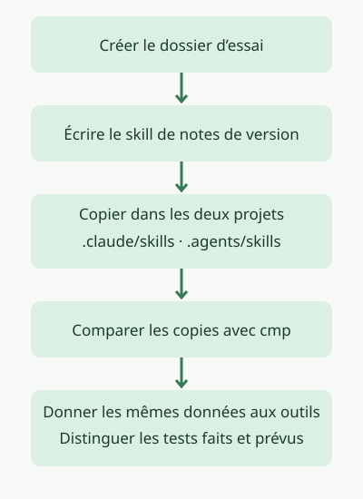

---
{
  "schemaVersion": 1,
  "state": "draft",
  "language": "fr",
  "translationKey": "2026-11-18-claude-code-codex-skills-top-10",
  "title": "Dix skills recommandés pour Claude Code et Codex et leurs usages au quotidien",
  "description": "Comparez dix skills pour Claude Code et Codex CLI, découvrez comment les installer et les appeler, puis essayez le même skill de notes de version dans les deux outils.",
  "sourcePath": "src/content/posts/en/2026-11-18-claude-code-codex-skills-top-10.md",
  "sourceSha256": "6e3aca2da19c8f558c9fdaaa5afcc7403a9fedfb528d5e3a58eb0ee33c0fd993"
}
---

Transformez les demandes répétitives en skills. Vous pouvez y enregistrer le périmètre des entrées et le format de sortie au lieu de ressaisir à chaque fois les consignes de résumé et les critères de vérification. Il suffit ensuite de changer les fichiers concernés. Les équipes de développement peuvent commencer par `skill-creator` et `webapp-testing`. Celles qui traitent beaucoup de documents peuvent choisir le skill correspondant à leurs formats de fichiers.

Par Claude, on entend **Claude Code** dans le terminal, et par Codex, **Codex CLI**. Les candidats ont été vérifiés dans les sources officielles le 18 novembre 2026 puis classés selon **la fréquence de réutilisation, la facilité de vérification et l’effort d’installation et de connexion externe**. Ce sont les critères de cette recommandation pratique. Les chiffres d’installation et de performance n’entrent pas dans le classement. OpenAI conseille d’abandonner son ancien catalogue. Pour l’installation dans Codex, les sources données sont donc la documentation et les plugins actuels. [Documentation des skills Claude Code](https://code.claude.com/docs/en/skills) · [Documentation des skills Codex](https://learn.chatgpt.com/docs/build-skills) · [Avis sur l’ancien catalogue](https://github.com/openai/skills) · [Dépôt de plugins OpenAI](https://github.com/openai/plugins)

## 10 skills recommandés pour le travail quotidien

La colonne « Source et environnement » indique l’offre officielle ou le canal de distribution officiel. Le format commun de `SKILL.md` peut servir pour transposer un exemple de Claude Code à Codex. Vérifiez séparément les scripts fournis, les noms des outils et les paramètres propres à l’environnement.

| Rang | Skill | Source et environnement | Exemple de demande et contrôle |
| --- | --- | --- | --- |
| 1 | `skill-creator` | Inclus dans Codex / [exemple Claude Code](https://github.com/anthropics/skills/tree/main/skills/skill-creator) | « Crée un skill pour rédiger des descriptions de PR. Donne une entrée d’exemple pour une PR de correction et une pour une PR documentaire. » Vérifiez le périmètre avec une demande qui doit le déclencher et une autre qu’il doit ignorer. |
| 2 | `webapp-testing` | [Exemple Claude Code](https://github.com/anthropics/skills/tree/main/skills/webapp-testing) | « Avec Playwright, vérifie l’envoi normal et l’absence d’une valeur obligatoire dans le formulaire de commande local. » Consignez l’état réel de l’écran et le journal d’exécution. Il faut un environnement où le navigateur et l’application peuvent tourner. |
| 3 | `frontend-design` | [Exemple Claude Code](https://github.com/anthropics/skills/tree/main/skills/frontend-design) | « Conçois la vue mobile d’un tableau de bord de réponse aux incidents. Affiche d’abord l’état et l’action suivante. » Vérifiez les états vides, les textes longs et le parcours au clavier. |
| 4 | `openai-docs` | Inclus dans Codex / [guide OpenAI Developers](https://developers.openai.com/learn/developers-codex-plugin) | « Vérifie dans la documentation officielle où enregistrer les skills du projet dans Codex CLI et comment les appeler. » Contrôlez que la source étaye les indications affichées dans le terminal et le comportement décrit. |
| 5 | `xlsx` | [Skill documentaire Claude Code](https://github.com/anthropics/skills/tree/main/skills/xlsx) | « Transforme le CSV de commandes en classeur récapitulatif par mois. Sépare les commandes annulées et calcule les totaux par formule. » Comparez le nombre de lignes, le périmètre de l’agrégation et les totaux avec les données sources, puis vérifiez les erreurs de formule. |
| 6 | `pdf` | [Skill documentaire Claude Code](https://github.com/anthropics/skills/tree/main/skills/pdf) | « Extrais les conditions de livraison et les exceptions de ce PDF d’exigences avec les numéros de page. » Vérifiez l’ordre des lignes et des colonnes ainsi que les omissions éventuelles dans les pages d’origine. Pour les scans, vérifiez séparément la qualité de l’OCR. |
| 7 | `docx` | [Skill documentaire Claude Code](https://github.com/anthropics/skills/tree/main/skills/docx) | « Rédige la passation du projet dans le modèle Word ci-joint en préservant les styles de titre et la structure des tableaux. » Ouvrez le résultat dans Word ou un éditeur compatible pour contrôler les sauts de page et les tableaux tronqués. |
| 8 | `pptx` | [Skill documentaire Claude Code](https://github.com/anthropics/skills/tree/main/skills/pptx) | « Présente le retour d’expérience de l’exploitation en 6 diapositives. Affiche la période de mesure et l’unité à côté des chiffres. » Affichez les diapositives pour vérifier les valeurs, les axes et les textes tronqués. |
| 9 | `openai-api-troubleshooting` | [Plugin OpenAI Developers pour Codex](https://github.com/openai/plugins/tree/main/plugins/openai-developers/skills/openai-api-troubleshooting) | « Cerne la cause à partir de ce message d’erreur API dont la clé a été retirée. La version du SDK et l’identifiant de requête sont joints. » Distinguez les hypothèses des commandes qui les vérifient et écartez les clés et jetons réels. |
| 10 | `imagegen` | Inclus dans Codex / [source du skill](https://github.com/openai/codex/tree/main/codex-rs/skills/src/assets/samples/imagegen) | « Prépare une proposition de couverture au format paysage pour un article. Laisse le titre de l’article hors de l’image. » Vérifiez que la génération est disponible, puis examinez les dimensions, le périmètre des retouches et la déformation éventuelle du texte. |

`skill-creator` figure en premier, car les équipes peuvent consigner leurs procédures répétitives dans le projet. `webapp-testing` demande une application et un navigateur, et permet d’évaluer le résultat à partir du journal et de l’état de l’interface constaté. Choisissez parmi les quatre skills documentaires selon le format de fichier. Le diagnostic d’API et la génération d’images sont utiles lorsqu’une erreur ou un besoin de visuel se présente.

En développement, `frontend-design` sert à préciser le rôle de l’interface, puis `webapp-testing` à vérifier le comportement utilisateur après réalisation. Même avec une première maquette, testez séparément la conservation des valeurs après un échec d’envoi. Pour les documents, vous pouvez lire un tableau avec `pdf` et l’agréger avec `xlsx`. Comparez le résultat de l’extraction avec l’original avant de le transmettre à l’étape suivante.

## Installer et appeler les skills

Dans Claude Code, ajoutez la place de marché officielle d’Anthropic puis choisissez le pack nécessaire. Pour PDF, Word, Excel et PowerPoint, prenez `document-skills`. Pour des exemples de création de skills ou de tests web, prenez `example-skills`. Une fois un skill de plugin installé, vous pouvez le nommer dans une demande en langage naturel. [Installation des skills Anthropic](https://github.com/anthropics/skills#claude-code)

```text
/plugin marketplace add anthropics/skills
/plugin install document-skills@anthropic-agent-skills
/plugin install example-skills@anthropic-agent-skills
```

Dans Codex CLI, trouvez et sélectionnez explicitement un skill via `/skills` ou le sélecteur `$`. Appelez le skill intégré `skill-creator` avec `$skill-creator`. Pour ajouter le diagnostic de l’API OpenAI, recherchez **OpenAI Developers** dans `/plugins` et sélectionnez `Install plugin`. Ouvrez une nouvelle session et confirmez que le skill de diagnostic apparaît dans `/skills`. [Appeler les skills Codex](https://learn.chatgpt.com/docs/build-skills) · [Plugin OpenAI Developers](https://developers.openai.com/learn/developers-codex-plugin)

Placez les skills gérés dans le projet sous `.claude/skills/<name>/SKILL.md` pour Claude Code et `.agents/skills/<name>/SKILL.md` pour Codex. Remplacez le paramètre dans le chemin par le nom du skill. Au moment de copier un exemple officiel, vérifiez aussi les fichiers et les outils auxquels `SKILL.md` fait référence. Pour un skill qui exige une connexion, vérifiez le compte utilisé et le périmètre d’accès avant l’exécution. [Emplacement des skills Claude Code](https://code.claude.com/docs/en/skills#choose-where-skills-load) · [Emplacement des skills Codex](https://learn.chatgpt.com/docs/build-skills#where-to-save-skills)

## Exercice — utiliser le même skill de notes de version dans les deux outils

Exécutez les commandes ci-dessous depuis un nouveau dossier d’essai. Elles écrivent un seul `SKILL.md`, le copient aux deux emplacements du projet, puis vérifient avec `cmp` que les fichiers sont identiques. Il vous faut un shell POSIX et les commandes `mkdir`, `cp` et `cmp`.



```sh
set -eu
mkdir skills-demo
cd skills-demo

mkdir -p .claude/skills/release-note-draft .agents/skills/release-note-draft

cat > release-note-source.md <<'SKILL'
---
name: release-note-draft
description: Draft a release note from a provided change list and test evidence.
---
Write three sections in Korean: 사용자 변경, 검증, 미확인.
Describe user-facing changes using only the supplied change list.
Put a test in 검증 only when the input explicitly says it ran and gives the result.
If a test is mentioned without a result, put it in 미확인.
Return the draft in the chat.
SKILL

cp release-note-source.md .claude/skills/release-note-draft/SKILL.md
cp release-note-source.md .agents/skills/release-note-draft/SKILL.md
cmp .claude/skills/release-note-draft/SKILL.md .agents/skills/release-note-draft/SKILL.md
printf '%s\n' 'Skill copies match.'
```

Dans un dossier temporaire sous macOS, l’exécution a donné le résultat ci-dessous avec un code de sortie `0`. Si vous relancez depuis le même dossier parent, le premier `mkdir` échoue car `skills-demo` existe déjà.

```text
Skill copies match.
```

Depuis `skills-demo`, lancez `claude` et `codex` dans deux terminaux distincts. Sélectionnez `/release-note-draft` dans Claude Code et `$release-note-draft` dans Codex CLI. Envoyez le nom du skill et les informations suivantes dans un même message.

> Changement : vider le champ d’e-mail de l’écran des réglages désactive le bouton Enregistrer.\
> Vérification : 3 tests unitaires de l’écran des réglages ont été exécutés. Tous ont réussi.\
> Prévu : vérifier le comportement dans un navigateur mobile.\
> Rédige une première version des notes de version à partir de ces informations.

Le résultat attendu présente le comportement du bouton dans les changements visibles, les 3 tests unitaires réussis dans les vérifications et le contrôle du navigateur mobile parmi les points à vérifier.

## Comparer les réponses à partir de la même entrée

Les deux CLI ont été lancées avec le même fichier de skill et les mêmes informations fictives sur le changement et sa vérification. L’exercice demande de **séparer les tests terminés des tests prévus** en se fondant sur les informations fournies. Il ne demande pas de relancer les tests de l’application.

Le journal d’exécution de Codex CLI 0.169.0 avec GPT-6.2 Sol confirme la lecture du fichier de skill du projet. Voici les principales affirmations de sa réponse.

| Partie | Réponse de Codex |
| --- | --- |
| Changement visible | Vider l’adresse e-mail saisie dans les réglages désactive le bouton Enregistrer. |
| Vérification | Les 3 tests unitaires des réglages ont été exécutés et ont tous réussi. |
| À vérifier | Une vérification du comportement dans un navigateur mobile est prévue. |

Le skill du projet est également apparu dans la liste de Claude Code 2.0.76 et 2.1.327. Une erreur de connexion a interrompu l’appel du modèle. L’exécution confirme que Claude Code a trouvé le skill et que Codex a fourni une réponse.
