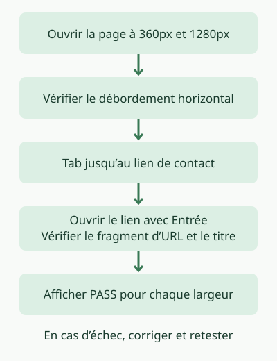

---
{
  "schemaVersion": 1,
  "state": "draft",
  "language": "fr",
  "translationKey": "2026-11-19-website-building-agent-skills",
  "title": "Créer un site web avec Claude Code et Codex — les skills de la conception au déploiement",
  "description": "Comparez les skills pour créer un site vitrine ou une application web avec Claude Code et Codex. Un exercice passe de la réalisation aux tests Playwright et aux vérifications de déploiement.",
  "sourcePath": "src/content/posts/en/2026-11-19-website-building-agent-skills.md",
  "sourceSha256": "5a054cc2358bab13553028e7a2e4183feefa7849d49e57e026c8849e15dd65df"
}
---

Pour un petit site vitrine, commencez par **organiser les textes et la structure des pages, réaliser l’interface, puis vérifier le parcours de contact dans le navigateur**. Pour une application web avec connexion ou paiement, commencez aussi par définir les autorisations, le stockage des données et la gestion des échecs. Une fois le type de site fixé, vous pouvez préciser les skills nécessaires et les critères d’évaluation.

Les recommandations pour chaque étape s’appuient sur les sources officielles des skills d’Anthropic, OpenAI et Vercel, vérifiées le 19 novembre 2026. Dans les exemples, des agents dans Claude Code et Codex CLI se chargent des tâches. [Skills d’Anthropic](https://github.com/anthropics/skills) · [OpenAI Build Web Apps](https://github.com/openai/plugins/tree/main/plugins/build-web-apps) · [Vercel Agent Skills](https://github.com/vercel-labs/agent-skills)

## Choisir les skills selon le type de site

| Projet | À définir en premier | Enchaînement de base |
| --- | --- | --- |
| Site vitrine, portfolio ou blog | Public, action principale, pages publiques et mise à jour du contenu | Textes → réalisation → tests dans le navigateur → vérification du déploiement |
| Application de réservation, paiement ou administration | Autorisations par profil, données à stocker, traitement des réussites et des échecs, journaux d’exploitation | Concevoir les écrans et états → réaliser l’interface et le serveur → tester les cas normaux et les échecs → prévisualiser → vérifier en production |

Si un dépôt existe déjà, commencez par repérer son framework et sa méthode de déploiement. Vous pouvez par exemple ajouter un article et un lien de contact dans la structure existante d’un blog Astro. Choisissez les skills de performance React ou Next.js et les skills de paiement lorsque vous avez effectivement besoin des technologies et des fonctions correspondantes.

| Étape | Skill ou consignes utiles | Travail attendu et vérification |
| --- | --- | --- |
| Planification et rédaction | Consignes de projet `website-copywriting` | Définir le public et son action principale, puis rédiger le titre, la description et le texte de contact. Vérifier dès le premier écran à qui s’adresse le service et ce qu’il offre. |
| Conception des écrans | Consignes de projet `frontend-architecture-design` | Fixer les routes, la responsabilité des composants et des états, ainsi que les écrans de réussite et d’erreur. Pour une application de réservation, prévoir les clics répétés pendant l’envoi et une nouvelle tentative après un échec d’enregistrement. |
| Réalisation de l’interface | [`frontend-design` pour Claude Code](https://github.com/anthropics/skills/tree/main/skills/frontend-design) ou [`frontend-app-builder` pour Codex](https://github.com/openai/plugins/tree/main/plugins/build-web-apps/skills/frontend-app-builder) | Réaliser les textes et la structure validés avec les composants existants. Vérifier que le titre, le bouton d’action et le contenu se lisent dans l’ordre, même sur un écran étroit. |
| Tests dans le navigateur | [`webapp-testing` pour Claude Code](https://github.com/anthropics/skills/tree/main/skills/webapp-testing), [`frontend-testing-debugging` pour Codex](https://github.com/openai/plugins/tree/main/plugins/build-web-apps/skills/frontend-testing-debugging) | Vérifier sur mobile le lien de contact, les erreurs du formulaire et la console. Noter l’URL, les dimensions de l’écran, les étapes exactes et le résultat. |
| Revue d’accessibilité | [`web-design-guidelines` de Vercel](https://github.com/vercel-labs/agent-skills/tree/main/skills/web-design-guidelines) | Examiner les libellés, le contraste et le focus dans le code. Vérifier l’ordre de tabulation et la visibilité du focus dans le navigateur. Consigner les résultats des tests automatiques et manuels. |
| Performance React | [`react-best-practices` de Build Web Apps](https://github.com/openai/plugins/tree/main/plugins/build-web-apps/skills/react-best-practices) | Examiner les requêtes de données en série et le bundle initial dans un projet React ou Next.js. Mesurer avant et après le changement dans le même environnement pour évaluer l’effet. |
| Déploiement | [`deployments-cicd` pour Vercel](https://github.com/openai/plugins/tree/main/plugins/vercel/skills/deployments-cicd) ou consignes de déploiement du projet | Vérifier l’URL de prévisualisation ou de préproduction chez l’hébergeur, puis déployer la version validée. Noter l’URL finale et la version à rétablir en cas de retour arrière. |

Les deux premières lignes donnent des exemples de rôles à décrire dans le projet. Pour les skills publics, suivez la procédure d’installation de leur équipe de maintenance. Dans Claude Code, le pack `example-skills` de la place de marché officielle d’Anthropic propose des skills de réalisation et de test. Dans Codex, le plugin **Build Web Apps** regroupe réalisation, tests et optimisation React. Le skill de déploiement Vercel sert pour les sites hébergés sur Vercel. Avec GitHub Pages, suivez les Actions et la procédure de prévisualisation du dépôt. [Installation dans Claude Code](https://github.com/anthropics/skills#claude-code) · [Contenu d’OpenAI Build Web Apps](https://github.com/openai/plugins/blob/main/plugins/build-web-apps/README.md)

## Enchaîner les skills sur un petit site

Une demande courte suffit. En donnant ensemble le contexte du service, la structure des écrans et les gestes à vérifier, vous pouvez utiliser les mêmes critères pendant la planification, la réalisation et les tests.

> Crée une page de présentation pour un studio photo fictif.\
> Les visiteurs veulent savoir où ont lieu les prises de vue et comment obtenir un rendez-vous.\
> Place la présentation et les informations de consultation sur une seule page. Relie le lien de contact\
> du premier écran à la section de consultation. Garde l’ordre présentation, lien de contact, consultation.\
> Prends en compte un écran étroit de 360px et l’utilisation au clavier.\
> Après la réalisation, vérifie les débordements horizontaux à 360px et 1280px.\
> Atteins le lien de contact avec Tab, puis ouvre la section de consultation avec Enter (Entrée).\
> Note le résultat de chaque étape et les points qui n’ont pas été vérifiés.

Transmettez la présentation et le lien de contact à la réalisation. Les largeurs d’écran et les gestes au clavier servent de critères pour les tests. En cas d’échec, communiquez à l’agent chargé de la réalisation la largeur et l’action concernées, puis relancez le test dans les mêmes conditions après correction. La revue d’accessibilité couvre aussi le contraste, les noms lus par les lecteurs d’écran et la position du focus après un changement de page.

## Exercice — tester le parcours de contact avec Playwright

L’exercice place une page dans le fichier de test et la vérifie dans le navigateur à deux largeurs. Préparez Node.js 22 et Chrome dans un nouveau dossier. Exécutez `npm init -y`, puis installez la dépendance avec `npm install --save-dev playwright-core@1.64.1`. Enregistrez le code ci-dessous sous `website-check.mjs` et lancez `node website-check.mjs` sous macOS. Si Chrome est installé ailleurs, indiquez le chemin de l’exécutable dans `CHROME_PATH`. [Options de démarrage de Playwright](https://playwright.dev/docs/api/class-browsertype#browser-type-launch)



```js
import assert from 'node:assert/strict';
import { chromium } from 'playwright-core';

const html = `<!doctype html>
<html lang="ko">
<meta charset="utf-8">
<meta name="viewport" content="width=device-width, initial-scale=1">
<title>봄 사진 스튜디오</title>
<style>
  body { margin: 0; font: 1rem/1.6 system-ui; }
  main { max-width: 42rem; margin: auto; padding: 1rem; }
  section { min-height: 74vh; }
</style>
<main>
  <section>
    <h1>봄 사진 스튜디오</h1>
    <p>프로필 사진과 가족사진을 촬영합니다.</p>
    <a href="#contact">문의하기</a>
  </section>
  <section id="contact">
    <h2>상담 안내</h2>
    <p>촬영 목적과 희망 일정을 준비해 주세요.</p>
  </section>
</main>
</html>`;

const browser = await chromium.launch({
  executablePath: process.env.CHROME_PATH
    ?? '/Applications/Google Chrome.app/Contents/MacOS/Google Chrome',
});

try {
  for (const width of [360, 1280]) {
    const page = await browser.newPage({ viewport: { width, height: 700 } });
    try {
      await page.setContent(html);
      const overflow = await page.evaluate(
        () => document.documentElement.scrollWidth > window.innerWidth,
      );
      assert.equal(overflow, false, `가로 넘침: ${width}px`);

      await page.keyboard.press('Tab');
      const focused = await page.evaluate(
        () => document.activeElement?.getAttribute('href'),
      );
      assert.equal(focused, '#contact', `문의 링크 포커스: ${width}px`);
      await page.keyboard.press('Enter');
      await page.waitForURL(/#contact$/);
      const heading = await page.getByRole('heading', { name: '상담 안내' }).boundingBox();
      assert.ok(heading && heading.y >= 0 && heading.y + heading.height <= 700);
      console.log(`PASS ${width}px: no overflow, keyboard link reaches contact`);
    } finally {
      await page.close();
    }
  }
} finally {
  await browser.close();
}
```

Voici le résultat de l’exécution. Chaque `PASS` indique que rien ne déborde horizontalement, que le lien de contact est accessible au clavier et que le titre de la section de consultation apparaît dans la zone visible.

```text
PASS 360px: no overflow, keyboard link reaches contact
PASS 1280px: no overflow, keyboard link reaches contact
```

Sur un vrai projet, démarrez le serveur local et ouvrez la page réalisée avec `page.goto()` à la place de la chaîne HTML. Pour un formulaire de contact, vérifiez séparément les champs obligatoires manquants, la conservation des saisies après un échec d’envoi et le message de réussite. Lorsque la destination du lien a été remplacée par un autre fragment d’URL, le test a échoué à 360px. L’exercice couvre une page HTML de démonstration et deux largeurs dans Chrome.

## Vérifications après le déploiement

Rouvrez les pages principales et le parcours de contact aux URL de prévisualisation et de production. Vérifiez les réponses du serveur et les ressources statiques. Pour les pages destinées aux moteurs de recherche, examinez le titre, la description, l’URL canonique, les liens internes et le sitemap. Vérifiez séparément, dans la Search Console, si le moteur a effectivement découvert et indexé la page. [Guide de démarrage SEO de Google](https://developers.google.com/search/docs/fundamentals/seo-starter-guide)
