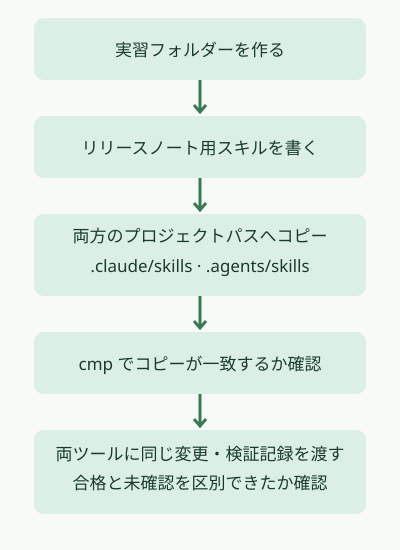

---
{
  "schemaVersion": 1,
  "state": "draft",
  "language": "ja",
  "translationKey": "2026-11-18-claude-code-codex-skills-top-10",
  "title": "Claude Code・Codex のおすすめスキル 10 選と実務での使い方",
  "description": "Claude Code と Codex CLI の実務スキル 10 個を比較し、導入と呼び出し方を紹介する。同じリリースノート用スキルを両方で使う実習も行う。",
  "sourcePath": "src/content/posts/en/2026-11-18-claude-code-codex-skills-top-10.md",
  "sourceSha256": "9338932f68b3342b8eee987674b733a84d8f24684b44e978ff027618dab08d68"
}
---

繰り返し頼む作業はスキルにまとめられる。変更の要約や検証の基準を毎回入力する代わりに、対象範囲と出力形式をスキルに保存し、作業ごとに対象ファイルを変える。開発チームなら `skill-creator` と `webapp-testing` から、文書作業が多いチームなら普段のファイル形式に合ったスキルから始めやすい。

ここでの Claude はターミナルで使う **Claude Code**、Codex は **Codex CLI** を指す。2026年11月18日に公式資料で候補を確認し、**繰り返し使う頻度、結果を検証しやすいか、導入や外部連携の手間**を基準に並べた。導入数や性能を集計した順位ではない。OpenAI は旧スキルカタログからの移行を勧めているため、Codex の導入元は現行ドキュメントとプラグインを参照した。 [Claude Code のスキルドキュメント](https://code.claude.com/docs/en/skills) · [Codex のスキルドキュメント](https://learn.chatgpt.com/docs/build-skills) · [旧カタログの案内](https://github.com/openai/skills) · [OpenAI のプラグインリポジトリ](https://github.com/openai/plugins)

## 実務向けのおすすめ 10 選

表の「提供元と環境」は公式の提供または配布先を指す。Claude Code の例を Codex に移す際にも、共通の `SKILL.md` 形式を利用できる。付属スクリプト、ツール名、ホスト固有の設定は個別に確認する。

| 順位 | スキル | 提供元と環境 | 依頼例と確認の基準 |
| --- | --- | --- | --- |
| 1 | `skill-creator` | Codex に組み込み / [Claude Code の例](https://github.com/anthropics/skills/tree/main/skills/skill-creator) | 「PR の説明文を書くスキルを作り、修正 PR とドキュメント PR の入力例をそれぞれ用意してください。」呼び出すべき依頼と呼び出さない依頼を一回ずつ試し、適用範囲を確かめる。 |
| 2 | `webapp-testing` | [Claude Code の例](https://github.com/anthropics/skills/tree/main/skills/webapp-testing) | 「ローカルの注文画面を Playwright で開き、正常な送信と必須項目の未入力を確認してください。」実際の画面の状態と実行ログを残す。ブラウザーとアプリの実行環境が必要だ。 |
| 3 | `frontend-design` | [Claude Code の例](https://github.com/anthropics/skills/tree/main/skills/frontend-design) | 「障害対応ダッシュボードのモバイル画面を設計してください。状態と次の行動を先に見せてください。」空の状態、長い文言、キーボードでの移動も確かめる。 |
| 4 | `openai-docs` | Codex に組み込み / [OpenAI Developers の案内](https://developers.openai.com/learn/developers-codex-plugin) | 「Codex CLI のプロジェクト用スキルの配置先と呼び出し方を公式ドキュメントで確かめてください。」出典が CLI の表示と説明した機能を直接裏付けているか確認する。 |
| 5 | `xlsx` | [Claude Code の文書スキル](https://github.com/anthropics/skills/tree/main/skills/xlsx) | 「注文 CSV を月別集計のワークブックにしてください。キャンセル分を分け、合計は数式で計算してください。」元の行数、集計範囲、合計を照合し、数式エラーも確認する。 |
| 6 | `pdf` | [Claude Code の文書スキル](https://github.com/anthropics/skills/tree/main/skills/pdf) | 「要件 PDF から納品条件と例外をページ番号付きで抽出してください。」表の行や列の順番と抜け漏れを原本の表示と照合する。スキャン版は OCR の精度も別途確認する。 |
| 7 | `docx` | [Claude Code の文書スキル](https://github.com/anthropics/skills/tree/main/skills/docx) | 「添付の Word テンプレートでプロジェクトの引き継ぎ書を作り、見出しのスタイルと表の構造を維持してください。」Word や互換エディターで開き、改ページや表の見切れを確認する。 |
| 8 | `pptx` | [Claude Code の文書スキル](https://github.com/anthropics/skills/tree/main/skills/pptx) | 「運用の振り返りをスライド 6 枚にまとめてください。数値のそばに測定期間と単位を添えてください。」レンダリングしたスライドで数値、軸、文字の見切れを確かめる。 |
| 9 | `openai-api-troubleshooting` | [Codex 向け OpenAI Developers プラグイン](https://github.com/openai/plugins/tree/main/plugins/openai-developers/skills/openai-api-troubleshooting) | 「キーを取り除いた API エラーメッセージから原因を絞ってください。SDK のバージョンとリクエスト ID を添付しました。」仮説と検証コマンドを分け、元のキーやトークンは含めない。 |
| 10 | `imagegen` | Codex に組み込み / [スキルのソース](https://github.com/openai/codex/tree/main/codex-rs/skills/src/assets/samples/imagegen) | 「ブログ記事の横長のカバー案を作ってください。記事タイトルは画像に入れないでください。」生成機能の使用可否を確認し、画像サイズ、編集された範囲、文字の崩れを見る。 |

`skill-creator` を最初にしたのは、チームが繰り返す手順をプロジェクトに残せるためだ。`webapp-testing` ではアプリとブラウザーを用意する必要があるが、実行ログと画面から結果を判定できる。四つの文書スキルはファイル形式に応じて選べばよい。API 診断と画像生成は、該当するエラーや画像が必要な場面に向く。

開発では `frontend-design` で画面の狙いを具体化し、実装後に `webapp-testing` でユーザー操作を確認する組み合わせが役立つ。デザイン案があっても、「送信に失敗したとき入力値が残るか」などはテストに別途入れる。文書作業で `pdf` から表を読み、`xlsx` で集計する場合は、抽出結果を原本と照合してから次に渡す。

## インストールと呼び出し方

Claude Code では Anthropic の公式マーケットプレイスを追加し、必要なセットを選ぶ。PDF、Word、Excel、PowerPoint を扱うときは `document-skills`、スキル作成やウェブテストの例を確認するなら `example-skills` を選ぶ。インストールしたプラグインのスキルは、自然言語の依頼で名前を挙げて呼び出せる。 [Anthropic の導入手順](https://github.com/anthropics/skills#claude-code)

```text
/plugin marketplace add anthropics/skills
/plugin install document-skills@anthropic-agent-skills
/plugin install example-skills@anthropic-agent-skills
```

Codex CLI では `/skills` または `$` の選択メニューからスキルを探して明示的に呼び出す。組み込みの `skill-creator` は `$skill-creator` で呼び出す。OpenAI API の診断スキルを追加するには Codex CLI の `/plugins` で **OpenAI Developers** を探し、`Install plugin` を選ぶ。新しいセッションを開き、`/skills` で診断スキルを確認する。 [Codex のスキル呼び出し手順](https://learn.chatgpt.com/docs/build-skills) · [OpenAI Developers プラグイン](https://developers.openai.com/learn/developers-codex-plugin)

プロジェクトで管理するスキルは Claude Code なら `.claude/skills/<name>/SKILL.md`、Codex なら `.agents/skills/<name>/SKILL.md` に置く。プレースホルダーはスキル名に置き換える。公式の例をコピーするときは、`SKILL.md` が参照するファイルやツールも確認する。連携が必要なスキルは、使用するアカウントと権限の範囲を確認してから動かす。 [Claude Code のスキルの配置先](https://code.claude.com/docs/en/skills#choose-where-skills-load) · [Codex のスキルの配置先](https://learn.chatgpt.com/docs/build-skills#where-to-save-skills)

## 実習 — 同じリリースノート用スキルを両方で使う

新しい実習用ディレクトリで以下のコマンドを実行する。一つの `SKILL.md` を作り、二つのプロジェクトパスへコピーして、`cmp` でファイルが一致するかを確認する。POSIX シェルと `mkdir`、`cp`、`cmp` が必要だ。



```sh
set -eu
mkdir skills-demo
cd skills-demo

mkdir -p .claude/skills/release-note-draft .agents/skills/release-note-draft

cat > release-note-source.md <<'SKILL'
---
name: release-note-draft
description: Draft a release note from a provided change list and test evidence.
---
Write three sections in Korean: 사용자 변경, 검증, 미확인.
Describe user-facing changes using only the supplied change list.
Put a test in 검증 only when the input explicitly says it ran and gives the result.
If a test is mentioned without a result, put it in 미확인.
Return the draft in the chat.
SKILL

cp release-note-source.md .claude/skills/release-note-draft/SKILL.md
cp release-note-source.md .agents/skills/release-note-draft/SKILL.md
cmp .claude/skills/release-note-draft/SKILL.md .agents/skills/release-note-draft/SKILL.md
printf '%s\n' 'Skill copies match.'
```

macOS の一時ディレクトリで実行し、次の出力と終了コード `0` を確認した。同じ親ディレクトリから再実行すると `skills-demo` がすでに存在するため、最初の `mkdir` で止まる。

```text
Skill copies match.
```

`skills-demo` を作業ディレクトリとし、別のターミナルセッションで `claude` と `codex` をそれぞれ起動する。Claude Code では `/release-note-draft`、Codex CLI では `$release-note-draft` を選ぶ。スキル名と次の変更・テスト記録を一つのメッセージで送る。

**プロンプト例** 変更: 設定画面のメールアドレス入力を消すと保存ボタンが無効になります。 検証記録: 設定画面の単体テストを 3 件実行し、すべて合格しました。 予定: モバイルブラウザーでの動作も確認する予定です。 以上の記録からリリースノートの下書きを作ってください。

期待する結果は、ユーザーに見える変更にボタンの動作、検証に単体テスト 3 件の合格、未確認事項にモバイルブラウザーでの確認がそれぞれ入ることだ。

## 同じ入力で応答を比べる

二つの CLI に同じスキルファイルと架空の変更・検証記録を使った。与えた記録から**実行済みのテストと実行予定のテストを分ける**課題であり、新たにアプリのテストを走らせる作業は含まない。

Codex CLI 0.169.0 で GPT-6.2 Sol を使って実行したところ、プロジェクトのスキルファイルを読んだことをログで確認できた。最終応答の要点は以下のとおりだ。

| 区分 | Codex の応答 |
| --- | --- |
| ユーザーに見える変更 | 設定画面に入力したメールアドレスを消すと保存ボタンが無効になる。 |
| 検証 | 設定画面の単体テストを 3 件実行し、すべて合格した。 |
| 未確認 | モバイルブラウザーでの動作は確認する予定だ。 |

Claude Code 2.0.76 と 2.1.327 でもプロジェクトスキルが一覧に表示された。モデルの呼び出しはログインエラーで止まった。この記録で確認できる範囲は、Claude Code がスキルを検出したことと、Codex の一件の応答だ。
