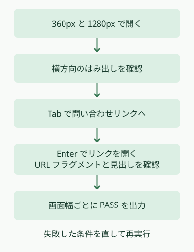

---
{
  "schemaVersion": 1,
  "state": "draft",
  "language": "ja",
  "translationKey": "2026-11-19-website-building-agent-skills",
  "title": "Claude Code・Codex でウェブサイトを作る — 企画からデプロイまでのスキル",
  "description": "Claude Code と Codex で紹介サイトやウェブアプリを作るためのスキルを比較し、画面の実装、Playwright での検証、デプロイ後の確認を段階ごとに解説する。",
  "sourcePath": "src/content/posts/en/2026-11-19-website-building-agent-skills.md",
  "sourceSha256": "f7eb2b67f71eb23934048777fc9d7ffed4a983fc580e1b4d9a7b2cf3c8a3180e"
}
---

小さな企業サイトなら、**文言とページ構成を決めて画面を作り、ブラウザーで問い合わせまでの導線を確認する**ところから始める。ログインや決済のあるウェブアプリでは、先に権限、データの保存、失敗からの復旧まで設計する。サイトの種類を決めると、必要なスキルと成果の判定基準を具体化できる。

2026年11月19日に Anthropic・OpenAI・Vercel の公式スキルのソースを調べ、工程ごとに候補を選んだ。例では Claude Code と Codex CLI でエージェントに仕事を依頼する場面を想定する。 [Anthropic のスキル集](https://github.com/anthropics/skills) · [OpenAI Build Web Apps](https://github.com/openai/plugins/tree/main/plugins/build-web-apps) · [Vercel Agent Skills](https://github.com/vercel-labs/agent-skills)

## サイトの種類に合わせてスキルを選ぶ

| 作るもの | 最初に決めること | 基本の組み合わせ |
| --- | --- | --- |
| 紹介サイト、ポートフォリオ、ブログ | 訪問者、主な行動、公開するページ、コンテンツの更新方法 | ページの文言 → 画面実装 → ブラウザーテスト → デプロイの確認 |
| 予約・決済・管理のウェブアプリ | ユーザーごとの権限、保存するデータ、成功と失敗の扱い、運用記録 | 画面と状態の設計 → 画面とサーバーの実装 → 成功・失敗のテスト → プレビュー → 本番確認 |

既存リポジトリがあれば、最初にフレームワークとデプロイ方法を確認する。たとえば Astro のブログに記事と問い合わせリンクを追加するなら、今の構成のままで完結できる。React や Next.js のパフォーマンススキル、決済スキルは、それらの技術や機能が必要になった段階で選ぶ。

| 工程 | スキルまたは基準 | 任せる作業と確認方法 |
| --- | --- | --- |
| 企画・文言 | プロジェクト用の `website-copywriting` ガイド | 想定する訪問者と主な行動を決め、見出し、説明、問い合わせの文言を書く。最初に見える画面で、誰に何を提供するサービスか読み取れるかを確かめる。 |
| 画面設計 | プロジェクト用の `frontend-architecture-design` ガイド | ページのパス、コンポーネントと状態の管理主体、成功・エラー画面を決める。予約アプリなら、送信中の連打と保存に失敗した後の再試行を設計する。 |
| 画面実装 | [Claude Code の `frontend-design`](https://github.com/anthropics/skills/tree/main/skills/frontend-design) または [Codex の `frontend-app-builder`](https://github.com/openai/plugins/tree/main/plugins/build-web-apps/skills/frontend-app-builder) | 承認された文言と画面構成を既存のコンポーネントで実装する。画面が狭くても、見出し、操作ボタン、本文を順に読めるか確認する。 |
| ブラウザー検証 | [Claude Code の `webapp-testing`](https://github.com/anthropics/skills/tree/main/skills/webapp-testing)、[Codex の `frontend-testing-debugging`](https://github.com/openai/plugins/tree/main/plugins/build-web-apps/skills/frontend-testing-debugging) | モバイルの画面幅で問い合わせリンク、フォームのエラー、コンソールを確認する。対象 URL、画面幅、再現した手順、実際の結果を残す。 |
| アクセシビリティレビュー | [Vercel の `web-design-guidelines`](https://github.com/vercel-labs/agent-skills/tree/main/skills/web-design-guidelines) | ラベル、コントラスト、フォーカスをコードでレビューし、ブラウザーでキーボード操作の順序とフォーカス表示を確認する。自動チェックと手動チェックの結果を記録する。 |
| React のパフォーマンス | [Build Web Apps の `react-best-practices`](https://github.com/openai/plugins/tree/main/plugins/build-web-apps/skills/react-best-practices) | React・Next.js プロジェクトで直列のデータリクエストと初期バンドルを確認する。変更の前後を同じ環境で測定してから改善効果を判断する。 |
| デプロイ | [Vercel の `deployments-cicd`](https://github.com/openai/plugins/tree/main/plugins/vercel/skills/deployments-cicd) またはプロジェクトのデプロイ手順 | 実際に使うホストでプレビューまたはステージングの URL を確認し、承認済みのバージョンをデプロイする。本番 URL とロールバック先のバージョンを記録する。 |

表の最初の二項目は、プロジェクト内で定義する役割の例だ。公開スキルはメンテナーが案内する配布先から導入する。Claude Code では Anthropic の公式マーケットプレイスの `example-skills` に画面実装とテストのスキルが含まれる。Codex では **Build Web Apps** プラグインに画面実装、テスト、React 最適化のスキルが入っている。Vercel に公開するなら Vercel 向けのデプロイスキルを使う。GitHub Pages なら、リポジトリの Actions とプレビュー手順に従う。 [Claude Code の導入手順](https://github.com/anthropics/skills#claude-code) · [OpenAI Build Web Apps の構成](https://github.com/openai/plugins/blob/main/plugins/build-web-apps/README.md)

## 小さなサイトでスキルをつなぐ

制作依頼は長くなくてよい。次のようにサービスの概要、画面構成、確認する行動を一緒に伝えると、企画・実装・テストで同じ基準を使える。

**プロンプト例** 架空の写真スタジオの紹介ページを作ってください。 訪問者は撮影場所と相談方法を知りたい人です。 同じページに紹介と相談案内を置き、最初に見える画面の「問い合わせ」リンクを ページ内の相談案内につなげてください。紹介、問い合わせリンク、相談案内の順に並べてください。 360px の狭い画面とキーボード操作を考慮してください。 実装後、360px と 1280px で横方向のはみ出しを確認し、 Tab で問い合わせリンクに移動して Enter で相談案内を開いてください。 各工程の結果と確認できなかった項目を記録してください。

紹介と問い合わせリンクは画面実装に渡し、画面幅とキーボード操作の条件はテストの判定基準として使う。失敗したら、そのときの画面幅と操作を実装担当のエージェントに伝え、修正後に同じ条件で再実行する。アクセシビリティレビューでは、コントラスト、スクリーンリーダーが読む名前、別ページに移動した後のフォーカス位置も確認する。

## 実習 — Playwright で問い合わせ導線を確認する

実習ではサイトの一ページをテストファイルに組み込み、ブラウザーで二つの画面幅を試す。新しいディレクトリに Node.js 22 と Chrome を用意する。`npm init -y` を実行し、次に `npm install --save-dev playwright-core@1.64.1` で依存関係をインストールする。以下のコードを `website-check.mjs` に保存し、macOS で `node website-check.mjs` を実行する。Chrome のインストール先が異なる場合は、`CHROME_PATH` に実行ファイルのパスを指定する。 [Playwright のブラウザー起動オプション](https://playwright.dev/docs/api/class-browsertype#browser-type-launch)



```js
import assert from 'node:assert/strict';
import { chromium } from 'playwright-core';

const html = `<!doctype html>
<html lang="ko">
<meta charset="utf-8">
<meta name="viewport" content="width=device-width, initial-scale=1">
<title>봄 사진 스튜디오</title>
<style>
  body { margin: 0; font: 1rem/1.6 system-ui; }
  main { max-width: 42rem; margin: auto; padding: 1rem; }
  section { min-height: 74vh; }
</style>
<main>
  <section>
    <h1>봄 사진 스튜디오</h1>
    <p>프로필 사진과 가족사진을 촬영합니다.</p>
    <a href="#contact">문의하기</a>
  </section>
  <section id="contact">
    <h2>상담 안내</h2>
    <p>촬영 목적과 희망 일정을 준비해 주세요.</p>
  </section>
</main>
</html>`;

const browser = await chromium.launch({
  executablePath: process.env.CHROME_PATH
    ?? '/Applications/Google Chrome.app/Contents/MacOS/Google Chrome',
});

try {
  for (const width of [360, 1280]) {
    const page = await browser.newPage({ viewport: { width, height: 700 } });
    try {
      await page.setContent(html);
      const overflow = await page.evaluate(
        () => document.documentElement.scrollWidth > window.innerWidth,
      );
      assert.equal(overflow, false, `가로 넘침: ${width}px`);

      await page.keyboard.press('Tab');
      const focused = await page.evaluate(
        () => document.activeElement?.getAttribute('href'),
      );
      assert.equal(focused, '#contact', `문의 링크 포커스: ${width}px`);
      await page.keyboard.press('Enter');
      await page.waitForURL(/#contact$/);
      const heading = await page.getByRole('heading', { name: '상담 안내' }).boundingBox();
      assert.ok(heading && heading.y >= 0 && heading.y + heading.height <= 700);
      console.log(`PASS ${width}px: no overflow, keyboard link reaches contact`);
    } finally {
      await page.close();
    }
  }
} finally {
  await browser.close();
}
```

実行すると次の結果になった。各 `PASS` は、横方向のはみ出しがなく、キーボードで問い合わせリンクに移動して開くと相談セクションの見出しが画面内に入ったことを示す。

```text
PASS 360px: no overflow, keyboard link reaches contact
PASS 1280px: no overflow, keyboard link reaches contact
```

実際のプロジェクトでは、HTML 文字列の代わりにローカルサーバーを起動し、実装したページを `page.goto()` で開く。問い合わせフォームなら、必須項目が空のとき、送信に失敗した後の入力保持、成功メッセージを別々に検証する。問い合わせリンクの参照先を別の URL フラグメントに変えた場合は、360px のリンクチェックで失敗した。上記の例で確認したのは、実習用 HTML の一ページを Chrome で二つの画面幅で開いた場合だ。

## デプロイ後の確認項目

プレビューと本番の URL で主要ページを開き直し、問い合わせの導線をたどり、サーバーの応答と静的アセットを確認する。検索に公開するページは、文書のタイトルと説明、正規 URL、内部リンク、サイトマップも確かめる。本番 URL を開けるかの確認とは別に、検索エンジンが実際にページを発見してインデックスしたかを Search Console で確認する。 [Google SEO スターターガイド](https://developers.google.com/search/docs/fundamentals/seo-starter-guide)
