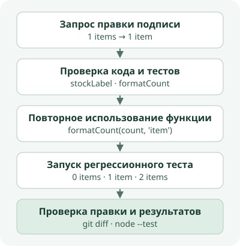

---
{
  "schemaVersion": 1,
  "state": "draft",
  "language": "ru",
  "translationKey": "2026-11-20-ponytail-skill-guide",
  "title": "Как пользоваться навыком Ponytail — небольшие правки и регрессионные тесты в Codex",
  "description": "Как вызвать Ponytail в Codex и Claude Code, выбрать режим Lite, Full или Ultra и переиспользовать функцию с регрессионным тестом на Node.js через Codex CLI.",
  "sourcePath": "src/content/posts/en/2026-11-20-ponytail-skill-guide.md",
  "sourceSha256": "7b1777565ade628aa9381193123b7b19f84ba4c91e57779cba53f40b8b19b6de"
}
---

**Ponytail — навык для ИИ-агента, который помогает реализовать запрошенное поведение, опираясь на существующий код.** Если при одном товаре в наличии интерфейс показывает `1 items`, сначала проверьте, есть ли в проекте функция для единственного и множественного числа. Используйте её, чтобы исправить подпись, и убедитесь, что при количестве 0 и 2 всё работает по-прежнему.

## Как начать в Codex и Claude Code

Если в Codex уже установлен самостоятельный навык Ponytail, введите в чате `$ponytail-help`, чтобы посмотреть названия навыков и доступные режимы. После `$ponytail full` укажите, какое поведение изменить, что сохранить и какой командой проверить результат. В упражнении используется самостоятельный навык, установленный по пользовательскому пути `~/.agents/skills/ponytail/SKILL.md`. В такой конфигурации выбранный режим действует как рабочая настройка текущего диалога. Отключить его можно командой `$ponytail off`. [Документация по навыкам Codex](https://learn.chatgpt.com/docs/build-skills)

Проект Ponytail также выпускает плагин. Для Codex CLI выполните две команды ниже в терминале. Затем откройте Codex и проверьте в `/hooks`, что выполняют оба хука. Если хотите их использовать, после проверки разрешите их запуск и начните новый диалог. В окружении, где работают хуки, `node` должен быть доступен через `PATH`. [Установка Ponytail](https://github.com/DietrichGebert/ponytail/blob/main/INSTALL.md#codex)

```bash
codex plugin marketplace add DietrichGebert/ponytail
codex plugin add ponytail@ponytail
```

В Claude Code введите две команды ниже по одной строке, затем выберите режим с помощью `/ponytail full`. В комплект входит команда ревью `/ponytail-review`. В плагине для Codex у навыка ревью есть префикс с именем плагина, например `$ponytail:ponytail-review`. Установка и работа хуков обоих плагинов описаны по открытой документации. [Установка для Claude Code](https://github.com/DietrichGebert/ponytail/blob/main/INSTALL.md#claude-code) · [Команды Ponytail](https://github.com/DietrichGebert/ponytail#commands)

```text
/plugin marketplace add DietrichGebert/ponytail
/plugin install ponytail@ponytail
```

## Когда выбирать Lite, Full или Ultra

В самостоятельном навыке Codex команда `$ponytail` без параметров включает Full — режим по умолчанию.

| Вызов | Как работает | Пример |
| --- | --- | --- |
| `$ponytail lite` | Выполняет задачу и кратко предлагает более компактный подход, если от него есть ощутимая польза. | Заменить уже согласованный текст интерфейса. |
| `$ponytail full` | Проверяет места вызова и существующие тесты. Реализует требуемое поведение минимальной полной правкой и сообщает о проверенных результатах и оставшихся рисках. | Исправить форму единственного числа и проверить прежние входные значения. |
| `$ponytail ultra` | Указывает, где задачу излишне расширили, и продолжает запрошенную работу. | Исправить ошибку на одном экране и отдельно оценить, нужна ли общая переработка интерфейса. |

Чтобы ограничить размер правки, задайте **что изменить, что сохранить и как проверить результат**. Включите условия, от которых зависит вызывающий код, например проверку прав, валидацию входных данных и защиту данных. Навык задаёт подход агента к работе. Возможность записывать файлы и выполнять команды регулируют настройки разрешений агента.

## Упражнение — выводить `1 item`, когда в наличии один товар

Упражнение выполнено в пустом учебном репозитории на Node.js 22.17.0 и Codex CLI 0.169.0. Чтобы восстановить начальное состояние, используйте строку возврата ниже в `stockLabel`. Первый тест из `stock.test.mjs` уже был в репозитории, второй добавили для этой правки.

```javascript
return `${count} items`;
```

**Пример запроса** `$ponytail full` Исправь stockLabel(1), который возвращает 1 items. Сохрани items для 0 и 2. Переиспользуй существующую функцию formatCount, добавь регрессионный тест для stockLabel и выполни `node --test`. Ничего не меняй за пределами учебного репозитория и не создавай коммит.



В `stock.mjs` изменилось только выражение, которое возвращает `stockLabel`. Теперь оно вызывает `formatCount`, где уже реализована обработка единственного и множественного числа.

```javascript
export function formatCount(count, noun) {
  return `${count} ${count === 1 ? noun : noun + 's'}`;
}

export function stockLabel(count) {
  return formatCount(count, 'item');
}
```

В `stock.test.mjs` проверяются подписи для количества 0, 1 и 2. Поместите оба файла в одну папку и запустите `node --test`.

```javascript
import assert from 'node:assert/strict';
import test from 'node:test';
import { formatCount, stockLabel } from './stock.mjs';

test('formatCount handles singular and plural', () => {
  assert.equal(formatCount(1, 'item'), '1 item');
  assert.equal(formatCount(2, 'item'), '2 items');
});

test('stockLabel handles zero, one, and two items', () => {
  assert.equal(stockLabel(0), '0 items');
  assert.equal(stockLabel(1), '1 item');
  assert.equal(stockLabel(2), '2 items');
});
```

До исправления добавленный тест упал на количестве 1. Ожидалось `1 item`, а фактически вернулось `1 items`. После исправления получен следующий вывод.

```text
ok 1 - formatCount handles singular and plural
ok 2 - stockLabel handles zero, one, and two items
# tests 2
# pass 2
# fail 0
```

В упражнении проверены два теста и изменения в двух файлах. Когда агент сообщит о завершении, сопоставьте фактический `git diff` с результатами тестов, чтобы убедиться в повторном использовании функции и соблюдении границ задачи.

## После исправления задайте область ревью

Если рядом установлены дополнительные самостоятельные навыки, доступны следующие команды. Уточните, какую часть кода проверять, чтобы было проще подтвердить замечания. [Команды Ponytail](https://github.com/DietrichGebert/ponytail#commands)

| Вызов | Когда использовать |
| --- | --- |
| `$ponytail-review` | Проверяет текущий diff и связанный код. Используйте перед открытием PR, чтобы проверить места вызова и обнаружить недостающие регрессионные тесты. |
| `$ponytail-audit` | Исследует весь репозиторий в режиме чтения и сортирует найденные проблемы по приоритету. |
| `$ponytail-debt` | Собирает существующие комментарии `shortcut:` и старые комментарии `ponytail:` для проверки. |
| `$ponytail-gain` | Показывает опубликованный проектом отчёт о сравнительных замерах. Для оценки экономии времени и затрат в своём репозитории потребуется отдельное сравнение. |
| `$ponytail-help` | Показывает режимы и способы вызова установленных навыков. |
