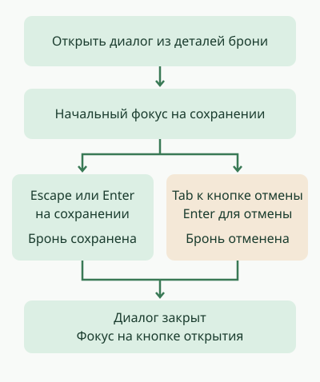

---
{
  "schemaVersion": 1,
  "state": "draft",
  "language": "ru",
  "translationKey": "2026-11-20-ui-ux-design-agent-skills",
  "title": "Проектирование UI и UX с Claude Code и Codex — сценарии, Figma и доступность",
  "description": "Как использовать Claude Code и Codex для проектирования сценариев, дизайн-систем в Figma, текстов интерфейса и доступности. Проверка клавиатуры и фокуса в диалоге отмены брони с Playwright.",
  "sourcePath": "src/content/posts/en/2026-11-20-ui-ux-design-agent-skills.md",
  "sourceSha256": "2fa2cdf9d087643f65deb61063a994cdd75549bf0b412379d831fa97c01906e2"
}
---

**Прежде чем рисовать экран, определите, что пользователь должен сделать и в какой момент он может вернуться назад.** В сценарии отмены брони пользователь должен заранее понимать последствия и иметь возможность сохранить или отменить бронь. Текст диалога, начальный фокус и точка возврата после закрытия дают общие критерии для реализации и проверки.

Это продолжение [предыдущей статьи](/ko/posts/2026-11-19-website-building-agent-skills/) о создании сайтов, теперь с акцентом на UI и UX. 20 ноября 2026 года я проверил открытые навыки Claude Code и Codex и материалы Figma, Vercel и W3C. На их основе пройдём сценарий отмены брони от проектирования до проверки в браузере.

## Как подобрать навык под результат

| Требуемый результат | Навык или подход | Что проверить |
| --- | --- | --- |
| Пользовательский сценарий и состояния экрана | Проектные инструкции `frontend-architecture-design` | Проверьте, описаны ли вход в сценарий, подтверждение, выход, обработка, успех и ошибка. Если есть исследования с реальными пользователями, разделите наблюдения и гипотезы. |
| Прототип для обсуждения | [Плагин Product Design](https://github.com/openai/plugins/tree/main/plugins/product-design) для Codex | Подготовьте макет, по которому можно проверить переходы между состояниями. Убедитесь, что есть способ сохранить бронь и способ подтвердить отмену. |
| Визуальное направление и код интерфейса | [`frontend-design`](https://github.com/anthropics/skills/tree/main/skills/frontend-design) для Claude Code | Определите визуальный приоритет заголовка, пояснения и кнопок. Проверьте, что смысл и порядок сохраняются с длинным заголовком или на узком экране. |
| Сборка экранов в Figma | [`figma-generate-design`](https://github.com/openai/plugins/tree/main/plugins/figma/skills/figma-generate-design) из плагина Figma | Переиспользуйте экземпляры кнопок и диалогов из библиотеки и создайте фрейм для каждого состояния. Проверьте, что сохраняются связи с компонентами и переменными. |
| Библиотека дизайн-системы | [`figma-generate-library`](https://github.com/openai/plugins/tree/main/plugins/figma/skills/figma-generate-library) из плагина Figma | Создайте или обновите переменные и библиотеку Figma на основе компонентов и дизайн-токенов из кода. Сверьте варианты и привязки переменных с именами в исходниках. |
| Реализация согласованного макета Figma | [`figma-design-to-code`](https://github.com/openai/plugins/tree/main/plugins/figma/skills/figma-design-to-code) из плагина Figma | Изучите нужный фрейм и реализуйте его в существующем коде интерфейса. После сравнения экранов отдельно проверьте клавиатурное управление и состояния ошибки. |
| Тексты интерфейса | Проектные инструкции по UX-текстам, например `cms-ux-writing` | Формулируйте результат нажатия глаголом. Подписи «Сохранить бронь» и «Подтвердить отмену» ясно описывают последствия каждого действия. |
| Проверка интерфейса | [`web-design-guidelines`](https://github.com/vercel-labs/agent-skills/tree/main/skills/web-design-guidelines) от Vercel и проверка в браузере | Найдите в коде возможные проблемы интерфейса и доступности. В браузере проверьте порядок клавиатурной навигации, перемещение фокуса и компоновку на разных размерах экрана. |

Две проектные инструкции показывают, как превратить правила команды по проектированию экранов и написанию текстов в переиспользуемые навыки. Они не обозначают встроенные функции конкретного продукта. Если есть кому проверить сценарий, сначала покажите прототип, внесите замечания в таблицу состояний и передайте её в реализацию. Если фреймы Figma и компоненты кода уже согласованы, можно начать с реализации и проверки доступности.

В Claude Code навык Anthropic `frontend-design` входит в набор `example-skills` официального каталога. Для работы с навыками Figma в Codex нужны подключённые к плагину инструменты Figma и доступ к файлу. При создании экранов или компонентов в Figma используйте инструкции плагина `figma-use` вместе с нужным навыком создания. Чтобы изучить макет для реализации, передайте ссылку на нужный фрейм. Чтобы создать новый, предоставьте редактируемый файл и библиотеку для повторного использования. [Установка Anthropic](https://github.com/anthropics/skills#claude-code) · [Плагин Figma для Codex](https://github.com/openai/plugins/tree/main/plugins/figma)

Если у вас есть брендбук, приложите логотип, цвета, шрифты и примеры запрещённого использования. Если выбрать навык Anthropic `brand-guidelines` для бренда команды только по названию, можно получить цвета и типографику Anthropic. Встроенные материалы рассчитаны на бренд Anthropic. [Исходник `brand-guidelines`](https://github.com/anthropics/skills/tree/main/skills/brand-guidelines)

## Как передать сценарий отмены в дизайн и разработку

Прежде чем рисовать экран, сведите действия и их результаты в таблицу. Ниже пример проектирования. Текст об условиях возврата средств и сборах за отмену сверяйте с реальной политикой сервиса.

| Действие пользователя или состояние сервера | Что происходит на экране |
| --- | --- |
| Пользователь выбирает «Открыть варианты отмены» в деталях брони | Открывается диалог, фокус переходит на «Сохранить бронь». |
| «Сохранить бронь» или Escape | Диалог закрывается, бронь сохраняется. Фокус возвращается на кнопку открытия. |
| Пользователь выбирает «Подтвердить отмену» | В рабочем сервисе отправляется запрос и показывается состояние обработки. Повтор того же запроса не приводит к повторной обработке. |
| Сервер подтверждает успех | Состояние меняется на «Бронь отменена», интерфейс сообщает результат. |
| Сервер сообщает об ошибке | Состояние брони сохраняется, интерфейс сообщает причину и доступные дальнейшие действия. |

В диалоге подтверждения действия, которое трудно отменить, начальный фокус можно поставить на наименее разрушительный вариант. При закрытии фокус обычно возвращают на элемент, открывший диалог. Если этого элемента больше нет, выберите другой, с которого пользователь сможет продолжить задачу. [Шаблон модального диалога W3C](https://www.w3.org/WAI/ARIA/apg/patterns/dialog-modal/)

Передайте агенту, который будет реализовывать сценарий, действия и критерии проверки. Например:

**Пример запроса** Спроектируй диалог отмены в деталях брони. Переиспользуй существующий диалог и кнопки. Установи начальный фокус на «Сохранить бронь». При закрытии по Escape сохрани бронь и верни фокус на «Открыть варианты отмены». После отправки запроса покажи отдельные состояния обработки, успеха и ошибки. На экране ошибки укажи, как повторить попытку или получить помощь. Соотнеси фреймы с состояниями, чтобы мы могли проверить экраны и таблицу до реализации.

## Упражнение — проверяем фокус диалога и оба результата

Проверьте в браузере первые две строки таблицы и изменение экрана после подтверждения отмены. В упражнении подтверждение меняет только состояние внутри страницы. Запрос к серверу, обработку ошибок и защиту от повторной отправки проверяют отдельно в рабочем проекте.



Подготовьте Node.js 22 и Chrome. В новой папке выполните `npm init -y` и `npm install --save-dev playwright-core@1.64.1`. Сохраните код как `dialog-check.mjs` и выполните `node dialog-check.mjs`. Если Chrome установлен не по стандартному пути, задайте `CHROME_PATH`. В примере подписи интерфейса на корейском. [Параметры запуска Playwright](https://playwright.dev/docs/api/class-browsertype#browser-type-launch)

```js
import assert from 'node:assert/strict';
import { chromium } from 'playwright-core';

const browser = await chromium.launch({
  executablePath: process.env.CHROME_PATH
    ?? '/Applications/Google Chrome.app/Contents/MacOS/Google Chrome',
});

try {
  const page = await browser.newPage({ viewport: { width: 360, height: 700 } });
  page.setDefaultTimeout(2000);
  await page.setContent(`
    <button id="open">취소 옵션 열기</button>
    <p role="status">예약 유지 중</p>
    <dialog aria-labelledby="title" aria-describedby="description">
      <h2 id="title">예약을 취소할까요?</h2>
      <p id="description">확정하면 예약 상태가 취소됨으로 바뀝니다.</p>
      <form method="dialog">
        <button value="keep" autofocus>예약 유지</button>
        <button value="cancel">예약 취소 확정</button>
      </form>
    </dialog>
    <script>
      const trigger = document.querySelector('#open');
      const dialog = document.querySelector('dialog');
      const status = document.querySelector('[role="status"]');

      trigger.addEventListener('click', () => {
        dialog.returnValue = '';
        dialog.showModal();
      });
      dialog.addEventListener('close', () => {
        if (dialog.returnValue === 'cancel') {
          status.textContent = '예약 취소됨';
        }
      });
    </script>
  `);

  const trigger = page.getByRole('button', { name: '취소 옵션 열기' });
  const dialog = page.getByRole('dialog', { name: '예약을 취소할까요?' });
  const status = page.getByRole('status');
  const focused = () => page.evaluate(
    () => document.activeElement?.textContent?.trim(),
  );

  for (const close of ['Escape', '예약 유지']) {
    await trigger.focus();
    await page.keyboard.press('Enter');
    await dialog.waitFor({ state: 'visible' });
    assert.equal(await focused(), '예약 유지', '초기 포커스');
    await page.keyboard.press(close === 'Escape' ? 'Escape' : 'Enter');
    await dialog.waitFor({ state: 'hidden' });
    assert.equal(await status.textContent(), '예약 유지 중');
    assert.equal(await focused(), '취소 옵션 열기', '닫은 뒤 포커스');
    console.log(`PASS ${close}: 예약 유지 및 포커스 복귀`);
  }

  await page.keyboard.press('Enter');
  await dialog.waitFor({ state: 'visible' });
  assert.equal(await focused(), '예약 유지', '초기 포커스');
  await page.keyboard.press('Tab');
  assert.equal(await focused(), '예약 취소 확정', '확정 버튼 포커스');
  await page.keyboard.press('Enter');
  await page.waitForFunction(
    () => document.querySelector('[role="status"]').textContent === '예약 취소됨',
  );
  await dialog.waitFor({ state: 'hidden' });
  assert.equal(await focused(), '취소 옵션 열기', '확정 뒤 포커스');
  console.log('PASS 예약 취소 확정: 상태 변경 및 포커스 복귀');
} finally {
  await browser.close();
}
```

Так выглядит вывод запуска в Chrome на macOS.

```text
PASS Escape: 예약 유지 및 포커스 복귀
PASS 예약 유지: 예약 유지 및 포커스 복귀
PASS 예약 취소 확정: 상태 변경 및 포커스 복귀
```

В контрольном эксперименте перенос `autofocus` на «Подтвердить отмену» привёл к ошибке проверки начального фокуса. Упражнение проверяет доступное имя диалога, управление с клавиатуры, начальный фокус, возврат фокуса и отображение состояния после закрытия. В реальном интерфейсе также проверьте видимость индикатора фокуса при навигации с клавиатуры, читаемость кнопок и пояснений при увеличенном тексте и озвучивание сообщений о состоянии вспомогательными технологиями. [WCAG 2.2](https://www.w3.org/TR/WCAG22/)
