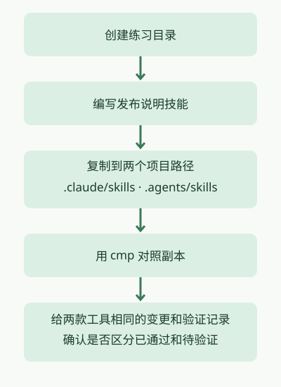

---
{
  "schemaVersion": 1,
  "state": "draft",
  "language": "zh-CN",
  "translationKey": "2026-11-18-claude-code-codex-skills-top-10",
  "title": "Claude Code 和 Codex 推荐技能 10 选及实战用法",
  "description": "比较 Claude Code 和 Codex CLI 的 10 项实用技能，介绍安装和调用方法，并在两款工具里练习使用同一项发布说明技能。",
  "sourcePath": "src/content/posts/en/2026-11-18-claude-code-codex-skills-top-10.md",
  "sourceSha256": "9338932f68b3342b8eee987674b733a84d8f24684b44e978ff027618dab08d68"
}
---

反复用到的请求可以封装成技能。把输入范围和输出格式放进技能，就不必每次重新输入变更摘要的要求和验证标准，只需按任务替换目标文件。开发团队可以从 `skill-creator` 和 `webapp-testing` 开始，常处理文档的团队则可先选与实际文件格式匹配的技能。

本文的 Claude 指在终端使用的 **Claude Code**，Codex 指 **Codex CLI**。2026年11月18日查阅官方资料后，按**复用频率、验证结果的难易、安装与外部集成成本**推荐以下技能。顺序依据是这些实际使用条件，不是安装量或性能统计。OpenAI 建议停用旧技能目录，因此 Codex 栏的安装来源以现行文档和插件为准。 [Claude Code 技能文档](https://code.claude.com/docs/en/skills) · [Codex 技能文档](https://learn.chatgpt.com/docs/build-skills) · [旧目录说明](https://github.com/openai/skills) · [OpenAI 插件仓库](https://github.com/openai/plugins)

## 10 项实用技能推荐

表中的“来源与环境”指官方提供或分发渠道。把 Claude Code 示例移到 Codex 时，可复用共同的 `SKILL.md` 格式。随附脚本、工具名称和宿主专用设置需要另行核对。

| 排序 | 技能 | 来源与环境 | 请求示例和验证标准 |
| --- | --- | --- | --- |
| 1 | `skill-creator` | Codex 内置 / [Claude Code 示例](https://github.com/anthropics/skills/tree/main/skills/skill-creator) | “制作一个写 PR 说明的技能，并分别给出代码修复 PR 和文档 PR 的输入示例。”各提交一次应触发的请求和应跳过的请求，检查范围是否恰当。 |
| 2 | `webapp-testing` | [Claude Code 示例](https://github.com/anthropics/skills/tree/main/skills/webapp-testing) | “用 Playwright 检查本地订单页面的正常提交与必填项缺失。”记录实际界面状态和运行日志。需要浏览器和应用运行环境。 |
| 3 | `frontend-design` | [Claude Code 示例](https://github.com/anthropics/skills/tree/main/skills/frontend-design) | “为故障响应仪表板设计移动端界面，优先展示状态和下一步操作。”检查空状态、长文案和键盘导航。 |
| 4 | `openai-docs` | Codex 内置 / [OpenAI Developers 指南](https://developers.openai.com/learn/developers-codex-plugin) | “用官方文档查证 Codex CLI 项目技能的保存位置和调用方法。”确认来源直接支持 CLI 中的界面和所述功能。 |
| 5 | `xlsx` | [Claude Code 文档技能](https://github.com/anthropics/skills/tree/main/skills/xlsx) | “把订单 CSV 转成按月汇总的工作簿。单独列出取消的订单，用公式计算总计。”与原始行数和汇总范围核对，并检查总计与公式错误。 |
| 6 | `pdf` | [Claude Code 文档技能](https://github.com/anthropics/skills/tree/main/skills/pdf) | “从需求 PDF 中提取交付条件与例外，并标出页码。”对照原始页面检查表格行列顺序和遗漏。扫描件要另外检查 OCR 质量。 |
| 7 | `docx` | [Claude Code 文档技能](https://github.com/anthropics/skills/tree/main/skills/docx) | “用附带的 Word 模板撰写项目交接文档，保留标题样式和表格结构。”用 Word 或兼容编辑器打开成品，检查分页和表格裁切。 |
| 8 | `pptx` | [Claude Code 文档技能](https://github.com/anthropics/skills/tree/main/skills/pptx) | “把运维复盘做成 6 张幻灯片，在数值旁注明测量时间范围和单位。”渲染幻灯片，检查数值、坐标轴和文字是否被截断。 |
| 9 | `openai-api-troubleshooting` | [Codex 的 OpenAI Developers 插件](https://github.com/openai/plugins/tree/main/plugins/openai-developers/skills/openai-api-troubleshooting) | “根据已删除密钥的 API 错误消息缩小原因范围。已附 SDK 版本和请求 ID。”区分假设与验证命令，排除原始密钥及令牌。 |
| 10 | `imagegen` | Codex 内置 / [技能源文件](https://github.com/openai/codex/tree/main/codex-rs/skills/src/assets/samples/imagegen) | “为博客文章制作横向封面草图，不要把文章标题合成进图片。”确认生成能力可用，并检查图片尺寸、编辑范围和文字变形。 |

`skill-creator` 排在首位，因为它能将团队反复执行的流程留在项目中。`webapp-testing` 需要准备应用和浏览器，运行记录和页面状态可以作为验收依据。四项文档技能按文件格式选用即可。遇到 API 错误或需要配图时，诊断和图像生成技能各有用途。

做开发时，可用 `frontend-design` 明确界面的设计意图，实施后用 `webapp-testing` 检查用户操作。有了设计稿，也要单独测试“提交失败时是否保留已填内容”等行为。处理文档时可先用 `pdf` 读取表格，再用 `xlsx` 汇总，但应先把提取结果与原文核对，再交给下一步。

## 如何安装和调用

在 Claude Code 中，添加 Anthropic 官方市场，再选择需要的套件。处理 PDF、Word、Excel 和 PowerPoint 时选 `document-skills`，查看技能编写或网页测试示例时选 `example-skills`。已安装的插件技能可在自然语言请求中按名称调用。 [Anthropic 安装指南](https://github.com/anthropics/skills#claude-code)

```text
/plugin marketplace add anthropics/skills
/plugin install document-skills@anthropic-agent-skills
/plugin install example-skills@anthropic-agent-skills
```

在 Codex CLI 中，用 `/skills` 或 `$` 选择器查找并显式调用技能。内置的 `skill-creator` 用 `$skill-creator` 调用。添加 OpenAI API 诊断技能时，在 Codex CLI 的 `/plugins` 中找 **OpenAI Developers**，然后选择 `Install plugin`。开启新会话，再在 `/skills` 中确认诊断技能。 [Codex 技能调用指南](https://learn.chatgpt.com/docs/build-skills) · [OpenAI Developers 插件](https://developers.openai.com/learn/developers-codex-plugin)

将项目内维护的技能放到 Claude Code 的 `.claude/skills/<name>/SKILL.md` 和 Codex 的 `.agents/skills/<name>/SKILL.md`，将占位符替换为技能名称。复制官方示例时，也要检查 `SKILL.md` 引用的文件和工具。需要外部连接的技能，使用前还要核对所用账号和权限范围。 [Claude Code 技能目录](https://code.claude.com/docs/en/skills#choose-where-skills-load) · [Codex 技能目录](https://learn.chatgpt.com/docs/build-skills#where-to-save-skills)

## 练习：在两款工具中使用同一项发布说明技能

在新的练习目录运行以下命令。示例编写一个 `SKILL.md`，将其复制到两个项目路径，再用 `cmp` 检查文件是否相同。需要 POSIX shell 以及 `mkdir`、`cp`、`cmp`。



```sh
set -eu
mkdir skills-demo
cd skills-demo

mkdir -p .claude/skills/release-note-draft .agents/skills/release-note-draft

cat > release-note-source.md <<'SKILL'
---
name: release-note-draft
description: Draft a release note from a provided change list and test evidence.
---
Write three sections in Korean: 사용자 변경, 검증, 미확인.
Describe user-facing changes using only the supplied change list.
Put a test in 검증 only when the input explicitly says it ran and gives the result.
If a test is mentioned without a result, put it in 미확인.
Return the draft in the chat.
SKILL

cp release-note-source.md .claude/skills/release-note-draft/SKILL.md
cp release-note-source.md .agents/skills/release-note-draft/SKILL.md
cmp .claude/skills/release-note-draft/SKILL.md .agents/skills/release-note-draft/SKILL.md
printf '%s\n' 'Skill copies match.'
```

在 macOS 的临时目录运行后，确认了下方的输出和退出码 `0`。在同一个父目录再运行一次，会因已有 `skills-demo` 而停在第一个 `mkdir`。

```text
Skill copies match.
```

以 `skills-demo` 为工作目录，在不同终端会话中分别运行 `claude` 和 `codex`。在 Claude Code 中选择 `/release-note-draft`，在 Codex CLI 中选择 `$release-note-draft`。将技能名称和以下变更及测试记录放在同一条消息里发出。

**提示示例** 变更：在设置页面清空邮箱输入后，保存按钮会禁用。 验证记录：运行了设置页面的 3 项单元测试，全部通过。 计划：之后还会在移动浏览器中检查。 请根据以上记录起草发布说明。

预期结果应把按钮行为写入用户可见变更，把 3 项通过的单元测试写入验证，把移动浏览器检查写入待验证事项。

## 用相同输入对比响应

两款 CLI 都使用同一个技能文件和虚构的变更、验证记录。任务是根据现成记录**区分已完成与计划中的测试**，无需重新运行应用测试。

在 Codex CLI 0.169.0 中通过 GPT-6.2 Sol 运行时，日志确认它读取了项目技能文件。最终响应要点如下。

| 类别 | Codex 响应 |
| --- | --- |
| 用户可见变更 | 在设置页面清空已输入的邮箱后，保存按钮会禁用。 |
| 验证 | 运行了设置页面的 3 项单元测试，全部通过。 |
| 待验证 | 计划检查移动浏览器中的行为。 |

在 Claude Code 2.0.76 和 2.1.327 中，项目技能也出现在列表中。模型调用因登录错误而停止。这次记录能确认 Claude Code 发现了技能，并提供了 Codex 的一条响应。
