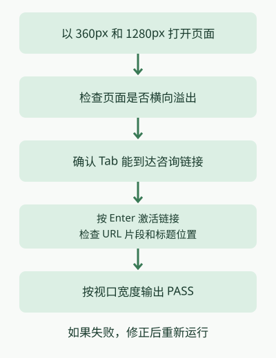

---
{
  "schemaVersion": 1,
  "state": "draft",
  "language": "zh-CN",
  "translationKey": "2026-11-19-website-building-agent-skills",
  "title": "用 Claude Code 和 Codex 制作网站：从规划到部署的技能",
  "description": "比较用 Claude Code 和 Codex 搭建展示网站与 Web 应用所需的技能，并通过分步骤示例覆盖界面实现、Playwright 验证和部署检查。",
  "sourcePath": "src/content/posts/en/2026-11-19-website-building-agent-skills.md",
  "sourceSha256": "5a054cc2358bab13553028e7a2e4183feefa7849d49e57e026c8849e15dd65df"
}
---

如果要搭建小型企业网站，可以先**整理文案和页面结构，实现界面，再用浏览器验证访客能否找到咨询入口**。有登录或支付的 Web 应用，则要先设计权限、数据存储和故障恢复。明确网站类型后，就能具体确定需要哪些技能，以及如何判断结果。

本文按阶段选出候选技能，依据是 2026年11月19日查阅的 Anthropic、OpenAI 和 Vercel 官方技能源文件。示例以在 Claude Code 和 Codex CLI 中把任务交给代理为背景。 [Anthropic 技能合集](https://github.com/anthropics/skills) · [OpenAI Build Web Apps](https://github.com/openai/plugins/tree/main/plugins/build-web-apps) · [Vercel Agent Skills](https://github.com/vercel-labs/agent-skills)

## 按网站类型选择技能

| 制作对象 | 优先确定的内容 | 基本组合 |
| --- | --- | --- |
| 展示网站、作品集、博客 | 访客、关键操作、公开页面、内容更新方式 | 页面文案 → 界面实现 → 浏览器测试 → 部署检查 |
| 预订、支付、后台管理 Web 应用 | 不同用户的权限、要保存的数据、成功及失败处理、运行记录 | 界面与状态设计 → 界面和服务器实现 → 测试正常与失败流程 → 预览 → 生产环境检查 |

如果已有代码仓库，先确认项目使用的框架和部署方法。例如，要在 Astro 博客中添加文章和咨询链接，可以沿用现有架构。确实用到相关技术或功能时，再选择 React、Next.js 性能技能或支付技能。

| 阶段 | 推荐技能或依据 | 委托工作与验证方式 |
| --- | --- | --- |
| 规划与文案 | 项目内的 `website-copywriting` 指南 | 确定目标访客和关键操作，撰写标题、说明和咨询文案。阅读首屏，确认信息是否说清服务对象及服务内容。 |
| 界面设计 | 项目内的 `frontend-architecture-design` 指南 | 确定页面路径、组件和状态的归属、成功和错误界面。在预订应用中，设计如何处理提交期间的重复点击，以及保存失败后的重试。 |
| 界面实现 | [Claude Code 的 `frontend-design`](https://github.com/anthropics/skills/tree/main/skills/frontend-design) 或 [Codex 的 `frontend-app-builder`](https://github.com/openai/plugins/tree/main/plugins/build-web-apps/skills/frontend-app-builder) | 用现有项目组件实现获批的文案和页面结构。确认页面变窄时，标题、操作按钮和正文仍能依次阅读。 |
| 浏览器验证 | [Claude Code 的 `webapp-testing`](https://github.com/anthropics/skills/tree/main/skills/webapp-testing)、[Codex 的 `frontend-testing-debugging`](https://github.com/openai/plugins/tree/main/plugins/build-web-apps/skills/frontend-testing-debugging) | 在移动视口检查咨询链接、表单错误和控制台。记录检查使用的 URL、视口尺寸、实际复现步骤和结果。 |
| 无障碍审查 | [Vercel 的 `web-design-guidelines`](https://github.com/vercel-labs/agent-skills/tree/main/skills/web-design-guidelines) | 从代码中检查标签、对比度及焦点，再在浏览器里检查键盘操作顺序和焦点显示。记录自动检查结果和人工检查。 |
| React 性能 | [Build Web Apps 的 `react-best-practices`](https://github.com/openai/plugins/tree/main/plugins/build-web-apps/skills/react-best-practices) | 检查 React、Next.js 项目中的串行数据请求和初始打包体积。在同一环境测量修改前后，再判断改进效果。 |
| 部署 | [Vercel 的 `deployments-cicd`](https://github.com/openai/plugins/tree/main/plugins/vercel/skills/deployments-cicd) 或项目部署指南 | 先在相应托管平台确认预览或预发布 URL，再部署获批版本。记录最终 URL 和可回滚的版本。 |

表中的前两项是可以在项目内定义的角色示例。使用公开技能时，请按维护团队提供的路径安装。在 Claude Code 中，Anthropic 官方市场的 `example-skills` 包括界面实现与测试技能。在 Codex 中，**Build Web Apps** 插件包含界面实现、测试和 React 优化技能。托管在 Vercel 时使用 Vercel 部署技能，使用 GitHub Pages 时则遵循仓库的 Actions 和预览流程。 [Claude Code 安装指南](https://github.com/anthropics/skills#claude-code) · [OpenAI Build Web Apps 插件内容](https://github.com/openai/plugins/blob/main/plugins/build-web-apps/README.md)

## 小型网站如何衔接不同技能

制作请求不必很长。像下面这样提供服务信息、页面结构和需要验证的操作，就能在规划、实现和测试阶段采用同一套标准。

> 为一家虚构的摄影工作室制作展示页面。\
> 访客想了解拍摄地点和咨询方式。\
> 在同一页面布置简介和咨询说明，将首屏的“咨询”链接\
> 连到页面内的咨询说明。按简介、咨询链接、咨询说明的顺序排列。\
> 考虑 360px 窄屏和键盘操作。\
> 实现后，检查 360px 和 1280px 下是否有横向溢出，\
> 用 Tab 移到咨询链接，再按 Enter 打开咨询说明。\
> 记录每一步的结果和未能验证的项目。

把简介和咨询链接交给界面实现阶段，将视口大小和键盘条件用作测试判定标准。如果测试失败，把失败时的视口宽度和操作交给负责实现的代理。修复后用相同条件重新运行。无障碍审查还可检查对比度、屏幕阅读器读出的名称，以及进入其他页面后的焦点位置。

## 练习：用 Playwright 检查咨询流程

将网站的一页放入测试文件，在浏览器中用两种视口宽度检查。在新目录准备 Node.js 22 和 Chrome。运行 `npm init -y`，再用 `npm install --save-dev playwright-core@1.64.1` 安装依赖。将以下代码保存为 `website-check.mjs`，在 macOS 上运行 `node website-check.mjs`。Chrome 安装位置不同时，把可执行文件路径设到 `CHROME_PATH`。 [Playwright 浏览器启动选项](https://playwright.dev/docs/api/class-browsertype#browser-type-launch)



```js
import assert from 'node:assert/strict';
import { chromium } from 'playwright-core';

const html = `<!doctype html>
<html lang="ko">
<meta charset="utf-8">
<meta name="viewport" content="width=device-width, initial-scale=1">
<title>봄 사진 스튜디오</title>
<style>
  body { margin: 0; font: 1rem/1.6 system-ui; }
  main { max-width: 42rem; margin: auto; padding: 1rem; }
  section { min-height: 74vh; }
</style>
<main>
  <section>
    <h1>봄 사진 스튜디오</h1>
    <p>프로필 사진과 가족사진을 촬영합니다.</p>
    <a href="#contact">문의하기</a>
  </section>
  <section id="contact">
    <h2>상담 안내</h2>
    <p>촬영 목적과 희망 일정을 준비해 주세요.</p>
  </section>
</main>
</html>`;

const browser = await chromium.launch({
  executablePath: process.env.CHROME_PATH
    ?? '/Applications/Google Chrome.app/Contents/MacOS/Google Chrome',
});

try {
  for (const width of [360, 1280]) {
    const page = await browser.newPage({ viewport: { width, height: 700 } });
    try {
      await page.setContent(html);
      const overflow = await page.evaluate(
        () => document.documentElement.scrollWidth > window.innerWidth,
      );
      assert.equal(overflow, false, `가로 넘침: ${width}px`);

      await page.keyboard.press('Tab');
      const focused = await page.evaluate(
        () => document.activeElement?.getAttribute('href'),
      );
      assert.equal(focused, '#contact', `문의 링크 포커스: ${width}px`);
      await page.keyboard.press('Enter');
      await page.waitForURL(/#contact$/);
      const heading = await page.getByRole('heading', { name: '상담 안내' }).boundingBox();
      assert.ok(heading && heading.y >= 0 && heading.y + heading.height <= 700);
      console.log(`PASS ${width}px: no overflow, keyboard link reaches contact`);
    } finally {
      await page.close();
    }
  }
} finally {
  await browser.close();
}
```

下面是运行结果。每项 `PASS` 都表示页面没有横向溢出，且用键盘移到咨询链接并激活后，咨询说明的标题出现在视口中。

```text
PASS 360px: no overflow, keyboard link reaches contact
PASS 1280px: no overflow, keyboard link reaches contact
```

在实际项目里，启动本地服务器，用 `page.goto()` 打开实现后的页面，替代测试用的 HTML 字符串。对于咨询表单，要单独加入缺少必填字段、提交失败后保留输入、以及成功消息的检查。将咨询链接改为指向另一个 URL 片段时，360px 下的链接检查失败。上面的示例在 Chrome 中用两个视口宽度检查了一个练习用 HTML 页面。

## 部署后要检查的项目

在预览和生产 URL 重新打开主要页面，走一遍咨询流程，确认服务器响应和静态资源正常。准备公开给搜索引擎的页面还要检查文档标题与描述、规范网址、内部链接和站点地图。生产 URL 能打开后，还要另用 Search Console 确认搜索引擎是否实际发现并编入索引。 [Google SEO 入门指南](https://developers.google.com/search/docs/fundamentals/seo-starter-guide)
