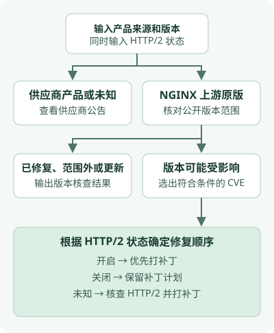

---
{
  "schemaVersion": 1,
  "state": "draft",
  "language": "zh-CN",
  "translationKey": "2026-11-21-nginx4shell-http2",
  "sourcePath": "src/content/posts/en/2026-11-21-nginx4shell-http2.md",
  "sourceSha256": "51daac7a022b582074f762f0ce0c07d617f4af8535152688b060235117af16c2",
  "title": "Nginx4Shell 应对指南——NGINX HTTP/2 漏洞的受影响版本与补丁核查",
  "description": "了解 NGINX HTTP/2 漏洞 CVE-2026-123007 和 CVE-2026-123633 的影响条件、修复版本和临时缓解措施，并用 Python 示例确定补丁优先级。"
}
---

**先排查接收 HTTP/2 流量的 NGINX 监听端点。** 2026年11月18日披露的 CVE-2026-123007 和 CVE-2026-123633 可能在处理 HTTP/2 时引发内存损坏，视具体条件而定，工作进程可能崩溃，也可能被用于以工作进程权限远程执行代码。NGINX 开源版的修复版本是 stable **1.30.7** 和 mainline **1.31.9**。对于发行版软件包、NGINX Plus 或 Ingress 产品，请以各供应商公布的修复版本为准。 [NGINX 安全公告](https://nginx.org/en/security_advisories.html) · [F5 11月18日安全更新](https://my.f5.com/s/article/K000164058)

## 哪些部署环境会受影响？

本文用 **Nginx4Shell** 作为便于检索的别名。在变更工单和资产清单中应分别填写两个 CVE 编号，才能准确核对各产品的公告和补丁状态。

| CVE | 触发条件和影响 | 受影响的 NGINX 开源版 |
| --- | --- | --- |
| CVE-2026-123007 | NGINX 处理客户端 HTTP/2 流量时可能发生内存损坏。只提供静态内容的服务器如果启用了 HTTP/2，也应纳入排查。 | 1.9.5～1.30.6 和 1.31.0～1.31.8 |
| CVE-2026-123633 | NGINX 向上游转发客户端的 HTTP/2 请求时，在一定条件下可能访问已释放的内存。应优先排查 HTTP/2 反向代理。 | 1.19.7～1.30.6 和 1.31.0～1.31.8 |

stable 分支中的 1.30.7 修复了两个漏洞。版本号高于 1.30.7 的 **1.31.8 仍在受影响范围内**。此次更新还包含 HTTP/3、DNS 解析器和邮件代理等组件的修复。通过调整 HTTP/2 配置临时缓解时，也应继续准备安装产品补丁。 [NGINX 版本公告](https://nginx.org/news.html) · [F5 CVE-2026-123007](https://my.f5.com/s/article/K000163926) · [F5 CVE-2026-123633](https://my.f5.com/s/article/K000163928) · [CERT-EU 安全建议](https://cert.europa.eu/publications/security-advisories/2026-022)

## 确认运行中的产品和 HTTP/2 链路

1. **确认运行中二进制文件的来源。** 在虚拟机上，检查服务使用的可执行文件和软件包。在容器中，检查正在运行的镜像及其摘要。在对应环境运行 `nginx -V` 可以查看版本和构建选项。Ubuntu 24.04 LTS 等发行版会把修复移植到已有版本。Ubuntu 公告列出的该发行版修复包为 `1.24.0-2ubuntu7.20`。 [NGINX 命令行参数](https://nginx.org/en/docs/switches.html) · [Ubuntu USN-9159-1](https://ubuntu.com/security/notices/USN-9159-1)
2. **检查客户端或前置代理到 NGINX 的链路。** 即使浏览器通过 HTTP/2 连接 CDN，CDN 回源至 NGINX 时也可能使用其他协议。用 `nginx -T` 检查运行中服务的实际配置，核对 `http` 和 `server` 配置块、包含的文件以及使用的语法。完整配置可能含有内部地址或机密信息，应在获授权的环境中检查。 [NGINX HTTP/2 模块文档](https://nginx.org/en/docs/http/ngx_http_v2_module.html)
3. **先修复可接收外部请求的受影响实例。** 部署后，确认运行中的进程已使用新的二进制文件或镜像。运行 `nginx -t` 检查配置，并验证服务能正常响应合法 HTTP 请求，同时查看上游健康状态、错误率及工作进程重启情况。对于集群，还需确认是否仍有副本运行旧镜像。 [CERT-EU 安全建议](https://cert.europa.eu/publications/security-advisories/2026-022)

如果无法立即更新，可以在受影响的监听端点禁用 HTTP/2，以降低两个漏洞的暴露风险。当前语法使用 `http2 off;`，旧语法需删除 `listen` 上的 `http2` 选项。变更前检查 gRPC 等依赖 HTTP/2 的链路，变更后实际连接相关端点并验证正常业务请求。 [NGINX HTTP/2 配置文档](https://nginx.org/en/docs/http/ngx_http_v2_module.html) · [Red Hat 缓解指南](https://access.redhat.com/security/vulnerabilities/RHSB-2026-019)

## 实操——根据排查结果确定补丁优先级

本示例以运维人员确认的**产品来源、版本和 HTTP/2 状态**为输入。它需要 Python 3.10 或更高版本，仅使用标准库。可将前述排查结果用于确定补丁优先级。



将脚本保存为 `nginx_http2_triage.py`。仅对 NGINX 项目发布的开源原版选用 `upstream`。有回移补丁的发行版软件包或供应商镜像选用 `vendor`。若尚未确认产品来源或监听端点的实际配置，请将相应输入设为 `unknown`。

```python
import argparse
import re


def upstream_version(value: str) -> tuple[int, int, int]:
    if not re.fullmatch(r"[0-9]{1,4}\.[0-9]{1,4}\.[0-9]{1,4}", value):
        raise argparse.ArgumentTypeError("use an upstream version such as 1.30.7")
    major, minor, patch = map(int, value.split("."))
    return major, minor, patch


def triage(origin: str, value: str, http2: str) -> str:
    if origin != "upstream":
        return "CHECK_VENDOR_ADVISORY"

    version = upstream_version(value)
    if version[0] != 1 or version > (1, 31, 9):
        return "CHECK_CURRENT_ADVISORY"
    if (1, 30, 7) <= version < (1, 31, 0) or version == (1, 31, 9):
        return "UPSTREAM_FIX_VERSION"

    affected = [
        cve
        for cve, first_version in (
            ("CVE-2026-123007", (1, 9, 5)),
            ("CVE-2026-123633", (1, 19, 7)),
        )
        if version >= first_version
    ]
    if not affected:
        return "OUTSIDE_LISTED_RANGES"

    action = {
        "on": "PRIORITIZE_PATCH",
        "off": "PATCH_STILL_REQUIRED",
        "unknown": "VERIFY_HTTP2_AND_PATCH",
    }[http2]
    return f"{action} {' '.join(affected)}"


def main() -> None:
    parser = argparse.ArgumentParser()
    parser.add_argument("origin", choices=("upstream", "vendor", "unknown"))
    parser.add_argument("version")
    parser.add_argument("http2", choices=("on", "off", "unknown"))
    args = parser.parse_args()
    try:
        print(triage(args.origin, args.version, args.http2))
    except argparse.ArgumentTypeError as error:
        parser.error(str(error))


if __name__ == "__main__":
    main()
```

```bash
python3 nginx_http2_triage.py upstream 1.31.8 on
python3 nginx_http2_triage.py upstream 1.30.7 on
python3 nginx_http2_triage.py upstream 1.19.6 unknown
python3 nginx_http2_triage.py vendor 1.24.0-2ubuntu7.20 on
```

在 Python 3.13.0 中运行上述命令，得到以下输出。

```text
PRIORITIZE_PATCH CVE-2026-123007 CVE-2026-123633
UPSTREAM_FIX_VERSION
VERIFY_HTTP2_AND_PATCH CVE-2026-123007
CHECK_VENDOR_ADVISORY
```

输出的 CVE 列表表示**根据版本判定的潜在影响**。要确定是否符合 CVE-2026-123633 的上游转发条件，还需核查实际的监听配置。示例仅依据输入值和公开的版本范围分类，生产环境的配置与补丁状态需另行核查。
