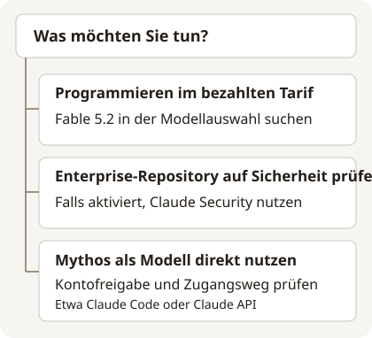

---
{
  "state": "draft",
  "language": "de",
  "translationKey": "2026-11-22-claude-mythos-availability",
  "title": "Wo lässt sich Claude Mythos 5.2 nutzen? Claude Security, Claude Code und die API",
  "description": "Die Voraussetzungen für direkten Zugriff auf Mythos 5.2, Enterprise-Code-Scans mit Claude Security und die Nutzung von Fable 5.2 in kostenpflichtigen Claude-Tarifen.",
  "sourcePath": "src/content/posts/en/2026-11-22-claude-mythos-availability.md",
  "sourceSha256": "03f809cd5ff47c9929524f940e1ebf683dc5e75760fb062cfdb425ffbf4ff424"
}
---

**Der direkte Zugriff auf Claude Mythos 5.2 setzt eine Genehmigung in einem Verifizierungsprogramm von Anthropic voraus.** Einzelpersonen mit einem berechtigten Tarif können nach erfolgreicher Prüfung im Cyber Verification Program (CVP) Defense Access erhalten. Organisationen mit Claude Enterprise können Claude Security aktivieren. Der Dienst scannt Code mit Mythos 5.2. Fable 5.2 ist in den kostenpflichtigen Claude-Tarifen allgemein verfügbar. Welche Nutzungsguthaben erforderlich sind, hängt vom Tarif oder von der Lizenz ab. Dieser Leitfaden gibt den Stand der öffentlichen Dokumentation vom 22. November 2026 wieder. [Ankündigung zu 5.2 von Anthropic](https://www.anthropic.com/claude-fable-and-mythos-5-2#availability) · [Claude-Hilfe zu den erfassten Modellen](https://support.claude.com/en/articles/15425695-covered-models) · [Cyber Verification Program](https://support.claude.com/en/articles/14604842-cyber-verification-program)

## Welcher Zugang passt zu Ihrer Aufgabe?



| Aufgabe | Wo Sie nachsehen können | Voraussetzungen |
| --- | --- | --- |
| Ein Modell der Version 5.2 zum Programmieren oder Schreiben nutzen | Modellauswahl in Claude im Web, auf dem Desktop oder auf dem Mobilgerät oder in Claude Code | Fable 5.2 ist in kostenpflichtigen Tarifen verfügbar. Nutzungsguthaben richten sich nach Tarif und Lizenz. |
| Ein Unternehmens-Repository mit Mythos auf Sicherheitsprobleme prüfen | Claude Security in der Webversion von Claude | Öffentliche Beta für Enterprise. Ihre Organisation muss die Funktion aktivieren, und Ihre Lizenz muss Claude Code umfassen. |
| Mythos direkt als Modell in Claude Code oder der Claude API verwenden | Modellberechtigungen Ihres Kontos oder der für die API genutzte Arbeitsbereich | Eine Genehmigung im Verifizierungsprogramm ist erforderlich. Einzelpersonen mit berechtigtem Tarif können Defense Access beantragen. |

**Mythos Preview** war die Forschungsvorschau, die Anthropic im April 2026 Organisationen in Project Glasswing bereitstellte. **Mythos 5.2** stellte Anthropic am 9. November vor. Achten Sie beim Vergleich von Berichten zur Verfügbarkeit auf das Datum und die Modellversion. [Ankündigung zu Project Glasswing](https://www.anthropic.com/project/glasswing) · [Modellseite von Claude Mythos](https://www.anthropic.com/claude/mythos)

## Wo Enterprise Mythos einsetzt

**Claude Security nutzt Mythos 5.2, um Repositories zu scannen.** So kann ein Team etwa eine fehlende Berechtigungsprüfung in einem internen Webdienst markieren lassen und anschließend den Nachweis und den Korrekturvorschlag prüfen. Anthropic bietet Claude Security auch Enterprise-Kunden außerhalb des Cyber Verification Program an. Jede Person benötigt eine Lizenz mit Claude Code. In Enterprise-Tarifen mit Abrechnung pro Lizenz müssen außerdem Nutzungsguthaben aktiviert sein. Ein Organisationsinhaber mit einer Lizenz für Claude Code aktiviert die Funktion unter `Organization settings → Claude Security`. [Ankündigung zur Einführung von Anthropic](https://www.anthropic.com/claude-fable-and-mythos-5-2) · [Voraussetzungen für Claude Security](https://support.claude.com/en/articles/14661296-use-claude-security)

Sie können einen Befund in Claude Code öffnen und dort an einer Korrektur arbeiten. **Der Scan und die Claude-Code-Sitzung haben getrennte Modellberechtigungen.** Der Scan verwendet Mythos. Die Claude-Code-Sitzung verwendet die für Ihr Konto freigegebenen Modelle. Daher kann Claude Security für Enterprise-Nutzer sichtbar sein, obwohl in der regulären Chat-Modellauswahl kein Mythos erscheint. [Produktseite zu Claude Security](https://claude.com/product/claude-security) · [Modellkonfiguration für Claude Code](https://code.claude.com/docs/en/model-config)

## Fable 5.2 im Einzeltarif finden

Laut Anthropic liegt Fable 5.2 und Mythos 5.2 dasselbe Basismodell zugrunde. Fable hat zusätzliche Schutzmaßnahmen für Cybersicherheit und Lebenswissenschaften. Mit einem kostenpflichtigen Einzeltarif können Sie Fable 5.2 für allgemeine Entwicklungsaufgaben einsetzen, etwa um ein Repository zu verstehen oder ein Refactoring zu planen. Für Pro und einige Standardlizenzen sind von Anfang an Nutzungsguthaben erforderlich. [Modellankündigung von Anthropic](https://www.anthropic.com/claude-fable-and-mythos-5-2) · [Fable-Verfügbarkeit nach Tarif](https://support.claude.com/en/articles/15424964-claude-fable-models-on-your-plan)

Suchen Sie in der Webversion, der Desktop-App oder der mobilen App in der Modellauswahl nach `Fable 5.2`. Wenn Sie Claude Code im Terminal verwenden, prüfen Sie zuerst, ob mindestens Version **2.1.321** installiert ist. Öffnen Sie dann in einer Sitzung `/model`, um die verfügbaren Modelle zu sehen. [Claude-Hilfe zu den Tarifen](https://support.claude.com/en/articles/15424964-claude-fable-models-on-your-plan) · [Modellkonfiguration für Claude Code](https://code.claude.com/docs/en/model-config)

```sh
claude --version
```

In der Claude API können Sie die Modell-ID von Fable über eine Metadatenabfrage prüfen. Das Beispiel verwendet eine Shell mit `curl`. Der API-Schlüssel für den betreffenden Arbeitsbereich muss bereits in `ANTHROPIC_API_KEY` gesetzt sein. Bei Erfolg sollte die Antwort den Wert `claude-fable-5-2` für `id` enthalten. Das Anfrageformat wurde mit der offiziellen Referenz abgeglichen und die Shell-Syntax lokal geprüft. Das Verhalten von Claude nach der Authentifizierung, einschließlich der Metadatenantwort und der Modellauswahl, wurde nicht getestet. [Claude-API-Referenz zur Modellabfrage](https://platform.claude.com/docs/en/api/models/retrieve)

```sh
curl --fail-with-body --silent --show-error \
  'https://api.anthropic.com/v1/models/claude-fable-5-2' \
  -H 'anthropic-version: 2026-10-21' \
  -H "Authorization: Bearer ${ANTHROPIC_API_KEY}"
```

## Direkten Zugriff auf Mythos prüfen

Laut dem Hilfeartikel zum Cyber Verification Program können Einzelpersonen wie unabhängige Sicherheitsforscher und Maintainer von Open-Source-Projekten mit berechtigten Tarifen wie Pro, Max und Ultra **Defense Access** beantragen. Diese Zugriffsstufe umfasst Mythos 5.2 für zugelassene Teilnehmende. Ein kostenpflichtiges Abonnement allein gewährt keinen Zugriff. Anthropic hat ein separates Verifizierungsprogramm für die Forschung in den Lebenswissenschaften. [Hilfe zum Cyber Verification Program](https://support.claude.com/en/articles/14604842-cyber-verification-program) · [Ankündigung zur Verfügbarkeit von Anthropic](https://www.anthropic.com/claude-fable-and-mythos-5-2#availability)

In der Claude-API-Dokumentation lautet die Modell-ID für Mythos 5.2 `claude-mythos-5-2`. Die Verfügbarkeit hängt von den Berechtigungen Ihres Kontos oder Ihrer Organisation und vom Zugangsweg ab. Die Zugriffsrechte für Claude und Claude Console werden getrennt verwaltet. Rechte in der Console gelten für den zugewiesenen Arbeitsbereich. Wer einen Cloud-Anbieter nutzt, sollte auch das verknüpfte Cloud-Konto und die Unterstützung durch den Anbieter prüfen. [Modellleitfaden für die Claude API](https://platform.claude.com/docs/en/models/fable-5-2/migration-guide) · [Claude-Hilfe zu Tarifen, Arbeitsbereichen und Cloud-Konten](https://support.claude.com/en/articles/14604842-cyber-verification-program)
