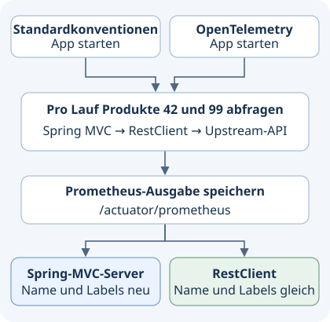

---
{
  "state": "draft",
  "language": "de",
  "translationKey": "2026-11-22-spring-boot-4-2-otel-http-metrics",
  "title": "Wie OpenTelemetry-Konventionen HTTP-Metriken in Spring Boot 4.2 verändern",
  "description": "Die Prometheus-Metriken von Spring MVC und RestClient in Spring Boot 4.2.0 vergleichen und eine 404-Abfrage an die OpenTelemetry-Konventionen anpassen.",
  "sourcePath": "src/content/posts/en/2026-11-22-spring-boot-4-2-otel-http-metrics.md",
  "sourceSha256": "184d3ca3476cfc05571ad97d60ef35f2d4c93f54cb152df388401376edc0ef57"
}
---

**Wenn Sie in Spring Boot 4.2.0 die Observation-Konventionen von OpenTelemetry aktivieren, wechselt die Prometheus-Metrik des Spring-MVC-Servers von `http_server_requests_seconds_count` zu `http_server_request_duration_seconds_count`.** Das Label für 404-Antworten wechselt ebenfalls, von `status` zu `http_response_status_code`. In derselben Anwendung behielten die Aufrufe der Upstream-API mit `RestClient` den bisherigen Metriknamen und die bisherigen Labels. Prüfen Sie beim Aktualisieren von Dashboards und Alarmen eingehende und ausgehende Anfragen getrennt. [Versionshinweise zu Spring Boot 4.2](https://github.com/spring-projects/spring-boot/wiki/Spring-Boot-4.2-Release-Notes#semantic-conventions)

## Dieselben beiden Anfragen mit beiden Konfigurationen ausführen

Verwenden Sie das [Beispiel zur Produktabfrage aus dem vorherigen Leitfaden](/en/posts/2026-11-22-spring-boot-4-2-restclient-migration/). Wenn die App `GET /products/{id}` empfängt, fragt sie die Upstream-API mit `RestClient` über `GET /items/{id}` ab. In diesem Beispiel liefert die ID `42` den Status `200` und den Produktnamen `Keyboard`. Für die ID `99` folgt ein `404` mit leerem Antwortinhalt.



Das Diagramm zeigt beide Läufe. Schicken Sie bei jedem Lauf dieselben Anfragen und sichern Sie die Prometheus-Ausgabe separat für den Vergleich.

Verwenden Sie Spring Boot 4.2.0 und JDK 21. Kopieren Sie `pom.xml` und `src/main/java/example/CatalogApplication.java` aus dem vorherigen Leitfaden. Entfernen Sie die Abhängigkeit `spring-boot-starter-webmvc-test`, die dieses Beispiel nicht benötigt, und ergänzen Sie die folgenden beiden Abhängigkeiten in Maven. `CatalogApplication.java` verwendet bereits den von Boot konfigurierten `RestClient.Builder` per Injection. [Spring-Boot-Dokumentation zu HTTP-Client-Metriken](https://docs.spring.io/spring-boot/reference/actuator/metrics.html#actuator.metrics.supported.http-clients)

```xml
<dependency>
    <groupId>org.springframework.boot</groupId>
    <artifactId>spring-boot-starter-actuator</artifactId>
</dependency>
<dependency>
    <groupId>io.micrometer</groupId>
    <artifactId>micrometer-registry-prometheus</artifactId>
</dependency>
```

Damit die Anwendung als ausführbare JAR-Datei gebaut wird, fügen Sie in `pom.xml` unter `<project>` diese Konfiguration hinzu.

```xml
<build>
    <plugins>
        <plugin>
            <groupId>org.springframework.boot</groupId>
            <artifactId>spring-boot-maven-plugin</artifactId>
        </plugin>
    </plugins>
</build>
```

Starten Sie in einem Terminal einen lokalen Server, der die Upstream-API ersetzt. Er liefert die Datei unter `/items/42`. Für `/items/99` liefert er 404, weil die Datei fehlt. Verwenden Sie eine lokale Entwicklungsumgebung, in der beide Ports frei sind.

```sh
upstream_dir=$(mktemp -d)
mkdir -p "$upstream_dir/items"
printf '%s' Keyboard > "$upstream_dir/items/42"
python3 -m http.server 18081 --bind 127.0.0.1 --directory "$upstream_dir"
```

Bauen Sie die App in einem anderen Terminal im Maven-Projektstamm und starten Sie sie mit den Standardkonventionen. Geben Sie den Actuator-Endpunkt für den Abruf frei und binden Sie die App an die Loopback-Adresse.

```sh
mvn package

java -jar target/restclient-migration-1.0.0.jar \
  --server.address=127.0.0.1 \
  --server.port=18080 \
  --catalog.base-url=http://127.0.0.1:18081 \
  --management.endpoints.web.exposure.include=health,prometheus
```

Senden Sie nach dem Start der App die folgenden Anfragen aus einem dritten Terminal. Prüfen Sie beide Antworten und sichern Sie dann die Prometheus-Ausgabe mit den `_count`-Zeitreihen für die kumulierten Anfragezahlen.

```sh
curl -sS -i http://127.0.0.1:18080/products/42
curl -sS -i http://127.0.0.1:18080/products/99
curl -fsS http://127.0.0.1:18080/actuator/prometheus > default.prom
```

Beenden Sie die App und starten Sie sie mit demselben `java -jar`-Befehl und der zusätzlichen Option `--management.observations.conventions=open-telemetry` neu. Führen Sie alle drei Anfragen erneut aus und speichern Sie die letzte Antwort als `open-telemetry.prom`. Ein neuer Prozess setzt die Zähler des ersten Laufs zurück.

```sh
grep -E '^http_(server|client).*_count\{.*(/products/|/items/)' \
  default.prom open-telemetry.prom
```

## Was sich in den erfassten Metriken geändert hat

Ich habe beide Konfigurationen mit JDK 21.0.1, Maven 3.9.11, Spring Boot 4.2.0 und eingebettetem Tomcat ausgeführt. Jeder Lauf umfasste eine Anfrage mit Status `200` und eine mit Status `404`. Bei allen vier Antworten entsprachen Status und Inhalt den Erwartungen.

| Metrik des MVC-Servers | Standardkonventionen | OpenTelemetry-Konventionen |
| --- | --- | --- |
| Prometheus-Anfragezähler | `http_server_requests_seconds_count` | `http_server_request_duration_seconds_count` |
| Label für HTTP-Methode | `method` | `http_request_method` |
| Label für Antwortstatus | `status` | `http_response_status_code` |
| Label für Route | `uri` | `http_route` |
| Routenwert in diesem Beispiel | `/products/{id}` | `/products/{id}` |

Das Routenlabel enthält die Routenvorlage mit `{id}`. Der Auszug zeigt die erfassten 404-Zeitreihen mit den für die Abfragen verwendeten Labels. Der serverseitige Zähler für 404 lag in jedem Lauf bei `1`.

```text
http_server_requests_seconds_count{status="404",uri="/products/{id}"} 1
http_server_request_duration_seconds_count{http_response_status_code="404",http_route="/products/{id}"} 1
```

In denselben Ausgaben erfassten beide Konfigurationen ausgehende Anfragen unter `http_client_requests_seconds_count` mit `method="GET"`, `uri="/items/{id}"` und entweder `status="200"` oder `status="404"`. Das Ergebnis gilt für die in diesem Beispiel verwendete Kombination aus Boot-Autokonfiguration und `RestClient.Builder`. Die Metriken stammen aus der Prometheus-Registry von Micrometer. Die Wahl der Beobachtungskonvention und der Datenexport sind getrennte Einstellungen. [Spring-Boot-Dokumentation zu Observability](https://docs.spring.io/spring-boot/reference/actuator/observability.html#actuator.observability.semantic-conventions)

## Die 404-Abfrage aktualisieren

Ein Grafana-Panel mit Standardkonventionen kann die kumulierte Zahl der 404-Antworten für diese Route wie folgt abfragen.

```text
sum(http_server_requests_seconds_count{uri="/products/{id}",status="404"})
```

Für OpenTelemetry-Konventionen ändern Sie den Metriknamen und beide Labels.

```text
sum(http_server_request_duration_seconds_count{http_route="/products/{id}",http_response_status_code="404"})
```

Ich habe die Abfragen mit den erfassten Zeitreihen und `promtool` aus Prometheus 3.5.0 getestet. Jede Abfrage lieferte `1` mit der passenden Konvention und ein leeres Ergebnis mit der jeweils anderen.

Die Abfragen vergleichen kumulierte Zähler für eine einzelne Anwendung. Wenn ein Produktionspanel Anfragen pro Sekunde für ein Zeitfenster anzeigt, behalten Sie die bestehende Berechnung wie `rate(...[5m])` bei und aktualisieren den darin enthaltenen Metrikselektor. Solange Prometheus alte und neue Versionen gleichzeitig abruft, prüfen Sie pro Deployment-Ziel, welches Ziel welchen Namen meldet. [Grundlagen zu Prometheus-Abfragen](https://prometheus.io/docs/prometheus/latest/querying/basics/) · [Prometheus-Dokumentation zu `rate()`](https://prometheus.io/docs/prometheus/latest/querying/functions/#rate)

Falls Sie den Server-Metriknamen über `management.observations.http.server.requests.name` festlegen, prüfen Sie zuerst die Panels und Alarme, die den benutzerdefinierten Namen verwenden. Diese Einstellung wirkt sich unter den OpenTelemetry-Konventionen nicht aus. Um eine einzelne Anfrage von den Metriken zu Logs und Traces zu verfolgen, lesen Sie [Logs und Traces in Grafana LGTM verknüpfen](/en/posts/2026-11-02-grafana-lgtm-log-trace/). [Versionshinweise zu Spring Boot 4.2](https://github.com/spring-projects/spring-boot/wiki/Spring-Boot-4.2-Release-Notes#semantic-conventions)
