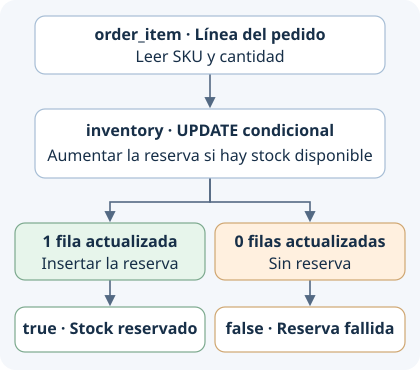

---
{
  "state": "draft",
  "language": "es",
  "translationKey": "2026-11-22-commerce-database-design",
  "title": "Diseño de una base de datos de comercio electrónico para SKU, pedidos, inventario y pagos",
  "description": "Modela los SKU, los precios registrados al comprar, las reservas de inventario y los intentos de pago en PostgreSQL. Después haz que dos sesiones compitan por la última unidad.",
  "sourcePath": "src/content/posts/en/2026-11-22-commerce-database-design.md",
  "sourceSha256": "da573ac023d969b02216c24993c872e842a6693607f8e3805fd988ce7d64bcf3"
}
---

**Una base de datos de comercio electrónico debe conservar las condiciones vigentes del catálogo, los importes acordados al comprar, el stock reservado para cada pedido y los resultados del proveedor de pagos.** El total del pedido de ayer debe seguir siendo correcto aunque mañana cambie el precio. Si hoy queda una sola unidad, solo uno de dos pedidos concurrentes debe poder reservarla. El ejemplo de PostgreSQL muestra qué tablas y restricciones permiten cumplir ambos requisitos.

La guía parte del [ejemplo de la última unidad del artículo anterior](/en/posts/2026-11-22-commerce-system-design-last-unit-of-stock/). Supone un único comerciante de productos físicos, un almacén y pagos en wones surcoreanos (KRW). El inventario y los pedidos comparten una base de datos. Las devoluciones posteriores al envío y la liquidación tienen sus propios modelos de negocio.

## Empieza por lo que necesitas registrar para una compra

| Pregunta | Tablas que se consultan o modifican | Claves y valores |
| --- | --- | --- |
| ¿Cuánto cuesta ahora el teclado negro? | `product` → `sku` | ID de producto, SKU a la venta y precio actual |
| ¿Por qué cobramos 43.000 KRW por el pedido de ayer? | `orders` → `order_item` | ID de pedido, cantidad acordada, precio unitario, descuento y coste de envío |
| ¿Qué pedido reservó la última unidad? | `inventory`, `stock_reservation` | Stock físico por SKU y una reserva por línea de pedido |
| ¿Cómo encontramos el mismo pago si se pierde la respuesta del proveedor? | `payment_attempt`, `payment_event` | Intento de pago por pedido, ID de transacción del proveedor e ID de evento |

En el ejemplo, `product` es una ficha del catálogo y `sku` una variante que se puede pedir, como el teclado negro. La línea de pedido hace referencia al SKU y **guarda el nombre del artículo, el nombre de la opción y el precio unitario del momento de la compra**. Una unidad a 42.000 KRW, un descuento de 2.000 KRW y 3.000 KRW de envío dan un total de 43.000 KRW. El pedido puede mostrar directamente ese total. La aplicación no modifica las líneas tras crearlas, pues son la base de los importes acordados y de las cantidades reservadas. Para retirar de la venta un SKU usado en una transacción, márcalo como no disponible para la venta. Conserva las filas a las que hacen referencia los pedidos históricos y evita las eliminaciones en cascada en esas relaciones.

## Expresa el modelo con claves y restricciones de PostgreSQL

Ejecuta este DDL una vez en una base de datos de prácticas vacía. El ejemplo asigna los ID de forma explícita y guarda los importes como wones enteros. Al finalizar la compra se combinan las entradas repetidas del mismo SKU en el carrito en una sola línea, así que `(order_id, sku_id)` identifica tanto la línea como su reserva.

```sql
CREATE TABLE product (
    id bigint PRIMARY KEY,
    name text NOT NULL
);

CREATE TABLE sku (
    id bigint PRIMARY KEY,
    product_id bigint NOT NULL REFERENCES product(id),
    code text NOT NULL UNIQUE,
    option_name text NOT NULL,
    current_price_krw bigint NOT NULL CHECK (current_price_krw >= 0),
    sellable boolean NOT NULL
);

CREATE TABLE inventory (
    sku_id bigint PRIMARY KEY REFERENCES sku(id),
    on_hand integer NOT NULL CHECK (on_hand >= 0),
    held integer NOT NULL CHECK (held >= 0),
    allocated integer NOT NULL CHECK (allocated >= 0),
    CHECK (held <= on_hand - allocated)
);

CREATE TABLE orders (
    id bigint PRIMARY KEY,
    customer_id bigint NOT NULL,
    request_key text NOT NULL,
    request_hash text NOT NULL,
    status text NOT NULL CHECK (status IN ('PENDING_PAYMENT', 'CONFIRMED', 'CANCELLED')),
    total_krw bigint NOT NULL CHECK (total_krw >= 0),
    shipping_krw bigint NOT NULL CHECK (shipping_krw >= 0),
    created_at timestamptz NOT NULL DEFAULT now(),
    UNIQUE (customer_id, request_key)
);

CREATE TABLE order_item (
    order_id bigint REFERENCES orders(id),
    sku_id bigint REFERENCES sku(id),
    item_name text NOT NULL,
    option_name text NOT NULL,
    quantity integer NOT NULL CHECK (quantity > 0),
    unit_price_krw bigint NOT NULL CHECK (unit_price_krw >= 0),
    discount_krw bigint NOT NULL CHECK (discount_krw >= 0),
    CHECK (discount_krw <= quantity * unit_price_krw::numeric),
    PRIMARY KEY (order_id, sku_id)
);

CREATE TABLE stock_reservation (
    order_id bigint,
    sku_id bigint REFERENCES inventory(sku_id),
    state text NOT NULL CHECK (state IN ('HELD', 'ALLOCATED', 'RELEASED', 'SHIPPED')),
    expires_at timestamptz NOT NULL,
    PRIMARY KEY (order_id, sku_id),
    FOREIGN KEY (order_id, sku_id) REFERENCES order_item(order_id, sku_id)
);

CREATE TABLE payment_attempt (
    id bigint PRIMARY KEY,
    order_id bigint NOT NULL REFERENCES orders(id),
    attempt_no integer NOT NULL CHECK (attempt_no > 0),
    provider text NOT NULL,
    merchant_account text NOT NULL,
    provider_request_key text NOT NULL,
    provider_payment_id text,
    amount_krw bigint NOT NULL CHECK (amount_krw >= 0),
    state text NOT NULL CHECK (state IN
        ('PENDING', 'UNKNOWN', 'PAID', 'CLOSED_UNPAID', 'REFUND_PENDING', 'REFUNDED')),
    UNIQUE (order_id, attempt_no),
    UNIQUE (provider, merchant_account, provider_request_key),
    UNIQUE (provider, merchant_account, provider_payment_id)
);

CREATE TABLE payment_event (
    provider text,
    merchant_account text,
    event_id text,
    received_at timestamptz NOT NULL DEFAULT now(),
    PRIMARY KEY (provider, merchant_account, event_id)
);

CREATE INDEX orders_customer_history
    ON orders (customer_id, created_at DESC, id DESC);

CREATE INDEX reservation_expiry
    ON stock_reservation (expires_at, order_id, sku_id)
    WHERE state = 'HELD';
```

La restricción `CHECK` impone `held + allocated ≤ on_hand` para cada fila de inventario. Para comprobar que el total del pedido coincide con sus líneas o que las cantidades de las reservas activas suman `held`, hay que leer varias filas. Escribe los totales y las reservas en la transacción que crea el pedido y concilia periódicamente los totales y contadores guardados con los registros subyacentes. [Documentación de PostgreSQL sobre restricciones CHECK](https://www.postgresql.org/docs/17/ddl-constraints.html#DDL-CONSTRAINTS-CHECK-CONSTRAINTS)

Cuando el mismo cliente reenvíe una `request_key`, busca el pedido existente. Si el `request_hash` guardado difiere, trátalo como un conflicto por reutilizar la clave. El ID de transacción del proveedor puede ser desconocido al enviar la solicitud, así que permite `NULL` al principio. Tras asignarse, el ID externo es único por proveedor y cuenta del comerciante. La clave de `payment_event` evita duplicar los eventos recibidos. Un mismo resultado satisfactorio puede llegar con distintos ID de evento. Protege también las solicitudes de preparación de envíos con una clave única por pedido y comprobaciones del estado previo. [Documentación de PostgreSQL sobre restricciones UNIQUE](https://www.postgresql.org/docs/17/ddl-constraints.html#DDL-CONSTRAINTS-UNIQUE-CONSTRAINTS) · [Guía de Stripe sobre webhooks duplicados](https://docs.stripe.com/webhooks#handle-duplicate-events)

## Reserva la última unidad con un UPDATE condicional



El stock disponible es `on_hand - allocated - held`. Con independencia de la cantidad que la tienda haya mostrado antes, el proceso de compra **comprueba el stock e incrementa la cantidad reservada en el mismo UPDATE**. La función inserta una reserva únicamente si la actualización cambia una fila. Si un error de SQL hace fallar la inserción, la misma instrucción revierte el incremento de `held`.

```sql
CREATE FUNCTION reserve_stock(p_order_id bigint, p_sku_id bigint,
                              p_expires_at timestamptz)
RETURNS boolean
LANGUAGE sql
AS $$
    WITH held_stock AS (
        UPDATE inventory AS i
           SET held = i.held + line.quantity
          FROM order_item AS line
         WHERE line.order_id = p_order_id
           AND line.sku_id = p_sku_id
           AND i.sku_id = line.sku_id
           AND i.on_hand - i.allocated - i.held >= line.quantity
         RETURNING i.sku_id
    ), reservation AS (
        INSERT INTO stock_reservation (order_id, sku_id, state, expires_at)
        SELECT p_order_id, sku_id, 'HELD', p_expires_at
        FROM held_stock
        RETURNING 1
    )
    SELECT EXISTS (SELECT 1 FROM reservation);
$$;
```

Al finalizar la compra, crea el pedido y sus líneas, reserva todos los SKU y registra el intento inicial de pago y el trabajo que hay que publicar en una sola transacción. Si la función devuelve `false` para algún artículo, quien la llama revierte toda la transacción. Para reservar varios SKU, adquiere los bloqueos en un orden constante, por ejemplo según el ID de SKU ascendente. Si se reintenta una solicitud de compra, quien llama comprueba la clave única del pedido y omite la función cuando ya hay una reserva. Si añades `ON CONFLICT DO NOTHING` al insertar la reserva, el contador puede aumentar sin una reserva correspondiente.

Llama al proveedor de pagos después de confirmar la transacción local. Una vez confirmado el pago, pasa la reserva a `ALLOCATED` y transfiere la cantidad de `held` a `allocated`. Liberar una reserva reduce solo `held`. Enviar el pedido reduce `on_hand` y `allocated`. Para evitar deducciones dobles, bloquea las filas de reserva e inventario en la misma transacción y comprueba el estado anterior esperado al efectuar estos cambios.

## Haz que dos sesiones compitan por la última unidad

Después de ejecutar el DDL y crear la función, carga estos datos en la base de prácticas. Las dos líneas de pedido se crean de antemano para aislar la competencia por la reserva.

```sql
INSERT INTO product VALUES (1, 'Keyboard');
INSERT INTO sku VALUES (101, 1, 'KB-BLK', 'Black', 42000, true);
INSERT INTO inventory VALUES (101, 1, 0, 0);

INSERT INTO orders (id, customer_id, request_key, request_hash,
                    status, total_krw, shipping_krw)
VALUES (41, 1001, 'checkout-a', 'fixture-a', 'PENDING_PAYMENT', 43000, 3000),
       (42, 1002, 'checkout-b', 'fixture-b', 'PENDING_PAYMENT', 43000, 3000);

INSERT INTO order_item
VALUES (41, 101, 'Keyboard', 'Black', 1, 42000, 2000),
       (42, 101, 'Keyboard', 'Black', 1, 42000, 2000);
```

Abre dos sesiones de `psql` conectadas a la misma base. Ejecuta lo siguiente en la sesión **A**. Devuelve `true` y deja abierta la transacción.

```sql
BEGIN ISOLATION LEVEL READ COMMITTED;
SELECT reserve_stock(41, 101, now() + interval '10 minutes') AS reserved;
```

Con la transacción de A abierta, ejecuta lo siguiente en la sesión **B**. Su `SELECT` queda a la espera al intentar actualizar la misma fila de inventario.

```sql
BEGIN ISOLATION LEVEL READ COMMITTED;
SELECT reserve_stock(42, 101, now() + interval '10 minutes') AS reserved;
```

Ejecuta `COMMIT;` en A. Tras liberarse el bloqueo, B vuelve a evaluar la condición `WHERE` sobre la fila actualizada. Como quedan cero unidades disponibles, B devuelve `false`. Ejecuta `ROLLBACK;` en B para terminar el ejercicio. [Documentación de PostgreSQL sobre el aislamiento Read Committed](https://www.postgresql.org/docs/17/transaction-iso.html#XACT-READ-COMMITTED)

```sql
SELECT sku_id, on_hand, held, allocated FROM inventory;
SELECT order_id, sku_id, state FROM stock_reservation ORDER BY order_id;
```

El ejemplo se ejecutó con dos conexiones simultáneas a PostgreSQL 17.12. A confirmó la transacción cuando `pg_stat_activity` mostró que B esperaba un bloqueo. A devolvió `true` y B devolvió `false`. Los valores finales de `on_hand / held / allocated` en `inventory` fueron `1 / 1 / 0`, con **una reserva `HELD` para el pedido 41**.

Cambiar el precio de catálogo a 45.000 KRW dejó el precio unitario del pedido 41 en 42.000 KRW y su total en 43.000 KRW. Después de añadir una unidad al inventario, llamar otra vez a la función de reserva para el pedido 41 provocó una infracción de la restricción de unicidad y dejó `held` en 1. El ejercicio verificó la competencia entre las dos conexiones y las restricciones SQL. Las llamadas al proveedor de pagos, las carreras que implican el vencimiento de la reserva y la carga de producción necesitan pruebas separadas.

## Elige los índices según las consultas de la aplicación

El historial de pedidos de un cliente usa una consulta de la forma `WHERE customer_id = … ORDER BY created_at DESC, id DESC LIMIT …`. El índice compuesto del DDL coincide con el filtro por cliente y el orden. La tarea de limpieza de reservas usa `WHERE state = 'HELD' AND expires_at <= now()`, por lo que un índice parcial excluye las reservas en otros estados. El índice de vencimiento encuentra candidatos. La tarea adquiere los bloqueos y comprueba el estado del pago antes de decidir si libera cada reserva. [Documentación de PostgreSQL sobre índices multicolumna](https://www.postgresql.org/docs/17/indexes-multicolumn.html) · [Documentación de PostgreSQL sobre índices parciales](https://www.postgresql.org/docs/17/indexes-partial.html)
