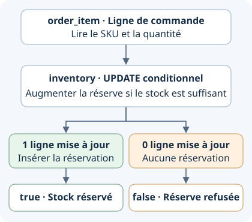

---
{
  "state": "draft",
  "language": "fr",
  "translationKey": "2026-11-22-commerce-database-design",
  "title": "Concevoir une base de données e-commerce pour les SKU, commandes, stocks et paiements",
  "description": "Modélisez les SKU, les prix figés à la commande, les réservations de stock et les tentatives de paiement dans PostgreSQL, puis faites concourir deux sessions pour le dernier article.",
  "sourcePath": "src/content/posts/en/2026-11-22-commerce-database-design.md",
  "sourceSha256": "da573ac023d969b02216c24993c872e842a6693607f8e3805fd988ce7d64bcf3"
}
---

**Une base de données e-commerce doit conserver les conditions actuelles du catalogue, les montants convenus à la commande, le stock réservé pour chaque commande et les résultats du prestataire de paiement.** Le total d’une commande passée hier doit rester exact après un changement de prix demain. S’il ne reste qu’un article aujourd’hui, une seule des deux commandes concurrentes doit pouvoir le réserver. L’exemple PostgreSQL indique les tables et les contraintes qui permettent de tenir ces deux exigences.

Ce guide s’appuie sur [l’exemple du dernier article en stock de la publication précédente](/en/posts/2026-11-22-commerce-system-design-last-unit-of-stock/). Il suppose un seul marchand de biens physiques, un entrepôt et des paiements en wons sud-coréens (KRW). Les stocks et les commandes partagent une base de données. Les retours après l’expédition et le règlement ont leurs propres modèles métier.

## Déterminer ce qu’il faut enregistrer pour un achat

| Question | Tables à lire ou à modifier | Clés et valeurs |
| --- | --- | --- |
| Quel est le prix actuel du clavier noir ? | `product` → `sku` | ID du produit, SKU disponible à la vente, prix actuel |
| Pourquoi avons-nous débité 43 000 KRW pour la commande d’hier ? | `orders` → `order_item` | ID de commande, quantité convenue, prix unitaire, remise et frais de livraison |
| Quelle commande a réservé le dernier article ? | `inventory`, `stock_reservation` | Stock physique par SKU et réservation par ligne de commande |
| Comment retrouver le même paiement après la perte de la réponse du prestataire ? | `payment_attempt`, `payment_event` | Tentative de paiement par commande, ID de transaction du prestataire, ID de l’événement |

Dans cet exemple, `product` représente une fiche du catalogue et `sku` une variante que les clients peuvent commander, comme le clavier noir. Une ligne de commande référence le SKU et **fige le nom de l’article, le nom de l’option et le prix unitaire au moment du passage de commande**. Un article à 42 000 KRW, une remise de 2 000 KRW et 3 000 KRW de frais de livraison donnent un total de 43 000 KRW. La commande peut afficher directement ce total. L’application ne modifie plus les lignes après leur création, puisqu’elles fixent les montants convenus et les quantités réservées. Pour retirer de la vente un SKU utilisé dans une transaction, marquez-le comme indisponible à la vente. Conservez les lignes référencées par les anciennes commandes et évitez les suppressions en cascade sur ces relations.

## Représenter le modèle avec les clés et les contraintes PostgreSQL

Exécutez le DDL ci-dessous une fois dans une base d’exercice vide. L’exemple attribue explicitement les identifiants et stocke les montants en wons entiers. Il suppose que le passage de commande regroupe les entrées répétées d’un SKU dans le panier en une seule ligne. Ainsi, `(order_id, sku_id)` identifie à la fois la ligne de commande et sa réservation.

```sql
CREATE TABLE product (
    id bigint PRIMARY KEY,
    name text NOT NULL
);

CREATE TABLE sku (
    id bigint PRIMARY KEY,
    product_id bigint NOT NULL REFERENCES product(id),
    code text NOT NULL UNIQUE,
    option_name text NOT NULL,
    current_price_krw bigint NOT NULL CHECK (current_price_krw >= 0),
    sellable boolean NOT NULL
);

CREATE TABLE inventory (
    sku_id bigint PRIMARY KEY REFERENCES sku(id),
    on_hand integer NOT NULL CHECK (on_hand >= 0),
    held integer NOT NULL CHECK (held >= 0),
    allocated integer NOT NULL CHECK (allocated >= 0),
    CHECK (held <= on_hand - allocated)
);

CREATE TABLE orders (
    id bigint PRIMARY KEY,
    customer_id bigint NOT NULL,
    request_key text NOT NULL,
    request_hash text NOT NULL,
    status text NOT NULL CHECK (status IN ('PENDING_PAYMENT', 'CONFIRMED', 'CANCELLED')),
    total_krw bigint NOT NULL CHECK (total_krw >= 0),
    shipping_krw bigint NOT NULL CHECK (shipping_krw >= 0),
    created_at timestamptz NOT NULL DEFAULT now(),
    UNIQUE (customer_id, request_key)
);

CREATE TABLE order_item (
    order_id bigint REFERENCES orders(id),
    sku_id bigint REFERENCES sku(id),
    item_name text NOT NULL,
    option_name text NOT NULL,
    quantity integer NOT NULL CHECK (quantity > 0),
    unit_price_krw bigint NOT NULL CHECK (unit_price_krw >= 0),
    discount_krw bigint NOT NULL CHECK (discount_krw >= 0),
    CHECK (discount_krw <= quantity * unit_price_krw::numeric),
    PRIMARY KEY (order_id, sku_id)
);

CREATE TABLE stock_reservation (
    order_id bigint,
    sku_id bigint REFERENCES inventory(sku_id),
    state text NOT NULL CHECK (state IN ('HELD', 'ALLOCATED', 'RELEASED', 'SHIPPED')),
    expires_at timestamptz NOT NULL,
    PRIMARY KEY (order_id, sku_id),
    FOREIGN KEY (order_id, sku_id) REFERENCES order_item(order_id, sku_id)
);

CREATE TABLE payment_attempt (
    id bigint PRIMARY KEY,
    order_id bigint NOT NULL REFERENCES orders(id),
    attempt_no integer NOT NULL CHECK (attempt_no > 0),
    provider text NOT NULL,
    merchant_account text NOT NULL,
    provider_request_key text NOT NULL,
    provider_payment_id text,
    amount_krw bigint NOT NULL CHECK (amount_krw >= 0),
    state text NOT NULL CHECK (state IN
        ('PENDING', 'UNKNOWN', 'PAID', 'CLOSED_UNPAID', 'REFUND_PENDING', 'REFUNDED')),
    UNIQUE (order_id, attempt_no),
    UNIQUE (provider, merchant_account, provider_request_key),
    UNIQUE (provider, merchant_account, provider_payment_id)
);

CREATE TABLE payment_event (
    provider text,
    merchant_account text,
    event_id text,
    received_at timestamptz NOT NULL DEFAULT now(),
    PRIMARY KEY (provider, merchant_account, event_id)
);

CREATE INDEX orders_customer_history
    ON orders (customer_id, created_at DESC, id DESC);

CREATE INDEX reservation_expiry
    ON stock_reservation (expires_at, order_id, sku_id)
    WHERE state = 'HELD';
```

La contrainte `CHECK` impose `held + allocated ≤ on_hand` sur chaque ligne de stock. Vérifier que le total de la commande correspond à ses lignes, ou que la somme des quantités réservées correspond à `held`, nécessite de lire plusieurs lignes. Écrivez les totaux et les réservations dans la transaction de création de la commande et rapprochez régulièrement les totaux et compteurs stockés des enregistrements sous-jacents. [Documentation PostgreSQL sur les contraintes CHECK](https://www.postgresql.org/docs/17/ddl-constraints.html#DDL-CONSTRAINTS-CHECK-CONSTRAINTS)

Quand le même client renvoie une `request_key`, recherchez la commande existante. Si le `request_hash` enregistré est différent, traitez la réutilisation de la clé comme un conflit. L’ID de la transaction du prestataire peut être inconnu au moment de la demande. Autorisez donc `NULL` au départ. Une fois renseigné, l’ID externe est unique pour le prestataire et le compte marchand. La clé de `payment_event` dédoublonne les événements reçus. Un même résultat positif peut suivre plusieurs événements d’ID différents. Protégez donc aussi les demandes d’expédition par une clé unique par commande et des transitions qui vérifient l’état précédent. [Documentation PostgreSQL sur les contraintes UNIQUE](https://www.postgresql.org/docs/17/ddl-constraints.html#DDL-CONSTRAINTS-UNIQUE-CONSTRAINTS) · [Recommandations Stripe sur les webhooks en double](https://docs.stripe.com/webhooks#handle-duplicate-events)

## Réserver le dernier article avec un UPDATE conditionnel



Le stock disponible est `on_hand - allocated - held`. Quelle que soit la quantité affichée auparavant dans la boutique, lors du passage de commande, **le même UPDATE vérifie le stock disponible et augmente la quantité réservée**. La fonction insère une réservation uniquement si la mise à jour affecte une ligne. Si une erreur SQL fait échouer l’insertion, la même instruction annule l’augmentation de `held`.

```sql
CREATE FUNCTION reserve_stock(p_order_id bigint, p_sku_id bigint,
                              p_expires_at timestamptz)
RETURNS boolean
LANGUAGE sql
AS $$
    WITH held_stock AS (
        UPDATE inventory AS i
           SET held = i.held + line.quantity
          FROM order_item AS line
         WHERE line.order_id = p_order_id
           AND line.sku_id = p_sku_id
           AND i.sku_id = line.sku_id
           AND i.on_hand - i.allocated - i.held >= line.quantity
         RETURNING i.sku_id
    ), reservation AS (
        INSERT INTO stock_reservation (order_id, sku_id, state, expires_at)
        SELECT p_order_id, sku_id, 'HELD', p_expires_at
        FROM held_stock
        RETURNING 1
    )
    SELECT EXISTS (SELECT 1 FROM reservation);
$$;
```

Au passage de commande, créez la commande et ses lignes, réservez chaque SKU et enregistrez la première tentative de paiement ainsi que le travail à publier dans une seule transaction. Si la fonction renvoie `false` pour un article, l’appelant annule toute la transaction. Pour plusieurs SKU, acquérez les verrous dans un ordre constant, par exemple par ID de SKU croissant. Quand une requête de commande est renvoyée, l’appelant vérifie la clé unique de la commande et ignore la fonction si le stock est déjà réservé. Ajouter `ON CONFLICT DO NOTHING` à l’insertion de la réservation pourrait augmenter le compteur sans réservation correspondante.

Appelez le prestataire de paiement après la validation de la transaction locale. Quand le paiement est confirmé, passez la réservation à `ALLOCATED` et transférez la quantité de `held` vers `allocated`. Libérer la réservation diminue uniquement `held`. Expédier diminue `on_hand` et `allocated`. Pour éviter les doubles déductions, verrouillez les lignes de réservation et de stock dans la même transaction, puis vérifiez l’état précédent attendu avant de changer d’état.

## Mettre deux sessions en concurrence pour le dernier article

Après avoir exécuté le DDL et créé la fonction, chargez les données suivantes dans la base d’exercice. Les deux lignes de commande sont créées à l’avance pour isoler la concurrence sur la réservation.

```sql
INSERT INTO product VALUES (1, 'Keyboard');
INSERT INTO sku VALUES (101, 1, 'KB-BLK', 'Black', 42000, true);
INSERT INTO inventory VALUES (101, 1, 0, 0);

INSERT INTO orders (id, customer_id, request_key, request_hash,
                    status, total_krw, shipping_krw)
VALUES (41, 1001, 'checkout-a', 'fixture-a', 'PENDING_PAYMENT', 43000, 3000),
       (42, 1002, 'checkout-b', 'fixture-b', 'PENDING_PAYMENT', 43000, 3000);

INSERT INTO order_item
VALUES (41, 101, 'Keyboard', 'Black', 1, 42000, 2000),
       (42, 101, 'Keyboard', 'Black', 1, 42000, 2000);
```

Ouvrez deux sessions `psql` sur la même base. Exécutez ce qui suit dans la session **A**. Elle renvoie `true` et laisse la transaction ouverte.

```sql
BEGIN ISOLATION LEVEL READ COMMITTED;
SELECT reserve_stock(41, 101, now() + interval '10 minutes') AS reserved;
```

Tant que la transaction de A est ouverte, exécutez ceci dans la session **B**. Son `SELECT` attend lorsqu’il tente de modifier la même ligne de stock.

```sql
BEGIN ISOLATION LEVEL READ COMMITTED;
SELECT reserve_stock(42, 101, now() + interval '10 minutes') AS reserved;
```

Exécutez `COMMIT;` dans A. Une fois le verrou libéré, B réévalue la condition `WHERE` sur la ligne actualisée. Comme il ne reste aucun article disponible, B renvoie `false`. Terminez l’exercice par `ROLLBACK;` dans B. [Documentation PostgreSQL sur l’isolation Read Committed](https://www.postgresql.org/docs/17/transaction-iso.html#XACT-READ-COMMITTED)

```sql
SELECT sku_id, on_hand, held, allocated FROM inventory;
SELECT order_id, sku_id, state FROM stock_reservation ORDER BY order_id;
```

L’exemple a été exécuté avec deux connexions simultanées à PostgreSQL 17.12. A a validé la transaction après que `pg_stat_activity` a indiqué que B attendait un verrou. A a renvoyé `true` et B, `false`. Les valeurs finales de `on_hand / held / allocated` dans `inventory` étaient `1 / 1 / 0`. Il restait **une réservation `HELD` pour la commande 41**.

Le passage du prix catalogue à 45 000 KRW a laissé le prix unitaire de la commande 41 à 42 000 KRW et son total à 43 000 KRW. Après avoir ajouté un article au stock, rappeler la fonction de réservation pour la commande 41 a provoqué une violation de contrainte d’unicité. `held` est resté à 1. L’exercice a vérifié la concurrence entre les deux connexions et les contraintes SQL. Les appels au prestataire de paiement, les courses liées à l’expiration des réservations et la charge de production exigent des tests distincts.

## Choisir les index d’après les requêtes de l’application

L’historique de commandes d’un client utilise une requête de la forme `WHERE customer_id = … ORDER BY created_at DESC, id DESC LIMIT …`. L’index multicolonne du DDL correspond au filtre par client et à l’ordre de tri. La tâche de nettoyage des réservations utilise `WHERE state = 'HELD' AND expires_at <= now()`, d’où un index partiel qui exclut les autres états. L’index d’expiration trouve des candidats. La tâche acquiert les verrous et vérifie l’état du paiement avant de décider de libérer ou non chaque réservation. [Documentation PostgreSQL sur les index multicolonnes](https://www.postgresql.org/docs/17/indexes-multicolumn.html) · [Documentation PostgreSQL sur les index partiels](https://www.postgresql.org/docs/17/indexes-partial.html)
