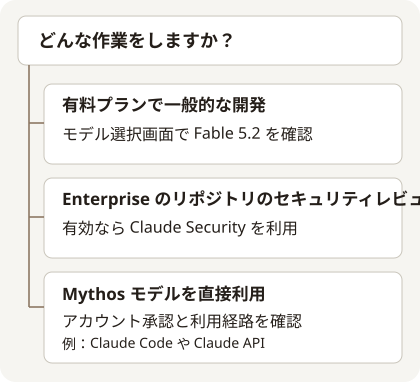

---
{
  "state": "draft",
  "language": "ja",
  "translationKey": "2026-11-22-claude-mythos-availability",
  "title": "Claude Mythos 5.2 はどこで使える？ Claude Security、Claude Code、API",
  "description": "Mythos 5.2 の直接利用、Claude Security の Enterprise 向けコードスキャン、有料プランでの Fable 5.2 の利用条件を比較します。",
  "sourcePath": "src/content/posts/en/2026-11-22-claude-mythos-availability.md",
  "sourceSha256": "03f809cd5ff47c9929524f940e1ebf683dc5e75760fb062cfdb425ffbf4ff424"
}
---

**Claude Mythos 5.2 を直接利用するには、Anthropic の検証プログラムで承認を受ける必要があります。** 対象プランを契約している個人は、Cyber Verification Program（CVP）で承認を受けると Defense Access を利用できます。Claude Enterprise の組織は、コードスキャンに Mythos 5.2 を使う Claude Security を有効化できます。Fable 5.2 は Claude の有料プランで一般提供されており、必要な利用クレジットはプランやシートによって異なります。この記事は 2026年11月22日 時点の公開ドキュメントに基づいています。 [Anthropic の 5.2 発表](https://www.anthropic.com/claude-fable-and-mythos-5-2#availability) · [対象モデルに関する Claude ヘルプセンターの説明](https://support.claude.com/en/articles/15425695-covered-models) · [Cyber Verification Program](https://support.claude.com/en/articles/14604842-cyber-verification-program)

## 目的に合う選択肢は？



| やりたいこと | 確認する場所 | 利用条件 |
| --- | --- | --- |
| コーディングや文章作成に 5.2 系のモデルを使う | Claude の Web 版、デスクトップ版、モバイル版、または Claude Code のモデル選択画面 | 有料プランで Fable 5.2 を利用できます。利用クレジットはプランとシートによって異なります。 |
| 会社のリポジトリにあるセキュリティ上の問題を Mythos で調べる | Claude の Web 版にある Claude Security | Enterprise 向けパブリックベータです。組織による機能の有効化と、Claude Code を含むシートが必要です。 |
| Claude Code または Claude API で Mythos をモデルとして直接利用する | アカウントのモデル権限、または API で使うワークスペース | 検証プログラムの承認が必要です。対象プランの個人は Defense Access に申請できます。 |

**Mythos Preview** は、Anthropic が 2026 年の四月に Project Glasswing の参加組織に提供した研究プレビューです。**Mythos 5.2** は Anthropic が 11月9日 に発表しました。Mythos の提供状況に関する報道を比較する際は、日付とモデルのバージョンを確認してください。 [Project Glasswing の発表](https://www.anthropic.com/project/glasswing) · [Claude Mythos のモデルページ](https://www.anthropic.com/claude/mythos)

## Enterprise で Mythos が使われる場所

**Claude Security はリポジトリのスキャンに Mythos 5.2 を使います。** たとえば、社内 Web サービスで認可チェックが抜けている箇所を検出し、チームで根拠や修正案を確認できます。Anthropic は Cyber Verification Program に参加していない Enterprise の顧客にも Claude Security を提供しています。各ユーザーには Claude Code を含むシートが必要です。シート単位の Enterprise プランでは、利用クレジットの有効化も必要です。Claude Code を含むシートを持つ組織のオーナーが `Organization settings → Claude Security` で機能を有効にします。 [Anthropic の提供開始の発表](https://www.anthropic.com/claude-fable-and-mythos-5-2) · [Claude Security の利用条件](https://support.claude.com/en/articles/14661296-use-claude-security)

検出項目を Claude Code で開き、修正を進められます。**スキャンと Claude Code のセッションでは、モデルの利用権限が別々に管理されます。** スキャンには Mythos が使われますが、Claude Code のセッションで使えるのは、アカウントに許可されたモデルです。そのため Enterprise ユーザーは、Claude Security を利用できても、通常のチャットのモデル選択画面には Mythos が表示されないことがあります。 [Claude Security の製品ページ](https://claude.com/product/claude-security) · [Claude Code のモデル設定](https://code.claude.com/docs/en/model-config)

## 個人プランで Fable 5.2 を探す

Anthropic によると、Fable 5.2 と Mythos 5.2 は同じ基盤モデルを共有しています。Fable には、サイバーセキュリティと生命科学に関する追加の安全対策があります。個人の有料プランでは、リポジトリの理解やリファクタリングの計画など、一般的な開発作業に Fable 5.2 を使えます。Pro と一部の標準シートでは、最初から利用クレジットが必要です。 [Anthropic のモデル発表](https://www.anthropic.com/claude-fable-and-mythos-5-2) · [プラン別の Fable 提供状況](https://support.claude.com/en/articles/15424964-claude-fable-models-on-your-plan)

Web 版、デスクトップ版、モバイル版では、モデル選択画面で `Fable 5.2` を探してください。端末で Claude Code を使う場合は、まずバージョンが **2.1.321** 以降であることを確認します。次にセッションで `/model` を開くと、選べるモデルが表示されます。 [Claude のプランヘルプ](https://support.claude.com/en/articles/15424964-claude-fable-models-on-your-plan) · [Claude Code のモデル設定](https://code.claude.com/docs/en/model-config)

```sh
claude --version
```

Claude API では、メタデータをリクエストして Fable のモデル ID を確認できます。この例では、`curl` を使えるシェルで、対象ワークスペースの API キーが `ANTHROPIC_API_KEY` に設定済みであることを前提とします。成功したレスポンスでは、`id` の値が `claude-fable-5-2` になります。リクエスト形式は公式リファレンスと照合し、シェルの構文はローカルで確認しました。メタデータのレスポンスやモデル選択など、認証が必要な Claude の動作は検証していません。 [Claude API のモデル取得リファレンス](https://platform.claude.com/docs/en/api/models/retrieve)

```sh
curl --fail-with-body --silent --show-error \
  'https://api.anthropic.com/v1/models/claude-fable-5-2' \
  -H 'anthropic-version: 2026-10-21' \
  -H "Authorization: Bearer ${ANTHROPIC_API_KEY}"
```

## Mythos を直接利用できるか確認する

Cyber Verification Program のヘルプセンターによると、独立系のセキュリティ研究者やオープンソースのメンテナーなどの個人は、Pro、Max、Ultra などの対象プランで **Defense Access** に申請できます。このアクセス区分で承認された参加者は Mythos 5.2 を利用できます。有料プランの契約だけでは利用権限は付与されません。Anthropic には、生命科学の研究向けに別の検証プログラムがあります。 [Cyber Verification Program のヘルプセンター](https://support.claude.com/en/articles/14604842-cyber-verification-program) · [Anthropic の提供状況に関する発表](https://www.anthropic.com/claude-fable-and-mythos-5-2#availability)

Claude API ドキュメントでは、Mythos 5.2 のモデル ID は `claude-mythos-5-2` です。利用できるかどうかは、アカウントや組織に付与された権限と利用経路によって異なります。Claude と Claude Console のアクセス権は別々に管理され、Console の権限は割り当てられたワークスペースに適用されます。クラウドプロバイダー経由で利用する組織は、連携済みのクラウドアカウントとプロバイダーの対応状況も確認してください。 [Claude API のモデルガイド](https://platform.claude.com/docs/en/models/fable-5-2/migration-guide) · [プラン、ワークスペース、クラウドアカウントに関する Claude ヘルプセンターの説明](https://support.claude.com/en/articles/14604842-cyber-verification-program)
