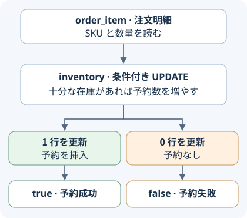

---
{
  "state": "draft",
  "language": "ja",
  "translationKey": "2026-11-22-commerce-database-design",
  "title": "EC データベース設計：SKU・注文・在庫・決済",
  "description": "PostgreSQL のテーブルで SKU、注文時の価格スナップショット、在庫予約、決済試行をモデル化し、2つのセッションが最後の在庫を取り合う場合を検証します。",
  "sourcePath": "src/content/posts/en/2026-11-22-commerce-database-design.md",
  "sourceSha256": "da573ac023d969b02216c24993c872e842a6693607f8e3805fd988ce7d64bcf3"
}
---

**EC のデータベースには、カタログ上の現在の販売条件、注文手続きで合意した金額、注文ごとに予約した在庫、決済事業者の結果を保存する必要があります。** 明日価格が変わっても、昨日の注文の合計が変わってはいけません。今日の在庫が残り一点なら、同時に届いた二つの注文のうち一方だけが予約できるようにします。PostgreSQL の例で、両方の要件を支えるテーブルと制約を確認します。

このガイドは [前回の記事の最後の在庫をめぐる例](/en/posts/2026-11-22-commerce-system-design-last-unit-of-stock/) を土台にします。販売事業者と倉庫はそれぞれ一つで、物理商品を韓国ウォン（KRW）で販売します。在庫と注文は同じデータベースを使います。出荷後の返品と精算には、それぞれ独立した業務モデルがあります。

## 一件の購入で記録する情報を整理する

| 確認したいこと | 読み書きするテーブル | キーと値 |
| --- | --- | --- |
| 黒いキーボードの現在の価格は？ | `product` → `sku` | 商品 ID、販売可能な SKU、現在価格 |
| 昨日の注文で 43,000 ウォンを請求した理由は？ | `orders` → `order_item` | 注文 ID、合意した数量・単価・割引・送料 |
| 最後の在庫を確保した注文は？ | `inventory`、`stock_reservation` | SKU ごとの実在庫と注文明細ごとの予約 |
| 決済事業者からの応答が失われた後、同じ決済をどう探すか？ | `payment_attempt`、`payment_event` | 注文ごとの決済試行、事業者の取引 ID、イベント ID |

この例では、`product` はカタログ上の商品で、`sku` は黒いキーボードのような、購入者が注文できるバリエーションです。注文明細は SKU を参照し、**注文手続き時の商品名・オプション名・単価をスナップショットとして保存します**。単価 42,000 ウォンの商品一点に、割引 2,000 ウォンと送料 3,000 ウォンを適用すると合計は 43,000 ウォンです。注文には保存した合計をそのまま表示できます。注文明細は合意金額と予約数量の根拠なので、作成後に変更しません。取引に使った SKU の販売をやめる場合は販売不可にします。過去の注文が参照する行は保持し、その関係には連鎖削除を使わないようにします。

## PostgreSQL のキーと制約でモデルを表現する

空の練習用データベースで次の DDL を一度実行します。この例では ID を明示的に割り当て、金額はウォン単位の整数で保存します。注文手続きで同じ SKU のカート項目を一つの明細にまとめる想定なので、`(order_id, sku_id)` は注文明細とそれに対応する予約の両方を識別します。

```sql
CREATE TABLE product (
    id bigint PRIMARY KEY,
    name text NOT NULL
);

CREATE TABLE sku (
    id bigint PRIMARY KEY,
    product_id bigint NOT NULL REFERENCES product(id),
    code text NOT NULL UNIQUE,
    option_name text NOT NULL,
    current_price_krw bigint NOT NULL CHECK (current_price_krw >= 0),
    sellable boolean NOT NULL
);

CREATE TABLE inventory (
    sku_id bigint PRIMARY KEY REFERENCES sku(id),
    on_hand integer NOT NULL CHECK (on_hand >= 0),
    held integer NOT NULL CHECK (held >= 0),
    allocated integer NOT NULL CHECK (allocated >= 0),
    CHECK (held <= on_hand - allocated)
);

CREATE TABLE orders (
    id bigint PRIMARY KEY,
    customer_id bigint NOT NULL,
    request_key text NOT NULL,
    request_hash text NOT NULL,
    status text NOT NULL CHECK (status IN ('PENDING_PAYMENT', 'CONFIRMED', 'CANCELLED')),
    total_krw bigint NOT NULL CHECK (total_krw >= 0),
    shipping_krw bigint NOT NULL CHECK (shipping_krw >= 0),
    created_at timestamptz NOT NULL DEFAULT now(),
    UNIQUE (customer_id, request_key)
);

CREATE TABLE order_item (
    order_id bigint REFERENCES orders(id),
    sku_id bigint REFERENCES sku(id),
    item_name text NOT NULL,
    option_name text NOT NULL,
    quantity integer NOT NULL CHECK (quantity > 0),
    unit_price_krw bigint NOT NULL CHECK (unit_price_krw >= 0),
    discount_krw bigint NOT NULL CHECK (discount_krw >= 0),
    CHECK (discount_krw <= quantity * unit_price_krw::numeric),
    PRIMARY KEY (order_id, sku_id)
);

CREATE TABLE stock_reservation (
    order_id bigint,
    sku_id bigint REFERENCES inventory(sku_id),
    state text NOT NULL CHECK (state IN ('HELD', 'ALLOCATED', 'RELEASED', 'SHIPPED')),
    expires_at timestamptz NOT NULL,
    PRIMARY KEY (order_id, sku_id),
    FOREIGN KEY (order_id, sku_id) REFERENCES order_item(order_id, sku_id)
);

CREATE TABLE payment_attempt (
    id bigint PRIMARY KEY,
    order_id bigint NOT NULL REFERENCES orders(id),
    attempt_no integer NOT NULL CHECK (attempt_no > 0),
    provider text NOT NULL,
    merchant_account text NOT NULL,
    provider_request_key text NOT NULL,
    provider_payment_id text,
    amount_krw bigint NOT NULL CHECK (amount_krw >= 0),
    state text NOT NULL CHECK (state IN
        ('PENDING', 'UNKNOWN', 'PAID', 'CLOSED_UNPAID', 'REFUND_PENDING', 'REFUNDED')),
    UNIQUE (order_id, attempt_no),
    UNIQUE (provider, merchant_account, provider_request_key),
    UNIQUE (provider, merchant_account, provider_payment_id)
);

CREATE TABLE payment_event (
    provider text,
    merchant_account text,
    event_id text,
    received_at timestamptz NOT NULL DEFAULT now(),
    PRIMARY KEY (provider, merchant_account, event_id)
);

CREATE INDEX orders_customer_history
    ON orders (customer_id, created_at DESC, id DESC);

CREATE INDEX reservation_expiry
    ON stock_reservation (expires_at, order_id, sku_id)
    WHERE state = 'HELD';
```

`CHECK` 制約は在庫行ごとに `held + allocated ≤ on_hand` を保証します。注文合計と明細が一致するか、または予約中の数量の合計が `held` と一致するかを確かめるには、複数行を読む必要があります。合計と予約は注文作成と同じトランザクションで書き込み、保存した合計とカウンターを、その内訳のレコードと定期的に照合します。 [PostgreSQL の CHECK 制約のドキュメント](https://www.postgresql.org/docs/17/ddl-constraints.html#DDL-CONSTRAINTS-CHECK-CONSTRAINTS)

同じ購入者が同じ `request_key` を送ったときは既存の注文を探します。保存済みの `request_hash` が異なる場合はキーの再利用による競合として扱います。リクエストの時点では決済事業者の取引 ID が不明なことがあるため、最初は `NULL` を許容します。設定後の外部 ID は、同じ決済事業者と加盟店アカウント内で一意です。`payment_event` のキーで受信イベントを重複排除します。同じ成功結果が異なるイベント ID で届くこともあるので、注文ごとの一意キーと遷移前の状態チェックで出荷依頼の重複も防ぎます。 [PostgreSQL の UNIQUE 制約のドキュメント](https://www.postgresql.org/docs/17/ddl-constraints.html#DDL-CONSTRAINTS-UNIQUE-CONSTRAINTS) · [重複する webhook に関する Stripe のガイド](https://docs.stripe.com/webhooks#handle-duplicate-events)

## 条件付き UPDATE で最後の在庫を予約する



利用可能な在庫は `on_hand - allocated - held` です。購入画面で先に表示した数量にかかわらず、注文手続きでは**同じ UPDATE 文で在庫の可用性を確認し、予約中の数量を増やします**。関数は更新された行がある場合だけ予約を挿入します。SQL エラーで挿入に失敗すれば、同じ文の `held` の増加もロールバックされます。

```sql
CREATE FUNCTION reserve_stock(p_order_id bigint, p_sku_id bigint,
                              p_expires_at timestamptz)
RETURNS boolean
LANGUAGE sql
AS $$
    WITH held_stock AS (
        UPDATE inventory AS i
           SET held = i.held + line.quantity
          FROM order_item AS line
         WHERE line.order_id = p_order_id
           AND line.sku_id = p_sku_id
           AND i.sku_id = line.sku_id
           AND i.on_hand - i.allocated - i.held >= line.quantity
         RETURNING i.sku_id
    ), reservation AS (
        INSERT INTO stock_reservation (order_id, sku_id, state, expires_at)
        SELECT p_order_id, sku_id, 'HELD', p_expires_at
        FROM held_stock
        RETURNING 1
    )
    SELECT EXISTS (SELECT 1 FROM reservation);
$$;
```

注文手続きでは、注文と明細の作成、全 SKU の予約、最初の決済試行と発行すべき作業の記録を一つのデータベーストランザクションで行います。一品でも関数が `false` を返したら、呼び出し元はトランザクション全体をロールバックします。複数 SKU の予約では SKU ID の昇順など、常に同じ順序でロックします。注文手続きの再試行時、呼び出し元は注文の一意キーを確認し、すでに予約済みなら関数を呼びません。予約の挿入に `ON CONFLICT DO NOTHING` を加えると、対応する予約がないのにカウンターだけ増える場合があります。

ローカルトランザクションのコミット後に決済事業者を呼び出します。支払いが確定したら予約を `ALLOCATED` にし、数量を `held` から `allocated` に移します。予約解除では `held` だけを、出荷では `on_hand` と `allocated` の両方を減らします。二重の減算を防ぐには、同じトランザクション内で予約行と在庫行をロックし、遷移前の状態が想定どおりか確認してから更新します。

## 二つのセッションで最後の在庫を取り合う

DDL を実行して関数を作成したら、練習用データベースに次のデータを読み込みます。二つの注文明細を先に作成し、予約の競合だけを確認します。

```sql
INSERT INTO product VALUES (1, 'Keyboard');
INSERT INTO sku VALUES (101, 1, 'KB-BLK', 'Black', 42000, true);
INSERT INTO inventory VALUES (101, 1, 0, 0);

INSERT INTO orders (id, customer_id, request_key, request_hash,
                    status, total_krw, shipping_krw)
VALUES (41, 1001, 'checkout-a', 'fixture-a', 'PENDING_PAYMENT', 43000, 3000),
       (42, 1002, 'checkout-b', 'fixture-b', 'PENDING_PAYMENT', 43000, 3000);

INSERT INTO order_item
VALUES (41, 101, 'Keyboard', 'Black', 1, 42000, 2000),
       (42, 101, 'Keyboard', 'Black', 1, 42000, 2000);
```

同じデータベースを使う二つの `psql` セッションを開きます。セッション **A** で次を実行します。`true` が返り、トランザクションは開いたままです。

```sql
BEGIN ISOLATION LEVEL READ COMMITTED;
SELECT reserve_stock(41, 101, now() + interval '10 minutes') AS reserved;
```

A のトランザクションを開いたまま、セッション **B** で次を実行します。`SELECT` は同じ在庫行を更新しようとして待機します。

```sql
BEGIN ISOLATION LEVEL READ COMMITTED;
SELECT reserve_stock(42, 101, now() + interval '10 minutes') AS reserved;
```

A で `COMMIT;` を実行します。ロックが解放されると、B は更新後の行に対して `WHERE` 条件を再評価します。利用可能な在庫がゼロなので、B は `false` を返します。B で `ROLLBACK;` を実行して演習を終えます。 [PostgreSQL の Read Committed 分離レベルのドキュメント](https://www.postgresql.org/docs/17/transaction-iso.html#XACT-READ-COMMITTED)

```sql
SELECT sku_id, on_hand, held, allocated FROM inventory;
SELECT order_id, sku_id, state FROM stock_reservation ORDER BY order_id;
```

PostgreSQL 17.12 への同時接続二つでこの例を実行しました。`pg_stat_activity` で B がロック待ちになったことを確認してから、A をコミットしました。A は `true`、B は `false` を返しました。`inventory` の `on_hand / held / allocated` の最終値は `1 / 1 / 0` で、**注文 41 に対する `HELD` の予約が一件**残りました。

カタログ価格を 45,000 ウォンに変更しても、注文 41 の単価は 42,000 ウォン、合計は 43,000 ウォンのままでした。在庫を一点増やしたあと、注文 41 に予約関数をもう一度実行すると一意制約違反となり、`held` は 1 のままでした。この演習では二つの接続の競合と SQL 制約を検証しました。決済事業者への呼び出し、予約期限に関わる競合、本番負荷は別途テストが必要です。

## アプリが実行するクエリからインデックスを選ぶ

購入者の注文履歴は `WHERE customer_id = … ORDER BY created_at DESC, id DESC LIMIT …` のようなクエリで取得します。DDL の複合インデックスは購入者の絞り込みと並び順に対応します。予約を整理するジョブは `WHERE state = 'HELD' AND expires_at <= now()` を使うため、部分インデックスには他の状態の予約が含まれません。期限のインデックスで候補を探し、ジョブはロックを取って決済状態を確認してから、個々の予約を解除するか決めます。 [PostgreSQL の複数列インデックスのドキュメント](https://www.postgresql.org/docs/17/indexes-multicolumn.html) · [PostgreSQL の部分インデックスのドキュメント](https://www.postgresql.org/docs/17/indexes-partial.html)
