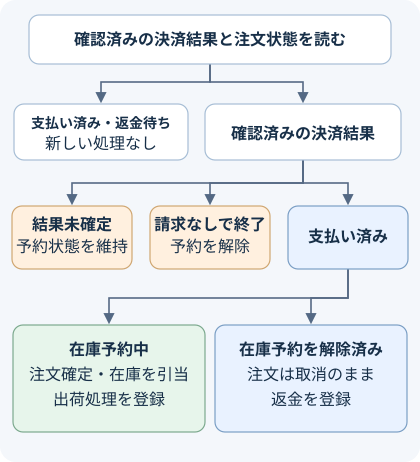

---
{
  "state": "draft",
  "language": "ja",
  "translationKey": "2026-11-22-commerce-system-design-last-unit-of-stock",
  "title": "EC システム設計：最後の在庫はどの注文に割り当てる？",
  "description": "在庫の最後の1点を例に、SKU の在庫予約、決済結果の照合、予約解除後の返金を考えます。",
  "sourcePath": "src/content/posts/en/2026-11-22-commerce-system-design-last-unit-of-stock.md",
  "sourceSha256": "63b33b1222e2cc6c885b4f2d63fb1a3f2727041b8710e7bf8ed7b335b6f8b9d6"
}
---

**二人の購入者が同時に最後の在庫を買おうとした場合、予約できる注文は一件だけにします。** 在庫予約後に決済事業者の応答を失ったら、決済を確認する間は注文を保留します。予約解除後に支払いが確定したら、注文は取り消したままにして返金を依頼します。一件の購入を追うと、カタログ、在庫、注文、決済がどのデータを管理するか分かります。

この例は物理商品を売る一つの販売事業者を想定します。決済は注文ごとに韓国ウォン（KRW）で一回、出荷元は一つの倉庫です。決済結果が未確定、または遅れて判明した場合の取消と返金が対象です。マーケットプレイスの精算、分割出荷、返品は扱いません。

## 商品ページの在庫表示と注文の在庫予約

**商品**は購入者に見えるカタログの項目です。**SKU**（在庫管理単位）は、注文と在庫を管理する単位です。同じキーボードでも白と黒は別の SKU です。商品ページは照会時点の在庫を表示します。在庫モジュールが応答しない場合も商品を表示し、在庫欄には「在庫を確認中」と示します。カートに追加するだけでは在庫は変わりません。

| 責務 | 変更できるデータ | 例 |
| --- | --- | --- |
| カタログと価格 | 商品、SKU、販売可否、現在の単価 | 黒いキーボード `KB-BLK` の単価を変更 |
| 在庫 | 倉庫ごとの実在庫、在庫予約、出荷向けの引当 | 特定の注文に `KB-BLK` を一点予約 |
| 注文 | 購入者、購入時の明細と金額、注文状態 | 注文 `O-42` の数量、単価、割引の配分、送料を保存 |
| 決済 | 決済試行、事業者の取引 ID、決済と返金の状態 | 試行 `P-1` の事業者側の結果を照合 |
| 出荷処理 | 出荷依頼とその進捗 | 支払い確定と在庫引当の後で商品をピッキング |

注文手続きの直前に、サーバーは商品が販売中か確かめ、価格を再確認します。認証済みのセッションから購入者を特定し、サーバー側の価格、割引、送料のルールで合計を計算します。カート追加時に黒いキーボードが 39,000 ウォンで、現在 42,000 ウォンなら、新しい金額を表示して購入者に確認を求めます。注文を作る際、購入者が同意した価格バージョンが、サーバーが適用するバージョンと同じか確認します。注文には SKU、オプション名、数量、単価、割引、送料、通貨を保存します。新しい単価 42,000 ウォンから割引 2,000 ウォンを引き、送料 3,000 ウォンを加えて、決済事業者に 43,000 ウォンを送ります。翌日に商品名が変わったり値下げされたりしても、保存した注文には同意済みの金額が表示される必要があります。[Spring Boot の商品照会の例](/en/posts/2026-11-22-spring-boot-4-2-restclient-migration/) を、商品表示から注文作成まで広げるときに加える境界です。

## 一つのトランザクションに含める処理

カタログ、在庫、注文、決済記録を**同じアプリケーションの別モジュール**に分けます。モジュールは一つのデータベースを共有し、自分のテーブルへの書き込みルールを管理します。これにより、注文と予約を同じローカルトランザクションでコミットできます。外部の決済事業者の呼び出しはコミット後に行います。

1. **注文を作成し、在庫を予約する。** 購入者と注文リクエストキーで再試行を識別します。同じキーで異なるリクエストデータが来たら競合として扱います。在庫モジュールは SKU 行のロックまたは条件付き更新で利用可能な在庫を確認します。複数 SKU の注文は、全商品を確保できたら明細と予約、決済試行を一括で保存します。一つでも足りなければトランザクション全体をロールバックし、在庫不足を通知します。決済リクエストを再開するための作業も同じローカルコミットで記録します。
2. **決済事業者を呼び出す。** 保存済みの決済試行 ID に結び付いた事業者側の冪等性キーを付け、決済リクエストを送ります。送信直後にサーバーが停止しても、記録を見つけて同じ試行の結果を照合できるようにします。応答を失った場合は事業者側の既存取引を照会します。再送は同じキーとリクエストパラメーターについて事業者が保証する範囲に限ります。結果が未確定の間は同じ試行を使います。 [Stripe の冪等リクエストのドキュメント](https://docs.stripe.com/api/idempotent_requests)
3. **結果を適用する。** イベントを記録する前に webhook の署名を確認するか、サーバーから取引を照会します。注文、決済試行、加盟店アカウント、金額、通貨が一致することを確かめます。注文と予約をロックし、最新の状態を読んだうえで、決済状態、在庫の状態遷移、後続作業を同じトランザクションで保存します。出荷依頼または返金依頼も同じコミットで outbox に書き込みます。 [Stripe の webhook 配信ルール](https://docs.stripe.com/webhooks#event-delivery-behaviors) · [AWS のトランザクショナルアウトボックスパターン](https://docs.aws.amazon.com/prescriptive-guidance/latest/cloud-design-patterns/transactional-outbox.html)

この例では **利用可能な在庫 = 実在庫 − 有効な予約 − 出荷用の引当** です。支払いが確定したら、予約数を減らし、同数を出荷用に引き当てます。出荷時には実在庫と引当数を減らします。最後の一点に対して二件の注文が同時に来た場合、最初の予約がコミットした後、二件目からは利用可能な在庫がゼロに見える必要があります。実際のデータベース上でトランザクションを重ねて、この動作を検証します。

## 未確定の決済と遅れて確定する決済を扱う



図は在庫を予約した後に決済結果を適用する流れを示します。保存済みの決済状態がすでに `PAID` または `REFUND_PENDING` なら、その状態を維持し、新しい後続作業は作りません。

注文、決済、在庫予約はそれぞれ独自の状態を持ちます。購入画面ではそれらを組み合わせ、購入者に分かる文言を表示します。たとえば事業者の応答が遅い場合、注文は `PENDING_PAYMENT`、決済は `UNKNOWN`、予約は `HELD` のままです。「決済結果を確認中です」と表示し、同じ注文を再照会できるようにします。

| 状況 | 保存される状態と後続作業 |
| --- | --- |
| 支払い確定、在庫予約中 | 注文 `CONFIRMED`、決済 `PAID`、在庫 `ALLOCATED`。出荷依頼を記録 |
| 応答を失った、または事業者が処理中 | 注文 `PENDING_PAYMENT`、決済 `UNKNOWN`、在庫 `HELD`。既存の決済を再確認 |
| 請求なしで取引終了を確認 | 注文 `CANCELLED`、決済 `CLOSED_UNPAID`、予約 `RELEASED` |
| 例外的な予約解除の後に支払い確定 | 注文 `CANCELLED`、決済 `REFUND_PENDING`、予約 `RELEASED`。返金依頼を記録 |

決済結果が未確定のまま予約期限が来たら、まず事業者に確認します。なお未確定なら、担当者が取引を探して照合できるように記録します。例外的に予約を解除した後に支払いが確定したら、この設計では返金を依頼し、予約は解除のままです。事業者が返金を確認してから成功と記録します。予約時間と例外的な解除の承認者は、店舗で在庫が売れる速さと事業者との契約条件をもとに決めます。

webhook のイベント ID で再配信の重複を除きます。イベント ID が異なる場合でも、同じ決済に対する出荷依頼を重複させないでください。たとえば出荷用 outbox に `order_id` と作業種別の一意制約を、返金用 outbox に `payment_attempt_id` と作業種別の一意制約を設けます。outbox の発行は再試行されることがあるため、出荷と返金のワーカーでは同じジョブ ID で二重実行を防ぎます。事業者への返金リクエストを再試行する場合は、事業者がサポートする返金専用の冪等性キーを使います。処理中と伝える古いイベントでは、確定済みの決済状態は変えません。ID や金額が合わない結果、確定履歴と矛盾する結果は、適用前に照合へ回します。 [重複する webhook に関する Stripe のガイド](https://docs.stripe.com/webhooks#handle-duplicate-events) · [AWS のトランザクショナルアウトボックスパターン](https://docs.aws.amazon.com/prescriptive-guidance/latest/cloud-design-patterns/transactional-outbox.html)

## Java で決済の状態遷移を確認する

次のコードを `CheckoutPolicy.java` に保存し、`java CheckoutPolicy.java` を実行します。この例は、注文にひも付く**一回の決済試行についてサーバーが確認した結果**を受け取ります。`CLOSED_UNPAID` は決済事業者が請求なしで取引終了を確認したことを示します。拒否のメッセージだけではその根拠になりません。コードは注文と予約の状態が整合していると仮定します。支払い待ちの注文には予約があり、取消済みの注文では予約が解除されています。呼び出し元が ID と金額を検証し、矛盾する結果を照合します。コードは次の状態と、記録すべき後続作業を返します。

```java
public class CheckoutPolicy {
    enum Order { PENDING_PAYMENT, CONFIRMED, CANCELLED }
    enum Payment { PENDING, UNKNOWN, PAID, CLOSED_UNPAID, REFUND_PENDING }
    enum Reservation { HELD, ALLOCATED, RELEASED }
    enum Result { UNRESOLVED, CLOSED_UNPAID, PAID }
    enum Effect { NONE, REQUEST_FULFILLMENT, REQUEST_REFUND }

    record State(Order order, Payment payment, Reservation reservation) {}
    record Decision(State state, Effect effect) {}

    static Decision apply(State current, Result result) {
        if (current.payment() == Payment.PAID
                || current.payment() == Payment.REFUND_PENDING) {
            return new Decision(current, Effect.NONE);
        }

        if (current.order() == Order.CANCELLED) {
            return switch (result) {
                case PAID -> new Decision(
                    new State(Order.CANCELLED, Payment.REFUND_PENDING, Reservation.RELEASED),
                    Effect.REQUEST_REFUND);
                case CLOSED_UNPAID -> new Decision(
                    new State(Order.CANCELLED, Payment.CLOSED_UNPAID, Reservation.RELEASED),
                    Effect.NONE);
                case UNRESOLVED -> new Decision(current, Effect.NONE);
            };
        }

        return switch (result) {
            case PAID -> new Decision(
                new State(Order.CONFIRMED, Payment.PAID, Reservation.ALLOCATED),
                Effect.REQUEST_FULFILLMENT);
            case CLOSED_UNPAID -> new Decision(
                new State(Order.CANCELLED, Payment.CLOSED_UNPAID, Reservation.RELEASED),
                Effect.NONE);
            case UNRESOLVED -> new Decision(
                new State(Order.PENDING_PAYMENT, Payment.UNKNOWN, Reservation.HELD),
                Effect.NONE);
        };
    }

    static void check(String label, Decision expected, Decision actual) {
        if (!expected.equals(actual)) {
            throw new AssertionError(label + ": " + actual);
        }
        System.out.println("PASS " + label);
    }

    public static void main(String[] args) {
        State held = new State(Order.PENDING_PAYMENT, Payment.PENDING, Reservation.HELD);
        State unknown = new State(Order.PENDING_PAYMENT, Payment.UNKNOWN, Reservation.HELD);
        State paid = new State(Order.CONFIRMED, Payment.PAID, Reservation.ALLOCATED);
        State closed = new State(
            Order.CANCELLED, Payment.CLOSED_UNPAID, Reservation.RELEASED);
        State released = new State(Order.CANCELLED, Payment.UNKNOWN, Reservation.RELEASED);
        State refundPending = new State(
            Order.CANCELLED, Payment.REFUND_PENDING, Reservation.RELEASED);

        check("unresolved retains hold", new Decision(unknown, Effect.NONE),
            apply(held, Result.UNRESOLVED));
        check("paid allocates stock", new Decision(paid, Effect.REQUEST_FULFILLMENT),
            apply(unknown, Result.PAID));
        check("duplicate paid has no effect", new Decision(paid, Effect.NONE),
            apply(paid, Result.PAID));
        check("old unresolved does not reopen payment", new Decision(paid, Effect.NONE),
            apply(paid, Result.UNRESOLVED));
        check("closed unpaid releases hold", new Decision(closed, Effect.NONE),
            apply(unknown, Result.CLOSED_UNPAID));
        check("late paid requests refund", new Decision(refundPending, Effect.REQUEST_REFUND),
            apply(released, Result.PAID));
        check("duplicate late paid has no effect", new Decision(refundPending, Effect.NONE),
            apply(refundPending, Result.PAID));
    }
}
```

以下の七つの確認を JDK 21.0.1 で実行しました。支払い確定を二度適用しても新しい作業は作成されませんでした。在庫予約を解除した後に支払いが確定すると、返金依頼が返りました。

```text
PASS unresolved retains hold
PASS paid allocates stock
PASS duplicate paid has no effect
PASS old unresolved does not reopen payment
PASS closed unpaid releases hold
PASS late paid requests refund
PASS duplicate late paid has no effect
```

実装では二つの競合も別途確認する必要があります。二つの注文が同時に最後の在庫を予約しようとしたら、成功するのは片方だけです。同じ注文について期限切れ処理と支払い確定が重なったら、在庫を予約中なら出荷、解除後なら返金のどちらか一方だけを記録します。逐次処理の Java 例とは別に、データベースの競合、事業者との連携、本番環境の決済を検証します。

より多くの倉庫で在庫管理が必要になった場合や、在庫機能を独立してデプロイまたは拡張する必要がある場合は、別サービスへの分離を検討します。分離すると注文と在庫のデータベースでローカルコミットを共有できません。在庫サービスは同じ予約 ID を一度だけ適用し、注文モジュールは結果を照会するか、失敗を補償できるようにします。サービスをまたいでも、在庫を過剰に販売せず、決済と出荷を一度だけ処理するという業務ルールは同じです。
