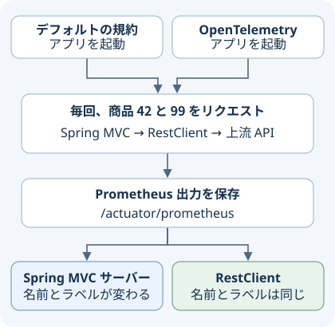

---
{
  "state": "draft",
  "language": "ja",
  "translationKey": "2026-11-22-spring-boot-4-2-otel-http-metrics",
  "title": "OpenTelemetry の規約で Spring Boot 4.2 の HTTP メトリクスはどう変わるか",
  "description": "Spring Boot 4.2.0 の Spring MVC と RestClient の Prometheus メトリクスを比較し、404 のクエリを OpenTelemetry の規約に合わせます。",
  "sourcePath": "src/content/posts/en/2026-11-22-spring-boot-4-2-otel-http-metrics.md",
  "sourceSha256": "184d3ca3476cfc05571ad97d60ef35f2d4c93f54cb152df388401376edc0ef57"
}
---

**Spring Boot 4.2.0 で OpenTelemetry の観測規約を有効にすると、Spring MVC サーバーの Prometheus メトリクスは `http_server_requests_seconds_count` から `http_server_request_duration_seconds_count` に変わります。** 404 を絞り込むラベルも、`status` から `http_response_status_code` に変わります。同じアプリで、`RestClient` が上流 API を呼び出すときのメトリクス名とラベルは変わりませんでした。ダッシュボードとアラートを更新するときは、受信と送信のメトリクスを別々に確認します。 [Spring Boot 4.2 リリースノート](https://github.com/spring-projects/spring-boot/wiki/Spring-Boot-4.2-Release-Notes#semantic-conventions)

## 両方の設定で同じリクエストを送る

[前回の商品照会の例](/en/posts/2026-11-22-spring-boot-4-2-restclient-migration/)を使います。アプリは `GET /products/{id}` を受け取ると、`RestClient` で上流 API の `GET /items/{id}` を呼び出します。この例では、ID `42` なら `200` と商品名 `Keyboard`、ID `99` なら本文が空の `404` が返ります。



図は両方の実行手順を示しています。それぞれ同じリクエストを送り、比較用に Prometheus の出力を個別に保存します。

Spring Boot 4.2.0 と JDK 21 を使います。前回のガイドから `pom.xml` と `src/main/java/example/CatalogApplication.java` をコピーします。この例では使わない `spring-boot-starter-webmvc-test` を削除し、次のふたつの依存関係を Maven の依存関係リストに加えます。`CatalogApplication.java` には Boot が構成した `RestClient.Builder` がすでに注入されます。 [Spring Boot の HTTP クライアントメトリクスのドキュメント](https://docs.spring.io/spring-boot/reference/actuator/metrics.html#actuator.metrics.supported.http-clients)

```xml
<dependency>
    <groupId>org.springframework.boot</groupId>
    <artifactId>spring-boot-starter-actuator</artifactId>
</dependency>
<dependency>
    <groupId>io.micrometer</groupId>
    <artifactId>micrometer-registry-prometheus</artifactId>
</dependency>
```

アプリを実行可能 JAR にするには、`pom.xml` の `<project>` 配下に次の設定を追加します。

```xml
<build>
    <plugins>
        <plugin>
            <groupId>org.springframework.boot</groupId>
            <artifactId>spring-boot-maven-plugin</artifactId>
        </plugin>
    </plugins>
</build>
```

端末をひとつ開き、上流 API の代わりとしてローカルサーバーを起動します。サーバーは `/items/42` のファイルを配信し、ファイルが存在しない `/items/99` には 404 を返します。両方のポートが空いているローカル開発環境で実行してください。

```sh
upstream_dir=$(mktemp -d)
mkdir -p "$upstream_dir/items"
printf '%s' Keyboard > "$upstream_dir/items/42"
python3 -m http.server 18081 --bind 127.0.0.1 --directory "$upstream_dir"
```

別の端末で Maven プロジェクトのルートからアプリをビルドし、デフォルトの規約で起動します。スクレイプ対象の Actuator エンドポイントを公開し、アプリをループバックアドレスにバインドします。

```sh
mvn package

java -jar target/restclient-migration-1.0.0.jar \
  --server.address=127.0.0.1 \
  --server.port=18080 \
  --catalog.base-url=http://127.0.0.1:18081 \
  --management.endpoints.web.exposure.include=health,prometheus
```

アプリが起動したら、三つ目の端末から次のリクエストを送ります。最初のふたつのレスポンスを確認してから、累積リクエスト数を表す `_count` 系列を含む Prometheus の出力を保存します。

```sh
curl -sS -i http://127.0.0.1:18080/products/42
curl -sS -i http://127.0.0.1:18080/products/99
curl -fsS http://127.0.0.1:18080/actuator/prometheus > default.prom
```

アプリを停止します。同じ `java -jar` コマンドに `--management.observations.conventions=open-telemetry` を加えて再起動します。三つのリクエストをすべて送り直し、最後のレスポンスを `open-telemetry.prom` に保存します。新しいプロセスを起動すると、最初の実行のカウンターがリセットされます。

```sh
grep -E '^http_(server|client).*_count\{.*(/products/|/items/)' \
  default.prom open-telemetry.prom
```

## 取得したメトリクスの変化

JDK 21.0.1、Maven 3.9.11、Spring Boot 4.2.0、組み込み Tomcat で両方の設定を実行しました。各回で `200` になるリクエストと `404` になるリクエストを一度ずつ送りました。四つのレスポンスから確認したステータスと本文はすべて想定どおりでした。

| MVC サーバーのメトリクス | デフォルトの規約 | OpenTelemetry の規約 |
| --- | --- | --- |
| Prometheus のリクエスト数 | `http_server_requests_seconds_count` | `http_server_request_duration_seconds_count` |
| HTTP メソッドのラベル | `method` | `http_request_method` |
| レスポンスステータスのラベル | `status` | `http_response_status_code` |
| ルートのラベル | `uri` | `http_route` |
| この例でのルートの値 | `/products/{id}` | `/products/{id}` |

ルートのラベルには `{id}` を含むルートテンプレートが入ります。次の抜粋は、取得した 404 の系列からクエリに使うラベルだけを示しています。サーバー側の 404 の件数は、各回とも `1` でした。

```text
http_server_requests_seconds_count{status="404",uri="/products/{id}"} 1
http_server_request_duration_seconds_count{http_response_status_code="404",http_route="/products/{id}"} 1
```

同じ取得データでは、どちらの規約でも送信リクエストが `http_client_requests_seconds_count` に記録され、ラベルは `method="GET"`、`uri="/items/{id}"`、および `status="200"` または `status="404"` でした。この結果は、例で使った Boot の自動構成と `RestClient.Builder` の組み合わせに当てはまります。この例では Micrometer の Prometheus レジストリからメトリクスを読み取ります。観測規約の選択とデータのエクスポート方法は別々の設定です。 [Spring Boot のオブザーバビリティのドキュメント](https://docs.spring.io/spring-boot/reference/actuator/observability.html#actuator.observability.semantic-conventions)

## 404 のクエリを更新する

デフォルトの規約を使う Grafana パネルでは、このルートの 404 の累積件数を次のように問い合わせられます。

```text
sum(http_server_requests_seconds_count{uri="/products/{id}",status="404"})
```

OpenTelemetry の規約の場合は、メトリクス名と両方のラベルを変更します。

```text
sum(http_server_request_duration_seconds_count{http_route="/products/{id}",http_response_status_code="404"})
```

取得した系列を使って、Prometheus 3.5.0 の `promtool` でクエリを検証しました。各クエリは、対応する規約のデータで `1` を返し、もう一方の規約では結果が空でした。

これらのクエリは、単一のアプリの累積件数を比較します。本番のパネルで直近の時間範囲における毎秒リクエスト数を表示している場合は、`rate(...[5m])` などの既存の計算を残し、その中のメトリクスセレクターを変更します。Prometheus が新旧バージョンをどちらもスクレイプしている間は、デプロイ先ごとにクエリを実行し、どの名前を各対象が報告しているか確認します。 [Prometheus のクエリの基礎](https://prometheus.io/docs/prometheus/latest/querying/basics/) · [Prometheus の `rate()` ドキュメント](https://prometheus.io/docs/prometheus/latest/querying/functions/#rate)

`management.observations.http.server.requests.name` でサーバーメトリクス名を設定している場合は、そのカスタム名を参照するパネルやアラートを先に確認してください。この設定は OpenTelemetry の規約では効きません。個々のリクエストをメトリクスからログやトレースへたどるには、[Grafana LGTM でログとトレースを関連付ける](/en/posts/2026-11-02-grafana-lgtm-log-trace/)を参照してください。 [Spring Boot 4.2 リリースノート](https://github.com/spring-projects/spring-boot/wiki/Spring-Boot-4.2-Release-Notes#semantic-conventions)
