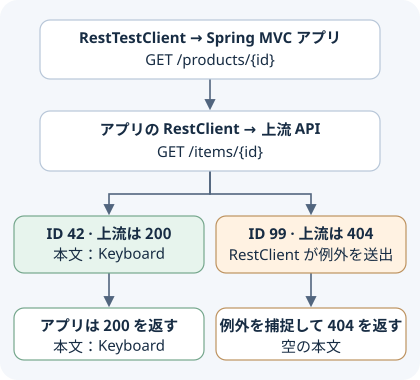

---
{
  "state": "draft",
  "language": "ja",
  "translationKey": "2026-11-22-spring-boot-4-2-restclient-migration",
  "title": "Spring Boot 4.2 で RestTemplate と TestRestTemplate を移行する",
  "description": "Spring Boot 4.2 で RestClient と RestTestClient に移行し、稼働中のサーバーで 200 と 404 のレスポンスを検証します。",
  "sourcePath": "src/content/posts/en/2026-11-22-spring-boot-4-2-restclient-migration.md",
  "sourceSha256": "8859ad29e5643a2fc5112004d1582dceddbd10ea1ccfdc3bd1bfb21aacff6b33"
}
---

**外部 API の呼び出しには `RestClient` を、アプリにリクエストを送りレスポンスを検証するテストには `RestTestClient` を使います。** Spring Boot 4.2 では、`RestTemplate` の自動構成とビルダー、および `TestRestTemplate` のサポートが非推奨になりました。移行時は成功ケースとエラーのアサーションを引き継ぎます。既存テストが HTTP 404 を確認していたなら、新しいテストでもそのステータスを検証します。 [Spring Boot 4.2 リリースノート](https://github.com/spring-projects/spring-boot/wiki/Spring-Boot-4.2-Release-Notes#deprecation-of-testresttemplate-support)

## 既存の API を何に置き換えるか

| 既存コード | 置き換え先 | 確認する動作 |
| --- | --- | --- |
| `RestTemplateBuilder` と `getForObject()` | `RestClient.Builder` と `get().uri().retrieve().body()` | ベース URL、リクエストヘッダー、4xx・5xx レスポンスの扱い |
| `RestTemplateCustomizer` | `RestClientCustomizer` | インターセプター、タイムアウト、リクエストファクトリ |
| `@AutoConfigureTestRestTemplate` と `TestRestTemplate` | `@AutoConfigureRestTestClient` と `RestTestClient` | 実サーバーの起動方法、ステータスコード、レスポンス本文 |

`RestClient.retrieve()` はデフォルトで 4xx・5xx レスポンスに対して例外を送出します。デフォルト構成の `RestTemplate` も同様です。`TestRestTemplate` はレスポンスを返すため、テストでステータスコードを調べられます。`RestTestClient` では `exchange()` の後に `expectStatus()` を使い、同じアサーションを残します。既存のクライアントが独自のエラーハンドラーを使っていた場合は、`defaultStatusHandler()` またはリクエストごとの `onStatus()` で同じステータス処理を表します。 [Spring Framework の REST クライアントリファレンス](https://docs.spring.io/spring-framework/reference/integration/rest-clients.html) · [TestRestTemplate API](https://docs.spring.io/spring-boot/api/java/org/springframework/boot/resttestclient/TestRestTemplate.html)

## 商品照会 API で両方の HTTP 境界をテストする



商品 ID が `42` のとき、上流 API は商品名 `Keyboard` を返します。それ以外の ID はすべて 404 になります。図では、アプリ経由でリクエストを送る二つの統合テストの流れを示します。テストでは上流 API の代わりにローカル HTTP サーバーを起動します。

### `pom.xml`

例では Spring Boot 4.2.0 と JDK 21 を使います。MVC のテスト用スターターには、`RestTestClient` の自動構成モジュールが含まれます。

```xml
<project xmlns="http://maven.apache.org/POM/4.0.0">
    <modelVersion>4.0.0</modelVersion>
    <parent>
        <groupId>org.springframework.boot</groupId>
        <artifactId>spring-boot-starter-parent</artifactId>
        <version>4.2.0</version>
    </parent>
    <groupId>example</groupId>
    <artifactId>restclient-migration</artifactId>
    <version>1.0.0</version>
    <properties>
        <java.version>21</java.version>
    </properties>
    <dependencies>
        <dependency>
            <groupId>org.springframework.boot</groupId>
            <artifactId>spring-boot-starter-webmvc</artifactId>
        </dependency>
        <dependency>
            <groupId>org.springframework.boot</groupId>
            <artifactId>spring-boot-starter-restclient</artifactId>
        </dependency>
        <dependency>
            <groupId>org.springframework.boot</groupId>
            <artifactId>spring-boot-starter-webmvc-test</artifactId>
            <scope>test</scope>
        </dependency>
    </dependencies>
</project>
```

### `src/main/java/example/CatalogApplication.java`

既存の呼び出しが `restTemplate.getForObject("/items/{id}", String.class, id)` なら、新しい呼び出しでも URI テンプレートとレスポンス型を引き継ぎます。Boot が構成したビルダーを注入し、上流のベース URL を設定します。この例では、商品が見つからず上流が 404 を返すと、コントローラーはアプリのレスポンスも 404 にします。

```java
package example;

import org.springframework.beans.factory.annotation.Value;
import org.springframework.boot.SpringApplication;
import org.springframework.boot.autoconfigure.SpringBootApplication;
import org.springframework.http.ResponseEntity;
import org.springframework.stereotype.Service;
import org.springframework.web.bind.annotation.GetMapping;
import org.springframework.web.bind.annotation.PathVariable;
import org.springframework.web.bind.annotation.RestController;
import org.springframework.web.client.HttpClientErrorException;
import org.springframework.web.client.RestClient;

@SpringBootApplication
public class CatalogApplication {
    public static void main(String[] args) {
        SpringApplication.run(CatalogApplication.class, args);
    }
}

@Service
class CatalogClient {
    private final RestClient http;

    CatalogClient(RestClient.Builder builder, @Value("${catalog.base-url}") String baseUrl) {
        this.http = builder.baseUrl(baseUrl).build();
    }

    String findName(long id) {
        return http.get()
            .uri("/items/{id}", id)
            .retrieve()
            .body(String.class);
    }
}

@RestController
class ProductController {
    private final CatalogClient catalog;

    ProductController(CatalogClient catalog) {
        this.catalog = catalog;
    }

    @GetMapping("/products/{id}")
    ResponseEntity<String> product(@PathVariable("id") long id) {
        try {
            return ResponseEntity.ok(catalog.findName(id));
        } catch (HttpClientErrorException.NotFound ex) {
            return ResponseEntity.notFound().build();
        }
    }
}
```

### `src/test/java/example/CatalogApplicationTests.java`

`RANDOM_PORT` を残して、稼働中の組み込みサーバーへ HTTP リクエストを送ります。Boot が注入する `RestTestClient` は、そのサーバーのアドレスを基準に相対パスを解決します。以前のテストが `getForEntity("/products/99", String.class).getStatusCode()` で 404 を確認していたなら、`exchange().expectStatus().isNotFound()` で同じステータスを検証します。 [稼働中のサーバーを使うテストの Spring Boot ドキュメント](https://docs.spring.io/spring-boot/reference/testing/spring-boot-applications.html#testing.spring-boot-applications.with-running-server)

```java
package example;

import java.io.IOException;
import java.io.UncheckedIOException;
import java.net.InetSocketAddress;
import java.nio.charset.StandardCharsets;

import com.sun.net.httpserver.HttpServer;
import org.junit.jupiter.api.AfterAll;
import org.junit.jupiter.api.Test;
import org.springframework.beans.factory.annotation.Autowired;
import org.springframework.boot.resttestclient.autoconfigure.AutoConfigureRestTestClient;
import org.springframework.boot.test.context.SpringBootTest;
import org.springframework.test.context.DynamicPropertyRegistry;
import org.springframework.test.context.DynamicPropertySource;
import org.springframework.test.web.servlet.client.RestTestClient;
import org.springframework.web.client.HttpClientErrorException;

import static org.assertj.core.api.Assertions.assertThatThrownBy;

@SpringBootTest(webEnvironment = SpringBootTest.WebEnvironment.RANDOM_PORT)
@AutoConfigureRestTestClient
class CatalogApplicationTests {
    private static final HttpServer upstream = startUpstream();

    @Autowired
    private RestTestClient app;

    @Autowired
    private CatalogClient catalog;

    @DynamicPropertySource
    static void configureUpstream(DynamicPropertyRegistry properties) {
        properties.add("catalog.base-url",
            () -> "http://127.0.0.1:" + upstream.getAddress().getPort());
    }

    @AfterAll
    static void stopUpstream() {
        upstream.stop(0);
    }

    @Test
    void returnsProductName() {
        app.get().uri("/products/42").exchange()
            .expectStatus().isOk()
            .expectBody(String.class).isEqualTo("Keyboard");
    }

    @Test
    void returnsNotFoundForMissingProduct() {
        app.get().uri("/products/99").exchange()
            .expectStatus().isNotFound()
            .expectBody().isEmpty();
    }

    @Test
    void turnsUpstream404IntoAnException() {
        assertThatThrownBy(() -> catalog.findName(99))
            .isInstanceOf(HttpClientErrorException.NotFound.class);
    }

    private static HttpServer startUpstream() {
        try {
            HttpServer server = HttpServer.create(new InetSocketAddress("127.0.0.1", 0), 0);
            server.createContext("/items/", exchange -> {
                try (exchange) {
                    if (exchange.getRequestURI().getPath().equals("/items/42")) {
                        byte[] body = "Keyboard".getBytes(StandardCharsets.UTF_8);
                        exchange.getResponseHeaders().set("Content-Type", "text/plain; charset=UTF-8");
                        exchange.sendResponseHeaders(200, body.length);
                        exchange.getResponseBody().write(body);
                    } else {
                        exchange.sendResponseHeaders(404, -1);
                    }
                }
            });
            server.start();
            return server;
        } catch (IOException ex) {
            throw new UncheckedIOException(ex);
        }
    }
}
```

## テストを実行する

三つのファイルを保存し、プロジェクトのルートで次のコマンドを実行します。

```sh
mvn test
```

実行環境は JDK 21.0.1 と Maven 3.9.11 です。組み込み Tomcat と、上流 API の代わりに起動したローカル HTTP サーバーは、どちらもランダムなポートで動作しました。三つのテストはすべて成功しました。

| テストの確認項目 | 観測した結果 |
| --- | --- |
| `GET /products/42` | `200 OK`、本文は `Keyboard` |
| `GET /products/99` | `404 Not Found`、本文は空 |
| `catalog.findName(99)` | `HttpClientErrorException.NotFound` を送出 |

```text
Tests run: 3, Failures: 0, Errors: 0, Skipped: 0
BUILD SUCCESS
```

プロジェクトを移行する前に、既存のテストが検証しているステータスと本文を洗い出します。たとえば、上流の 404 を空の結果に変換するクライアントと、自身で 404 を返すコントローラーにはそれぞれ別の契約があります。両方の境界をテストすると、どこで動作が変わったかを確認できます。同期呼び出しとリアクティブな呼び出しの比較は [WebClient と RestClient の比較](/en/posts/2026-10-31-webclient-restclient-comparison/) を参照してください。
