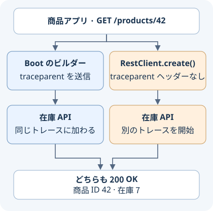

---
{
  "state": "draft",
  "language": "ja",
  "translationKey": "2026-11-22-spring-boot-4-2-restclient-traceparent",
  "title": "Spring Boot 4.2 で RestClient の traceparent 伝播を検証する",
  "description": "Spring Boot 4.2.0 で RestClient の作成方法を変え、traceparent の伝播と Tempo に表示されるスパンの関係を比較します。",
  "sourcePath": "src/content/posts/en/2026-11-22-spring-boot-4-2-restclient-traceparent.md",
  "sourceSha256": "79632a97012abbc73db2e3e1a0bbe924c261ceb52f4603146310d3e2c4f897f5"
}
---

**商品照会とそこからの在庫 API 呼び出しを一つのトレースで追うには、Spring Boot が注入する `RestClient.Builder` を使います。** この例では、`RestClient.create()` で作成したクライアントも同じ商品を照会し、HTTP 200 を返します。ただし、在庫 API は `traceparent` ヘッダーを受け取らず、別のトレースを開始します。HTTP レスポンスと Tempo に保存されたスパンを比べ、トレースコンテキストの伝播がどこで止まるかを確認します。 [Spring Boot のトレース伝播ドキュメント](https://docs.spring.io/spring-boot/4.2/reference/actuator/tracing.html#actuator.micrometer-tracing.propagating-traces)

この演習は [RestClient 移行ガイド](/en/posts/2026-11-22-spring-boot-4-2-restclient-migration/)の商品照会を土台にします。[HTTP メトリクスのガイド](/en/posts/2026-11-22-spring-boot-4-2-otel-http-metrics/)ではリクエストを数えました。ここでは一件のリクエストの経路をたどります。

## 商品照会と在庫照会をつなぐヘッダー

`traceparent` は、トレースコンテキストを伝播する W3C 標準の HTTP ヘッダーです。この演習では `00-<trace-id>-<parent-id>-<trace-flags>` の形式です。`trace-id` はトレース全体を識別します。`parent-id` は送信側の HTTP クライアントスパンを識別し、受信側のサービスがそれをサーバースパンの親として使えるようにします。 [W3C Trace Context 仕様](https://www.w3.org/TR/trace-context/#traceparent-header)



図に示すのは、商品 42 を照会する両方のクライアント経路です。どちらも同じ在庫数を返します。この例では `traceparent` ヘッダーの有無で、在庫サーバーのスパンが商品側のトレースに加わるかが決まります。

## 同じ JAR を二つのアプリとして実行する

JDK 21、Maven、Docker、`curl`、`jq` が必要です。ローカルポート `13200`、`14318`、`18180`、`18181` を使います。空のディレクトリに次のファイルを作成します。同じ JAR を、サービス名 `product` と `inventory` でそれぞれ起動します。確認できるように、サンプルのレスポンスには現在のトレース ID と受信したヘッダーが含まれます。

### `pom.xml`

```xml
<project xmlns="http://maven.apache.org/POM/4.0.0">
    <modelVersion>4.0.0</modelVersion>
    <parent>
        <groupId>org.springframework.boot</groupId>
        <artifactId>spring-boot-starter-parent</artifactId>
        <version>4.2.0</version>
    </parent>
    <groupId>example</groupId>
    <artifactId>trace-propagation</artifactId>
    <version>1.0.0</version>
    <properties>
        <java.version>21</java.version>
    </properties>
    <dependencies>
        <dependency>
            <groupId>org.springframework.boot</groupId>
            <artifactId>spring-boot-starter-webmvc</artifactId>
        </dependency>
        <dependency>
            <groupId>org.springframework.boot</groupId>
            <artifactId>spring-boot-starter-restclient</artifactId>
        </dependency>
        <dependency>
            <groupId>org.springframework.boot</groupId>
            <artifactId>spring-boot-starter-opentelemetry</artifactId>
        </dependency>
    </dependencies>
    <build>
        <plugins>
            <plugin>
                <groupId>org.springframework.boot</groupId>
                <artifactId>spring-boot-maven-plugin</artifactId>
            </plugin>
        </plugins>
    </build>
</project>
```

### `src/main/java/example/TraceApplication.java`

```java
package example;

import io.micrometer.tracing.Tracer;
import org.springframework.beans.factory.annotation.Value;
import org.springframework.boot.SpringApplication;
import org.springframework.boot.autoconfigure.SpringBootApplication;
import org.springframework.web.bind.annotation.GetMapping;
import org.springframework.web.bind.annotation.PathVariable;
import org.springframework.web.bind.annotation.RequestHeader;
import org.springframework.web.bind.annotation.RequestParam;
import org.springframework.web.bind.annotation.RestController;
import org.springframework.web.client.RestClient;

@SpringBootApplication
public class TraceApplication {
    public static void main(String[] args) {
        SpringApplication.run(TraceApplication.class, args);
    }
}

@RestController
class ProductController {
    private final RestClient bootClient;
    private final RestClient directClient;
    private final Tracer tracer;

    ProductController(RestClient.Builder builder, Tracer tracer,
            @Value("${inventory.base-url}") String inventoryUrl) {
        this.bootClient = builder.baseUrl(inventoryUrl).build();
        this.directClient = RestClient.create(inventoryUrl);
        this.tracer = tracer;
    }

    @GetMapping("/products/{id}")
    ProductReply product(@PathVariable("id") long id,
            @RequestParam("instrumented") boolean instrumented) {
        RestClient client = instrumented ? bootClient : directClient;
        InventoryReply inventory = client.get().uri("/items/{id}", id)
            .retrieve().body(InventoryReply.class);
        return new ProductReply(tracer.currentSpan().context().traceId(), inventory);
    }
}

@RestController
class InventoryController {
    private final Tracer tracer;

    InventoryController(Tracer tracer) {
        this.tracer = tracer;
    }

    @GetMapping("/items/{id}")
    InventoryReply item(@PathVariable("id") long id,
            @RequestHeader(name = "traceparent", required = false) String traceparent) {
        return new InventoryReply(id, 7, traceparent, tracer.currentSpan().context().traceId());
    }
}

record ProductReply(String productTraceId, InventoryReply inventory) {}
record InventoryReply(long id, int stock, String traceparent, String inventoryTraceId) {}
```

### `src/main/resources/application.properties`

```properties
server.address=127.0.0.1
inventory.base-url=http://127.0.0.1:18181
management.tracing.sampling.probability=1.0
management.opentelemetry.tracing.export.otlp.endpoint=http://127.0.0.1:14318/v1/traces
management.otlp.metrics.export.enabled=false
```

サンプリング確率を `1.0` にすると、この演習の全リクエストが記録されます。アプリは OTLP でトレースだけをエクスポートします。まず HTTP レスポンスでヘッダーを確認すると、Tempo でスパンが欠ける問題を、伝播の問題と分けて診断できます。 [Spring Boot のサンプリングドキュメント](https://docs.spring.io/spring-boot/4.2/reference/actuator/tracing.html#actuator.micrometer-tracing.sampling)

### `tempo.yaml`

この設定で Tempo は OTLP HTTP によってスパンを受け取り、ローカルストレージに書き込みます。クエリ API と受信ポートは、ホストのループバックアドレスだけに公開します。

```yaml
server:
  http_listen_port: 3200

distributor:
  receivers:
    otlp:
      protocols:
        http:
          endpoint: 0.0.0.0:4318

storage:
  trace:
    backend: local
    wal:
      path: /tmp/tempo/wal
    local:
      path: /tmp/tempo/blocks
```

プロジェクトのルートで Tempo とアプリを起動します。最初の端末で Tempo を起動してください。

```sh
docker run --rm --name traceparent-tempo \
  -p 127.0.0.1:13200:3200 -p 127.0.0.1:14318:4318 \
  --mount "type=bind,source=$PWD/tempo.yaml,target=/etc/tempo.yaml,readonly" \
  grafana/tempo:2.9.0 -config.file=/etc/tempo.yaml
```

別の端末で `curl -fsS http://127.0.0.1:13200/ready` が成功することを確認し、Maven でビルドします。二つの `java` コマンドは別々の端末で実行します。

```sh
mvn package

java -jar target/trace-propagation-1.0.0.jar \
  --spring.application.name=inventory --server.port=18181

java -jar target/trace-propagation-1.0.0.jar \
  --spring.application.name=product --server.port=18180
```

## レスポンスのヘッダーとトレース ID を比較する

両アプリが起動したら、同じ商品を二度照会します。クライアントの選択には `instrumented` だけを変更します。

```sh
curl -fsS 'http://127.0.0.1:18180/products/42?instrumented=true' -o boot.json
curl -fsS 'http://127.0.0.1:18180/products/42?instrumented=false' -o direct.json

jq '{id: .inventory.id, stock: .inventory.stock,
     headerReceived: (.inventory.traceparent != null),
     sameTrace: (.productTraceId == .inventory.inventoryTraceId)}' boot.json direct.json
jq -r .inventory.traceparent boot.json
```

どちらのリクエストも HTTP 200 を返しました。Boot のビルダーを使った場合、両アプリでトレース ID が一致し、在庫 API が受け取った `traceparent` にその ID が含まれていました。直接作成したクライアントでは、在庫 API の報告する `traceparent` は `null` で、両アプリのトレース ID は異なりました。

| クライアントの作成方法 | 商品 ID と在庫数 | ヘッダーを受信したか | アプリ間のトレース ID |
| --- | --- | --- | --- |
| Boot が注入した `RestClient.Builder` | 42 と 7 | はい | 同じ |
| `RestClient.create()` | 42 と 7 | いいえ | 異なる |

## Tempo でスパンを確認する

レスポンスのトレース ID で Tempo に問い合わせます。スパンのエクスポートには数秒かかることがあります。トレースが見つからない場合は少し待ってから、クエリを再実行してください。 [トレースを ID で問い合わせる Grafana Tempo API](https://grafana.com/docs/tempo/latest/api_docs/#query)

```sh
show_spans() {
  curl -fsS "http://127.0.0.1:13200/api/traces/$1" | jq -r '
    (.batches // .resourceSpans)[] as $batch
    | ($batch.resource.attributes[]
       | select(.key == "service.name").value.stringValue) as $service
    | $batch.scopeSpans[].spans[]
    | [$service, .kind, .name, .spanId, (.parentSpanId // "-")] | @tsv'
}

show_spans "$(jq -r .productTraceId boot.json)"
show_spans "$(jq -r .productTraceId direct.json)"
show_spans "$(jq -r .inventory.inventoryTraceId direct.json)"
```

この例は Spring Boot 4.2.0、JDK 21.0.1、Maven 3.9.11、Tempo 2.9.0 で実行しました。二つのリクエストで得られた三つのトレース ID に対して、Tempo API は次のスパンを返しました。

| 問い合わせたトレース ID | Tempo で観測したスパン |
| --- | --- |
| Boot のビルダーを利用したリクエスト | 商品サーバー → 商品 HTTP クライアント → 在庫サーバー |
| 直接作成したクライアントを使った場合の商品アプリ | 商品サーバーのルートスパン一つ |
| 直接作成したクライアントを使った場合の在庫アプリ | 在庫サーバーのルートスパン一つ |

Boot のビルダーを使った経路では、Tempo 上の在庫サーバーの `parentSpanId` が商品 HTTP クライアントの `spanId` と一致しました。今回の Tempo API レスポンスではスパン ID が Base64 でエンコードされていましたが、`traceparent` は十六進数です。クライアントのスパン ID を Base64 からデコードしてバイト列を十六進数で表すと、ヘッダーの `parent-id` と同じ値になりました。

リクエストが成功しているのにサービス境界でトレースが途切れる場合は、受信側のサービスが `traceparent` を受け取っているか確認します。ヘッダーがなければ、呼び出し元が Boot の構成したビルダーを使っているかを確認します。トレース ID が伝播しても Tempo にスパンがない場合は、サンプリングと OTLP エクスポートの設定を確認してください。その後、同じトレース ID でログを探すには [Grafana LGTM でログとトレースを関連付ける](/en/posts/2026-11-02-grafana-lgtm-log-trace/)を参照してください。
