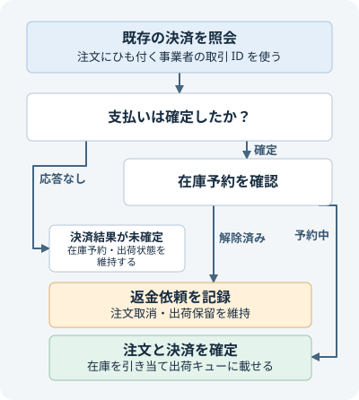

---
{
  "state": "draft",
  "language": "ja",
  "translationKey": "2026-11-23-commerce-admin-screen",
  "title": "EC 管理画面の設計：注文キュー・決済・出荷",
  "description": "運用作業ごとに管理画面を構成し、注文キューと詳細画面で、決済結果の未確定、在庫予約の解除、返金依頼に対応します。",
  "sourcePath": "src/content/posts/en/2026-11-23-commerce-admin-screen.md",
  "sourceSha256": "00692a737eb62a4f313f4adb76e503c7796c83e7a788f20151b7f09669719558"
}
---

**EC の管理画面は、対応が必要な注文と、判断に必要な根拠を担当者が見つけられるようにします。** まず決済確認、出荷処理、返金の追跡のキューを用意します。注文詳細では決済結果とその注文の在庫予約を並べます。予約解除後に支払いが確定した場合、担当者は出荷保留を維持し、返金依頼の進捗を追えるようにします。

一つの事業者が物理商品を韓国ウォン（KRW）で販売し、一つの倉庫から出荷する想定です。システム設計で扱った最後の在庫の例と、データベース設計で扱った注文明細・在庫予約・決済試行のモデルを、管理画面に反映します。担当者が決済事業者の既存取引を照会する流れをたどります。 [EC システム設計](/en/posts/2026-11-22-commerce-system-design-last-unit-of-stock/) · [EC データベース設計](/en/posts/2026-11-22-commerce-database-design/)

## 各メニューに作業の入口を設ける

「注文」が日常業務の入口です。「決済と返金」と「出荷処理」からは、それぞれの未対応作業を直接開けます。どこから開いても同じ注文番号なら同じ詳細と履歴を表示し、シフトやチームをまたいで引き継げるようにします。

| メニュー | ここから始める作業 | 担当者が確認する情報 |
| --- | --- | --- |
| 注文 | 決済結果が未確定の注文、出荷待ちの注文、返金待ちの注文を開く。 | 注文番号、購入時の商品と金額、四つの状態 |
| カタログ | SKU の販売可否、オプション、現在価格を変更する。 | SKU ごとの現在の販売条件、変更前後の値 |
| 在庫 | 在庫予約のある注文を探すか、実地棚卸しとの差異を調整する。 | SKU ごとの実在庫、予約数、引当数、関連注文、調整履歴 |
| 決済と返金 | 事業者の既存取引を照合し、返金依頼を追跡する。 | 決済試行、事業者の取引 ID、元の取引金額、照会と返金の履歴 |
| 出荷処理 | 注文に引き当てた商品をピッキングして発送する。 | SKU、数量、出荷可否、発送記録 |
| 役割と権限 | 作業の閲覧・実行権限をスタッフに付与し、変更を確認する。 | 作業ごとの権限と範囲、付与と取り消しの履歴 |

カタログ価格の変更は今後の販売に反映します。注文詳細は明細に保存した金額を読みます。たとえば黒いキーボードの注文 `O-42` は合計 43,000 ウォンです。割引 2,000 ウォンを単価 42,000 ウォンから引き、送料 3,000 ウォンを加えています。カタログ価格が変わっても、注文詳細と返金確認画面には購入時の金額を表示します。

## キューで作業を選び、詳細で根拠を確認する

**決済確認**には決済結果が未確定の注文を集めます。**出荷待ち**には在庫を引き当て済みで、発送処理前の注文を集めます。**返金の追跡**には返金依頼を記録して最終結果を待っている注文を集めます。キューごとに並び順を決めます。たとえば決済確認は検出が古い順、出荷は倉庫の締め時間順にできます。

一覧には注文番号、注文時刻、商品、金額、現在の状態を表示します。決済状態のフィルターに加え、注文番号、商品名、SKU で検索できるようにします。作業ごとに絞り込み前の総数を表示し、一覧の上には現在の件数を示します。本番では必要に応じて日付と担当者のフィルターを追加し、詳細画面を閉じても絞り込み条件、検索語、スクロール位置を維持します。更新で元の行が一覧から消えた場合は、選択中の作業へフォーカスを戻し、次の注文へ移れるようにします。

| 状態 | 表示する内容 | 確認する理由 |
| --- | --- | --- |
| 注文 | 支払い待ち、確定、取消済み | 注文の進捗が分かります。取消後でも支払いが遅れて確定する場合があります。 |
| 決済 | 結果未確定、支払い済み、返金依頼済み、返金済み | 同じ取引を再照会するか、返金結果を待つか判断できます。 |
| 在庫 | 予約中、予約解除済み、引当済み、出荷済み | 注文が確保した数量と現在の在庫状態が分かります。 |
| 出荷 | 出荷保留、出荷待ち、出荷済み | 倉庫が今対応できるか、すでに出荷したか分かります。 |

注文詳細では、状態のすぐ下に購入時の金額、SKU と数量、関連する予約 ID、事業者の取引 ID を表示します。決済結果が未確定のとき、現在の販売可能数を見ても、この注文が在庫を確保したかは分かりません。履歴には変更時刻、実行者、変更元、関連 ID を記録して表示します。狭い画面でも状態ラベルを読めるようにし、色は強調に使います。

## 決済結果が未確定なら既存取引を照会する

注文 `O-42` の決済リクエストの応答が失われました。結果が長時間未確定だったため、担当者が例外を承認し、予約 `R-42` を解除して注文を取り消しました。決済担当者は注文を開き、既存の取引 `PG-DEMO-42` を照会します。支払いが確定したら**返金依頼**を記録します。注文は取消済み、出荷は保留、予約は解除済みのままにします。事業者が確認してから返金完了を記録します。



図は三つの架空の注文の分岐を示します。`O-43` の照会では応答がなく、**決済結果は未確定、予約は有効、出荷は保留のまま**です。`O-44` は支払いが確定し、予約が有効なので、**注文を確定し、支払い済みにし、在庫を引き当てて出荷待ちに移します**。図が扱うのは応答なしと支払い確定です。本番では請求なしで取引が終わったと確認できれば、予約を解除し注文を取り消せます。取引情報が一致しなければ、状態を変える前に照合の例外を記録します。

### 状態遷移を確認する JavaScript の例

この例は、決済結果が未確定で出荷保留中の架空の注文三件に、照会結果を適用します。ブラウザーの開発者コンソールに貼り付ければ何もインストールせずに実行できます。関数が更新するのはメモリー上の注文オブジェクトだけです。

```javascript
function applyDemoPaymentResult(order, result) {
  if (order.payment !== 'UNKNOWN' || result !== 'PAID') return 'NO_CHANGE';

  if (order.stock === 'RELEASED') {
    order.payment = 'REFUND_PENDING';
    return 'REFUND_REQUESTED';
  }

  if (order.stock === 'HELD') {
    order.order = 'CONFIRMED';
    order.payment = 'PAID';
    order.stock = 'ALLOCATED';
    order.shipping = 'READY';
    return 'READY_TO_SHIP';
  }

  return 'NO_CHANGE';
}

const examples = [
  ['O-42', 'CANCELLED', 'RELEASED', 'PAID'],
  ['O-43', 'PENDING_PAYMENT', 'HELD', 'UNAVAILABLE'],
  ['O-44', 'PENDING_PAYMENT', 'HELD', 'PAID'],
];

for (const [id, state, stock, result] of examples) {
  const order = { order: state, payment: 'UNKNOWN', stock, shipping: 'BLOCKED' };
  console.log(id, applyDemoPaymentResult(order, result), ...Object.values(order));
}
```

想定するコンソール出力には、注文 ID、結果、注文・決済・在庫・出荷の状態がこの順で表示されます。

```text
O-42 REFUND_REQUESTED CANCELLED REFUND_PENDING RELEASED BLOCKED
O-43 NO_CHANGE PENDING_PAYMENT UNKNOWN HELD BLOCKED
O-44 READY_TO_SHIP CONFIRMED PAID ALLOCATED READY
```

このコードを Node.js 24.13.0 で実行し、想定どおりの三行を確認しました。

## 操作権限と状態の確認はサーバーで行う

決済担当者に既存取引の照会権限を与え、倉庫担当者に発送記録へのアクセスを許可します。例外的な予約解除や返金の承認は、指定の承認者に任せます。カタログ価格の変更権限は別に付与します。注文詳細は、現在のユーザーに関係する項目と利用可能な操作だけを返します。操作リクエストのたびに API は認証、操作権限、対象注文へのアクセス、現在の状態を確認します。決済照会 API はサーバーで注文にひも付く既存取引を見つけ、事業者アカウント、取引 ID、金額、通貨を照合します。結果を適用するときは最新の注文と関連予約を読み、再試行が webhook と競合しても出荷や返金の依頼を重複させないようにします。倉庫が出荷を要求したときも、サーバーは注文と支払いが確定し、在庫が引当済みかを再確認します。

既存取引の照会などでは、ボタンの近くに対象取引と操作の範囲を示します。照会で新たな請求は発生しません。照会で支払いが確定した場合は、予約状態に応じて返金を依頼するか出荷待ちに移します。手動返金や例外的な予約解除など、金額や在庫に直接影響する操作には別の確認と権限が必要です。たとえば手動返金の確認には、**注文 `O-42`、元の取引 `PG-DEMO-42`、返金依頼額 43,000 ウォン、理由**を表示します。受理した依頼は「返金依頼済み」と表示し、承認者、実行者、依頼時刻、変更前後の状態、関連取引、結果をサーバー側の監査履歴に保存します。応答を失った場合は、先に同じ依頼の状態を照会します。

## 空のキューと未確定の結果を別の文言で伝える

| 状況 | メッセージと次の操作 |
| --- | --- |
| キューに注文がない | 「この作業の対象となる注文はありません。」別のキューを開けるようにします。 |
| 検索やフィルターに一致しない | 「検索条件やフィルターに一致する注文がありません。」同じキューで条件を解除できるようにします。 |
| 注文一覧を読み込めなかった | 「注文を読み込めませんでした。」検索条件を残し、再読み込みを案内します。古い結果を残す場合は取得時刻を表示します。 |
| 注文を開いたが事業者の結果が未確定 | 「照会に応答がありませんでした。決済結果は未確定で、出荷は保留中です。」同じ取引を再照会できるようにします。 |
| ユーザーに操作権限がない | 「既存取引は決済担当者が照会できます。」現在の役割で許可される範囲の状態と履歴は表示します。 |

## 例の結果を作業キューに反映する

**決済確認**で注文を開き、**既存の決済を照会**を選んだとします。応答がなければ `O-43` は「決済確認」に残ります。照会履歴には応答がなかったことと、予約を維持したことが残ります。`O-42` の返金依頼を記録したら、**返金の追跡**で見つけられます。`O-44` に在庫を引き当てたら、**出荷待ち**で見つけられます。出荷担当者には注文の状態と履歴が表示され、照会は決済担当者が実行できると案内します。

この例は用意した注文と決済応答を使います。本番の実装では、ログイン、顧客データ、事業者への実際の照会と返金、倉庫との連携を別途扱います。
