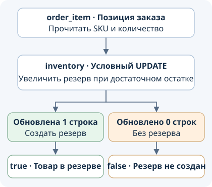

---
{
  "state": "draft",
  "language": "ru",
  "translationKey": "2026-11-22-commerce-database-design",
  "title": "База данных интернет-магазина: SKU, заказы, запасы и платежи",
  "description": "Смоделируйте SKU, цены в момент заказа, резервы и попытки оплаты в PostgreSQL, а затем проверьте, как два сеанса конкурируют за последнюю единицу товара.",
  "sourcePath": "src/content/posts/en/2026-11-22-commerce-database-design.md",
  "sourceSha256": "da573ac023d969b02216c24993c872e842a6693607f8e3805fd988ce7d64bcf3"
}
---

**База данных интернет-магазина должна хранить актуальные условия каталога, согласованные при оформлении суммы, резервы товаров по заказам и результаты от платёжного провайдера.** Итог вчерашнего заказа должен оставаться правильным после завтрашнего изменения цены. Если сегодня в наличии одна единица, зарезервировать её может только один из двух одновременных заказов. Пример на PostgreSQL показывает, какие таблицы и ограничения поддерживают оба требования.

Руководство опирается на [пример с последней единицей товара из предыдущей статьи](/en/posts/2026-11-22-commerce-system-design-last-unit-of-stock/). Предполагается один продавец физических товаров, один склад и оплата в южнокорейских вонах (KRW). Остатки и заказы используют общую базу. Возвраты после отгрузки и расчёты с продавцом описываются отдельными предметными моделями.

## Определите, что нужно записать для одной покупки

| Вопрос | Какие таблицы читать или менять | Ключи и значения |
| --- | --- | --- |
| Сколько сейчас стоит чёрная клавиатура? | `product` → `sku` | ID товара, доступный для продажи SKU, текущая цена |
| За что со вчерашнего заказа списали 43 000 KRW? | `orders` → `order_item` | ID заказа, согласованные количество, цена за единицу, скидка и стоимость доставки |
| Какой заказ получил последнюю единицу? | `inventory`, `stock_reservation` | Фактический остаток по SKU и резерв по позиции заказа |
| Как найти тот же платёж, если ответ провайдера потерялся? | `payment_attempt`, `payment_event` | Попытка оплаты заказа, ID операции провайдера, ID события |

В этом примере `product` представляет позицию каталога, а `sku` — вариант, который можно заказать, например чёрную клавиатуру. Позиция заказа ссылается на SKU и **сохраняет название товара, название варианта и цену за единицу на момент оформления**. Одна единица за 42 000 KRW, скидка 2 000 KRW и доставка за 3 000 KRW дают итог 43 000 KRW. Заказ может показывать эту сохранённую сумму напрямую. Приложение не меняет позиции после создания, поскольку от них зависят согласованные суммы и объём резервирования. Чтобы снять с продажи SKU, по которому уже была операция, отметьте его как недоступный для продажи. Сохраните строки, на которые ссылаются старые заказы, и избегайте каскадного удаления в этих связях.

## Опишите модель ключами и ограничениями PostgreSQL

Выполните следующий DDL один раз в пустой учебной базе. В примере идентификаторы задаются явно, а суммы хранятся в целых вонах. При оформлении несколько записей корзины с одним SKU объединяются в одну позицию. Поэтому `(order_id, sku_id)` идентифицирует и позицию заказа, и её резерв.

```sql
CREATE TABLE product (
    id bigint PRIMARY KEY,
    name text NOT NULL
);

CREATE TABLE sku (
    id bigint PRIMARY KEY,
    product_id bigint NOT NULL REFERENCES product(id),
    code text NOT NULL UNIQUE,
    option_name text NOT NULL,
    current_price_krw bigint NOT NULL CHECK (current_price_krw >= 0),
    sellable boolean NOT NULL
);

CREATE TABLE inventory (
    sku_id bigint PRIMARY KEY REFERENCES sku(id),
    on_hand integer NOT NULL CHECK (on_hand >= 0),
    held integer NOT NULL CHECK (held >= 0),
    allocated integer NOT NULL CHECK (allocated >= 0),
    CHECK (held <= on_hand - allocated)
);

CREATE TABLE orders (
    id bigint PRIMARY KEY,
    customer_id bigint NOT NULL,
    request_key text NOT NULL,
    request_hash text NOT NULL,
    status text NOT NULL CHECK (status IN ('PENDING_PAYMENT', 'CONFIRMED', 'CANCELLED')),
    total_krw bigint NOT NULL CHECK (total_krw >= 0),
    shipping_krw bigint NOT NULL CHECK (shipping_krw >= 0),
    created_at timestamptz NOT NULL DEFAULT now(),
    UNIQUE (customer_id, request_key)
);

CREATE TABLE order_item (
    order_id bigint REFERENCES orders(id),
    sku_id bigint REFERENCES sku(id),
    item_name text NOT NULL,
    option_name text NOT NULL,
    quantity integer NOT NULL CHECK (quantity > 0),
    unit_price_krw bigint NOT NULL CHECK (unit_price_krw >= 0),
    discount_krw bigint NOT NULL CHECK (discount_krw >= 0),
    CHECK (discount_krw <= quantity * unit_price_krw::numeric),
    PRIMARY KEY (order_id, sku_id)
);

CREATE TABLE stock_reservation (
    order_id bigint,
    sku_id bigint REFERENCES inventory(sku_id),
    state text NOT NULL CHECK (state IN ('HELD', 'ALLOCATED', 'RELEASED', 'SHIPPED')),
    expires_at timestamptz NOT NULL,
    PRIMARY KEY (order_id, sku_id),
    FOREIGN KEY (order_id, sku_id) REFERENCES order_item(order_id, sku_id)
);

CREATE TABLE payment_attempt (
    id bigint PRIMARY KEY,
    order_id bigint NOT NULL REFERENCES orders(id),
    attempt_no integer NOT NULL CHECK (attempt_no > 0),
    provider text NOT NULL,
    merchant_account text NOT NULL,
    provider_request_key text NOT NULL,
    provider_payment_id text,
    amount_krw bigint NOT NULL CHECK (amount_krw >= 0),
    state text NOT NULL CHECK (state IN
        ('PENDING', 'UNKNOWN', 'PAID', 'CLOSED_UNPAID', 'REFUND_PENDING', 'REFUNDED')),
    UNIQUE (order_id, attempt_no),
    UNIQUE (provider, merchant_account, provider_request_key),
    UNIQUE (provider, merchant_account, provider_payment_id)
);

CREATE TABLE payment_event (
    provider text,
    merchant_account text,
    event_id text,
    received_at timestamptz NOT NULL DEFAULT now(),
    PRIMARY KEY (provider, merchant_account, event_id)
);

CREATE INDEX orders_customer_history
    ON orders (customer_id, created_at DESC, id DESC);

CREATE INDEX reservation_expiry
    ON stock_reservation (expires_at, order_id, sku_id)
    WHERE state = 'HELD';
```

Ограничение `CHECK` обеспечивает `held + allocated ≤ on_hand` для каждой строки остатков. Чтобы проверить, что итог заказа соответствует его позициям или что сумма активных резервов равна `held`, нужно прочитать несколько строк. Записывайте суммы и резервы в транзакции создания заказа, а затем периодически сверяйте сохранённые итоги и счётчики с записями, на которых они основаны. [Документация PostgreSQL об ограничениях CHECK](https://www.postgresql.org/docs/17/ddl-constraints.html#DDL-CONSTRAINTS-CHECK-CONSTRAINTS)

Если тот же покупатель повторно отправляет `request_key`, найдите существующий заказ. Если сохранённый `request_hash` отличается, обработайте это как конфликт повторного использования ключа. В момент запроса идентификатор операции провайдера может быть неизвестен, поэтому сначала допустим `NULL`. После заполнения внешний ID уникален в пределах провайдера и учётной записи продавца. Ключ `payment_event` исключает дублирование полученных событий. Один и тот же успешный результат может прийти с разными идентификаторами событий, поэтому запросы на отгрузку защищают уникальным ключом заказа и проверкой исходного состояния. [Документация PostgreSQL об ограничениях UNIQUE](https://www.postgresql.org/docs/17/ddl-constraints.html#DDL-CONSTRAINTS-UNIQUE-CONSTRAINTS) · [Рекомендации Stripe по повторным вебхукам](https://docs.stripe.com/webhooks#handle-duplicate-events)

## Зарезервируйте последнюю единицу условным UPDATE



Доступный остаток равен `on_hand - allocated - held`. Какое бы количество ни показала витрина раньше, при оформлении **одна инструкция UPDATE проверяет наличие и увеличивает резерв**. Функция создаёт резерв, только если обновилась строка. Если вставка завершится ошибкой SQL, та же инструкция откатит увеличение `held`.

```sql
CREATE FUNCTION reserve_stock(p_order_id bigint, p_sku_id bigint,
                              p_expires_at timestamptz)
RETURNS boolean
LANGUAGE sql
AS $$
    WITH held_stock AS (
        UPDATE inventory AS i
           SET held = i.held + line.quantity
          FROM order_item AS line
         WHERE line.order_id = p_order_id
           AND line.sku_id = p_sku_id
           AND i.sku_id = line.sku_id
           AND i.on_hand - i.allocated - i.held >= line.quantity
         RETURNING i.sku_id
    ), reservation AS (
        INSERT INTO stock_reservation (order_id, sku_id, state, expires_at)
        SELECT p_order_id, sku_id, 'HELD', p_expires_at
        FROM held_stock
        RETURNING 1
    )
    SELECT EXISTS (SELECT 1 FROM reservation);
$$;
```

При оформлении создавайте заказ с позициями, резервируйте все SKU и записывайте начальную попытку оплаты и задачу на публикацию в одной транзакции. Если для любого товара функция вернула `false`, вызывающая сторона откатывает всю транзакцию. При резервировании нескольких SKU берите блокировки в одном порядке, например по возрастанию ID SKU. При повторном запросе оформления вызывающая сторона проверяет уникальный ключ заказа и пропускает функцию для заказа с уже созданным резервом. Если добавить к вставке резерва `ON CONFLICT DO NOTHING`, счётчик может вырасти без соответствующей записи резерва.

Вызывайте платёжного провайдера после фиксации локальной транзакции. Когда оплата подтверждена, переведите резерв в `ALLOCATED` и перенесите количество из `held` в `allocated`. Снятие резерва уменьшает только `held`. Отгрузка уменьшает `on_hand` и `allocated`. Чтобы избежать двойного списания, блокируйте строки резервов и остатков в одной транзакции и проверяйте ожидаемое предыдущее состояние при переходе.

## Запустите два сеанса, которые попытаются зарезервировать последнюю единицу

После выполнения DDL и создания функции загрузите следующие данные в учебную базу. Две позиции заказа добавлены заранее, чтобы отдельно проверить гонку за резерв.

```sql
INSERT INTO product VALUES (1, 'Keyboard');
INSERT INTO sku VALUES (101, 1, 'KB-BLK', 'Black', 42000, true);
INSERT INTO inventory VALUES (101, 1, 0, 0);

INSERT INTO orders (id, customer_id, request_key, request_hash,
                    status, total_krw, shipping_krw)
VALUES (41, 1001, 'checkout-a', 'fixture-a', 'PENDING_PAYMENT', 43000, 3000),
       (42, 1002, 'checkout-b', 'fixture-b', 'PENDING_PAYMENT', 43000, 3000);

INSERT INTO order_item
VALUES (41, 101, 'Keyboard', 'Black', 1, 42000, 2000),
       (42, 101, 'Keyboard', 'Black', 1, 42000, 2000);
```

Откройте два сеанса `psql`, подключённых к одной базе. Выполните следующий запрос в сеансе **A**. Он вернёт `true` и оставит транзакцию открытой.

```sql
BEGIN ISOLATION LEVEL READ COMMITTED;
SELECT reserve_stock(41, 101, now() + interval '10 minutes') AS reserved;
```

Пока транзакция A открыта, выполните следующий запрос в сеансе **B**. Его `SELECT` ждёт при попытке обновить ту же строку остатков.

```sql
BEGIN ISOLATION LEVEL READ COMMITTED;
SELECT reserve_stock(42, 101, now() + interval '10 minutes') AS reserved;
```

Выполните `COMMIT;` в A. Когда блокировка снимается, B заново проверяет условие `WHERE` для обновлённой строки. Доступных единиц не осталось, поэтому B возвращает `false`. Выполните `ROLLBACK;` в B, чтобы завершить упражнение. [Документация PostgreSQL об изоляции Read Committed](https://www.postgresql.org/docs/17/transaction-iso.html#XACT-READ-COMMITTED)

```sql
SELECT sku_id, on_hand, held, allocated FROM inventory;
SELECT order_id, sku_id, state FROM stock_reservation ORDER BY order_id;
```

Пример выполнили с двумя одновременными подключениями к PostgreSQL 17.12. A зафиксировала транзакцию после того, как `pg_stat_activity` показало, что B ждёт блокировку. A вернула `true`, а B — `false`. Итоговые значения `on_hand / held / allocated` в `inventory` составили `1 / 1 / 0`. Для **заказа 41 остался один резерв в состоянии `HELD`**.

После изменения цены каталога на 45 000 KRW цена единицы в заказе 41 осталась 42 000 KRW, а итог — 43 000 KRW. Когда в остатки добавили одну единицу и снова вызвали функцию для заказа 41, сработало ограничение уникальности, а `held` осталось равно 1. Упражнение проверило конкуренцию двух подключений и ограничения SQL. Вызовы провайдера, гонки при истечении срока резерва и промышленная нагрузка требуют отдельных проверок.

## Выбирайте индексы по запросам приложения

Для истории заказов клиента используется запрос вида `WHERE customer_id = … ORDER BY created_at DESC, id DESC LIMIT …`. Составной индекс в DDL соответствует фильтру по клиенту и сортировке. Задача очистки резервов использует `WHERE state = 'HELD' AND expires_at <= now()`, поэтому частичный индекс исключает резервы в других состояниях. Индекс по сроку действия находит кандидатов. Задача получает блокировки и проверяет статус платежа перед решением о снятии каждого резерва. [Документация PostgreSQL о составных индексах](https://www.postgresql.org/docs/17/indexes-multicolumn.html) · [Документация PostgreSQL о частичных индексах](https://www.postgresql.org/docs/17/indexes-partial.html)
