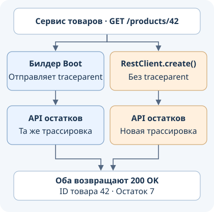

---
{
  "state": "draft",
  "language": "ru",
  "translationKey": "2026-11-22-spring-boot-4-2-restclient-traceparent",
  "title": "Проверка передачи traceparent с RestClient в Spring Boot 4.2",
  "description": "Сравните передачу traceparent и связи между спанами в Tempo при двух способах создания RestClient в Spring Boot 4.2.0.",
  "sourcePath": "src/content/posts/en/2026-11-22-spring-boot-4-2-restclient-traceparent.md",
  "sourceSha256": "79632a97012abbc73db2e3e1a0bbe924c261ceb52f4603146310d3e2c4f897f5"
}
---

**Чтобы увидеть поиск товара и запрос его остатков в одной трассировке, используйте `RestClient.Builder`, который внедряет Spring Boot.** В примере клиент из `RestClient.create()` ищет тот же товар и тоже возвращает HTTP 200. API остатков при этом не получает заголовок `traceparent` и начинает отдельную трассировку. Сравните HTTP-ответы и спаны в Tempo, чтобы понять, где перестаёт передаваться контекст трассировки. [Документация Spring Boot о передаче контекста трассировки](https://docs.spring.io/spring-boot/4.2/reference/actuator/tracing.html#actuator.micrometer-tracing.propagating-traces)

В упражнении используется поиск товара из [руководства по переходу на RestClient](/en/posts/2026-11-22-spring-boot-4-2-restclient-migration/). В [руководстве по метрикам HTTP](/en/posts/2026-11-22-spring-boot-4-2-otel-http-metrics/) мы считали запросы. Здесь проследим за одним запросом.

## Заголовок, который связывает поиск товара и проверку остатков

`traceparent` — стандартный заголовок HTTP, который W3C определяет для передачи контекста трассировки. В упражнении заголовок имеет вид `00-<trace-id>-<parent-id>-<trace-flags>`. `trace-id` обозначает всю трассировку. `parent-id` обозначает спан HTTP-клиента отправителя, чтобы принимающий сервис мог использовать его как родительский для своего серверного спана. [Спецификация W3C Trace Context](https://www.w3.org/TR/trace-context/#traceparent-header)



На схеме показаны оба пути для товара 42. Они возвращают один и тот же остаток. В этом примере от заголовка `traceparent` зависит, войдёт ли серверный спан API остатков в трассировку поиска товара.

## Запустите один JAR как два приложения

Вам понадобятся JDK 21, Maven, Docker, `curl` и `jq`. Упражнение использует локальные порты `13200`, `14318`, `18180` и `18181`. Создайте следующие файлы в пустом каталоге. Запустите один и тот же JAR с именем сервиса `product`, затем с именем `inventory`. В ответ добавлены текущие идентификаторы трассировки и полученный заголовок, чтобы их можно было проверить.

### `pom.xml`

```xml
<project xmlns="http://maven.apache.org/POM/4.0.0">
    <modelVersion>4.0.0</modelVersion>
    <parent>
        <groupId>org.springframework.boot</groupId>
        <artifactId>spring-boot-starter-parent</artifactId>
        <version>4.2.0</version>
    </parent>
    <groupId>example</groupId>
    <artifactId>trace-propagation</artifactId>
    <version>1.0.0</version>
    <properties>
        <java.version>21</java.version>
    </properties>
    <dependencies>
        <dependency>
            <groupId>org.springframework.boot</groupId>
            <artifactId>spring-boot-starter-webmvc</artifactId>
        </dependency>
        <dependency>
            <groupId>org.springframework.boot</groupId>
            <artifactId>spring-boot-starter-restclient</artifactId>
        </dependency>
        <dependency>
            <groupId>org.springframework.boot</groupId>
            <artifactId>spring-boot-starter-opentelemetry</artifactId>
        </dependency>
    </dependencies>
    <build>
        <plugins>
            <plugin>
                <groupId>org.springframework.boot</groupId>
                <artifactId>spring-boot-maven-plugin</artifactId>
            </plugin>
        </plugins>
    </build>
</project>
```

### `src/main/java/example/TraceApplication.java`

```java
package example;

import io.micrometer.tracing.Tracer;
import org.springframework.beans.factory.annotation.Value;
import org.springframework.boot.SpringApplication;
import org.springframework.boot.autoconfigure.SpringBootApplication;
import org.springframework.web.bind.annotation.GetMapping;
import org.springframework.web.bind.annotation.PathVariable;
import org.springframework.web.bind.annotation.RequestHeader;
import org.springframework.web.bind.annotation.RequestParam;
import org.springframework.web.bind.annotation.RestController;
import org.springframework.web.client.RestClient;

@SpringBootApplication
public class TraceApplication {
    public static void main(String[] args) {
        SpringApplication.run(TraceApplication.class, args);
    }
}

@RestController
class ProductController {
    private final RestClient bootClient;
    private final RestClient directClient;
    private final Tracer tracer;

    ProductController(RestClient.Builder builder, Tracer tracer,
            @Value("${inventory.base-url}") String inventoryUrl) {
        this.bootClient = builder.baseUrl(inventoryUrl).build();
        this.directClient = RestClient.create(inventoryUrl);
        this.tracer = tracer;
    }

    @GetMapping("/products/{id}")
    ProductReply product(@PathVariable("id") long id,
            @RequestParam("instrumented") boolean instrumented) {
        RestClient client = instrumented ? bootClient : directClient;
        InventoryReply inventory = client.get().uri("/items/{id}", id)
            .retrieve().body(InventoryReply.class);
        return new ProductReply(tracer.currentSpan().context().traceId(), inventory);
    }
}

@RestController
class InventoryController {
    private final Tracer tracer;

    InventoryController(Tracer tracer) {
        this.tracer = tracer;
    }

    @GetMapping("/items/{id}")
    InventoryReply item(@PathVariable("id") long id,
            @RequestHeader(name = "traceparent", required = false) String traceparent) {
        return new InventoryReply(id, 7, traceparent, tracer.currentSpan().context().traceId());
    }
}

record ProductReply(String productTraceId, InventoryReply inventory) {}
record InventoryReply(long id, int stock, String traceparent, String inventoryTraceId) {}
```

### `src/main/resources/application.properties`

```properties
server.address=127.0.0.1
inventory.base-url=http://127.0.0.1:18181
management.tracing.sampling.probability=1.0
management.opentelemetry.tracing.export.otlp.endpoint=http://127.0.0.1:14318/v1/traces
management.otlp.metrics.export.enabled=false
```

Вероятность семплирования `1.0` позволяет записать все запросы в упражнении. По OTLP приложения экспортируют только трассировки. Сначала проверьте заголовок в HTTP-ответе, чтобы диагностировать отсутствие спанов в Tempo отдельно от передачи контекста. [Документация Spring Boot о семплировании](https://docs.spring.io/spring-boot/4.2/reference/actuator/tracing.html#actuator.micrometer-tracing.sampling)

### `tempo.yaml`

С такой конфигурацией Tempo принимает спаны по OTLP HTTP и записывает их в локальное хранилище. API запросов и порты приёма доступны только по loopback-адресу хоста.

```yaml
server:
  http_listen_port: 3200

distributor:
  receivers:
    otlp:
      protocols:
        http:
          endpoint: 0.0.0.0:4318

storage:
  trace:
    backend: local
    wal:
      path: /tmp/tempo/wal
    local:
      path: /tmp/tempo/blocks
```

Запустите Tempo и приложения из корня проекта. В первом терминале запустите Tempo.

```sh
docker run --rm --name traceparent-tempo \
  -p 127.0.0.1:13200:3200 -p 127.0.0.1:14318:4318 \
  --mount "type=bind,source=$PWD/tempo.yaml,target=/etc/tempo.yaml,readonly" \
  grafana/tempo:2.9.0 -config.file=/etc/tempo.yaml
```

В другом терминале проверьте, что `curl -fsS http://127.0.0.1:13200/ready` завершается успешно, и выполните сборку Maven. Две команды `java` запустите в отдельных терминалах.

```sh
mvn package

java -jar target/trace-propagation-1.0.0.jar \
  --spring.application.name=inventory --server.port=18181

java -jar target/trace-propagation-1.0.0.jar \
  --spring.application.name=product --server.port=18180
```

## Сравните заголовки и идентификаторы трассировки в ответах

После запуска обоих приложений дважды запросите один и тот же товар. Для выбора клиента меняйте только `instrumented`.

```sh
curl -fsS 'http://127.0.0.1:18180/products/42?instrumented=true' -o boot.json
curl -fsS 'http://127.0.0.1:18180/products/42?instrumented=false' -o direct.json

jq '{id: .inventory.id, stock: .inventory.stock,
     headerReceived: (.inventory.traceparent != null),
     sameTrace: (.productTraceId == .inventory.inventoryTraceId)}' boot.json direct.json
jq -r .inventory.traceparent boot.json
```

Оба запроса вернули HTTP 200. С билдером Boot идентификаторы трассировки совпали, а полученный API остатков заголовок `traceparent` содержал этот идентификатор. С клиентом, созданным напрямую, API остатков вернул для `traceparent` значение `null`, а идентификаторы трассировки в приложениях различались.

| Как создан клиент | ID товара и остаток | Заголовок получен | Идентификаторы трассировки |
| --- | --- | --- | --- |
| `RestClient.Builder`, внедрённый Boot | 42 и 7 | Да | Совпадают |
| `RestClient.create()` | 42 и 7 | Нет | Различаются |

## Проверьте спаны в Tempo

Запросите Tempo по идентификаторам трассировки из ответов. Экспорт спанов может занять несколько секунд. Если трассировка пока не найдена, подождите немного и повторите запрос. [API Grafana Tempo для поиска трассировки по ID](https://grafana.com/docs/tempo/latest/api_docs/#query)

```sh
show_spans() {
  curl -fsS "http://127.0.0.1:13200/api/traces/$1" | jq -r '
    (.batches // .resourceSpans)[] as $batch
    | ($batch.resource.attributes[]
       | select(.key == "service.name").value.stringValue) as $service
    | $batch.scopeSpans[].spans[]
    | [$service, .kind, .name, .spanId, (.parentSpanId // "-")] | @tsv'
}

show_spans "$(jq -r .productTraceId boot.json)"
show_spans "$(jq -r .productTraceId direct.json)"
show_spans "$(jq -r .inventory.inventoryTraceId direct.json)"
```

Пример запускался с Spring Boot 4.2.0, JDK 21.0.1, Maven 3.9.11 и Tempo 2.9.0. Для трёх идентификаторов из двух запросов Tempo API вернул следующие спаны.

| Запрошенный идентификатор трассировки | Спаны, найденные в Tempo |
| --- | --- |
| Запрос с билдером Boot | Сервер товаров → HTTP-клиент товаров → сервер остатков |
| Приложение товаров в запросе с клиентом, созданным напрямую | Один корневой спан сервера товаров |
| Приложение остатков в запросе с клиентом, созданным напрямую | Один корневой спан сервера остатков |

На пути с билдером Boot значение `parentSpanId` сервера остатков в Tempo совпало с `spanId` HTTP-клиента приложения товаров. При этом запуске ответ Tempo API кодировал идентификаторы спанов в Base64. В `traceparent` используется шестнадцатеричная запись. После декодирования идентификатора клиентского спана из Base64 его байты в шестнадцатеричной записи дали значение `parent-id` из заголовка.

Если запросы проходят, а трассировка обрывается на границе сервисов, проверьте, получает ли принимающий сервис `traceparent`. Если заголовка нет, проверьте, использует ли вызывающий сервис билдер, настроенный Boot. Если идентификатор передаётся, но в Tempo нет спанов, проверьте параметры семплирования и экспорта по OTLP. Затем можно найти журналы по тому же идентификатору, как описано в статье [Как связать журналы и трассировки в Grafana LGTM](/en/posts/2026-11-02-grafana-lgtm-log-trace/).
