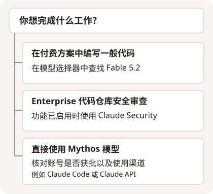

---
{
  "state": "draft",
  "language": "zh-CN",
  "translationKey": "2026-11-22-claude-mythos-availability",
  "title": "在哪里可以使用 Claude Mythos 5.2？Claude Security、Claude Code 与 API",
  "description": "比较 Mythos 5.2 的直接访问权限、Claude Security 的 Enterprise 代码扫描，以及 Fable 5.2 在 Claude 付费方案中的可用性。",
  "sourcePath": "src/content/posts/en/2026-11-22-claude-mythos-availability.md",
  "sourceSha256": "03f809cd5ff47c9929524f940e1ebf683dc5e75760fb062cfdb425ffbf4ff424"
}
---

**直接使用 Claude Mythos 5.2 需要通过 Anthropic 验证计划的审批。** 符合方案条件且获批的个人可通过网络安全验证计划（CVP）获得 Defense Access。使用 Claude Enterprise 的组织可以启用 Claude Security，该功能使用 Mythos 5.2 扫描代码。Fable 5.2 通常向 Claude 付费方案开放，所需使用额度取决于方案或席位。本文以截至 2026年11月22日 的公开文档为准。 [Anthropic 的 5.2 公告](https://www.anthropic.com/claude-fable-and-mythos-5-2#availability) · [Claude 帮助中心的适用模型说明](https://support.claude.com/en/articles/15425695-covered-models) · [网络安全验证计划](https://support.claude.com/en/articles/14604842-cyber-verification-program)

## 哪种方式适用于你？



| 想完成的工作 | 在哪里查找 | 使用条件 |
| --- | --- | --- |
| 使用 5.2 系列模型编写代码或文章 | Claude 网页版、桌面版、移动版或 Claude Code 中的模型选择器 | 付费方案可使用 Fable 5.2。使用额度因方案和席位而异。 |
| 使用 Mythos 审查公司代码仓库的安全问题 | Claude 网页版中的 Claude Security | Enterprise 公开测试版。组织须启用功能，且你的席位须包含 Claude Code。 |
| 在 Claude Code 或 Claude API 中直接选用 Mythos | 账号的模型权限或 API 所用工作区 | 须通过验证计划审批。符合方案条件的个人可以申请 Defense Access。 |

**Mythos Preview** 是 Anthropic 于 2026 年四月向 Project Glasswing 参与组织提供的研究预览版。**Mythos 5.2** 由 Anthropic 于 11月9日 推出。比较有关 Mythos 可用性的报道时，请核对日期和模型版本。 [Project Glasswing 公告](https://www.anthropic.com/project/glasswing) · [Claude Mythos 模型页面](https://www.anthropic.com/claude/mythos)

## Enterprise 在哪里使用 Mythos？

**Claude Security 使用 Mythos 5.2 扫描代码仓库。** 例如，团队可以用它标记内部 Web 服务中缺失的授权检查，再审阅证据与修复建议。Anthropic 也向未参加网络安全验证计划的 Enterprise 客户提供 Claude Security。每位用户都需要包含 Claude Code 的席位，按席位计费的 Enterprise 方案还须启用使用额度。持有包含 Claude Code 席位的组织所有者可通过 `Organization settings → Claude Security` 启用功能。 [Anthropic 发布公告](https://www.anthropic.com/claude-fable-and-mythos-5-2) · [Claude Security 使用条件](https://support.claude.com/en/articles/14661296-use-claude-security)

你可以在 Claude Code 中打开一项扫描发现并着手修复。**扫描与 Claude Code 会话分别管理模型权限。** 扫描使用 Mythos，Claude Code 会话则使用账号获准访问的模型。因此，Enterprise 用户可以看到 Claude Security，但常规模型选择器中仍可能没有 Mythos。 [Claude Security 产品页面](https://claude.com/product/claude-security) · [Claude Code 模型配置](https://code.claude.com/docs/en/model-config)

## 如何在个人方案中找到 Fable 5.2？

据 Anthropic 说明，Fable 5.2 和 Mythos 5.2 使用同一基础模型。Fable 在网络安全和生命科学方面配有额外的防护措施。个人付费方案可用 Fable 5.2 完成一般开发工作，例如了解代码仓库或规划重构。Pro 和部分标准席位从开始使用时就需要使用额度。 [Anthropic 模型公告](https://www.anthropic.com/claude-fable-and-mythos-5-2) · [各方案的 Fable 可用性](https://support.claude.com/en/articles/15424964-claude-fable-models-on-your-plan)

在网页版、桌面版或移动版中，从模型选择器查找 `Fable 5.2`。在终端使用 Claude Code 时，先确认版本为 **2.1.321** 或更高，再在会话中打开 `/model` 查看可选模型。 [Claude 方案帮助](https://support.claude.com/en/articles/15424964-claude-fable-models-on-your-plan) · [Claude Code 模型配置](https://code.claude.com/docs/en/model-config)

```sh
claude --version
```

在 Claude API 中，你可以请求模型元数据来确认 Fable 的模型 ID。示例在具备 `curl` 的 Shell 中运行，且相应工作区的 API 密钥已设为 `ANTHROPIC_API_KEY`。请求成功时，响应中的 `id` 应为 `claude-fable-5-2`。请求格式已与官方参考文档核对，Shell 语法也已在本地检查。需要认证的 Claude 行为（包括元数据响应和模型选择）未经过测试。 [Claude API 模型查询参考](https://platform.claude.com/docs/en/api/models/retrieve)

```sh
curl --fail-with-body --silent --show-error \
  'https://api.anthropic.com/v1/models/claude-fable-5-2' \
  -H 'anthropic-version: 2026-10-21' \
  -H "Authorization: Bearer ${ANTHROPIC_API_KEY}"
```

## 如何确认是否可以直接使用 Mythos？

网络安全验证计划帮助中心说明，独立安全研究人员、开源项目维护者等个人可在 Pro、Max、Ultra 等符合条件的方案上申请 **Defense Access**。获批的参与者可通过这一权限层级使用 Mythos 5.2。仅购买付费订阅不会获得该权限。Anthropic 为生命科学研究设有独立的验证计划。 [网络安全验证计划帮助中心](https://support.claude.com/en/articles/14604842-cyber-verification-program) · [Anthropic 可用性公告](https://www.anthropic.com/claude-fable-and-mythos-5-2#availability)

Claude API 文档列出的 Mythos 5.2 模型 ID 为 `claude-mythos-5-2`。可用性取决于账号或组织获得的访问权限，以及所用渠道。Claude 与 Claude Console 的访问权限分别管理，Console 权限适用于分配的工作区。通过云服务商使用的组织还应核查关联的云账号及服务商的支持情况。 [Claude API 模型指南](https://platform.claude.com/docs/en/models/fable-5-2/migration-guide) · [Claude 帮助中心的方案、工作区与云账号说明](https://support.claude.com/en/articles/14604842-cyber-verification-program)
