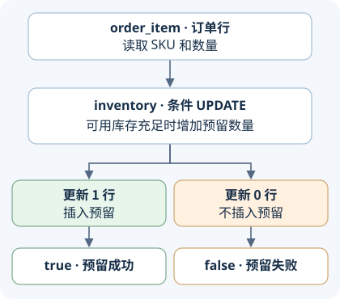

---
{
  "state": "draft",
  "language": "zh-CN",
  "translationKey": "2026-11-22-commerce-database-design",
  "title": "电商数据库设计：SKU、订单、库存与支付",
  "description": "用 PostgreSQL 表建模 SKU、订单价格快照、库存预留和支付尝试，并测试两个会话争抢最后一件库存。",
  "sourcePath": "src/content/posts/en/2026-11-22-commerce-database-design.md",
  "sourceSha256": "da573ac023d969b02216c24993c872e842a6693607f8e3805fd988ce7d64bcf3"
}
---

**电商数据库需要保存商品目录的现行销售条件、结账时约定的金额、每个订单的预留库存，以及支付服务商返回的结果。** 即使明天商品改价，昨天订单的总额也必须正确。今天只剩一件库存时，两个并发订单只能有一个成功预留。下面用 PostgreSQL 示例说明哪些表和约束能满足这两项要求。

本文沿用 [上一篇中最后一件库存的例子](/en/posts/2026-11-22-commerce-system-design-last-unit-of-stock/)。假设只有一个商家，销售实物，使用一个仓库，以韩元（KRW）结算。库存与订单共用一个数据库，发货后的退货与结算各有自己的业务模型。

## 先确定一笔购买需要记录什么

| 问题 | 要读写的表 | 键和值 |
| --- | --- | --- |
| 黑色键盘现在卖多少钱？ | `product` → `sku` | 商品 ID、可售 SKU、当前价格 |
| 为什么昨天的订单收了 43,000 韩元？ | `orders` → `order_item` | 订单 ID、约定数量、单价、折扣、运费 |
| 哪个订单预留到了最后一件？ | `inventory`、`stock_reservation` | 各 SKU 的实物库存、各订单行的预留记录 |
| 支付服务商的响应丢失后，怎样查询同一笔支付？ | `payment_attempt`、`payment_event` | 订单对应的支付尝试、服务商交易 ID、事件 ID |

本例中，`product` 是目录中的商品，`sku` 是购物者可以下单的规格，例如黑色键盘。订单行引用 SKU，**并保存结账时的商品名称、规格名称和单价快照**。一件商品单价为 42,000 韩元，折扣为 2,000 韩元，运费为 3,000 韩元，总额为 43,000 韩元。订单可以直接显示该总额。订单行是约定金额和预留数量的依据，因此应用在创建订单行后不再修改它。要停售有交易记录的 SKU，应将其标为不可售。保留历史订单引用的数据行，这些关系不要使用级联删除。

## 用 PostgreSQL 的键和约束表示模型

在空的练习数据库中执行下面的 DDL 一次。示例显式分配 ID，并把金额存为整数韩元。假设结账会把购物车中同一 SKU 的重复条目合并成一条订单行，因此 `(order_id, sku_id)` 同时标识一条订单行和它的预留记录。

```sql
CREATE TABLE product (
    id bigint PRIMARY KEY,
    name text NOT NULL
);

CREATE TABLE sku (
    id bigint PRIMARY KEY,
    product_id bigint NOT NULL REFERENCES product(id),
    code text NOT NULL UNIQUE,
    option_name text NOT NULL,
    current_price_krw bigint NOT NULL CHECK (current_price_krw >= 0),
    sellable boolean NOT NULL
);

CREATE TABLE inventory (
    sku_id bigint PRIMARY KEY REFERENCES sku(id),
    on_hand integer NOT NULL CHECK (on_hand >= 0),
    held integer NOT NULL CHECK (held >= 0),
    allocated integer NOT NULL CHECK (allocated >= 0),
    CHECK (held <= on_hand - allocated)
);

CREATE TABLE orders (
    id bigint PRIMARY KEY,
    customer_id bigint NOT NULL,
    request_key text NOT NULL,
    request_hash text NOT NULL,
    status text NOT NULL CHECK (status IN ('PENDING_PAYMENT', 'CONFIRMED', 'CANCELLED')),
    total_krw bigint NOT NULL CHECK (total_krw >= 0),
    shipping_krw bigint NOT NULL CHECK (shipping_krw >= 0),
    created_at timestamptz NOT NULL DEFAULT now(),
    UNIQUE (customer_id, request_key)
);

CREATE TABLE order_item (
    order_id bigint REFERENCES orders(id),
    sku_id bigint REFERENCES sku(id),
    item_name text NOT NULL,
    option_name text NOT NULL,
    quantity integer NOT NULL CHECK (quantity > 0),
    unit_price_krw bigint NOT NULL CHECK (unit_price_krw >= 0),
    discount_krw bigint NOT NULL CHECK (discount_krw >= 0),
    CHECK (discount_krw <= quantity * unit_price_krw::numeric),
    PRIMARY KEY (order_id, sku_id)
);

CREATE TABLE stock_reservation (
    order_id bigint,
    sku_id bigint REFERENCES inventory(sku_id),
    state text NOT NULL CHECK (state IN ('HELD', 'ALLOCATED', 'RELEASED', 'SHIPPED')),
    expires_at timestamptz NOT NULL,
    PRIMARY KEY (order_id, sku_id),
    FOREIGN KEY (order_id, sku_id) REFERENCES order_item(order_id, sku_id)
);

CREATE TABLE payment_attempt (
    id bigint PRIMARY KEY,
    order_id bigint NOT NULL REFERENCES orders(id),
    attempt_no integer NOT NULL CHECK (attempt_no > 0),
    provider text NOT NULL,
    merchant_account text NOT NULL,
    provider_request_key text NOT NULL,
    provider_payment_id text,
    amount_krw bigint NOT NULL CHECK (amount_krw >= 0),
    state text NOT NULL CHECK (state IN
        ('PENDING', 'UNKNOWN', 'PAID', 'CLOSED_UNPAID', 'REFUND_PENDING', 'REFUNDED')),
    UNIQUE (order_id, attempt_no),
    UNIQUE (provider, merchant_account, provider_request_key),
    UNIQUE (provider, merchant_account, provider_payment_id)
);

CREATE TABLE payment_event (
    provider text,
    merchant_account text,
    event_id text,
    received_at timestamptz NOT NULL DEFAULT now(),
    PRIMARY KEY (provider, merchant_account, event_id)
);

CREATE INDEX orders_customer_history
    ON orders (customer_id, created_at DESC, id DESC);

CREATE INDEX reservation_expiry
    ON stock_reservation (expires_at, order_id, sku_id)
    WHERE state = 'HELD';
```

`CHECK` 约束保证每条库存记录满足 `held + allocated ≤ on_hand`。要验证订单总额是否与订单行一致，或者所有占用中预留的数量之和是否等于 `held`，需要读取多行。在创建订单的事务中写入总额和预留记录，并定期将已存的总额、计数器与对应明细核对。 [PostgreSQL 的 CHECK 约束文档](https://www.postgresql.org/docs/17/ddl-constraints.html#DDL-CONSTRAINTS-CHECK-CONSTRAINTS)

同一购物者重发 `request_key` 时，查询现有订单。如果保存的 `request_hash` 不同，则视为重用请求键引起的冲突。发出请求时，服务商交易 ID 可能未知，因此初始允许 `NULL`。外部 ID 填入后，在同一支付服务商和商户账号范围内必须唯一。`payment_event` 的键为收到的事件去重。同一次成功结果可能由不同的事件 ID 传来，所以还要对履约请求采用每个订单的唯一键，并在改变状态时校验前置状态。 [PostgreSQL 的 UNIQUE 约束文档](https://www.postgresql.org/docs/17/ddl-constraints.html#DDL-CONSTRAINTS-UNIQUE-CONSTRAINTS) · [Stripe 关于重复 webhook 的指导](https://docs.stripe.com/webhooks#handle-duplicate-events)

## 用条件 UPDATE 预留最后一件库存



可用库存为 `on_hand - allocated - held`。无论电商前台此前显示了多少，结账都会**在同一个 UPDATE 中检查可用库存并增加预留数量**。只有更新影响了某行，函数才插入预留记录。如果 SQL 错误导致插入失败，同一条语句会回滚 `held` 的增加。

```sql
CREATE FUNCTION reserve_stock(p_order_id bigint, p_sku_id bigint,
                              p_expires_at timestamptz)
RETURNS boolean
LANGUAGE sql
AS $$
    WITH held_stock AS (
        UPDATE inventory AS i
           SET held = i.held + line.quantity
          FROM order_item AS line
         WHERE line.order_id = p_order_id
           AND line.sku_id = p_sku_id
           AND i.sku_id = line.sku_id
           AND i.on_hand - i.allocated - i.held >= line.quantity
         RETURNING i.sku_id
    ), reservation AS (
        INSERT INTO stock_reservation (order_id, sku_id, state, expires_at)
        SELECT p_order_id, sku_id, 'HELD', p_expires_at
        FROM held_stock
        RETURNING 1
    )
    SELECT EXISTS (SELECT 1 FROM reservation);
$$;
```

结账时，在同一个数据库事务中创建订单及订单行、预留所有 SKU，并记录初次支付尝试与待发布的任务。只要有一项返回 `false`，调用方就回滚整个事务。预留多个 SKU 时，按一致顺序加锁，例如按 SKU ID 升序。收到结账重试时，调用方核查订单唯一键，已预留的订单无需再调用函数。如果在插入预留时添加 `ON CONFLICT DO NOTHING`，计数可能增加，却没有相应的预留记录。

在本地事务提交后再调用支付服务商。确认支付后，将预留改为 `ALLOCATED`，并把数量从 `held` 转移到 `allocated`。释放预留只减少 `held`，发货则同时减少 `on_hand` 和 `allocated`。为防止重复扣减，在同一事务中锁定预留行及库存行，并检查是否处于预期的前置状态，再实施这些转换。

## 让两个会话争抢最后一件库存

运行 DDL 并创建函数后，将以下数据加载到练习数据库。提前创建两条订单行来单独验证预留竞争。

```sql
INSERT INTO product VALUES (1, 'Keyboard');
INSERT INTO sku VALUES (101, 1, 'KB-BLK', 'Black', 42000, true);
INSERT INTO inventory VALUES (101, 1, 0, 0);

INSERT INTO orders (id, customer_id, request_key, request_hash,
                    status, total_krw, shipping_krw)
VALUES (41, 1001, 'checkout-a', 'fixture-a', 'PENDING_PAYMENT', 43000, 3000),
       (42, 1002, 'checkout-b', 'fixture-b', 'PENDING_PAYMENT', 43000, 3000);

INSERT INTO order_item
VALUES (41, 101, 'Keyboard', 'Black', 1, 42000, 2000),
       (42, 101, 'Keyboard', 'Black', 1, 42000, 2000);
```

打开两个连接到同一数据库的 `psql` 会话。在会话 **A** 中执行下列命令。它返回 `true`，事务保持打开。

```sql
BEGIN ISOLATION LEVEL READ COMMITTED;
SELECT reserve_stock(41, 101, now() + interval '10 minutes') AS reserved;
```

在 A 的事务仍打开时，在会话 **B** 中执行下列命令。其 `SELECT` 尝试更新同一库存行时会等待。

```sql
BEGIN ISOLATION LEVEL READ COMMITTED;
SELECT reserve_stock(42, 101, now() + interval '10 minutes') AS reserved;
```

在 A 中执行 `COMMIT;`。锁释放后，B 针对已更新的行重新判断 `WHERE` 条件。由于可用库存为零，B 返回 `false`。在 B 中执行 `ROLLBACK;` 结束练习。 [PostgreSQL 的 Read Committed 隔离文档](https://www.postgresql.org/docs/17/transaction-iso.html#XACT-READ-COMMITTED)

```sql
SELECT sku_id, on_hand, held, allocated FROM inventory;
SELECT order_id, sku_id, state FROM stock_reservation ORDER BY order_id;
```

示例在 PostgreSQL 17.12 上用两个并发数据库连接运行。`pg_stat_activity` 显示 B 正在等待锁之后，A 提交。A 返回 `true`，B 返回 `false`。`inventory` 中 `on_hand / held / allocated` 最终为 `1 / 1 / 0`，且**订单 41 对应一条 `HELD` 预留记录**。

把商品目录中的价格改为 45,000 韩元后，订单 41 的单价仍为 42,000 韩元，总额仍为 43,000 韩元。向库存增加一件后，再次为订单 41 调用预留函数触发了唯一约束冲突，`held` 保持为 1。练习验证了两个连接间的竞争和 SQL 约束。支付服务商调用、涉及预留到期的竞争和生产负载须另行测试。

## 根据应用执行的查询选择索引

购物者的订单历史使用类似 `WHERE customer_id = … ORDER BY created_at DESC, id DESC LIMIT …` 的查询。DDL 中的复合索引与购物者筛选条件和排序顺序一致。预留清理任务使用 `WHERE state = 'HELD' AND expires_at <= now()`，因此用部分索引排除其他状态的预留。到期索引只找出候选记录。清理任务加锁并核查支付状态之后，再决定是否释放各项预留。 [PostgreSQL 的多列索引文档](https://www.postgresql.org/docs/17/indexes-multicolumn.html) · [PostgreSQL 的部分索引文档](https://www.postgresql.org/docs/17/indexes-partial.html)
