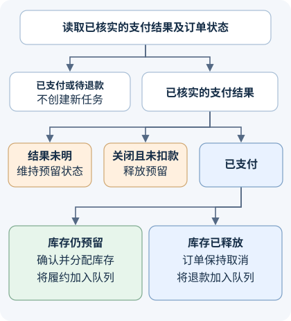

---
{
  "state": "draft",
  "language": "zh-CN",
  "translationKey": "2026-11-22-commerce-system-design-last-unit-of-stock",
  "title": "电商系统设计：最后一件库存该给谁？",
  "description": "通过争抢最后一件库存的场景，梳理 SKU 库存预留、支付核对，以及释放预留后的退款。",
  "sourcePath": "src/content/posts/en/2026-11-22-commerce-system-design-last-unit-of-stock.md",
  "sourceSha256": "63b33b1222e2cc6c885b4f2d63fb1a3f2727041b8710e7bf8ed7b335b6f8b9d6"
}
---

**两位顾客同时尝试购买最后一件商品时，只能有一个订单预留成功。** 如果店铺预留了库存，却丢失支付服务商的响应，就在核实支付期间将订单维持为待支付。如果释放预留后才确认已支付，订单保持取消，并发起退款。跟踪一笔购买，可以看出商品目录、库存、订单和支付分别负责哪些数据。

示例假定一个商家销售实物，每个订单以韩元（KRW）支付一次，并从一个仓库发货。示例涵盖支付结果未明或延迟确认时的取消和退款。平台结算、部分发货和退货超出本例范围。

## 商品页展示的库存与订单预留的库存

**商品**是购物者看到的目录条目。**SKU**（库存单位）是店铺在订单和库存中跟踪的单位。同一款键盘的白色和黑色版本使用不同的 SKU。商品页显示查询时的可售情况。如果库存模块没有响应，仍显示商品，并将可售情况标为“正在核对库存”。加入购物车不会改变库存。

| 职责 | 可更改的数据 | 示例 |
| --- | --- | --- |
| 商品目录和定价 | 商品、SKU、可售状态、当前单价 | 修改黑色键盘 `KB-BLK` 的单价 |
| 库存 | 各仓库的实物库存、预留、履约分配 | 为指定订单预留一件 `KB-BLK` |
| 订单 | 购物者、购买时的订单行和金额、订单状态 | 为订单 `O-42` 保存数量、单价、折扣分摊和运费 |
| 支付 | 支付尝试、服务商交易 ID、支付和退款状态 | 核对支付尝试 `P-1` 在服务商处的结果 |
| 履约 | 履约请求及其进度 | 在支付完成并分配库存之后为订单拣货 |

结账前，服务器检查商品是否仍在售并重新核对价格。它从经过身份验证的会话确定购物者，按服务器上的定价、折扣、配送规则计算总额。如果黑色键盘加入购物车时为 39,000 韩元，现在变为 42,000 韩元，店铺就显示新金额并请购物者确认。创建订单时，服务器核对购物者接受的价格版本与实际采用的版本是否一致。订单保留 SKU、规格名称、数量、单价、折扣、运费和币种。按新单价 42,000 韩元、折扣 2,000 韩元和运费 3,000 韩元计算，服务器向支付服务商发送 43,000 韩元。即便商品改名或次日降价，已保存的订单仍须显示当时确认的金额。将 [Spring Boot 商品查询示例](/en/posts/2026-11-22-spring-boot-4-2-restclient-migration/) 从展示商品拓展到下单时，需要加上这道边界。

## 哪些操作属于同一个事务？

先在**一个应用内划分独立模块**，分别处理商品目录、库存、订单和支付记录。模块共享一个数据库，各自负责写入本模块表的规则。这使订单与预留能在同一个本地事务中提交。提交后再调用外部支付服务商。

1. **创建订单并预留库存。** 通过购物者和订单请求键识别重试。同一键若携带不同请求数据，按冲突处理。库存模块通过锁定 SKU 行或使用条件更新来核查可用库存。一个订单若有多个 SKU，要在全部商品均获预留后，一起保存订单行、预留记录和支付尝试。如果有任何一项库存不足，回滚整个事务并报告不足。在同一次本地提交中记录恢复支付请求所需的任务。
2. **调用支付服务商。** 发起支付请求时，携带与已保存支付尝试 ID 绑定的服务商幂等键。若服务器刚发完请求就停机，恢复后必须能找到该记录，并核对同一次尝试。响应丢失时，在服务商处查询已有交易。只在服务商对同一键和请求参数的保证范围内重发。结果未明期间继续使用现有尝试。 [Stripe 的幂等请求文档](https://docs.stripe.com/api/idempotent_requests)
3. **应用结果。** 记录事件之前验证 webhook 签名，或由服务器查询交易。核对订单、支付尝试、商户账号、金额和币种。锁定订单和预留，读取当前状态，然后在一个事务中保存支付状态、库存状态转换和后续任务。履约或退款请求也在同一次提交中写入 outbox。 [Stripe 的 webhook 投递规则](https://docs.stripe.com/webhooks#event-delivery-behaviors) · [AWS 的事务型 outbox 模式](https://docs.aws.amazon.com/prescriptive-guidance/latest/cloud-design-patterns/transactional-outbox.html)

本例中，**可用库存 = 实物库存 − 有效预留 − 履约分配**。付款确认后，将预留数量扣减，并把同样数量加到履约分配。发货时同时减少实物库存和分配数量。如果只剩一件而两个订单同时到达，第一笔预留提交后，第二笔订单必须看到可用库存为零。在实际数据库上运行重叠事务来验证此规则。

## 处理结果未明或延迟确认的支付



图中展示店铺如何在预留库存后应用支付结果。如果保存的支付状态已经是 `PAID` 或 `REFUND_PENDING`，代码保留该状态，不生成后续任务。

订单、支付和库存预留各有自己的状态。电商前台组合这些状态，给购物者一条能看懂的消息。例如，服务商迟迟未响应时，订单仍为 `PENDING_PAYMENT`，支付为 `UNKNOWN`，预留为 `HELD`。显示“正在核实支付”，让购物者再次查询同一订单。

| 情况 | 保存的状态和后续操作 |
| --- | --- |
| 支付已确认，库存仍预留 | 订单 `CONFIRMED`，支付 `PAID`，库存 `ALLOCATED`。记录履约请求 |
| 响应丢失或服务商尚在处理 | 订单 `PENDING_PAYMENT`，支付 `UNKNOWN`，库存 `HELD`。再次核对已有支付 |
| 确认交易关闭且未扣款 | 订单 `CANCELLED`，支付 `CLOSED_UNPAID`，预留 `RELEASED` |
| 例外释放预留后才确认支付 | 订单 `CANCELLED`，支付 `REFUND_PENDING`，预留 `RELEASED`。记录退款请求 |

预留到期时如果支付结果还未明确，先向服务商查询。若仍未明确，记录该案例，由运营人员查找并核对交易。如果因例外释放预留后收到支付确认，本设计发起退款，并维持预留已释放的状态。服务商确认后才记录退款成功。按库存销售速度和服务商合同，设定预留期限及例外释放的审批权限。

按 webhook 事件 ID 对重复投递去重。不同事件 ID 报告同一笔支付时，也要防止重复提交履约请求。例如，为履约 outbox 的 `order_id` 和任务类型加唯一约束，为退款 outbox 的 `payment_attempt_id` 和任务类型加唯一约束。Outbox 发布可重试，履约和退款消费者用同一个任务 ID 避免重复执行。向服务商重试退款时，使用该服务商支持的退款专用幂等键。较早的事件如果报告仍在处理，不应改变已确认的支付状态。ID 或金额不一致、或与已确认历史冲突的结果，要先送交核对再应用。 [Stripe 关于重复 webhook 的指导](https://docs.stripe.com/webhooks#handle-duplicate-events) · [AWS 的事务型 outbox 模式](https://docs.aws.amazon.com/prescriptive-guidance/latest/cloud-design-patterns/transactional-outbox.html)

## 用 Java 检查支付状态转换

将下列代码保存为 `CheckoutPolicy.java`，运行 `java CheckoutPolicy.java`。示例接收**与订单绑定的一次支付尝试的服务器核实结果**。`CLOSED_UNPAID` 表示服务商确认该交易已结束且未扣款。只有支付拒绝消息不足以作证。代码假设订单和预留状态相符。待支付订单仍持有预留，已取消订单已经释放预留。调用方验证 ID 和金额，并核对冲突结果。代码返回下一状态及需要记录的后续任务。

```java
public class CheckoutPolicy {
    enum Order { PENDING_PAYMENT, CONFIRMED, CANCELLED }
    enum Payment { PENDING, UNKNOWN, PAID, CLOSED_UNPAID, REFUND_PENDING }
    enum Reservation { HELD, ALLOCATED, RELEASED }
    enum Result { UNRESOLVED, CLOSED_UNPAID, PAID }
    enum Effect { NONE, REQUEST_FULFILLMENT, REQUEST_REFUND }

    record State(Order order, Payment payment, Reservation reservation) {}
    record Decision(State state, Effect effect) {}

    static Decision apply(State current, Result result) {
        if (current.payment() == Payment.PAID
                || current.payment() == Payment.REFUND_PENDING) {
            return new Decision(current, Effect.NONE);
        }

        if (current.order() == Order.CANCELLED) {
            return switch (result) {
                case PAID -> new Decision(
                    new State(Order.CANCELLED, Payment.REFUND_PENDING, Reservation.RELEASED),
                    Effect.REQUEST_REFUND);
                case CLOSED_UNPAID -> new Decision(
                    new State(Order.CANCELLED, Payment.CLOSED_UNPAID, Reservation.RELEASED),
                    Effect.NONE);
                case UNRESOLVED -> new Decision(current, Effect.NONE);
            };
        }

        return switch (result) {
            case PAID -> new Decision(
                new State(Order.CONFIRMED, Payment.PAID, Reservation.ALLOCATED),
                Effect.REQUEST_FULFILLMENT);
            case CLOSED_UNPAID -> new Decision(
                new State(Order.CANCELLED, Payment.CLOSED_UNPAID, Reservation.RELEASED),
                Effect.NONE);
            case UNRESOLVED -> new Decision(
                new State(Order.PENDING_PAYMENT, Payment.UNKNOWN, Reservation.HELD),
                Effect.NONE);
        };
    }

    static void check(String label, Decision expected, Decision actual) {
        if (!expected.equals(actual)) {
            throw new AssertionError(label + ": " + actual);
        }
        System.out.println("PASS " + label);
    }

    public static void main(String[] args) {
        State held = new State(Order.PENDING_PAYMENT, Payment.PENDING, Reservation.HELD);
        State unknown = new State(Order.PENDING_PAYMENT, Payment.UNKNOWN, Reservation.HELD);
        State paid = new State(Order.CONFIRMED, Payment.PAID, Reservation.ALLOCATED);
        State closed = new State(
            Order.CANCELLED, Payment.CLOSED_UNPAID, Reservation.RELEASED);
        State released = new State(Order.CANCELLED, Payment.UNKNOWN, Reservation.RELEASED);
        State refundPending = new State(
            Order.CANCELLED, Payment.REFUND_PENDING, Reservation.RELEASED);

        check("unresolved retains hold", new Decision(unknown, Effect.NONE),
            apply(held, Result.UNRESOLVED));
        check("paid allocates stock", new Decision(paid, Effect.REQUEST_FULFILLMENT),
            apply(unknown, Result.PAID));
        check("duplicate paid has no effect", new Decision(paid, Effect.NONE),
            apply(paid, Result.PAID));
        check("old unresolved does not reopen payment", new Decision(paid, Effect.NONE),
            apply(paid, Result.UNRESOLVED));
        check("closed unpaid releases hold", new Decision(closed, Effect.NONE),
            apply(unknown, Result.CLOSED_UNPAID));
        check("late paid requests refund", new Decision(refundPending, Effect.REQUEST_REFUND),
            apply(released, Result.PAID));
        check("duplicate late paid has no effect", new Decision(refundPending, Effect.NONE),
            apply(refundPending, Result.PAID));
    }
}
```

下面七项检查在 JDK 21.0.1 上运行。重复应用支付确认没有生成额外任务。预留释放后再确认支付，返回了退款请求。

```text
PASS unresolved retains hold
PASS paid allocates stock
PASS duplicate paid has no effect
PASS old unresolved does not reopen payment
PASS closed unpaid releases hold
PASS late paid requests refund
PASS duplicate late paid has no effect
```

实现中有两种竞争情况需要单独检查。两个订单同时预留最后一件时，只能有一个成功。同一订单的到期处理与支付确认同时到达时，系统只能记录一个结果：订单仍持有库存则履约，释放后则退款。顺序运行的 Java 示例不覆盖数据库竞争、服务商集成或生产支付，这些需要另行验证。

当更多仓库需要管理库存，或者库存服务需要独立部署或扩展时，可考虑将库存拆成独立服务。这样订单和库存数据库就没有共用的本地提交。库存服务必须保证每个预留 ID 只应用一次，订单模块必须能查询结果或在失败时补偿。跨服务边界仍须遵守业务规则：防止超卖，每笔支付和履约仅应用一次。
