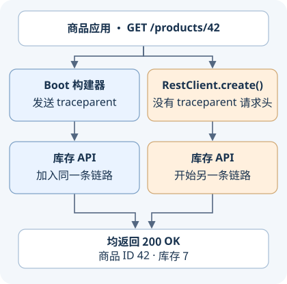

---
{
  "state": "draft",
  "language": "zh-CN",
  "translationKey": "2026-11-22-spring-boot-4-2-restclient-traceparent",
  "title": "验证 Spring Boot 4.2 中 RestClient 的 traceparent 传播",
  "description": "比较 Spring Boot 4.2.0 中两种 RestClient 创建方式的 traceparent 传播行为和 Tempo 中的跨度关系。",
  "sourcePath": "src/content/posts/en/2026-11-22-spring-boot-4-2-restclient-traceparent.md",
  "sourceSha256": "79632a97012abbc73db2e3e1a0bbe924c261ceb52f4603146310d3e2c4f897f5"
}
---

**要在同一条链路中跟踪商品查询及其库存调用，请使用 Spring Boot 注入的 `RestClient.Builder`。** 本例中，通过 `RestClient.create()` 创建的客户端也查询了同一商品，并返回 HTTP 200。但库存 API 没有收到 `traceparent` 请求头，因而开启了另一条链路。比较 HTTP 响应和 Tempo 中保存的 span，找出链路上下文在哪里停止传播。 [Spring Boot 链路传播文档](https://docs.spring.io/spring-boot/4.2/reference/actuator/tracing.html#actuator.micrometer-tracing.propagating-traces)

本练习沿用 [RestClient 迁移指南](/en/posts/2026-11-22-spring-boot-4-2-restclient-migration/) 中的商品查询。[HTTP 指标指南](/en/posts/2026-11-22-spring-boot-4-2-otel-http-metrics/) 统计请求数量，这里则跟踪单次请求的路径。

## 连接商品查询与库存查询的请求头

`traceparent` 是 W3C 用于传播链路上下文的标准 HTTP 请求头。本练习中的格式为 `00-<trace-id>-<parent-id>-<trace-flags>`。`trace-id` 标识整条链路。`parent-id` 标识发送方的 HTTP 客户端 span，以便接收服务将其用作服务器 span 的父级。 [W3C Trace Context 规范](https://www.w3.org/TR/trace-context/#traceparent-header)



图中展示了商品 42 的两种客户端调用路径。两种路径返回的库存量相同。在本例中，`traceparent` 请求头决定库存服务器的 span 是否加入商品查询链路。

## 用同一个 JAR 运行两个应用

需要 JDK 21、Maven、Docker、`curl` 和 `jq`。练习使用本地端口 `13200`、`14318`、`18180` 和 `18181`。在空目录中创建以下文件。将同一个 JAR 运行两次，服务名分别为 `product` 和 `inventory`。示例的响应会附带当前链路 ID 和收到的请求头，便于检查。

### `pom.xml`

```xml
<project xmlns="http://maven.apache.org/POM/4.0.0">
    <modelVersion>4.0.0</modelVersion>
    <parent>
        <groupId>org.springframework.boot</groupId>
        <artifactId>spring-boot-starter-parent</artifactId>
        <version>4.2.0</version>
    </parent>
    <groupId>example</groupId>
    <artifactId>trace-propagation</artifactId>
    <version>1.0.0</version>
    <properties>
        <java.version>21</java.version>
    </properties>
    <dependencies>
        <dependency>
            <groupId>org.springframework.boot</groupId>
            <artifactId>spring-boot-starter-webmvc</artifactId>
        </dependency>
        <dependency>
            <groupId>org.springframework.boot</groupId>
            <artifactId>spring-boot-starter-restclient</artifactId>
        </dependency>
        <dependency>
            <groupId>org.springframework.boot</groupId>
            <artifactId>spring-boot-starter-opentelemetry</artifactId>
        </dependency>
    </dependencies>
    <build>
        <plugins>
            <plugin>
                <groupId>org.springframework.boot</groupId>
                <artifactId>spring-boot-maven-plugin</artifactId>
            </plugin>
        </plugins>
    </build>
</project>
```

### `src/main/java/example/TraceApplication.java`

```java
package example;

import io.micrometer.tracing.Tracer;
import org.springframework.beans.factory.annotation.Value;
import org.springframework.boot.SpringApplication;
import org.springframework.boot.autoconfigure.SpringBootApplication;
import org.springframework.web.bind.annotation.GetMapping;
import org.springframework.web.bind.annotation.PathVariable;
import org.springframework.web.bind.annotation.RequestHeader;
import org.springframework.web.bind.annotation.RequestParam;
import org.springframework.web.bind.annotation.RestController;
import org.springframework.web.client.RestClient;

@SpringBootApplication
public class TraceApplication {
    public static void main(String[] args) {
        SpringApplication.run(TraceApplication.class, args);
    }
}

@RestController
class ProductController {
    private final RestClient bootClient;
    private final RestClient directClient;
    private final Tracer tracer;

    ProductController(RestClient.Builder builder, Tracer tracer,
            @Value("${inventory.base-url}") String inventoryUrl) {
        this.bootClient = builder.baseUrl(inventoryUrl).build();
        this.directClient = RestClient.create(inventoryUrl);
        this.tracer = tracer;
    }

    @GetMapping("/products/{id}")
    ProductReply product(@PathVariable("id") long id,
            @RequestParam("instrumented") boolean instrumented) {
        RestClient client = instrumented ? bootClient : directClient;
        InventoryReply inventory = client.get().uri("/items/{id}", id)
            .retrieve().body(InventoryReply.class);
        return new ProductReply(tracer.currentSpan().context().traceId(), inventory);
    }
}

@RestController
class InventoryController {
    private final Tracer tracer;

    InventoryController(Tracer tracer) {
        this.tracer = tracer;
    }

    @GetMapping("/items/{id}")
    InventoryReply item(@PathVariable("id") long id,
            @RequestHeader(name = "traceparent", required = false) String traceparent) {
        return new InventoryReply(id, 7, traceparent, tracer.currentSpan().context().traceId());
    }
}

record ProductReply(String productTraceId, InventoryReply inventory) {}
record InventoryReply(long id, int stock, String traceparent, String inventoryTraceId) {}
```

### `src/main/resources/application.properties`

```properties
server.address=127.0.0.1
inventory.base-url=http://127.0.0.1:18181
management.tracing.sampling.probability=1.0
management.opentelemetry.tracing.export.otlp.endpoint=http://127.0.0.1:14318/v1/traces
management.otlp.metrics.export.enabled=false
```

采样概率 `1.0` 使示例记录所有请求。两个应用仅通过 OTLP 导出链路。先查看 HTTP 响应中的请求头，以便把 Tempo 缺少 span 的问题与传播问题分开诊断。 [Spring Boot 采样文档](https://docs.spring.io/spring-boot/4.2/reference/actuator/tracing.html#actuator.micrometer-tracing.sampling)

### `tempo.yaml`

此配置让 Tempo 通过 OTLP HTTP 接收 span，并写入本地存储。查询 API 和接收端口只在宿主机环回地址上开放。

```yaml
server:
  http_listen_port: 3200

distributor:
  receivers:
    otlp:
      protocols:
        http:
          endpoint: 0.0.0.0:4318

storage:
  trace:
    backend: local
    wal:
      path: /tmp/tempo/wal
    local:
      path: /tmp/tempo/blocks
```

在项目根目录启动 Tempo 和两个应用。先在第一个终端启动 Tempo。

```sh
docker run --rm --name traceparent-tempo \
  -p 127.0.0.1:13200:3200 -p 127.0.0.1:14318:4318 \
  --mount "type=bind,source=$PWD/tempo.yaml,target=/etc/tempo.yaml,readonly" \
  grafana/tempo:2.9.0 -config.file=/etc/tempo.yaml
```

在另一个终端，确认 `curl -fsS http://127.0.0.1:13200/ready` 成功，然后用 Maven 构建。在不同终端中分别运行两个 `java` 命令。

```sh
mvn package

java -jar target/trace-propagation-1.0.0.jar \
  --spring.application.name=inventory --server.port=18181

java -jar target/trace-propagation-1.0.0.jar \
  --spring.application.name=product --server.port=18180
```

## 比较响应中的请求头和链路 ID

两个应用启动后，查询同一商品两次。只改 `instrumented` 来选择客户端。

```sh
curl -fsS 'http://127.0.0.1:18180/products/42?instrumented=true' -o boot.json
curl -fsS 'http://127.0.0.1:18180/products/42?instrumented=false' -o direct.json

jq '{id: .inventory.id, stock: .inventory.stock,
     headerReceived: (.inventory.traceparent != null),
     sameTrace: (.productTraceId == .inventory.inventoryTraceId)}' boot.json direct.json
jq -r .inventory.traceparent boot.json
```

两次请求均返回 HTTP 200。使用 Boot 构建器时，两个应用的链路 ID 相同，库存 API 收到的 `traceparent` 也包含该 ID。使用直接创建的客户端时，库存 API 将 `traceparent` 报为 `null`，两个应用的链路 ID 不同。

| 客户端创建方式 | 商品 ID 和库存量 | 收到请求头 | 两个应用的链路 ID |
| --- | --- | --- | --- |
| Boot 注入的 `RestClient.Builder` | 42 和 7 | 是 | 相同 |
| `RestClient.create()` | 42 和 7 | 否 | 不同 |

## 在 Tempo 中检查 span

用响应中的链路 ID 查询 Tempo。导出 span 可能需要几秒。如果某条链路还查不到，稍等片刻后重试。 [Grafana Tempo 通过 ID 查询链路的 API](https://grafana.com/docs/tempo/latest/api_docs/#query)

```sh
show_spans() {
  curl -fsS "http://127.0.0.1:13200/api/traces/$1" | jq -r '
    (.batches // .resourceSpans)[] as $batch
    | ($batch.resource.attributes[]
       | select(.key == "service.name").value.stringValue) as $service
    | $batch.scopeSpans[].spans[]
    | [$service, .kind, .name, .spanId, (.parentSpanId // "-")] | @tsv'
}

show_spans "$(jq -r .productTraceId boot.json)"
show_spans "$(jq -r .productTraceId direct.json)"
show_spans "$(jq -r .inventory.inventoryTraceId direct.json)"
```

示例在 Spring Boot 4.2.0、JDK 21.0.1、Maven 3.9.11 和 Tempo 2.9.0 下运行。对两次请求取得的三个链路 ID，Tempo API 返回以下 span。

| 查询的链路 ID | Tempo 中观察到的 span |
| --- | --- |
| 使用 Boot 构建器的请求 | 商品服务器 → 商品 HTTP 客户端 → 库存服务器 |
| 直接创建客户端时的商品应用 | 一个商品服务器根 span |
| 直接创建客户端时的库存应用 | 一个库存服务器根 span |

在 Boot 构建器路径中，Tempo 中库存服务器的 `parentSpanId` 与商品 HTTP 客户端的 `spanId` 相同。本次运行中，Tempo API 响应用 Base64 编码 span ID，而 `traceparent` 使用十六进制。对客户端 span ID 做 Base64 解码，再将字节表示为十六进制，得到的值与请求头中的 `parent-id` 一致。

如果请求成功，但链路在服务边界断开，请检查接收服务是否收到 `traceparent`。如果缺少该请求头，请检查调用方是否使用了 Boot 配置的构建器。如果链路 ID 已传播，但 Tempo 中仍缺少 span，请检查采样和 OTLP 导出设置。之后可用同一链路 ID 查找日志，参见 [在 Grafana LGTM 中关联日志与链路追踪](/en/posts/2026-11-02-grafana-lgtm-log-trace/)。
