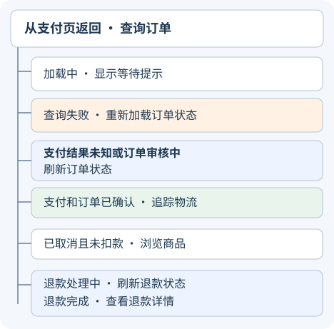

---
{
  "state": "draft",
  "language": "zh-CN",
  "translationKey": "2026-11-23-commerce-storefront-design",
  "title": "电商前台设计：从选择商品到确认支付",
  "description": "明确购物者从商品列表到订单详情各阶段可查看和操作的内容，并在结账返回后根据服务器的订单和支付状态提供指引。",
  "sourcePath": "src/content/posts/en/2026-11-23-commerce-storefront-design.md",
  "sourceSha256": "fde9deae56ab163d6fad0ea42a0136927d901a84ecd0111e5006b0eb21aa00ce"
}
---

**购物者从支付页返回时如果只看到空白，最先想知道的是有没有扣款。** 提供一个页面，让他们查询已存在订单的结果。从商品详情到订单历史，每个页面都应把能确认的事实与购物者可以采取的操作放在一起。

[电商后台设计指南](/en/posts/2026-11-23-commerce-admin-screen/)展示运营人员如何查询支付未确认的订单。这里从购物者角度看同一情况。假设一家店只有一个商家，以韩元销售实物并发货，购物者通过账号下单。折扣和运费规则仅用于举例。

## 购物者在各页面做什么决定？

| 页面 | 优先展示 | 购物者接下来可以做什么 |
| --- | --- | --- |
| 商品列表和搜索 | 商品名称和照片、可比较的价格、当前筛选条件 | 缩小结果范围或打开商品页 |
| 商品详情 | 所选规格的价格、库存情况和配送条件 | 选择规格和数量，加入购物车 |
| 购物车 | 各商品的规格、数量和金额、预计总价，以及无法结账的商品 | 修改数量和商品后去结账 |
| 结账 | 收货地址、运费、折扣、最终金额和修改入口 | 核对交易条件并发起支付 |
| 订单详情 | 订单号、支付、配送和退款状态，以及变更历史 | 根据当前状态查询结果或追踪配送 |

如果列表显示“₩39,000 起”，购物者在商品页选定规格后就应看到实际价格。用文字标明售罄的规格。搜索无结果时，展示当前筛选条件，并允许清除。搜索加载失败时，提供重试。

沿用 [电商库存预留指南](/en/posts/2026-11-22-commerce-system-design-last-unit-of-stock/) 中的规则。商品详情显示查询时的库存，购物车保留购物者的选择，服务器在创建订单时预留库存。如果最后一件已被其他人预留，在购物车里标出受影响的商品和规格，保留其余商品及购物者填写的收货地址。

## 支付前允许购物者检查并修改

在最终金额旁，让购物者检查和修改所选规格、数量和收货地址。按钮应标明实际操作，例如 **“支付 ₩43,000”**。WCAG 关于预防财务交易错误的指南提出，提交前应允许用户检查并纠正信息。 [W3C 关于预防财务交易错误的指导](https://www.w3.org/WAI/WCAG22/Understanding/error-prevention-legal-financial-data.html)

例如，购物者加入购物车时键盘为 ₩39,000，结账时已涨到 ₩42,000，就明确指出受影响的商品。“黑色键盘的价格已从 ₩39,000 调整为 ₩42,000。”重新计算折扣和运费后显示新总额，让购物者在发起支付前确认。服务器创建订单时核对购物者确认的报价是否与将收取的金额一致，并记录交易条件。 [电商数据库如何保存订单金额](/en/posts/2026-11-22-commerce-database-design/)

在移动端，将修改收货地址和商品的链接放在相应信息旁边，最终金额靠近支付按钮。若按钮固定在底部，确保页面能滚动到最后一个字段和任何错误提示。购物车总额更新、支付核对结果等无需移动焦点的变化，也可由辅助技术播报。例如，在结果文字更新的区域加入 `role="status"`。 [W3C 关于状态消息的指导](https://www.w3.org/WAI/WCAG22/Understanding/status-messages.html)

## 在服务器上确认支付结果



购物者从支付页返回时，在服务器上查询已存在的订单。如果点击支付后丢失创建订单的响应，用同一个订单请求键检查订单是否已受理。短暂禁用按钮有助于减少重复点击，请求键和服务器端的唯一性校验用来防止重复下单。订单详情和状态 API 还要确认当前购物者有权访问该订单。

| 服务器核实的状态 | 给购物者的消息和操作 |
| --- | --- |
| 订单状态查询失败 | “无法加载订单状态。” → **重新加载订单状态** |
| 订单存在，支付结果未知 | “正在核对支付结果。” → **刷新订单状态** |
| 支付完成，订单审核中 | “支付已完成，正在核对订单。” → **刷新订单状态** |
| 支付和订单均已确认 | “我们已收到你的订单。” → **追踪物流** |
| 确认取消且未扣款 | “订单已取消，未扣款。” → **浏览商品** |
| 订单取消后确认支付，退款待处理 | “正在处理退款。” → **刷新退款状态** |
| 确认退款 | “退款已完成。” → **查看退款详情** |

根据实际履约状态，显示订单是备货中、运输中还是已送达。仅在当前状态允许、且用户有权限时显示取消或退货按钮。受理请求后显示处理进度。服务器确认退款结果后，再显示退款完成消息。

## 将服务器状态映射为消息和操作

示例接收已从服务器读取的订单和支付状态，将其映射为标题及下一步操作。网络错误和支付结果未知是不同的输入。未定义的状态组合一律不显示成功。代码使用韩语界面文案，上表给出对应的中文。把代码保存为 `order-view.mjs`，运行 `node order-view.mjs`。

```javascript
const labels = {
  loading: ["주문 상태를 불러오는 중입니다.", null],
  unavailable: ["주문 상태를 불러오지 못했습니다.", "주문 상태 다시 불러오기"],
  pending: ["결제 결과를 확인 중입니다.", "주문 상태 새로고침"],
  paidReview: ["결제는 완료됐고 주문을 확인 중입니다.", "주문 상태 새로고침"],
  confirmed: ["주문이 접수됐습니다.", "배송 상태 보기"],
  closed: ["주문이 취소됐으며 결제된 금액이 없습니다.", "상품 다시 보기"],
  refundPending: ["환불을 처리 중입니다.", "환불 상태 새로고침"],
  refunded: ["환불이 완료됐습니다.", "환불 내역 보기"]
};

function orderView(snapshot) {
  if (snapshot.kind === "loading") return labels.loading;
  if (snapshot.kind === "unavailable") return labels.unavailable;

  const { order, payment } = snapshot;
  if (order === "CANCELLED" && payment === "REFUND_PENDING") {
    return labels.refundPending;
  }
  if (order === "CANCELLED" && payment === "REFUNDED") {
    return labels.refunded;
  }
  if (order === "CANCELLED" && payment === "CLOSED_UNPAID") {
    return labels.closed;
  }
  if (order === "CONFIRMED" && payment === "PAID") {
    return labels.confirmed;
  }
  if (order === "PENDING_PAYMENT" && payment === "PAID") {
    return labels.paidReview;
  }
  if (order === "PENDING_PAYMENT" &&
      (payment === "PENDING" || payment === "UNKNOWN")) {
    return labels.pending;
  }
  return labels.unavailable;
}

const verified = (order, payment) => ({ kind: "loaded", order, payment });
const cases = [
  [{ kind: "loading" }, "loading"],
  [{ kind: "unavailable" }, "unavailable"],
  [verified("PENDING_PAYMENT", "UNKNOWN"), "pending"],
  [verified("PENDING_PAYMENT", "PAID"), "paidReview"],
  [verified("CONFIRMED", "PAID"), "confirmed"],
  [verified("CANCELLED", "CLOSED_UNPAID"), "closed"],
  [verified("CANCELLED", "REFUND_PENDING"), "refundPending"],
  [verified("CANCELLED", "REFUNDED"), "refunded"],
  [verified("CONFIRMED", "UNKNOWN"), "unavailable"]
];

for (const [input, key] of cases) {
  if (orderView(input) !== labels[key]) throw new Error(key);
  console.log("PASS", key);
}
```

所有九组输入在 Node.js 22.17.0 下均通过。查询失败、支付结果未知、取消且未扣款，以及退款待处理，都返回了预期消息和操作。此次运行覆盖了由状态选出界面消息与操作的函数。移动端易用性、辅助技术的表现和真实支付集成，需要在实现的页面中另行验证。
