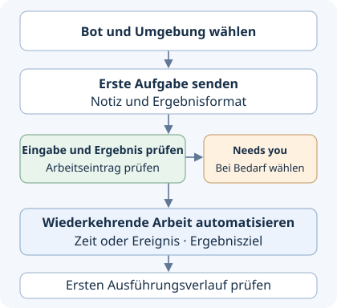

---
{
  "state": "draft",
  "language": "de",
  "translationKey": "2026-11-23-orca-bot-guide",
  "title": "Orca Bot verwenden: Blog-Bot erstellen und Aufgaben und Automationen prüfen",
  "description": "Erste Aufgabe, Speicher und Arbeit eines Orca Bots prüfen und wiederkehrende Aufgaben einrichten.",
  "sourcePath": "src/content/posts/en/2026-11-23-orca-bot-guide.md",
  "sourceSha256": "96033cbac131a6cad800f9782a2ad820fcfba2e710c8628bb440b0af0c898e02"
}
---

**Wer zum ersten Mal einen Orca Bot erstellt, sollte ihm vor der Planung wiederkehrender Arbeit eine Aufgabe geben, deren Ergebnis sich prüfen lässt.** Eine kurze technische Notiz kann zum Beispiel als Grundlage für einen Blogtitel und eine Gliederung dienen. Entspricht das Ergebnis dem gewünschten Format, lassen sich Rolle und wiederkehrende Aufgaben ergänzen. Dieser Leitfaden zeigt den Ablauf mit einem Bot für Blogentwürfe.

Ein Orca Bot ist eine Arbeitseinheit mit Namen, Zweck und Speicher. Wählen Sie den ausführenden Computer und einen Agenten wie Claude Code oder Codex. Installieren Sie den Agenten auf diesem Computer und melden Sie sich dort an. Die erste Übung bleibt innerhalb von Orca. Um den Bot aus Slack, GitHub oder Linear aufzurufen oder durch Ereignisse dieser Dienste auszuführen, fügen Sie die nötigen Verbindungen hinzu. [Orca Bots: Einstieg](https://orca.dev/docs/bots) · [Bot-Konnektoren](https://orca.dev/docs/bots/connectors)



## Bot erstellen und erste Anfrage senden

Wählen Sie in der Orca-Seitenleiste unter **Bots** die Option **+ → New bot → Start from scratch**. Vergeben Sie einen Namen und beschreiben Sie unter **Who it is and what it does** die Rolle in einem Satz. Der Beispielname lautet `Blog Draft`, der Zweck „Entwicklungsnotizen in technische Blogentwürfe verwandeln“. Prüfen Sie unter dem Namen Computer und Agent und wählen Sie **Create**. Falls Bots in der Seitenleiste fehlt, prüfen Sie **Settings → Bots → Enable bots**. [Bot erstellen](https://orca.dev/docs/bots)

Geben Sie im Bot-Chat wie unten sowohl das Eingabematerial als auch das gewünschte Format an. Die Notiz ist erfundenes Übungsmaterial.

```text
Prepare a technical blog draft from the following practice note.

Note
- A Java service calls an external API.
- Tests checked a successful response and a 404 response.
- Production latency was not measured.

Suggest one title, one introductory paragraph, and three headings.
Do not add versions or performance figures absent from the note.
At the end, list anything that needs checking before writing the body.
Show the result in this chat.
```

Prüfen Sie im Ergebnis, ob die eingeschränkte Aussage erhalten bleibt, dass die 404-Antwort geprüft wurde. Fügt der Bot eine Versions- oder Durchsatzbehauptung hinzu, entfernen Sie diese oder fragen Sie nach einem Beleg. Die erste Anfrage ist erfolgreich, wenn Titel, Einleitung und Überschriften auf der Notiz beruhen; sie muss keinen sofort veröffentlichungsreifen Artikel liefern.

## Regeln für spätere Chats von aktueller Arbeit trennen

| Wo nachsehen | Geeigneter Inhalt | Beispiel für den Blog-Bot |
| --- | --- | --- |
| `SOUL.md` | Dauerhafte Rolle und Arbeitsweise | Belege anhand offizieller Dokumentation prüfen und für eine Veröffentlichung eine separate Anfrage abwarten |
| `MEMORY.md` | Fakten und Vorlieben für spätere Chats | Leser sind Java-Entwickler und bevorzugen ausführbare Beispiele |
| Arbeitseintrag in **Home** | Aktueller Fortschritt, angehängte Ergebnisse und zu genehmigende Entscheidungen | Ein neuer Entwurf wartet auf Prüfung |

Die beiden Markdown-Dateien liegen im Bot-Ordner. Sie können eine dauerhafte Regel wie „Unterscheide künftig selbst ausgeführte Ergebnisse von erwarteten Ergebnissen“ mitteilen und bei späterer Arbeit prüfen, ob sie eingehalten wird. Öffnen Sie den Arbeitseintrag des Bots, um den Abschluss der aktuellen Arbeit zu prüfen. Ist eine Entscheidung nötig, prüfen Sie in **Needs you** Gegenstand und Folgen der Frage und antworten Sie. [Orca Bots verwenden](https://orca.dev/docs/bots) · [Bot-Speicher und Zugriff](https://orca.dev/docs/bots/security)

Bei Codeänderungen in einem Repository kann der Bot die Arbeit an einen Worker in einem separaten Git-Worktree übergeben. Öffnen Sie dessen Workspace in der Seitenleiste und prüfen Sie Dateien und Tests; prüfen Sie bei einem PR die tatsächlichen Änderungen. [Bot-Worker](https://orca.dev/docs/bots) · [Orca-Worktree-Leitfaden](../2026-11-12-orca-worktree-guide/)

## Für wiederkehrende Arbeit Auslöser und Ergebnisort festlegen

Wenn die erste Aufgabe passt, bitten Sie den Bot im Chat wie folgt. Dieses Beispiel liest öffentliche Dokumentation und sammelt nur Artikelideen.

```text
Every Monday at 9:00 a.m. Korea time, select up to three technical
article ideas from official Spring Boot releases announced in the
previous seven days. For each candidate, include the announcement date,
official link, and a question to explore in an exercise.
If there were no announcements, say so.
Make the result available to me in Orca; do not publish it to the blog.
Also tell me which conversation the automation will leave its result in.
```

Prüfen Sie nach dem Erstellen der Automation im Bot-Panel **Zeitzone, Auslöser und Ergebnisziel**. Soll statt einer Zeit ein Ereignis wie ein neuer GitHub-PR auslösen, prüfen Sie zuerst, ob der Konnektor verbunden ist und das Ereignis unterstützt. Ist der ausführende Computer im Ruhezustand oder offline, kann der Bot nicht sofort planmäßig arbeiten; prüfen Sie daher das erste Ergebnis im Ausführungsverlauf der Automation. [Orca-Automationen](https://orca.dev/docs/bots) · [Orca-Konnektoren](https://orca.dev/docs/bots/connectors)

Unter macOS mit installierter CLI zeigen die folgenden Befehle Bot-Namen und verfügbare Ereignisse. Ersetzen Sie den Namen in der zweiten Zeile durch den Ihres Bots.

```sh
orca bot list
orca automations trigger-options --bot 'Blog Draft'
```

Die beiden lesenden Befehle wurden in der Schreibumgebung mit **Orca CLI 1.4.271** und einem bestehenden Bot geprüft. Bei einem Bot ohne GitHub-Verbindung zeigte die Abfrage, dass GitHub-Ereignisse diesen Bot nicht starten können. Beispielname und Notiz sind erfunden; für diesen Artikel wurden weder ein neuer Bot noch eine Automation erstellt oder ausgeführt. Die zur Version passende CLI-Anleitung steht unter `orca skills get orca-cli --reference bots`.
