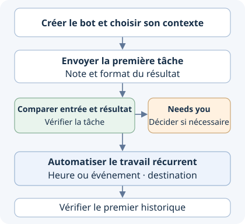

---
{
  "state": "draft",
  "language": "fr",
  "translationKey": "2026-11-23-orca-bot-guide",
  "title": "Utiliser Orca Bot : créer un bot de blog et vérifier ses tâches et automatisations",
  "description": "Confiez une première tâche à Orca Bot, vérifiez sa mémoire et son travail, puis configurez des tâches récurrentes.",
  "sourcePath": "src/content/posts/en/2026-11-23-orca-bot-guide.md",
  "sourceSha256": "00b9ff415bf1d0fddd82a856377211655f16ca6c010e833f68ed5639ee6d5108"
}
---

**Pour créer votre premier Orca Bot, confiez-lui d'abord une tâche dont vous pouvez vérifier le résultat avant de programmer un travail récurrent.** Donnez-lui par exemple une courte note technique et demandez un titre et un plan de blog. Si le résultat a le format souhaité, affinez le rôle du bot et ajoutez des tâches récurrentes. Ce guide suit ce parcours avec un bot qui prépare des brouillons de blog.

Un Orca Bot est une unité de travail dotée d'un nom, d'un objectif et d'une mémoire. Choisissez l'ordinateur d'exécution et un agent tel que Claude Code ou Codex. Installez cet agent et connectez-vous sur cet ordinateur. Le premier exercice reste dans Orca. Pour appeler le bot depuis Slack, GitHub ou Linear, ou le lancer sur les événements de ces services, ajoutez les connexions nécessaires. [Premiers pas avec Orca Bots](https://orca.dev/docs/bots) · [Connecteurs des bots](https://orca.dev/docs/bots/connectors)



## Créer un bot et envoyer une première demande

Dans la barre latérale d'Orca, sous **Bots**, sélectionnez **+ → New bot → Start from scratch**. Choisissez un nom et décrivez son rôle en une phrase dans **Who it is and what it does**. Le nom de l'exemple est `Blog Draft` et son objectif est de « transformer des notes de développement en brouillons de blog technique ». Vérifiez l'ordinateur et l'agent sous le nom, puis sélectionnez **Create**. Si Bots ne figure pas dans la barre latérale, vérifiez **Settings → Bots → Enable bots**. [Créer un bot](https://orca.dev/docs/bots)

Dans le chat du bot, fournissez à la fois les données et le format souhaité, comme ci-dessous. Cette note est un exemple fictif pour l'exercice.

```text
Prepare a technical blog draft from the following practice note.

Note
- A Java service calls an external API.
- Tests checked a successful response and a 404 response.
- Production latency was not measured.

Suggest one title, one introductory paragraph, and three headings.
Do not add versions or performance figures absent from the note.
At the end, list anything that needs checking before writing the body.
Show the result in this chat.
```

À la réception du résultat, vérifiez qu'il conserve la portée de l'affirmation : la réponse 404 a été vérifiée. Si une version ou un débit est ajouté, supprimez cette affirmation ou demandez une preuve. La première demande réussit si le titre, l'introduction et les intertitres reposent sur la note ; elle ne produit pas nécessairement un article prêt à publier.

## Distinguer les règles des futurs chats du travail en cours

| Où vérifier | Contenu approprié | Exemple pour le bot de blog |
| --- | --- | --- |
| `SOUL.md` | Rôle et méthodes de travail permanents | Vérifier les sources dans la documentation officielle et attendre une demande distincte pour publier |
| `MEMORY.md` | Faits et préférences à retenir dans les prochains chats | Les lecteurs sont des développeurs Java et préfèrent les exemples exécutables |
| Élément de travail dans **Home** | Avancement, résultats joints et décisions à approuver | Un nouveau brouillon attend une relecture |

Les deux fichiers Markdown se trouvent dans le dossier du bot. Vous pouvez lui donner une règle durable comme « Dans les prochains exemples, distingue les résultats exécutés des résultats attendus », puis vérifier son respect lors des tâches suivantes. Pour savoir si le travail actuel est terminé, ouvrez son élément de travail. Si une décision est nécessaire, vérifiez l'objet et les conséquences de la question dans **Needs you**, puis répondez. [Utiliser les bots Orca](https://orca.dev/docs/bots) · [Mémoire et accès du bot](https://orca.dev/docs/bots/security)

Pour une modification de code dans un dépôt, le bot peut transmettre le travail à un agent dans un worktree Git séparé. Ouvrez le workspace de cet agent dans la barre latérale pour examiner les fichiers et les tests ; si une PR est créée, vérifiez les modifications réelles. [Agents des bots](https://orca.dev/docs/bots) · [Guide des worktrees Orca](../2026-11-12-orca-worktree-guide/)

## Définir le déclencheur et la destination du résultat récurrent

Si la première tâche convient, faites la demande suivante dans le chat du bot. Cet exemple lit la documentation publique et rassemble uniquement des idées d'articles.

```text
Every Monday at 9:00 a.m. Korea time, select up to three technical
article ideas from official Spring Boot releases announced in the
previous seven days. For each candidate, include the announcement date,
official link, and a question to explore in an exercise.
If there were no announcements, say so.
Make the result available to me in Orca; do not publish it to the blog.
Also tell me which conversation the automation will leave its result in.
```

Une fois l'automatisation créée, vérifiez son **fuseau horaire, son déclencheur et la destination du résultat** dans le panneau du bot. Pour réagir à un événement tel qu'une nouvelle PR GitHub plutôt qu'à une heure, vérifiez d'abord que le connecteur est relié et prend en charge cet événement. Si l'ordinateur qui exécute le bot est en veille ou hors ligne, il ne peut pas travailler immédiatement à l'heure prévue ; vérifiez donc le premier résultat dans l'historique d'exécution de l'automatisation. [Automatisations Orca](https://orca.dev/docs/bots) · [Connecteurs Orca](https://orca.dev/docs/bots/connectors)

Sur macOS avec le CLI installé, les commandes suivantes affichent les noms des bots et les événements disponibles. Remplacez le nom de la deuxième ligne par celui de votre bot.

```sh
orca bot list
orca automations trigger-options --bot 'Blog Draft'
```

Les deux commandes de lecture ont été vérifiées avec un bot existant et **Orca CLI 1.4.271** dans l'environnement de rédaction. Pour un bot sans connexion GitHub, le résultat indiquait que les événements GitHub ne pouvaient pas le lancer. Le nom et la note sont fictifs ; aucun nouveau bot ni aucune automatisation n'a été créé ou exécuté pour cet article. Consultez le guide CLI de votre version avec `orca skills get orca-cli --reference bots`.
