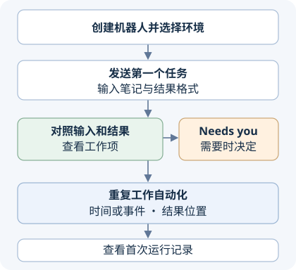

---
{
  "state": "draft",
  "language": "zh-CN",
  "translationKey": "2026-11-23-orca-bot-guide",
  "title": "使用 Orca Bot：创建博客机器人并检查任务与自动化",
  "description": "为 Orca Bot 分配第一个任务，检查记忆和工作，并设置重复任务。",
  "sourcePath": "src/content/posts/en/2026-11-23-orca-bot-guide.md",
  "sourceSha256": "00b9ff415bf1d0fddd82a856377211655f16ca6c010e833f68ed5639ee6d5108"
}
---

**第一次创建 Orca Bot 时，在安排重复工作之前，先交给它一项结果可以检查的任务。** 例如，提供简短的技术笔记，让它提出博客标题和文章结构。如果结果符合所需格式，再完善机器人的角色并添加重复任务。本文以准备博客草稿的机器人为例介绍这一过程。

Orca Bot 是拥有名称、目的和记忆的工作单元。选择运行它的计算机和 Claude Code、Codex 等代理，并在该计算机上安装并登录所选代理。第一次练习只在 Orca 内进行。若要从 Slack、GitHub 或 Linear 调用机器人，或由这些服务的事件触发运行，请添加所需连接。[Orca Bots 快速入门](https://orca.dev/docs/bots) · [Orca 机器人连接器](https://orca.dev/docs/bots/connectors)



## 创建机器人并发送第一个请求

在 Orca 侧栏的 **Bots** 中选择 **+ → New bot → Start from scratch**。选择名称，并在 **Who it is and what it does** 中用一句话描述角色。示例名称为 `Blog Draft`，目的是“将开发笔记整理为技术博客草稿”。检查名称下方的运行计算机和代理，然后选择 **Create**。如果侧栏没有 Bots，请检查 **Settings → Bots → Enable bots**。[创建机器人](https://orca.dev/docs/bots)

在机器人的聊天中，像下面这样同时提供输入资料和期望格式。此笔记是虚构的练习资料。

```text
Prepare a technical blog draft from the following practice note.

Note
- A Java service calls an external API.
- Tests checked a successful response and a 404 response.
- Production latency was not measured.

Suggest one title, one introductory paragraph, and three headings.
Do not add versions or performance figures absent from the note.
At the end, list anything that needs checking before writing the body.
Show the result in this chat.
```

收到结果后，检查是否保留了“检查过 404 响应”这一范围。如果新增了版本或吞吐量的说法，请删除或要求提供依据。首次请求的成功标准是基于笔记得到标题、导语和小标题，而不是得到可以立即发布的文章。

## 区分未来聊天的规则和当前工作

| 查看位置 | 适合的内容 | 博客机器人示例 |
| --- | --- | --- |
| `SOUL.md` | 持续适用的角色和工作方式 | 用官方文档核实依据，发布前等待单独请求 |
| `MEMORY.md` | 未来聊天可参考的事实和偏好 | 读者是 Java 开发者，偏好可运行的示例 |
| **Home** 中的工作项 | 当前进度、附加结果和待批准的决定 | 新草稿正在等待审阅 |

这两个 Markdown 文件位于机器人文件夹中。可以告诉它“以后在示例中区分亲自运行的结果和预期结果”等持续适用的规则，再检查它在后续工作中是否遵守。要确认当前工作是否完成，请打开机器人的工作项。如果需要决定，请在 **Needs you** 中确认问题的对象和后果并答复。[使用 Orca Bot](https://orca.dev/docs/bots) · [机器人记忆和访问范围](https://orca.dev/docs/bots/security)

如果要求修改仓库中的代码，机器人可以把工作交给独立 Git worktree 中的工作者。在侧栏打开该工作者的 workspace，检查文件和测试；如果创建了 PR，请检查实际变更。[机器人工作者](https://orca.dev/docs/bots) · [Orca worktree 指南](../2026-11-12-orca-worktree-guide/)

## 为重复工作设置触发条件和结果位置

首次任务符合要求后，可以在机器人聊天中提出以下请求。本例只读取公开文档并收集文章选题。

```text
Every Monday at 9:00 a.m. Korea time, select up to three technical
article ideas from official Spring Boot releases announced in the
previous seven days. For each candidate, include the announcement date,
official link, and a question to explore in an exercise.
If there were no announcements, say so.
Make the result available to me in Orca; do not publish it to the blog.
Also tell me which conversation the automation will leave its result in.
```

创建自动化后，在机器人面板检查 **时区、触发条件和结果接收位置**。如果要响应新的 GitHub PR 等事件而非定时运行，请先确认连接器已连接且支持该事件。运行机器人的计算机处于睡眠或离线状态时，它无法按计划立即工作，因此请在自动化运行记录中检查首次结果。[Orca 自动化](https://orca.dev/docs/bots) · [Orca 连接器](https://orca.dev/docs/bots/connectors)

在安装了 CLI 的 macOS 上，可以用以下命令查询机器人名称和可用事件。将第二行的名称替换为自己的机器人名称。

```sh
orca bot list
orca automations trigger-options --bot 'Blog Draft'
```

在写作环境中，使用 **Orca CLI 1.4.271** 和已有机器人检查了这两条只读命令。没有 GitHub 连接的机器人的查询结果显示，GitHub 事件无法启动该机器人。示例名称和笔记均为虚构；本文没有创建或运行新的机器人或自动化。可通过 `orca skills get orca-cli --reference bots` 阅读与所用版本匹配的 CLI 指南。
