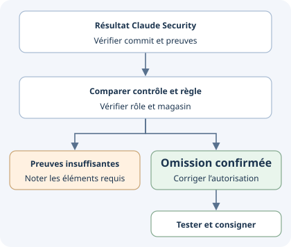

---
{
  "state": "draft",
  "language": "fr",
  "translationKey": "2026-11-23-claude-mythos-defensive-review",
  "title": "Utiliser Claude Mythos : relier les résultats Claude Security aux corrections et aux tests",
  "description": "Vérifiez les preuves d’un résultat Claude Security et testez les autorisations et refus côté serveur.",
  "sourcePath": "src/content/posts/en/2026-11-23-claude-mythos-defensive-review.md",
  "sourceSha256": "f2681dfbb0c7b7d09b2e0d0b566305cdaec11b271949b3a7aa2785e56013639e"
}
---

**À la réception d'un résultat Claude Security, vérifiez d'abord le commit examiné et les fichiers de preuve.** Écrivez ensuite la règle que l'application doit respecter et testez les cas autorisés et refusés. Cet exemple utilise une politique commerciale fictive : seule une personne responsable des remboursements dans le même magasin peut demander un remboursement.

Selon Anthropic, Claude Security dans Claude Enterprise analyse les dépôts avec des modèles dont Mythos 5.2. Cet exemple examine et corrige un résultat défensif dans un dépôt autorisé. Le [guide de disponibilité de Mythos](../2026-11-22-claude-mythos-availability/) présente les conditions d'accès du compte. [Annonce des modèles par Anthropic](https://www.anthropic.com/claude-fable-and-mythos-5-2) · [Aide Claude Security](https://support.claude.com/en/articles/14661296-use-claude-security)



## Choisir les preuves de la correction

Un résultat Claude Security comprend la gravité, les fichiers et lignes concernés, la branche et le commit des preuves ainsi qu'une proposition de correction. Ouvrez d'abord les fichiers cités au **même commit**. Si la branche courante a changé, vérifiez séparément si la même règle manque dans sa version actuelle. [Résultats Claude Security](https://support.claude.com/en/articles/14661296-use-claude-security)

| Vérification | Question pour cet exemple |
| --- | --- |
| Version et emplacement analysés | Quel commit du service de demande de remboursement et de son contrôle d'autorisation le rapport concerne-t-il ? |
| Règle métier réelle | Une personne en lecture seule ne peut-elle pas demander de remboursement, même dans le même magasin ? |
| Portée des contrôles existants | Indépendamment de l'affichage du bouton, le parcours serveur vérifie-t-il le rôle et le magasin ? |
| Preuves nécessaires | Si la règle commune d'autorisation est inaccessible, quels fichiers ou réglages faut-il encore consulter ? |

Si le rapport indique par exemple « vérifier l'autorisation des demandes de remboursement », recherchez d'abord un contrôle commun déjà appliqué à ce parcours. Si la règle commune est illisible, notez dans le résultat les documents nécessaires. Si l'omission est confirmée, ciblez le contrôle serveur et les tests associés. [Conception des droits dans l'administration commerciale](../2026-11-23-commerce-admin-screen/)

## Donner la règle métier et les critères d'achèvement à l'outil de correction

La fonction **Fix** de Claude Security permet de poursuivre la correction dans Claude Code. Sans Claude Code in the cloud, copiez le prompt fourni dans votre propre Claude Code. La session utilise un modèle disponible pour le compte. La demande fictive ci-dessous s'utilise après vérification des fichiers et des preuves de la règle ; adaptez les chemins et commits au dépôt. [Corriger un résultat](https://support.claude.com/en/articles/14661296-use-claude-security) · [Claude Security](https://claude.com/product/claude-security)

```text
Vérifie l'autorisation serveur des demandes de remboursement dans le commit
examiné et les fichiers joints.

Règle métier
- Seule une personne responsable des remboursements du même magasin peut en demander un.
- Le droit de lecture est distinct du droit de demander un remboursement.
- Le rôle et le magasin proviennent du contexte serveur authentifié.

Vérifie d'abord si une règle d'autorisation commune s'applique déjà et indique
les fichiers de preuve. Si une omission est confirmée, modifie au minimum le
contrôle existant. Ajoute des tests de régression autorisant la personne responsable
du même magasin et refusant une personne en lecture seule, une personne responsable
d'un autre magasin et une demande non authentifiée. Rapporte les fichiers vérifiés,
les modifications, les tests exécutés et leurs résultats, et les points non vérifiés.
```

Le travail est terminé lorsque **la portée autorisée correspond à la règle existante**. Un contrôle du seul rôle pourrait accepter une personne d'un autre magasin ; un contrôle du seul magasin n'exclurait pas la lecture seule. Lisez les modifications et vérifiez que le serveur compare le contexte utilisateur authentifié au magasin de la commande lue dans le dépôt.

## Vérifier les parcours autorisés et refusés

Le code suivant teste isolément la décision d'autorisation après correction. Il suppose que l'authentification et la recherche de commande sont terminées et que le serveur transmet `actor` et `order`. L'exécution réelle du remboursement et les communications avec le prestataire de paiement sont hors du périmètre de cette fonction.

```javascript
import assert from "node:assert/strict";

function canRequestRefund(actor, order) {
  return actor !== null &&
    actor.role === "REFUND_MANAGER" &&
    actor.storeId === order.storeId;
}

const order = { storeId: "store-a" };
const manager = { role: "REFUND_MANAGER", storeId: "store-a" };

const cases = [
  ["same-store refund manager", manager, true],
  ["read-only operator", { ...manager, role: "VIEWER" }, false],
  ["different-store refund manager", { ...manager, storeId: "store-b" }, false],
  ["unauthenticated request", null, false]
];

for (const [label, actor, expected] of cases) {
  assert.equal(canRequestRefund(actor, order), expected, label);
  console.log(`PASS ${label}`);
}
```

Enregistré sous `refund-policy.mjs` et exécuté avec `node refund-policy.mjs`, il a produit les quatre décisions attendues sous Node.js 22.17.0 :

```text
PASS same-store refund manager
PASS read-only operator
PASS different-store refund manager
PASS unauthenticated request
```

Dans un dépôt réel, vérifiez aussi que le parcours de demande utilise cette décision. Des tests d'intégration doivent vérifier qu'une demande refusée n'enregistre aucune opération de remboursement et qu'une demande autorisée conserve le flux existant. À la clôture, consignez le commit ou la PR de correction, les tests exécutés et les points restants. Si le rapport est jugé incorrect, consignez aussi les preuves, comme un contrôle commun existant. [Suivi des résultats Claude Security](https://support.claude.com/en/articles/14661296-use-claude-security)

Le résultat de cet article est fictif. Aucun dépôt réel n'a été analysé avec Claude Security et aucune réponse Mythos n'a été recueillie ; le résultat ci-dessus est un test local de la fonction d'autorisation. Aucun lancement de modèle authentifié, remboursement réel ni intégration de paiement n'a été testé.
