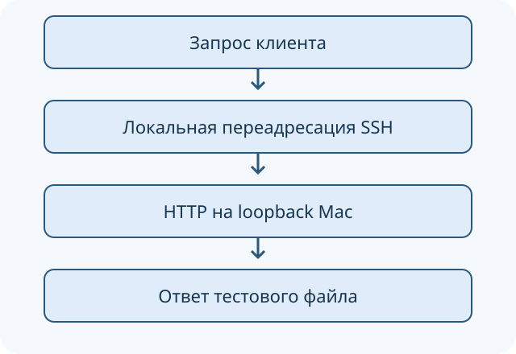

---
{
  "state": "draft",
  "language": "ru",
  "translationKey": "2026-11-23-macbook-personal-server",
  "title": "MacBook как личный сервер в частной сети",
  "description": "Проверьте локальный HTTP-сервер через SSH-туннель и узнайте ограничения доступности Mac.",
  "sourcePath": "src/content/posts/en/2026-11-23-macbook-personal-server.md",
  "sourceSha256": "1f7cecd174ca16a5d160e958a0c11213101696af9d4c909bbadb9fe85e60fbfb"
}
---

MacBook может предоставить короткую демонстрацию разработки другому компьютеру в доверенной частной сети, не открывая HTTP-порт в сети. Запустите временный HTTP-сервер на интерфейсе обратной связи Mac и подключитесь через локальную переадресацию SSH. Это тест, а не настройка постоянно доступного публичного сервиса.



Схема обобщает запрос и ответ; проверка подлинности и очистка описаны ниже.

## Подготовка доступа

Используйте два компьютера в частной сети, которую вы контролируете. В общей или публичной сети могут быть недоверенные устройства; частный адрес сам по себе не ограничивает доступ. Не настраивайте переадресацию портов на маршрутизаторе. Используйте отдельную стандартную учётную запись macOS и предоставьте ей доступ только к необходимым файлам. На Mac откройте «Системные настройки» → «Основные» → «Общий доступ» → «Удалённый вход», включите его и выберите «Только эти пользователи», разрешив эту учётную запись. Не включайте полный доступ удалённых пользователей к диску без отдельной необходимости. В панели удалённого входа показан адрес SSH Mac. Настройки могут отличаться в зависимости от версии macOS и управления устройством. [Apple: удалённый вход](https://support.apple.com/guide/mac-help/allow-a-remote-computer-to-access-your-mac-mchlp1066/mac)

На клиенте создайте отдельный ключ, при запросе выбрав парольную фразу и новое имя файла:

```sh
ssh-keygen -t ed25519 -f ~/.ssh/macbook_demo
```

Передайте единственную строку открытого ключа из `~/.ssh/macbook_demo.pub` на Mac по доверенному каналу. Локально войдите на Mac под разрешённой учётной записью, выполните команды ниже, вставьте строку открытого ключа и нажмите Ctrl-D на новой строке. Строка добавится в `~/.ssh/authorized_keys`, существующие записи сохранятся. Никогда не копируйте закрытый ключ.

```sh
umask 077
mkdir -p ~/.ssh
chmod 700 ~/.ssh
cat >> ~/.ssh/authorized_keys
chmod 600 ~/.ssh/authorized_keys
```

См. [разрешённые ключи OpenSSH](https://man.openbsd.org/sshd#AUTHORIZED_KEYS_FILE_FORMAT) и [ssh-keygen](https://man.openbsd.org/ssh-keygen).

На Mac узнайте отпечаток ключа хоста в локальном терминале:

```sh
ssh-keygen -lf /etc/ssh/ssh_host_ed25519_key.pub
```

Подключитесь с клиента, используя разрешённую учётную запись и адрес из панели удалённого входа; `demo` и `192.168.1.20` ниже — примеры, замените их. Прежде чем принять первое подключение, сравните показанный отпечаток ED25519 с полученным на Mac. Если они различаются, остановитесь и выясните причину. Предупреждение об изменении ключа хоста также требует проверки, а не автоматического принятия. [Проверка хоста OpenSSH](https://man.openbsd.org/ssh#VERIFYING_HOST_KEYS)

```sh
ssh -i ~/.ssh/macbook_demo -o HostKeyAlgorithms=ssh-ed25519 demo@192.168.1.20
```

Убедитесь, что вход выполнен, и введите `exit`. Пароль учётной записи может по-прежнему работать: добавление ключа само по себе не отключает проверку пароля.

## Запуск теста и переадресация

На Mac в терминале разрешённой учётной записи создайте пустой временный каталог, добавьте безвредный файл и запустите Python 3.7+. Сервер привязывается только к IPv4-адресу обратной связи Mac. Оставьте терминал открытым.

```sh
sample_dir=$(mktemp -d)
printf 'home server test\n' > "$sample_dir/index.html"
python3 -m http.server 8000 --bind 127.0.0.1 --directory "$sample_dir"
```

Если порт 8000 уже занят, остановитесь и выберите свободный порт в обеих командах — сервера и переадресации. Простой HTTP-сервер Python предназначен для тестов, а не для эксплуатации; он следует по символическим ссылкам, поэтому используйте только пустой тестовый каталог и безвредный файл. [Python http.server](https://docs.python.org/3/library/http.server.html)

На клиенте откройте туннель во втором терминале и оставьте его открытым:

```sh
ssh -N -o ExitOnForwardFailure=yes -i ~/.ssh/macbook_demo -L 127.0.0.1:18000:127.0.0.1:8000 demo@192.168.1.20
```

В другом терминале клиента выполните:

```sh
curl http://127.0.0.1:18000/
```

Ожидаемый вывод — `home server test`. Клиент подключается к собственному порту 18000; SSH передаёт запрос на Mac, где подключается к порту обратной связи 8000. Если туннель не работает, перед повторной попыткой проверьте адрес, список доступа, отпечаток и ключ. Если туннель запущен, но curl не работает, проверьте, что процесс Python запущен и оба порта совпадают. `ExitOnForwardFailure` подтверждает создание локального слушающего порта, а не доступность целевого HTTP-сервера. [Переадресация OpenSSH](https://man.openbsd.org/ssh#L)

Остановите SSH-туннель сочетанием Ctrl-C в его терминале. Остановите Python сочетанием Ctrl-C в терминале Mac и удалите только созданный выше тестовый каталог:

```sh
rm "$sample_dir/index.html"
rmdir "$sample_dir"
```

Удалите строку примера открытого ключа и отключите удалённый вход, если они были добавлены только для этого упражнения. Сохраните существовавшие ключи и настройки доступа.

## Доступность и дальнейшие шаги

Выключенный экран и спящий Mac — разные состояния. Закрытие экрана ноутбука обычно переводит его в сон; не предполагайте, что закрытая крышка, пробуждение по сети или изменение питания сохранят работу теста. После перезапуска с FileVault предусмотрите возможность ручной разблокировки Mac при необходимости. Apple описывает разблокировку FileVault по SSH при определённых условиях на Apple Silicon с macOS 26 или новее; не предполагайте, что эти условия выполнены. [Apple: режим сна](https://support.apple.com/guide/mac-help/put-your-mac-to-sleep-or-wake-it-mh10330/mac) · [Apple: FileVault](https://support.apple.com/guide/security/managing-filevault-sec8447f5049/web)

После одноразовой демонстрации остановите процесс. Для файлов можно рассмотреть общий доступ к файлам macOS и его ограничения доступа. Долго работающему сервису нужны отдельная конфигурация launchd, обновления, резервные копии и план восстановления; выделенное оборудование может подойти лучше. Для доступа вне дома можно отдельно рассмотреть частную VPN; она не отменяет необходимость защищать Mac и сервис.

Ответ HTTP через интерфейс обратной связи проверен локально с временным файлом и процессом; SSH-подключение и туннель — документированные шаги для читателя, подключение к этому Mac не проверялось.
