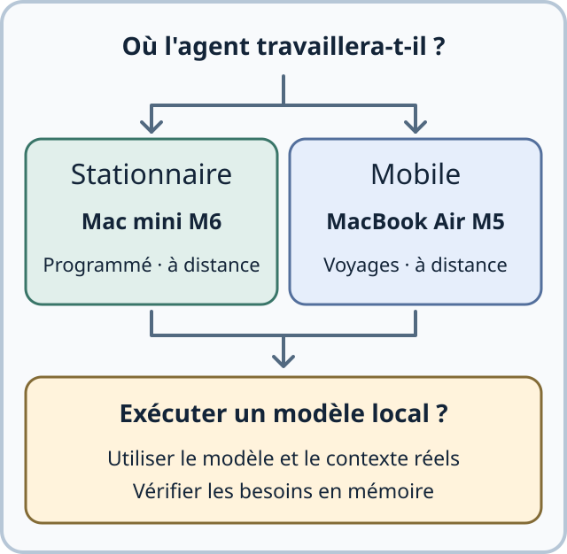

---
{
  "state": "draft",
  "language": "fr",
  "translationKey": "2026-11-23-mac-for-ai-agents",
  "title": "MacBook ou Mac mini pour les agents IA : lequel acheter ?",
  "description": "Comparez les Mac mini et MacBook Air en fonction de l'endroit où travaillent vos agents IA et de la quantité de mémoire dont ils ont besoin.",
  "sourcePath": "src/content/posts/en/2026-11-23-mac-for-ai-agents.md",
  "sourceSha256": "cf0a6f26766c7d6ada501ad70e444774995908e2d4c22f1683cddffe6211454a"
}
---

Si vous possédez déjà un ordinateur portable et souhaitez que les agents IA exécutent des tests de navigateur ou des tâches planifiées, je recommande le **Mac mini M6**. Si vous souhaitez bénéficier du même environnement de développement lors de vos déplacements domicile-travail et que vous préférez un seul ordinateur, le **modèle 13 pouces du MacBook Air M5** est un meilleur choix. Si vous envisagez d'exécuter des modèles vous-même avec un outil tel que Ollama, vérifiez d'abord la mémoire nécessaire pour le modèle et le contexte choisis. Pour une machine stationnaire nécessitant plus de 32GB, envisagez les configurations **48GB et 64GB Mac mini M5 Pro**. [Spécifications Apple Mac mini](https://www.apple.com/kr/mac-mini/specs/) · [Spécifications Apple MacBook Air](https://www.apple.com/kr/macbook-air/specs/)



## Là où les agents et les modèles fonctionnent

Pensez à exécuter Claude Code ou Codex sur le terminal de votre Mac avec un modèle cloud. Un service distant génère des réponses de modèle, tandis que les builds et les tests exécutés par l'agent sur votre Mac utilisent son CPU, sa mémoire et son stockage. Vos besoins diffèrent entre demander à un agent une révision du code et exécuter Docker, des tests et des navigateurs dans deux dossiers de travail à la fois. Avec un modèle cloud, choisissez des spécifications basées sur le travail qui se chevauche réellement sur votre Mac.

Avec l'inférence locale, le modèle utilise également la mémoire de votre Mac. Même avec le même modèle, les exigences varient en fonction de la précision utilisée pour stocker les poids et de la longueur de l'entrée fournie en même temps. Une courte conversation peut fonctionner, mais les réponses peuvent ralentir lorsque vous ajoutez du code long et des journaux et ouvrez un navigateur. Avant d'acheter, si possible, vérifiez la latence de réponse et la pression de la mémoire avec le **modèle réel, la quantification et la longueur du contexte** que vous avez l'intention d'utiliser. [Documentation de la longueur du contexte Ollama](https://docs.ollama.com/context-length)

## Configurations par utilisation

| Charge de travail principale | Mon choix | Vérifiez avant d'acheter |
| --- | --- | --- |
| Codage avec un modèle cloud sur un bureau fixe et tests occasionnels | Mac mini M6 16GB | Vérifiez si la base 256GB est suffisante. Si vous conservez régulièrement des caches de build et des images Docker, comparez les configurations à partir de 512GB. |
| Travailler dans des cafés et des bureaux | modèle 13 pouces du MacBook Air M5 16GB · 512GB | Si les tests de conteneurs et de navigateurs se chevauchent fréquemment, considérez d'abord 24GB. |
| Exécuter des conteneurs et des tests simultanément sur plusieurs dossiers de travail | Mac mini M6 pour une utilisation stationnaire, ou MacBook Air M5 pour une utilisation mobile, avec 24–32GB | Vérifiez le nombre de services simultanés et la pression de la mémoire. Vérifiez également la mémoire allouée à la machine virtuelle de Docker Desktop. |
| Exécuter des modèles locaux quotidiennement et avoir besoin de plus de 32GB | Mac mini M5 Pro 48GB · 64GB pour utilisation stationnaire | Tenez compte du navigateur et de l’IDE exécutés simultanément après le chargement du modèle. Si vous avez également besoin du même modèle hors de chez vous, déterminez la capacité requise et comparez les configurations MacBook Pro avec cette capacité. |

16GB, 24GB et 32GB sont des points de départ basés sur la charge de travail. Les besoins réels varient en fonction des méthodes de construction et du nombre de conteneurs. [Paramètres des ressources Docker Desktop](https://docs.docker.com/desktop/settings-and-maintenance/settings/#resources)

### Prix ​​de départ dans la boutique Apple Korea

Il s'agit des prix de départ ordinaires des configurations de base vérifiés le 23 novembre 2026.

| Modèle | Mémoire de base · SSD | Prix ​​initial |
| --- | --- | ---: |
| Mac mini M6 | 16GB · 256GB | KRW 1,499,000 |
| modèle 13 pouces du MacBook Air M5 | 16GB · 512GB | KRW 2,190,000 |
| Mac mini M5 Pro | 24GB · 512GB | KRW 2,990,000 |

Les prix de départ des deux modèles de base 16GB diffèrent de KRW 691,000. Le MacBook Air comprend un écran, un clavier et une batterie, et sa base SSD est plus grande. Si vous possédez déjà un moniteur et des périphériques d'entrée, le Mac mini présente un avantage de prix plus important. Si vous envisagez d'augmenter le stockage SSD ou la mémoire, comparez les configurations souhaitées dans le panier. [Magasin Apple Korea](https://www.apple.com/kr/shop/buy-mac) · [Prix de lancement Mac mini](https://www.apple.com/kr/newsroom/2026/09/the-new-mac-mini-and-mac-studio-are-available-today/) · [Spécifications Mac mini](https://www.apple.com/kr/mac-mini/specs/) · [Spécifications MacBook Air](https://www.apple.com/kr/macbook-air/specs/)

## Vérifiez votre Mac actuel avant d'acheter

1. Utilisez les commandes ci-dessous pour vérifier la mémoire et l'espace libre sur le volume contenant votre dossier personnel.
2. Ouvrez votre agent et IDE comme d'habitude et exécutez les charges de travail de build, Docker et de navigateur qui se chevauchent le plus souvent. Vérifiez la pression de la mémoire et l'utilisation du swap dans **Activity Monitor → Mémoire**.
3. Si la pression de la mémoire augmente de manière répétée et que les applications répondent également lentement, comparez les configurations avec plus de mémoire. Si le problème se produit uniquement pendant l'exécution des conteneurs, vérifiez également la limite d'allocation dans Docker Desktop. [Guide Apple Activity Monitor](https://support.apple.com/guide/activity-monitor/view-memory-usage-actmntr1004/mac) · [Paramètres des ressources Docker Desktop](https://docs.docker.com/desktop/settings-and-maintenance/settings/#resources)

```sh
sw_vers -productVersion
sysctl -n hw.memsize | awk '{ printf "Unified memory: %.0f GiB\n", $1 / 1073741824 }'
df -h "$HOME" | awk 'NR == 2 { print "Free storage:", $4 }'
```

Même avec suffisamment de mémoire et de disque, une machine pour les tâches planifiées nécessite une autre vérification. Après le travail, exécutez une tâche planifiée une fois avec l'écran éteint et vérifiez son journal. Si les tâches doivent être exécutées après une mise en veille ou un redémarrage, vérifiez à nouveau les deux conditions. Si vous possédez déjà un MacBook, cette vérification peut vous aider à décider si vous avez besoin d'un Mac mini dédié. [Utiliser un MacBook comme serveur personnel](https://youdozi.github.io/fr/posts/2026-11-23-macbook-personal-server/)

J'ai vérifié les spécifications et les prix par rapport aux pages coréennes de Apple et exécuté les trois commandes ci-dessus sur macOS. Je n'ai pas mesuré les performances de build entre les machines ni les temps de réponse des modèles locaux.
