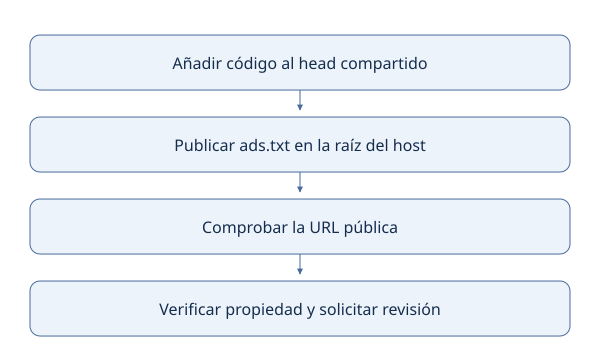

---
{
  "state": "draft",
  "language": "es",
  "translationKey": "2026-11-24-github-pages-ads-guide",
  "title": "Anuncios en un blog de GitHub Pages: desde la elección del servicio hasta la instalación de AdSense",
  "description": "Elige un servicio de anuncios, configura AdSense y ads.txt en la raíz de GitHub Pages y comprueba la revisión y la publicación.",
  "sourcePath": "src/content/posts/en/2026-11-24-github-pages-ads-guide.md",
  "sourceSha256": "884b5c639b2345ac6daac6b307db2cd0ec22e80801c8d5d2d5860b4ba12356d8"
}
---

Si tienes un blog técnico en `username.github.io`, Google AdSense es una opción para empezar. Carbon Ads y EthicalAds también son candidatos si el sitio tiene una audiencia constante de desarrolladores. Antes de solicitar el servicio, comprueba si puedes publicar `https://username.github.io/ads.txt`; esto es especialmente importante si la dirección del proyecto es `username.github.io/blog/`.

GitHub no prohíbe de forma general los anuncios en sitios centrados en contenido. Sin embargo, GitHub Pages limita su uso como alojamiento gratuito para un negocio en línea, comercio electrónico o SaaS comercial. Consulta ambas políticas al añadir anuncios a un blog técnico. [Política de publicidad de GitHub](https://docs.github.com/en/site-policy/acceptable-use-policies/github-acceptable-use-policies#10-advertising-on-github) · [Límites de GitHub Pages](https://docs.github.com/en/pages/getting-started-with-github-pages/github-pages-limits)

## ¿Qué servicio de anuncios elegir?

| Servicio | Sitios adecuados | Solicitud |
| --- | --- | --- |
| **Google AdSense** | Un blog personal que añade sus primeros anuncios y quiere elegir entre ubicación automática o manual | [Empezar con AdSense](https://adsense.google.com/start/) |
| **Carbon Ads** | Artículos, documentación y herramientas para desarrolladores y diseñadores. Revisa solicitudes a partir de 10,000 páginas vistas al mes y no permite combinar otras redes de anuncios. | [Solicitar Carbon Ads](https://www.carbonads.net/join?_hsmi=83378591) |
| **EthicalAds** | Sitios para desarrolladores con al menos 50,000 páginas vistas al mes y espacio para un anuncio que no interrumpa la lectura | [Guía para editores de EthicalAds](https://www.ethicalads.io/publisher-guide/) |

Decide primero dónde colocar el anuncio. En un blog con muchos ejemplos de código, empezar con un anuncio manual de AdSense debajo del artículo y revisarlo en móvil ayuda a evaluar la ubicación. AdSense ofrece **bloques de anuncios**, cuya ubicación eliges, y **anuncios automáticos**, cuya ubicación decide Google. EthicalAds tiene reglas propias: el anuncio debe verse en la primera pantalla en escritorio y móvil; si no es posible en móvil, se puede desactivar allí. [Configuración de anuncios de AdSense](https://support.google.com/adsense/answer/7037624)



El diagrama resume la configuración y la solicitud de revisión; la publicación real de anuncios se comprueba por separado.

## 1. Regístrate en AdSense y añade el sitio

Regístrate con una cuenta de Google e introduce el país y la información de pago. En **Sitios → Nuevo sitio**, añade `https://username.github.io`. La Public Suffix List incluye `github.io`, y AdSense indica que se pueden añadir como sitios los subdominios de plataformas incluidas en esa lista. Después se verifica la propiedad y se revisa el sitio. [Crear una cuenta de AdSense](https://support.google.com/adsense/answer/7402253) · [Criterios de sitios de AdSense](https://support.google.com/adsense/answer/12170421) · [Public Suffix List](https://publicsuffix.org/list/public_suffix_list.dat)

Comprueba la dirección: un sitio de usuario de GitHub Pages está en `username.github.io/`, mientras que uno de proyecto suele estar en `username.github.io/blog/`. Un `ads.txt` incluido en la publicación del proyecto puede quedar en `/blog/ads.txt`. Google comienza en la raíz del host, `/ads.txt`, así que publica el archivo desde el sitio de usuario o en la raíz de un dominio personalizado conectado al blog. [Tipos de sitios de GitHub Pages](https://docs.github.com/en/pages/getting-started-with-github-pages/what-is-github-pages#types-of-github-pages-sites) · [Rastreo de ads.txt de Google](https://support.google.com/adsense/answer/7679060)

## 2. Un código en el `<head>` compartido y un `ads.txt` en la raíz

AdSense ofrece un fragmento de código, `ads.txt` o una etiqueta meta para verificar la propiedad. Si eliges el fragmento, coloca el código del panel en el `<head>` del diseño compartido. El siguiente solo muestra el formato; para publicar, usa el código copiado de tu cuenta. [Conectar el sitio](https://support.google.com/adsense/answer/7584263)

```html
<script async
  src="https://pagead2.googlesyndication.com/pagead/js/adsbygoogle.js?client=ca-pub-0000000000000000"
  crossorigin="anonymous"></script>
```

Copia en `ads.txt` la línea que proporciona el panel. El archivo identifica las cuentas autorizadas a vender el inventario publicitario del sitio. Conserva las líneas de vendedores existentes y añade la nueva.

```text
google.com, pub-0000000000000000, DIRECT, f08c47fec0942fa0
```

En un sitio de usuario con Astro, coloca el archivo en `public/ads.txt`; Astro copia los archivos de `public/` al resultado de la compilación. Tras publicar, comprueba la URL pública, no solo el repositorio. [Directorio `public/` de Astro](https://docs.astro.build/en/guides/images/#src-vs-public) · [Guía ads.txt de Google](https://support.google.com/adsense/answer/12171612)

```bash
curl -fsSL https://username.github.io/ads.txt
```

La salida esperada es la línea de vendedor del ejemplo anterior. Un sitio real debe devolver el ID de editor de su cuenta. La dirección `username` es ilustrativa y esta no es una salida observada.

Para un blog multilingüe en el mismo host basta un archivo en la raíz; no hacen falta archivos separados en `/ko/` y `/en/`. Comprueba que el cargador compartido aparece una vez en el HTML final de un artículo representativo de cada idioma.

## 3. Comprueba por separado la publicación, la revisión y los anuncios

Tras publicar el archivo y el código, verifica la propiedad en AdSense y solicita la revisión del sitio. El estado del sitio **`Ready`** significa que está listo para mostrar anuncios; el estado de ads.txt **`Authorized`** significa que Google encontró el ID de editor en el archivo. Si el panel sigue mostrando `Not found` aunque funcione la URL pública, comprueba si el cambio ocurrió después del último rastreo. Si la ruta y el contenido son correctos, solicita otra comprobación con **Comprobar actualizaciones**. [Estado del sitio](https://support.google.com/adsense/answer/12170222) · [Estado de ads.txt](https://support.google.com/adsense/answer/12171612)

Antes de activar anuncios, explica en la política de privacidad qué información se recoge o comparte para publicidad y qué tecnologías, como cookies, se utilizan. Para mostrar anuncios personalizados a visitantes del EEE, Reino Unido y Suiza se necesita una plataforma de gestión del consentimiento (CMP) certificada por Google e integrada con el Transparency and Consent Framework (TCF) de IAB. El mensaje de normativa europea de **Privacidad y mensajes** de AdSense es una opción. [Política de privacidad para editores de Google](https://support.google.com/adsense/answer/10502938) · [Requisitos de CMP de Google](https://support.google.com/adsense/answer/13554116)

Tras la revisión, comprueba la ubicación con la vista previa de anuncios automáticos o un bloque manual. En un teléfono, verifica que los anuncios no tapen el índice, los botones para copiar código ni el menú de idioma. No hagas clic en tus propios anuncios para probarlos; usa la vista previa y los informes del panel. [Vista previa de anuncios automáticos](https://support.google.com/adsense/answer/9261307) · [Tráfico no válido](https://support.google.com/adsense/answer/16737)

En `youdozi.github.io` se comprobaron el `ads.txt` público de la raíz y un script de AdSense en el HTML de la página principal en coreano. La comprobación se limitó al archivo público y al HTML; el estado de revisión de la cuenta y la publicación real de anuncios requieren otra verificación. [ads.txt público](https://youdozi.github.io/ads.txt) · [Página principal en coreano](https://youdozi.github.io/ko/)
