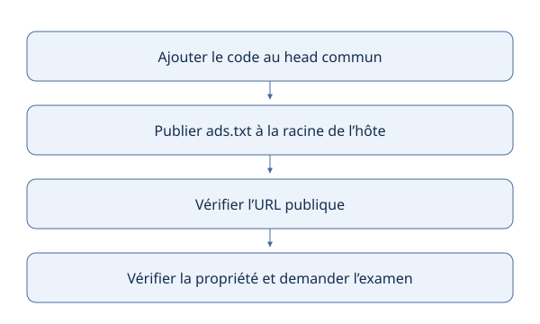

---
{
  "state": "draft",
  "language": "fr",
  "translationKey": "2026-11-24-github-pages-ads-guide",
  "title": "Afficher des publicités sur un blog GitHub Pages : du choix du service à l’installation d’AdSense",
  "description": "Choisir un service publicitaire, configurer AdSense et ads.txt à la racine de GitHub Pages et vérifier l’examen et la diffusion.",
  "sourcePath": "src/content/posts/en/2026-11-24-github-pages-ads-guide.md",
  "sourceSha256": "884b5c639b2345ac6daac6b307db2cd0ec22e80801c8d5d2d5860b4ba12356d8"
}
---

Pour un blog technique sur `username.github.io`, Google AdSense est une option à examiner en premier. Carbon Ads et EthicalAds sont aussi des candidats si le site attire régulièrement des développeurs. Avant de déposer une demande, vérifiez que vous pouvez publier `https://username.github.io/ads.txt`, en particulier si l’adresse du projet ressemble à `username.github.io/blog/`.

GitHub n’interdit pas généralement les publicités sur les sites centrés sur le contenu. GitHub Pages limite toutefois son utilisation comme hébergement gratuit pour une activité en ligne, un site de commerce électronique ou un SaaS commercial. Consultez les deux règles avant d’ajouter des publicités à un blog technique. [Règles publicitaires de GitHub](https://docs.github.com/en/site-policy/acceptable-use-policies/github-acceptable-use-policies#10-advertising-on-github) · [Limites de GitHub Pages](https://docs.github.com/en/pages/getting-started-with-github-pages/github-pages-limits)

## Quel service publicitaire choisir ?

| Service | Sites adaptés | Demande |
| --- | --- | --- |
| **Google AdSense** | Blog personnel ajoutant ses premières publicités et souhaitant choisir entre placement automatique et manuel | [Commencer avec AdSense](https://adsense.google.com/start/) |
| **Carbon Ads** | Articles, documentation et outils destinés aux développeurs et designers. Les demandes sont examinées à partir de 10,000 pages vues par mois et les autres réseaux publicitaires ne sont pas autorisés en parallèle. | [Candidater à Carbon Ads](https://www.carbonads.net/join?_hsmi=83378591) |
| **EthicalAds** | Sites destinés aux développeurs avec au moins 50,000 pages vues par mois et une place pour une publicité qui ne gêne pas la lecture | [Guide des éditeurs EthicalAds](https://www.ethicalads.io/publisher-guide/) |

Choisissez d’abord un emplacement. Pour un blog riche en exemples de code, une publicité AdSense placée manuellement sous l’article constitue un point de départ à examiner sur mobile. AdSense propose des **blocs d’annonces**, dont vous choisissez l’emplacement, et des **annonces automatiques**, placées par Google. EthicalAds impose ses propres règles : l’annonce doit être visible dans le premier écran sur ordinateur et mobile ; si ce n’est pas possible sur mobile, elle peut y être désactivée. [Paramètres publicitaires AdSense](https://support.google.com/adsense/answer/7037624)



Le schéma résume la configuration et la demande d’examen ; la diffusion réelle des annonces se vérifie séparément.

## 1. Créer un compte AdSense et ajouter le site

Inscrivez-vous à AdSense avec un compte Google et saisissez le pays et les informations de paiement. Dans **Sites → Nouveau site**, ajoutez `https://username.github.io`. La Public Suffix List contient `github.io` et AdSense indique que les sous-domaines des plateformes de cette liste peuvent être ajoutés comme sites. La vérification de propriété et l’examen du site suivent. [Créer un compte AdSense](https://support.google.com/adsense/answer/7402253) · [Critères des sites AdSense](https://support.google.com/adsense/answer/12170421) · [Public Suffix List](https://publicsuffix.org/list/public_suffix_list.dat)

Vérifiez l’adresse : un site utilisateur GitHub Pages se trouve à `username.github.io/`, tandis qu’un site de projet se trouve généralement à `username.github.io/blog/`. Un fichier `ads.txt` dans le déploiement du projet peut apparaître à `/blog/ads.txt`. Google commence à la racine de l’hôte, `/ads.txt` ; publiez donc le fichier depuis le site utilisateur ou à la racine d’un domaine personnalisé lié au blog. [Types de sites GitHub Pages](https://docs.github.com/en/pages/getting-started-with-github-pages/what-is-github-pages#types-of-github-pages-sites) · [Exploration ads.txt par Google](https://support.google.com/adsense/answer/7679060)

## 2. Un code dans le `<head>` partagé et un `ads.txt` à la racine

AdSense propose un extrait de code, `ads.txt` ou une balise méta pour vérifier la propriété. Si vous choisissez l’extrait, placez le code fourni par le tableau de bord dans le `<head>` de la mise en page commune. L’exemple suivant montre seulement la forme ; utilisez le code copié de votre compte pour le déploiement réel. [Connecter le site](https://support.google.com/adsense/answer/7584263)

```html
<script async
  src="https://pagead2.googlesyndication.com/pagead/js/adsbygoogle.js?client=ca-pub-0000000000000000"
  crossorigin="anonymous"></script>
```

Copiez dans `ads.txt` la ligne fournie par le tableau de bord. Le fichier indique les comptes autorisés à vendre l’inventaire publicitaire du site. Conservez les lignes des vendeurs existants et ajoutez la nouvelle.

```text
google.com, pub-0000000000000000, DIRECT, f08c47fec0942fa0
```

Pour un site utilisateur Astro, placez le fichier dans `public/ads.txt` ; Astro copie les fichiers de `public/` dans le résultat de compilation. Après déploiement, vérifiez l’URL publique et pas seulement le dépôt. [Répertoire `public/` d’Astro](https://docs.astro.build/en/guides/images/#src-vs-public) · [Guide ads.txt de Google](https://support.google.com/adsense/answer/12171612)

```bash
curl -fsSL https://username.github.io/ads.txt
```

La sortie attendue est la ligne de vendeur donnée en exemple ci-dessus. Un site réel doit renvoyer l’identifiant éditeur du compte. L’adresse `username` est illustrative ; il ne s’agit pas d’un résultat observé.

Pour un blog multilingue sur le même hôte, un fichier à la racine suffit ; il n’en faut pas séparément sous `/ko/` et `/en/`. Vérifiez que le chargeur partagé apparaît une fois dans le HTML final d’un article représentatif de chaque langue.

## 3. Vérifier séparément le déploiement, l’examen et la diffusion

Après déploiement du fichier et du code, vérifiez la propriété dans AdSense et demandez l’examen du site. L’état du site **`Ready`** signifie qu’il est prêt à afficher des annonces ; l’état ads.txt **`Authorized`** signifie que Google a trouvé l’identifiant éditeur dans le fichier. Si le tableau de bord indique toujours `Not found` alors que l’URL publique fonctionne, vérifiez si la modification a suivi la dernière exploration. Si le chemin et le contenu sont corrects, demandez une nouvelle vérification avec **Rechercher des mises à jour**. [État du site](https://support.google.com/adsense/answer/12170222) · [État ads.txt](https://support.google.com/adsense/answer/12171612)

Avant d’activer les annonces, décrivez dans la politique de confidentialité les informations recueillies ou partagées pour la publicité et les technologies utilisées, comme les cookies. Pour diffuser des annonces personnalisées aux visiteurs de l’EEE, du Royaume-Uni et de Suisse, il faut une plateforme de gestion du consentement (CMP) certifiée par Google et intégrée au Transparency and Consent Framework (TCF) de l’IAB. Le message sur la réglementation européenne dans **Confidentialité et messages** d’AdSense est une option. [Politique de confidentialité des éditeurs Google](https://support.google.com/adsense/answer/10502938) · [Exigences CMP de Google](https://support.google.com/adsense/answer/13554116)

Après l’examen, vérifiez le placement avec l’aperçu des annonces automatiques ou un bloc manuel. Sur téléphone, assurez-vous que les annonces ne couvrent pas le sommaire, les boutons de copie du code ou le menu des langues. Ne cliquez pas sur vos propres annonces pour les tester ; utilisez l’aperçu et les rapports du tableau de bord. [Aperçu des annonces automatiques](https://support.google.com/adsense/answer/9261307) · [Trafic incorrect](https://support.google.com/adsense/answer/16737)

Sur `youdozi.github.io`, le fichier `ads.txt` public à la racine et un script AdSense dans le HTML de la page d’accueil coréenne ont été vérifiés. La vérification se limite au fichier public et au HTML ; l’état d’examen du compte et la diffusion réelle des annonces doivent être vérifiés séparément. [ads.txt public](https://youdozi.github.io/ads.txt) · [Page d’accueil coréenne](https://youdozi.github.io/ko/)
