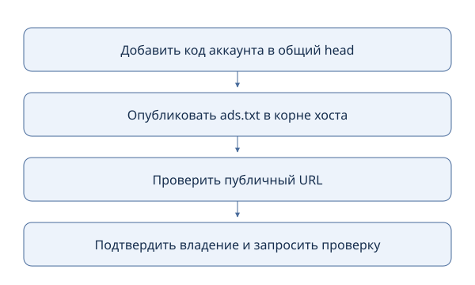

---
{
  "state": "draft",
  "language": "ru",
  "translationKey": "2026-11-24-github-pages-ads-guide",
  "title": "Реклама в блоге на GitHub Pages: от выбора сервиса до установки AdSense",
  "description": "Выберите рекламный сервис, настройте AdSense и ads.txt в корне GitHub Pages и проверьте рассмотрение и показ рекламы.",
  "sourcePath": "src/content/posts/en/2026-11-24-github-pages-ads-guide.md",
  "sourceSha256": "884b5c639b2345ac6daac6b307db2cd0ec22e80801c8d5d2d5860b4ba12356d8"
}
---

Если вы ведёте технический блог на `username.github.io`, для начала стоит рассмотреть Google AdSense. При постоянной аудитории разработчиков подойдут для рассмотрения также Carbon Ads и EthicalAds. До подачи заявки проверьте, можете ли вы опубликовать `https://username.github.io/ads.txt`, особенно если адрес проекта выглядит как `username.github.io/blog/`.

GitHub обычно не запрещает рекламу на сайтах, главным содержанием которых являются материалы. Однако GitHub Pages ограничивает использование бесплатного хостинга для онлайн-бизнеса, электронной коммерции или коммерческого SaaS. При размещении рекламы в техническом блоге ознакомьтесь с обоими правилами. [Рекламная политика GitHub](https://docs.github.com/en/site-policy/acceptable-use-policies/github-acceptable-use-policies#10-advertising-on-github) · [Ограничения GitHub Pages](https://docs.github.com/en/pages/getting-started-with-github-pages/github-pages-limits)

## Какой рекламный сервис выбрать?

| Сервис | Подходящие сайты | Заявка |
| --- | --- | --- |
| **Google AdSense** | Личный блог с первой рекламой и выбором автоматического или ручного размещения | [Начать работу с AdSense](https://adsense.google.com/start/) |
| **Carbon Ads** | Статьи, документация и инструменты для разработчиков и дизайнеров. Заявки рассматриваются от 10,000 просмотров страниц в месяц; использовать другие рекламные сети одновременно нельзя. | [Заявка в Carbon Ads](https://www.carbonads.net/join?_hsmi=83378591) |
| **EthicalAds** | Сайты для разработчиков с не менее чем 50,000 просмотров страниц в месяц и местом для одного объявления, не мешающего чтению | [Руководство издателя EthicalAds](https://www.ethicalads.io/publisher-guide/) |

Сначала выберите место для рекламы. В блоге с множеством примеров кода можно начать с одного вручную размещённого объявления AdSense под статьёй и проверить его на телефоне. AdSense предлагает **рекламные блоки**, место которых выбираете вы, и **автоматические объявления**, место которых выбирает Google. У EthicalAds свои правила: объявление должно быть видно на первом экране компьютера и мобильного устройства; если на мобильном это невозможно, его там можно отключить. [Настройки рекламы AdSense](https://support.google.com/adsense/answer/7037624)



Схема показывает настройку и запрос проверки; фактический показ рекламы проверяется отдельно.

## 1. Зарегистрируйтесь в AdSense и добавьте сайт

Зарегистрируйтесь в AdSense с аккаунтом Google и укажите страну и платёжную информацию. В разделе **Сайты → Новый сайт** добавьте `https://username.github.io`. Public Suffix List включает `github.io`, а AdSense разрешает добавлять как сайты поддомены платформ из этого списка. Затем следуют подтверждение владения и проверка сайта. [Создание аккаунта AdSense](https://support.google.com/adsense/answer/7402253) · [Критерии сайтов AdSense](https://support.google.com/adsense/answer/12170421) · [Public Suffix List](https://publicsuffix.org/list/public_suffix_list.dat)

Проверьте адрес: пользовательский сайт GitHub Pages находится по адресу `username.github.io/`, а сайт проекта обычно по адресу `username.github.io/blog/`. Файл `ads.txt` в публикации проекта может оказаться по пути `/blog/ads.txt`. Google начинает поиск с корня хоста `/ads.txt`, поэтому опубликуйте файл через пользовательский сайт или в корне собственного домена, подключённого к блогу. [Типы сайтов GitHub Pages](https://docs.github.com/en/pages/getting-started-with-github-pages/what-is-github-pages#types-of-github-pages-sites) · [Сканирование ads.txt Google](https://support.google.com/adsense/answer/7679060)

## 2. Один код в общем `<head>`, один `ads.txt` в корне

Для подтверждения владения AdSense предлагает фрагмент кода, `ads.txt` или метатег. Если выбран фрагмент, поместите код из панели в `<head>` общего макета. Ниже показан только пример формата; при публикации используйте код из своего аккаунта. [Подключение сайта](https://support.google.com/adsense/answer/7584263)

```html
<script async
  src="https://pagead2.googlesyndication.com/pagead/js/adsbygoogle.js?client=ca-pub-0000000000000000"
  crossorigin="anonymous"></script>
```

Скопируйте предоставленную панелью строку в `ads.txt`. Файл указывает аккаунты, которым разрешено продавать рекламный инвентарь сайта. Сохраните строки существующих продавцов и добавьте новую.

```text
google.com, pub-0000000000000000, DIRECT, f08c47fec0942fa0
```

Для пользовательского сайта на Astro поместите файл в `public/ads.txt`; Astro копирует файлы из `public/` в результат сборки. После публикации проверьте общедоступный URL, а не только репозиторий. [Каталог `public/` Astro](https://docs.astro.build/en/guides/images/#src-vs-public) · [Руководство Google по ads.txt](https://support.google.com/adsense/answer/12171612)

```bash
curl -fsSL https://username.github.io/ads.txt
```

Ожидается приведённая выше строка продавца. Реальный сайт должен вернуть ID издателя своего аккаунта. Адрес `username` приведён для примера; это не наблюдавшийся результат команды.

Для многоязычного блога на одном хосте достаточно одного файла в корне; отдельные файлы в `/ko/` и `/en/` не нужны. Убедитесь, что общий загрузчик присутствует один раз в итоговом HTML представительной статьи каждого языка.

## 3. Проверяйте публикацию, рассмотрение и показ отдельно

После публикации файла и кода подтвердите владение в AdSense и запросите проверку сайта. Статус сайта **`Ready`** означает готовность к показу рекламы; статус ads.txt **`Authorized`** означает, что Google нашёл ID издателя в файле. Если панель по-прежнему показывает `Not found`, хотя публичный URL доступен, проверьте, не произошло ли изменение после последнего сканирования. При правильных пути и содержимом запросите повторную проверку через **Проверить обновления**. [Статус сайта](https://support.google.com/adsense/answer/12170222) · [Статус ads.txt](https://support.google.com/adsense/answer/12171612)

До включения рекламы опишите в политике конфиденциальности информацию, собираемую или передаваемую для рекламы, и используемые технологии, например файлы cookie. Для персонализированной рекламы посетителям из ЕЭЗ, Великобритании и Швейцарии нужна сертифицированная Google платформа управления согласием (CMP), интегрированная с IAB Transparency and Consent Framework (TCF). Сообщение о европейских правилах в разделе AdSense **Конфиденциальность и сообщения** — один из вариантов. [Политика конфиденциальности издателей Google](https://support.google.com/adsense/answer/10502938) · [Требования Google к CMP](https://support.google.com/adsense/answer/13554116)

После проверки оцените размещение с помощью предварительного просмотра автоматических объявлений или ручного рекламного блока. На телефоне убедитесь, что реклама не закрывает оглавление, кнопки копирования кода и меню языка. Не нажимайте собственные объявления для проверки; используйте предпросмотр и отчёты панели. [Предпросмотр автоматических объявлений](https://support.google.com/adsense/answer/9261307) · [Недействительный трафик](https://support.google.com/adsense/answer/16737)

На `youdozi.github.io` были проверены публичный `ads.txt` в корне и один скрипт AdSense в HTML корейской главной страницы. Проверка охватывала только публичный файл и HTML; статус рассмотрения аккаунта и фактический показ рекламы требуют отдельной проверки. [Публичный ads.txt](https://youdozi.github.io/ads.txt) · [Корейская главная страница](https://youdozi.github.io/ko/)
