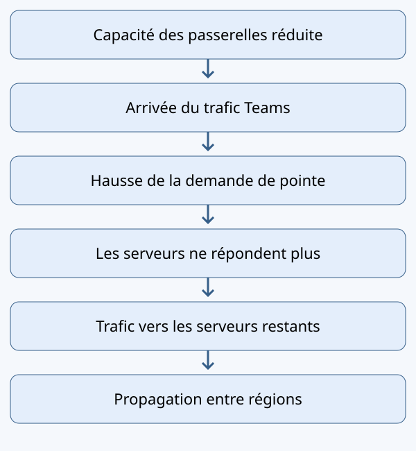

---
{
  "state": "draft",
  "language": "fr",
  "translationKey": "2026-11-25-microsoft-365-code-red",
  "title": "Les leçons du « Code Red » Microsoft 365 : que vérifier avant de déplacer le trafic ?",
  "description": "Capacité de réception lors du basculement, charge de reconnexion et journal commun : les leçons de la panne Microsoft 365.",
  "sourcePath": "src/content/posts/en/2026-11-25-microsoft-365-code-red.md",
  "sourceSha256": "2df9b4039ebb04013f04e21b144e3cb3780236a74b97dd9dcd885df36569a389"
}
---

Lorsqu'un serveur ne répond plus, les requêtes sont redirigées vers des serveurs sains. Ce mécanisme évite habituellement que les utilisateurs remarquent la panne de quelques serveurs. Lors de la panne de novembre 2026 de Microsoft 365, il a propagé l'incident à d'autres régions : les serveurs qui recevaient le trafic présentaient le même défaut, révélé à son tour par la hausse de charge. [Copie du rapport d'incident Microsoft](https://www.365fanatic.com/wp-content/uploads/2026/11/postincidentreport-mo1550821.pdf)

La capacité réduite, le trafic Teams et la pointe se combinent ; la redirection reporte la charge sur des serveurs présentant le même défaut.

## Pourquoi un défaut introduit en juillet est-il apparu en novembre ?

Selon le rapport de Microsoft, le défaut se trouvait dans une mise à jour Windows destinée aux passerelles réseau Microsoft 365. Déployée sur plusieurs semaines à partir de juillet, elle n'avait donné lieu à aucun impact client observé pendant plus de trois mois. Sur les nouveaux serveurs dotés de davantage de cœurs, davantage de demandes de connexion pouvaient toutefois être traitées simultanément, accentuant la contention sur les verrous internes. Les serveurs utilisés pour les tests de charge avaient moins de cœurs et le trafic de test différait de celui de l'incident. [Copie du rapport d'incident Microsoft](https://www.365fanatic.com/wp-content/uploads/2026/11/postincidentreport-mo1550821.pdf)

Le 12 novembre, des travaux réguliers avaient retiré une partie de la capacité des passerelles lorsque le trafic Teams est passé sur des passerelles partagées avec Exchange Online. Le service a fonctionné normalement pendant un temps. Lorsque l'utilisation en Amérique du Nord s'est approchée de son pic habituel, des serveurs ont cessé de répondre et la redirection automatique a accru la charge de chaque serveur restant. La redirection entre régions a aussi envoyé des requêtes vers des serveurs présentant le même défaut. Le rapport indique **environ 23 heures et 50 minutes d'impact actif sur les clients** ; le traitement des messages retardés et la surveillance de la stabilité se sont poursuivis ensuite. [Copie du rapport d'incident Microsoft](https://www.365fanatic.com/wp-content/uploads/2026/11/postincidentreport-mo1550821.pdf)

## Le basculement a aussi besoin d'une limite de réception

Lors de la conception d'un basculement, vérifiez **la capacité supplémentaire disponible actuellement côté réception**. Si la région A doit transférer 1 000 requêtes et que la région B ne dispose d'une marge que pour 300 sur la même période, tout rediriger peut provoquer une panne dans les deux régions. On peut accepter en priorité les requêtes essentielles et limiter la file d'attente des tâches différables ou les refuser temporairement. Réduire volontairement les requêtes acceptées en cas de surcharge s'appelle le **délestage de charge (load shedding)**. [Guide Microsoft Learn sur la limitation](https://learn.microsoft.com/en-us/azure/well-architected/design-guides/throttling)

Le même principe s'applique au rétablissement. Pendant cet incident, les serveurs ont reçu des demandes de reconnexion accumulées dès leur retour en service et ont de nouveau cessé de répondre. Une équipe d'exploitation peut renvoyer progressivement les requêtes vers les instances rétablies en surveillant ensemble taux de réussite des connexions, latence et files d'attente. Les tests de charge devraient combiner, sur la même génération de serveurs qu'en production, **trafic de pointe, capacité réduite par des travaux réguliers, basculement et reconnexion**. Tester séparément chaque condition peut masquer les problèmes dus à leur combinaison. [Copie du rapport d'incident Microsoft](https://www.365fanatic.com/wp-content/uploads/2026/11/postincidentreport-mo1550821.pdf)

## Des discussions séparées, un seul journal de décision

Selon des notes internes consultées par Reuters, les intervenants ont échangé plus de 11 000 messages dans 11 salons Teams. Les données de diagnostic étaient dispersées entre plusieurs systèmes, ce qui rendait difficile de voir d'un coup d'œil les hypothèses encore actives et les responsables des décisions. Microsoft est ensuite passé en « Code Red », en donnant la priorité à la prévention des récidives et à l'amélioration du rétablissement. Le **rétablissement mondial en moins d'une heure** rapporté par Reuters est un objectif interne pour les futurs incidents. [Présentation GeekNews](https://news.hada.io/topic?id=37797) · [Republication de l'article Reuters](https://www.investing.com/news/stock-market-news/exclusivemicrosoft-declares-code-red-after-historic-outage-internal-memos-show-5048702)

Même avec des canaux d'enquête par équipe, on peut tenir un document d'incident commun. En tête figurent **l'impact client actuel, les faits confirmés, les hypothèses en cours et leurs responsables, la dernière action et son résultat, ainsi que l'heure de la prochaine communication**. Au lieu de « serveur redémarré », on peut écrire : « le taux de réussite des connexions s'est brièvement rétabli après le redémarrage, puis a de nouveau chuté sous l'afflux de reconnexions ». La personne qui prend le relais peut décider de répéter l'action immédiatement ou de réguler d'abord le trafic entrant. Il est aussi utile de vérifier si l'accès au document partage des dépendances avec le service à rétablir. [Google SRE : document d'incident en direct](https://sre.google/sre-book/managing-incidents/#live-incident-state-document)

Pour le prochain exercice, partez d'une **capacité réduite dans une région à l'heure de pointe**. Décidez combien de requêtes la région restante peut accepter, quelles fonctions réduire en premier et à quelle vitesse renvoyer les requêtes vers les serveurs rétablis. Le critère de fin doit dépasser le simple démarrage des serveurs : les utilisateurs doivent pouvoir réutiliser les fonctions essentielles et les requêtes accumulées doivent diminuer. L'objectif de rétablissement devient alors mesurable.

À lire aussi · [Vérifier la propagation de traceparent par RestClient dans Spring Boot 4.2](https://youdozi.github.io/en/posts/2026-11-22-spring-boot-4-2-restclient-traceparent/)
