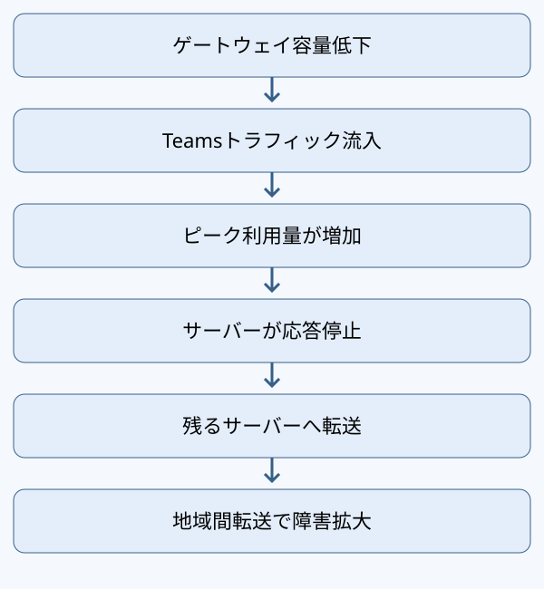

---
{
  "state": "draft",
  "language": "ja",
  "translationKey": "2026-11-25-microsoft-365-code-red",
  "title": "Microsoft 365の「Code Red」に学ぶ障害対応 — トラフィックを移す前に確認すること",
  "description": "Microsoft 365障害から、切り替え先の受け入れ上限、復旧時の再接続負荷、共通の障害記録を考えます。",
  "sourcePath": "src/content/posts/en/2026-11-25-microsoft-365-code-red.md",
  "sourceSha256": "2df9b4039ebb04013f04e21b144e3cb3780236a74b97dd9dcd885df36569a389"
}
---

サーバーが応答しなくなると、正常なサーバーにリクエストを振り分けます。通常はこの仕組みにより、数台が停止してもユーザーは気づきません。2026年十一月のMicrosoft 365障害では、同じ仕組みが障害を別の地域に広げました。引き継ぎ先にも同じ欠陥があり、負荷の増加によってそこでも顕在化したためです。[Microsoft事後報告書のコピー](https://www.365fanatic.com/wp-content/uploads/2026/11/postincidentreport-mo1550821.pdf)

ゲートウェイ容量の低下にTeamsの流入とピーク利用が重なり、転送で同じ欠陥のあるサーバーに負荷が広がります。

## 七月に入った欠陥がなぜ十一月に現れたのか

Microsoftの事後報告書によると、欠陥はMicrosoft 365ネットワークゲートウェイ向けのWindows更新に含まれていました。七月から数週間かけて展開され、三か月以上、顧客への影響は観測されませんでした。しかし、コア数の多い新しいサーバーでは、より多くの接続要求が同時に処理され、内部のロック競合が激しくなる可能性がありました。当時の負荷試験に使ったサーバーはコア数が少なく、試験トラフィックも障害時とは異なっていました。[Microsoft事後報告書のコピー](https://www.365fanatic.com/wp-content/uploads/2026/11/postincidentreport-mo1550821.pdf)

11月12日、定期作業でゲートウェイ容量の一部が失われている状態で、TeamsのトラフィックがExchange Onlineと共有するゲートウェイに移りました。しばらくは正常に動作していました。北米の利用量が通常のピークに近づくとサーバーが応答しなくなり、自動迂回によって残るサーバー一台あたりの負荷が増えました。リージョン間の迂回も、同じ欠陥のあるサーバーにリクエストを送りました。報告書に記録された**顧客への直接的な影響の期間は約23時間50分**で、その後も遅延メールの処理と安定性の監視が続きました。[Microsoft事後報告書のコピー](https://www.365fanatic.com/wp-content/uploads/2026/11/postincidentreport-mo1550821.pdf)

## フェイルオーバーにも受け入れ上限が必要

フェイルオーバーを設計するときは、**受け入れ先が今どれだけ追加処理できるか**を確認します。例えば、リージョンAが同じ時間内に1,000件を移そうとしても、Bに300件分の余裕しかなければ、全量を迂回させることで両リージョンが障害に陥る可能性があります。重要な要求を優先し、遅延できる処理にはキューの上限を設けるか、一時的に拒否する方法があります。過負荷時に意図的に受け入れる要求を減らすことを**負荷遮断（load shedding）**と呼びます。[Microsoft Learnのスロットリングガイド](https://learn.microsoft.com/en-us/azure/well-architected/design-guides/throttling)

復旧にも同じ原則が当てはまります。今回の障害ではサーバーがサービスに戻った瞬間、たまっていた再接続要求を受けて再び応答しなくなりました。運用チームは復旧したインスタンスに少しずつ要求を戻し、接続成功率、遅延、キューを併せて確認できます。負荷試験では本番と同じ世代のサーバーで、**ピークトラフィック、定期作業による容量低下、フェイルオーバー、再接続**を重ねる必要があります。個別の試験では、今回のように条件が重なったときの問題を見逃す可能性があります。[Microsoft事後報告書のコピー](https://www.365fanatic.com/wp-content/uploads/2026/11/postincidentreport-mo1550821.pdf)

## チャットを分けても判断の記録は一か所に

Reutersが確認した社内メモによると、対応者は11,000件以上のメッセージを11のTeamsチャットルームでやり取りしました。診断データが複数のシステムに分散し、どの仮説が有効で、誰がどの対応を決めたかを一目で把握しにくかったといいます。Microsoftはその後、再発防止と復旧改善を優先する「Code Red」に入りました。Reutersが報じた**世界中で一時間以内の復旧**は、今後の障害に対する社内目標です。[GeekNewsの紹介](https://news.hada.io/topic?id=37797) · [Reuters記事の転載](https://www.investing.com/news/stock-market-news/exclusivemicrosoft-declares-code-red-after-historic-outage-internal-memos-show-5048702)

チーム別に調査チャネルがあっても、共通の障害文書を一つ維持できます。冒頭には**現在の顧客影響、確認済みの事実、進行中の仮説と担当者、直近の対応と結果、次の告知時刻**を置きます。例えば「サーバー再起動完了」だけでなく、「再起動後に接続成功率は一時回復したが、再接続要求が集中すると再び低下」と記録します。交代した担当者は、この一行から同じ操作をすぐ繰り返すか、先に流入を制御するか判断できます。文書へのアクセス経路が復旧対象のサービスと依存先を共有していないかも確認しておくとよいでしょう。[Google SREの障害文書運用](https://sre.google/sre-book/managing-incidents/#live-incident-state-document)

次の障害訓練では、**ピーク時に一つのリージョンの容量が低下した状態**から始めてみてください。残るリージョンがどれだけの要求を受けられるか、どの機能を先に縮小するか、復旧したサーバーにどの速度で要求を戻すかを決めます。終了条件はサーバーの起動だけでなく、ユーザーが主要機能を再び使え、滞留した要求が減り始める時点に設定します。そうして初めて復旧目標を測定できます。

関連記事 · [Spring Boot 4.2でRestClientのtraceparent伝播を確認する（英語）](https://youdozi.github.io/en/posts/2026-11-22-spring-boot-4-2-restclient-traceparent/)
