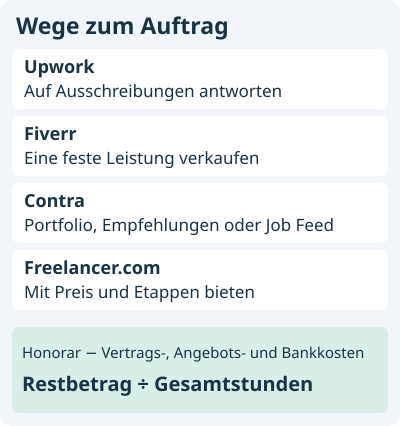

---
{
  "state": "draft",
  "language": "de",
  "translationKey": "2026-11-25-overseas-freelance-platforms",
  "title": "Vier Plattformen für nebenberufliche Aufträge im Vergleich — Upwork, Fiverr, Contra und Freelancer.com",
  "description": "Wie Entwickler in Südkorea Aufträge finden, welche Kosten beim Anbieten und Auszahlen anfallen und was pro Stunde übrig bleibt.",
  "sourcePath": "src/content/posts/en/2026-11-25-overseas-freelance-platforms.md",
  "sourceSha256": "459d7a14dff0b6e636f388225c92b5c5b2feacd82c5314c7ee576111648842aa"
}
---

**Wer in Südkorea nebenberuflich Entwicklungsaufträge sucht, kann bei Upwork Angebote auf Ausschreibungen abgeben oder bei Fiverr eine klar umrissene Leistung wiederholt verkaufen.** Ist der Kontakt zum Kunden bereits über eine Empfehlung entstanden, kann Contra für Vertrag und Zahlung passen. Freelancer.com erweitert die Auswahl an Ausschreibungen. Vor dem Bieten lohnt ein Blick auf das erforderliche Guthaben und die Gebühr, die bei Annahme eines Festpreisauftrags fällig wird.

Ein Beispiel ist ein fehlgeschlagener Spring-Boot-Test. Ist die Ursache offen, lässt sich anhand der Ausschreibung eine bezahlte Fehlersuche anbieten. Tritt derselbe Testfehler regelmäßig auf, kann man die Reparatur als Leistung anbieten und vorab festlegen, welchen Test man korrigiert und was der Kunde erhält. Grundlage sind die offiziellen Unterlagen der Plattformen, abgerufen am 25. November 2026.

## Wo findet man Kunden und welche Kosten fallen an?

| Plattform | Weg zum Auftrag | Kosten für Freelancer |
| --- | --- | --- |
| Upwork | Individuelles Angebot auf eine Ausschreibung | Je Vertrag 0–15 % Servicegebühr. Wie viele Connects ein Angebot kostet, hängt von der Ausschreibung ab. Beim Kauf kostet ein Connect 0,15 USD. |
| Fiverr | Eine Leistung (Gig) mit Umfang und Preis einstellen und Bestellungen annehmen | Bei abgeschlossener Bestellung erhält man 80 % des Bestellwerts. |
| Contra | Kunden über Portfolio und Job Feed finden oder mit bestehenden Kunden abschließen | 0 % Provision für Freelancer. Plattform- und Zahlungsgebühren sowie Auszahlungs- und Wechselkosten gesondert prüfen. |
| Freelancer.com | Preis und Lieferetappen in einem Gebot angeben | Bei regulären Festpreisprojekten der höhere Betrag aus 10 % und 5 USD, bei regulärer Stundenabrechnung 10 %. Standard-Mindestguthaben zum Bieten: 20 USD. |

[Servicegebühr bei Upwork](https://support.upwork.com/hc/en-us/articles/211062538-Learn-about-the-Freelancer-Service-Fee) · [Upwork Connects](https://support.upwork.com/hc/en-us/articles/211062898-About-Connects-costs-uses-balances-and-expiration) · [Einnahmen bei Fiverr](https://help.fiverr.com/hc/en-us/articles/9234443621137-Your-earnings-page) · [Gebühren bei Contra](https://help.contra.com/en/articles/9322934-fees-overview) · [Gebühren bei Freelancer.com](https://www.freelancer.com/feesandcharges)

### Upwork — für jede Ausschreibung einen Lösungsweg anbieten

Zu einer passenden Ausschreibung schlägt man Umfang, Zeitplan und Preis vor. Ist die Ursache unklar, kann sich der erste Auftrag auf eine bezahlte Diagnose beschränken: einen fehlgeschlagenen Test reproduzieren, die Ursache erklären und einen Reparaturplan liefern. Auch erfolglose Angebote kosten Zeit und gegebenenfalls Connects. Vor dem Absenden die angezeigte Vertragsgebühr und die erforderlichen Connects prüfen.

Bei Festpreisverträgen können Kunden einzelne Meilensteine vorfinanzieren. Für den Zahlungsschutz muss der Betrag für die Etappe vor Arbeitsbeginn vollständig hinterlegt sein. Das vereinbarte Ergebnis ist über **Submit Work for Payment** einzureichen. Für eine Auszahlung per **Direct to Local Bank** auf ein koreanisches Won-Konto berechnet Upwork 0,99 USD. Je nach Bank können weitere Kosten und Bedingungen hinzukommen. [Zahlungsschutz bei Festpreisprojekten](https://support.upwork.com/hc/en-us/articles/211063748-How-Fixed-Price-Payment-Protection-works-for-freelancers-on-Upwork) · [Auszahlung auf ein lokales Bankkonto](https://support.upwork.com/hc/en-us/articles/211063888-How-to-withdraw-earnings-with-Direct-to-Local-Bank)

### Fiverr — wiederkehrende Arbeiten als feste Leistung verkaufen

Ein bestellbares Angebot könnte lauten: einen fehlschlagenden Test in einem Spring-Boot-Projekt reparieren und Patch samt Befehl zum Reproduzieren liefern. Wer unterstützte Versionen, Korrekturrunden und benötigte Unterlagen neben dem Preis aufführt, muss den Umfang bei neuen Bestellungen seltener erklären. Könnten Änderungen an weiteren Modulen nötig sein, den Umfang vorher klären oder gesondert anbieten.

Kunden können das Ergebnis auf der Bestellseite abnehmen oder Änderungen anfordern. In der Regel sind Einnahmen 14 Tage nach Abschluss der Bestellung auszahlbar, bei bestimmten Stufen und Programmen früher. Für jede Auszahlungsmethode, etwa eine Banküberweisung via Payoneer, Mindestbetrag und regionale Verfügbarkeit prüfen. [Bestellung und Freigabefrist](https://help.fiverr.com/hc/en-us/articles/360010639617-A-freelancer-s-guide-to-the-Fiverr-order-process) · [Auszahlungsmethoden bei Fiverr](https://help.fiverr.com/hc/en-us/articles/360010530058-Withdrawing-your-earnings-managing-payout-methods)

### Contra — vom Portfolio zum Vertrag

Einem empfohlenen Kunden kann man das Portfolio zeigen und Vertrag und Zahlung am selben Ort abwickeln. Über den Job Feed lassen sich neue Aufträge finden. Die Provision für Freelancer beträgt 0 %. Im kostenlosen Tarif kostet eine Zahlung 15 USD Plattformgebühr bei einem Betrag von 1 bis 499 USD und 29 USD ab 500 USD. Maßgeblich sind Zahlungsart und Tarif. Für eine lokale Überweisung auf ein koreanisches Won-Konto nennt die Gebührentabelle 2 USD. Wechselkosten gesondert prüfen. [Über Contra](https://help.contra.com/en/articles/9322235-contra-overview) · [Aufträge finden](https://help.contra.com/en/articles/9322973-applying-to-jobs-on-contra) · [Zahlungs- und Auszahlungsgebühren](https://help.contra.com/en/articles/9322934-fees-overview)

Bei neuen Kunden lohnt sich ein Vergleich der Treuhandoptionen für ein **Project** mit festgelegtem Umfang. Bei Streitigkeiten unterstützt Contra die Parteien hinsichtlich der noch treuhänderisch verwahrten Projektgelder. Einzelne Rechnungen und Zahlungslinks fallen aus dieser Unterstützung heraus. [Arten bezahlter Projekte](https://help.contra.com/en/articles/9322763-paid-projects) · [Unterstützung bei Streitigkeiten](https://help.contra.com/en/articles/11329360-contra-s-dispute-assistance)

### Freelancer.com — vom Gebot bis zur Auftragsannahme rechnen

Im Gebot stehen Preis und Lieferetappen. Vor dem Bieten müssen standardmäßig 20 USD frei verfügbar sein. Je nach Projekt oder Konto kann die Schwelle höher liegen. Bei regulären Festpreisprojekten wird die Gebühr fällig, sobald man den Zuschlag annimmt. Bei einem Auftrag über 30 USD entsprechen 10 % nur 3 USD. Somit greift die Mindestgebühr von 5 USD und es bleiben vor Auszahlungskosten 25 USD. [Gebühren und Mindestguthaben](https://www.freelancer.com/feesandcharges)

Vor Arbeitsbeginn prüfen, ob der Kunde das **Milestone Payment** für die anstehende Etappe hinterlegt hat. An diese Zahlung knüpft das Streitverfahren an. Die verfügbaren Auszahlungsmethoden zeigt das Konto. Südkorea fehlt auf der offiziellen Länderliste für direkte Bankauszahlungen (Express Withdrawal). Für PayPal und Payoneer liegt der angegebene Mindestbetrag bei jeweils 50 USD. [Meilensteinzahlungen](https://www.freelancer.com/support/payments/how-do-i-get-paid) · [Länder für Express Withdrawal](https://www.freelancer.com/support/freelancer/payments/express-withdrawals) · [Auszahlungsmethoden und Mindestbeträge](https://www.freelancer.com/support/payments/how-to-withdraw-funds)

## Was bleibt beim ersten Auftrag pro Stunde übrig?

Wer nur die Gebühr vom Honorar abzieht, übersieht die Zeit für Angebote und Abnahme. Angenommen, die Ausführung dauert 6 Stunden, Abstimmung und Abnahme dauern 1 Stunde und für 6 Angebote fallen je 20 Minuten an, bis ein Vertrag über 300 USD zustande kommt. Upwork zeigt für diesen Vertrag beispielhaft 10 % Gebühr an. In die Rechnung gehen 12 gekaufte Connects pro Angebot und eine Auszahlung auf ein Won-Konto ein.



Das Beispiel nutzt nur die Standardbibliothek von Python 3. Als `estimate.py` speichern und mit `python3 estimate.py` ausführen. Wechselkursdifferenzen und Steuern bleiben unberücksichtigt.

```python
from decimal import Decimal

contract_usd = Decimal("300")
service_fee_rate = Decimal("0.10")
proposals = 6
connects_per_proposal = 12
connect_price_usd = Decimal("0.15")
withdrawal_usd = Decimal("0.99")

proposal_hours = Decimal(proposals * 20) / 60
delivery_hours = Decimal("6")
review_hours = Decimal("1")

proposal_cost = proposals * connects_per_proposal * connect_price_usd
remaining = contract_usd * (1 - service_fee_rate) - proposal_cost - withdrawal_usd
total_hours = proposal_hours + delivery_hours + review_hours

print(f"Costs deducted, before tax: ${remaining:.2f}")
print(f"Total hours: {total_hours:.1f}")
print(f"Per hour, before tax: ${remaining / total_hours:.2f}")
```

Der Programmlauf ergab folgende Ausgabe.

```text
Costs deducted, before tax: $258.21
Total hours: 9.0
Per hour, before tax: $28.69
```

Selbst bei demselben Auftrag über 300 USD verändert jede Überarbeitung des Angebots oder zusätzliche Korrektur den Stundenverdienst. Für den Einstieg eignet sich ein Ergebnis, das sich in einem Satz beschreiben lässt, etwa einen Testfehler reproduzieren und den Patch liefern. Verlangt ein Kunde kostenlose Probearbeit an echtem Kundencode oder vor Vertragsschluss eine externe Zahlung, kann man ein öffentliches Beispiel zeigen oder über die Plattform eine bezahlte Diagnose anbieten. [Upwork zu Warnzeichen für Betrug](https://support.upwork.com/hc/en-us/articles/35088484250003-Recognize-red-flags-and-avoid-scams)
