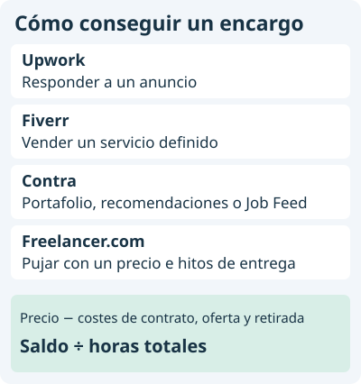

---
{
  "state": "draft",
  "language": "es",
  "translationKey": "2026-11-25-overseas-freelance-platforms",
  "title": "Cuatro plataformas para ganar un ingreso extra como freelance — Upwork, Fiverr, Contra y Freelancer.com",
  "description": "Cómo encontrar encargos de desarrollo desde Corea del Sur, comparar costes y calcular el ingreso por hora después de comisiones.",
  "sourcePath": "src/content/posts/en/2026-11-25-overseas-freelance-platforms.md",
  "sourceSha256": "459d7a14dff0b6e636f388225c92b5c5b2feacd82c5314c7ee576111648842aa"
}
---

**Si vives en Corea del Sur y buscas tus primeros encargos de desarrollo, empieza por Upwork para responder a anuncios o por Fiverr para vender repetidamente un servicio bien delimitado.** Contra puede encajar si ya tienes un cliente por recomendación y buscas dónde formalizar el contrato y cobrar. Freelancer.com te permite optar a más encargos, pero revisa el saldo que exige para pujar y la comisión que cobra en cuanto aceptas un proyecto a precio fijo.

Piensa en un fallo en una prueba de Spring Boot. Si se desconoce la causa, conviene leer el anuncio y proponer un diagnóstico de pago con un alcance concreto. Si sueles corregir errores del mismo tipo, puedes vender un servicio que indique de antemano qué prueba vas a reparar y qué entregarás. La comparación se basa en la documentación oficial consultada el 25 de noviembre de 2026.

## ¿Dónde se encuentran los clientes y qué costes hay?

| Plataforma | Cómo se consigue trabajo | Costes que conviene revisar |
| --- | --- | --- |
| Upwork | Enviar una propuesta para cada anuncio | Comisión de servicio del 0 al 15 % por contrato. Los Connects necesarios dependen del anuncio. Comprarlos cuesta 0,15 USD por unidad. |
| Fiverr | Publicar un servicio (Gig) con alcance y precio definidos y recibir pedidos | El freelance recibe el 80 % del importe de cada pedido completado. |
| Contra | Buscar clientes mediante el portafolio y el Job Feed o contratar con un cliente propio | Comisión del 0 % para el freelance. Comprobar los cargos de plataforma, procesamiento, retirada y cambio de divisa. |
| Freelancer.com | Presentar una oferta con precio e hitos de entrega | A precio fijo se aplica la mayor de dos cifras: el 10 % o 5 USD. La tarifa habitual por horas es del 10 %. El saldo mínimo estándar para pujar es de 20 USD. |

[Comisión de Upwork](https://support.upwork.com/hc/en-us/articles/211062538-Learn-about-the-Freelancer-Service-Fee) · [Connects de Upwork](https://support.upwork.com/hc/en-us/articles/211062898-About-Connects-costs-uses-balances-and-expiration) · [Ingresos en Fiverr](https://help.fiverr.com/hc/en-us/articles/9234443621137-Your-earnings-page) · [Tarifas de Contra](https://help.contra.com/en/articles/9322934-fees-overview) · [Tarifas de Freelancer.com](https://www.freelancer.com/feesandcharges)

### Upwork — proponer una solución para cada anuncio

Elige un anuncio y propón un alcance, un plazo y un precio. Si la causa del fallo es incierta, puedes limitar el primer contrato a un diagnóstico de pago: reproducir una prueba fallida, explicar la causa y entregar un plan de corrección. Las propuestas que no consiguen contrato también cuestan tiempo y pueden consumir Connects. Antes de enviarlas, comprueba la comisión que se muestra para el contrato y los Connects necesarios.

En un contrato a precio fijo, el cliente puede depositar el dinero por adelantado para cada hito. Para optar a la protección del pago, el hito debe estar financiado en su totalidad antes de empezar a trabajar. Entrega lo acordado mediante **Submit Work for Payment**. Upwork cobra 0,99 USD por retirada a una cuenta en wones surcoreanos con **Direct to Local Bank**. El banco puede aplicar sus propias condiciones y cargos. [Protección del pago a precio fijo](https://support.upwork.com/hc/en-us/articles/211063748-How-Fixed-Price-Payment-Protection-works-for-freelancers-on-Upwork) · [Retirada a un banco local](https://support.upwork.com/hc/en-us/articles/211063888-How-to-withdraw-earnings-with-Direct-to-Local-Bank)

### Fiverr — poner a la venta un servicio de alcance estable

Define algo que se pueda pedir, por ejemplo, corregir una prueba fallida en un proyecto Spring Boot y entregar el parche y el comando que reproduce el fallo. Indica junto al precio las versiones compatibles, las rondas de revisión y los materiales necesarios. Así evitarás explicar el alcance desde cero en cada pedido. Si el cambio puede afectar a otro módulo, aclara primero el alcance o envía otro presupuesto.

En la página del pedido, el cliente puede revisar la entrega, aceptarla o solicitar cambios. Por lo general, se puede retirar el dinero 14 días después de completarse el pedido, aunque el plazo es menor en algunos niveles y programas. Comprueba el mínimo y la disponibilidad regional de cada método, incluida la transferencia bancaria mediante Payoneer. [Pedidos y plazo de disponibilidad](https://help.fiverr.com/hc/en-us/articles/360010639617-A-freelancer-s-guide-to-the-Fiverr-order-process) · [Métodos de retirada en Fiverr](https://help.fiverr.com/hc/en-us/articles/360010530058-Withdrawing-your-earnings-managing-payout-methods)

### Contra — pasar del portafolio al contrato

Puedes enseñar tu portafolio a un cliente que llegue por recomendación y gestionar contrato y cobro en el mismo sitio, o buscar nuevos encargos en el Job Feed. La comisión del freelance es del 0 %, pero el plan gratuito aplica un cargo de plataforma de 15 USD a pagos de 1 a 499 USD, y de 29 USD a partir de 500 USD. Comprueba el total según el método de pago y el plan. La tarifa oficial por transferencia local a una cuenta en wones surcoreanos es de 2 USD. Consulta aparte el coste del cambio de divisa. [Acerca de Contra](https://help.contra.com/en/articles/9322235-contra-overview) · [Solicitar encargos](https://help.contra.com/en/articles/9322973-applying-to-jobs-on-contra) · [Costes de pago y retirada](https://help.contra.com/en/articles/9322934-fees-overview)

Con un cliente nuevo, compara las opciones de depósito en garantía en un **Project** con un alcance definido. Contra puede ayudar a resolver disputas sobre fondos del proyecto que sigan en depósito. Las facturas independientes y los enlaces de pago quedan fuera de esa asistencia. [Tipos de proyectos de pago](https://help.contra.com/en/articles/9322763-paid-projects) · [Asistencia en disputas](https://help.contra.com/en/articles/11329360-contra-s-dispute-assistance)

### Freelancer.com — calcular el coste desde la puja hasta la aceptación

Indica el precio y los hitos de entrega en la oferta. El saldo disponible mínimo habitual para pujar es de 20 USD. Algunos proyectos o cuentas pueden requerir más. En un encargo estándar a precio fijo, la comisión se cobra cuando aceptas la adjudicación. En un encargo de 30 USD, el 10 % son 3 USD. Se aplica el mínimo de 5 USD y quedan 25 USD antes de los costes de retirada. [Tarifas y saldo mínimo](https://www.freelancer.com/feesandcharges)

Antes de empezar el primer encargo, comprueba que el cliente ha depositado el **Milestone Payment** de esa etapa. El procedimiento de disputa está vinculado a ese pago. Consulta los métodos de retirada disponibles en tu cuenta. Corea del Sur no figura en la lista oficial de países con retirada bancaria directa (Express Withdrawal), y tanto PayPal como Payoneer tienen un mínimo publicado de 50 USD. [Pagos por hitos](https://www.freelancer.com/support/payments/how-do-i-get-paid) · [Países con retirada directa](https://www.freelancer.com/support/freelancer/payments/express-withdrawals) · [Métodos de retirada y mínimos](https://www.freelancer.com/support/payments/how-to-withdraw-funds)

## ¿Cuánto deja por hora el primer contrato?

Restar solo la comisión al importe del contrato pasa por alto el tiempo de preparar propuestas y revisar entregas. Supongamos que dedicas 6 horas a la entrega, 1 hora a acordar detalles y revisar, y envías 6 propuestas de 20 minutos cada una para conseguir un contrato de 300 USD. Supongamos que Upwork muestra una comisión del 10 % para ese contrato. Incluye 12 Connects comprados por propuesta y una retirada a una cuenta en wones.



El ejemplo usa solo la biblioteca estándar de Python 3. Guárdalo como `estimate.py` y ejecuta `python3 estimate.py`. El cálculo excluye las diferencias de cambio y los impuestos.

```python
from decimal import Decimal

contract_usd = Decimal("300")
service_fee_rate = Decimal("0.10")
proposals = 6
connects_per_proposal = 12
connect_price_usd = Decimal("0.15")
withdrawal_usd = Decimal("0.99")

proposal_hours = Decimal(proposals * 20) / 60
delivery_hours = Decimal("6")
review_hours = Decimal("1")

proposal_cost = proposals * connects_per_proposal * connect_price_usd
remaining = contract_usd * (1 - service_fee_rate) - proposal_cost - withdrawal_usd
total_hours = proposal_hours + delivery_hours + review_hours

print(f"Costs deducted, before tax: ${remaining:.2f}")
print(f"Total hours: {total_hours:.1f}")
print(f"Per hour, before tax: ${remaining / total_hours:.2f}")
```

Al ejecutarlo se obtuvo el siguiente resultado.

```text
Costs deducted, before tax: $258.21
Total hours: 9.0
Per hour, before tax: $28.69
```

Incluso en el mismo contrato de 300 USD, reescribir propuestas o atender más revisiones cambia el ingreso por hora. Empieza por un entregable que puedas explicar en una línea, como reproducir un fallo de prueba y entregar el parche. Si te piden trabajar gratis a modo de prueba con código real del cliente o cobrar fuera de la plataforma antes de contratar, muestra un ejemplo público o propón un diagnóstico de pago en la plataforma. [Guía de Upwork para detectar estafas](https://support.upwork.com/hc/en-us/articles/35088484250003-Recognize-red-flags-and-avoid-scams)
