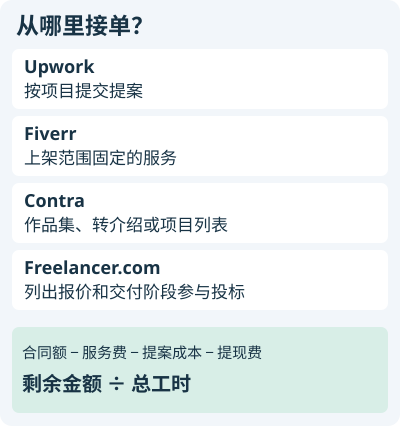

---
{
  "state": "draft",
  "language": "zh-CN",
  "translationKey": "2026-11-25-overseas-freelance-platforms",
  "title": "海外开发兼职平台比较 — Upwork、Fiverr、Contra 和 Freelancer.com",
  "description": "从韩国接海外开发兼职时，如何比较接单方式、提案成本、收款保障和扣费后的时薪。",
  "sourcePath": "src/content/posts/en/2026-11-25-overseas-freelance-platforms.md",
  "sourceSha256": "459d7a14dff0b6e636f388225c92b5c5b2feacd82c5314c7ee576111648842aa"
}
---

**如果你在韩国，刚开始接开发兼职，想主动给项目方发提案，可以先看 Upwork；想反复出售范围明确的服务，可以先看 Fiverr。** 如果已经有人介绍了客户，只差签约和收款，Contra 可能更合适。Freelancer.com 可以拓宽投标渠道，但要先弄清投标所需的账户余额，以及接受固定总价项目时就要支付的费用。

以修复 Spring Boot 测试为例。如果还不知道故障原因，可以先读项目需求，提议做一次有偿排查。如果经常处理同一类测试错误，则可以把要修的测试和交付物写清楚，作为服务上架。以下比较依据各平台的官方资料，查询日期为2026年11月25日。

## 去哪里找客户，要付哪些费用？

| 平台 | 接单方式 | 需要留意的成本 |
| --- | --- | --- |
| Upwork | 针对客户发布的项目提交提案 | 每份合同收取0%至15%的服务费。所需 Connects 数量因项目而异，购买单价为0.15美元。 |
| Fiverr | 上架写明范围和价格的服务（Gig），等待客户下单 | 已完成订单金额的80%归自由职业者。 |
| Contra | 通过作品集和 Job Feed 找客户，或与已有客户签约 | 自由职业者佣金为0%。平台费、支付处理费、提现和换汇成本需分别确认。 |
| Freelancer.com | 提交报价并列明交付阶段，参与竞标 | 普通固定总价项目收取10%或5美元，以较高者为准；普通计时项目收取10%。投标所需的标准最低余额为20美元。 |

[Upwork 服务费](https://support.upwork.com/hc/en-us/articles/211062538-Learn-about-the-Freelancer-Service-Fee) · [Upwork Connects](https://support.upwork.com/hc/en-us/articles/211062898-About-Connects-costs-uses-balances-and-expiration) · [Fiverr 收益](https://help.fiverr.com/hc/en-us/articles/9234443621137-Your-earnings-page) · [Contra 费用](https://help.contra.com/en/articles/9322934-fees-overview) · [Freelancer.com 费率表](https://www.freelancer.com/feesandcharges)

### Upwork — 针对每个项目提出解决方案

选择客户发布的项目，提出工作范围、时间和价格。如果故障原因不明，可以把第一份合同限定为有偿诊断：复现一个失败的测试，说明原因，给出修复计划。即使没有中标，提案也耗费时间，还可能用掉 Connects。提交前，先核对页面显示的合同服务费和所需 Connects。

固定总价合同可以约定里程碑，由客户分阶段预存款项。要获得付款保障，必须在开工前确认该阶段款项已全额存入，并通过 **Submit Work for Payment** 提交符合约定的成果。通过 **Direct to Local Bank** 提现到韩国的韩元账户，Upwork 每笔收取0.99美元，银行还可能另有费用或条件。 [固定总价付款保障](https://support.upwork.com/hc/en-us/articles/211063748-How-Fixed-Price-Payment-Protection-works-for-freelancers-on-Upwork) · [提现至当地银行](https://support.upwork.com/hc/en-us/articles/211063888-How-to-withdraw-earnings-with-Direct-to-Local-Bank)

### Fiverr — 出售范围固定的服务

先确定客户能买到什么，比如“修复 Spring Boot 项目中一个失败的测试，交付补丁和复现命令”。在价格旁写明支持的版本、修改次数和所需资料，就不用每次接单都重新解释工作范围。如果修改可能波及其他模块，先确认范围或另行报价。

客户可以在订单页检查交付物，选择验收或要求修改。一般在订单完成14天后可以提现，部分等级或计划的等待期更短。包括通过 Payoneer 转账到银行在内，各种提现方式都有各自的最低金额和地区限制，选择前应先核对。 [订单流程和结算等待期](https://help.fiverr.com/hc/en-us/articles/360010639617-A-freelancer-s-guide-to-the-Fiverr-order-process) · [Fiverr 提现方式](https://help.fiverr.com/hc/en-us/articles/360010530058-Withdrawing-your-earnings-managing-payout-methods)

### Contra — 从展示作品到签约收款

可以向转介绍的客户展示作品集，在同一处处理合同与收款，也可以在 Job Feed 上找新项目。自由职业者佣金为0%，但免费方案对每笔付款收取平台费：15美元（付款额为1至499美元）或29美元（付款额在500美元及以上）。最终费用要结合支付方式和方案确认。官方费率表列出的韩国韩元账户本地转账处理费为2美元，换汇成本需另查。 [Contra 简介](https://help.contra.com/en/articles/9322235-contra-overview) · [申请项目](https://help.contra.com/en/articles/9322973-applying-to-jobs-on-contra) · [支付和提现费用](https://help.contra.com/en/articles/9322934-fees-overview)

与新客户合作时，可以在明确工作范围的 **Project** 中比较资金托管选项。Contra 的争议协助只涉及项目中仍在托管的款项，独立发票和付款链接不在此范围内。 [付费项目类型](https://help.contra.com/en/articles/9322763-paid-projects) · [争议协助范围](https://help.contra.com/en/articles/11329360-contra-s-dispute-assistance)

### Freelancer.com — 从投标到接受项目，先算清费用

投标时列出交付阶段和价格。通常投标前要有至少20美元可用余额，部分项目或账户的要求更高。普通固定总价项目在你接受中标项目时收费。以30美元的项目为例，10%是3美元，低于最低费用5美元，因此在扣除提现费用前还剩25美元。 [费用和最低余额](https://www.freelancer.com/feesandcharges)

开始第一份工作前，先确认该阶段的 **Milestone Payment** 已存入。争议处理与这笔里程碑款项相关。提现前查看账户支持哪些方式。官方列出的银行直接提现（Express Withdrawal）支持国家中没有韩国，PayPal 和 Payoneer 的最低提现金额均为50美元。 [里程碑付款](https://www.freelancer.com/support/payments/how-do-i-get-paid) · [直接提现支持国家](https://www.freelancer.com/support/freelancer/payments/express-withdrawals) · [提现方式和最低金额](https://www.freelancer.com/support/payments/how-to-withdraw-funds)

## 第一份合同折合每小时能赚多少？

只从合同金额里扣服务费，会漏算写提案和验收的时间。假设交付花6小时，沟通和验收花1小时，提交6份提案，每份用20分钟，拿到一份300美元的合同。假设 Upwork 对这份合同显示的费率为10%，每份提案用掉12个购买的 Connects，再计入一次向韩元账户提现的费用。



下面的示例仅使用 Python 3 标准库。将其保存为 `estimate.py`，然后运行 `python3 estimate.py`。计算未计入汇差和税款。

```python
from decimal import Decimal

contract_usd = Decimal("300")
service_fee_rate = Decimal("0.10")
proposals = 6
connects_per_proposal = 12
connect_price_usd = Decimal("0.15")
withdrawal_usd = Decimal("0.99")

proposal_hours = Decimal(proposals * 20) / 60
delivery_hours = Decimal("6")
review_hours = Decimal("1")

proposal_cost = proposals * connects_per_proposal * connect_price_usd
remaining = contract_usd * (1 - service_fee_rate) - proposal_cost - withdrawal_usd
total_hours = proposal_hours + delivery_hours + review_hours

print(f"Costs deducted, before tax: ${remaining:.2f}")
print(f"Total hours: {total_hours:.1f}")
print(f"Per hour, before tax: ${remaining / total_hours:.2f}")
```

实际运行结果如下。

```text
Costs deducted, before tax: $258.21
Total hours: 9.0
Per hour, before tax: $28.69
```

同样是300美元的合同，多写几次提案或多改几轮，时薪就会变化。第一次接单可以选“复现一个测试失败并提交补丁”这样一句话能说清验收条件的工作。如果对方要求用真实客户代码免费试做，或在签约前转到平台外付款，可以展示公开示例，或在平台内提出有偿诊断方案。 [Upwork 防骗指南](https://support.upwork.com/hc/en-us/articles/35088484250003-Recognize-red-flags-and-avoid-scams)
