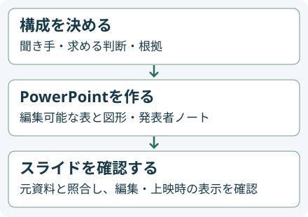

---
{
  "state": "draft",
  "language": "ja",
  "translationKey": "2026-11-26-ai-powerpoint-guide",
  "title": "AIでPowerPointを作る ― 構成案から編集可能なスライドまで",
  "description": "デプロイ前チェックの試験運用を例に、構成案の作成、編集可能なPowerPointの制作、スライドごとの検証に使うプロンプトを紹介します。",
  "sourcePath": "src/content/posts/en/2026-11-26-ai-powerpoint-guide.md",
  "sourceSha256": "859efd0ceeccfc1b46a9a9b1f8bbfb0235b50e0f4eee44c55f224a6a936c87cd"
}
---

AIに発表資料を頼むときは、**誰が聞くのか、発表が終わったときに何を決めてほしいのか**を先に伝えましょう。「見栄えのよいスライドを作って」と頼めば表紙と目次はすぐにできますが、会議で決めたいことが最後のスライドまで出てこないかもしれません。各スライドのタイトルと根拠を決め、その構成案を .pptx にして、実際に発表するアプリで開くと、修正箇所が見つけやすくなります。



## PowerPointの制作に使えるスキルとツール

| スキル・ツール | 使いどころ | 任せる作業 |
|---|---|---|
| **ai-guide-writing** | 使い方の説明や教材を発表資料にするとき | 演習の手順、入力例、期待する結果、確認方法を整理する。 |
| **tech-blog-writing** | 技術文書や運用記録を発表資料にするとき | 主張と根拠を絞り、説明をスライドと発表者ノートに振り分ける。 |
| **Anthropicのpptxスキル** | Claude CodeでPowerPointファイルを作成したり既存のテンプレートを修正したりするとき | .pptx の作成・編集、内容の抽出、サムネイルとファイル構造の確認。[公式スキル](https://raw.githubusercontent.com/anthropics/skills/main/skills/pptx/SKILL.md) |
| **PptxGenJS** | Codexなどのコーディングエージェントで同じ形式の週報を作るとき | JavaScriptと入力データから編集可能な .pptx を再生成する。[公式クイックスタート](https://github.com/gitbrent/PptxGenJS#-quick-start-guide) |

ai-guide-writingとtech-blog-writingは、この記事の作業環境で確認した執筆用スキルです。PowerPointファイルの制作にはClaude CodeのpptxスキルやPptxGenJSを使えます。Claude CodeにAnthropicの公式スキルをインストールするには、次のコマンドを上から順に実行します。インストール後は、プロンプトでpptxスキルを使うよう指定できます。[Anthropicのインストール手順](https://github.com/anthropics/skills#claude-code)

```text
/plugin marketplace add anthropics/skills
/plugin install document-skills@anthropic-agent-skills
```

PowerPointで作業している場合は、**Copilot**にプロンプトや参考ファイルを渡して下書きを作る方法もあります。会社のテンプレートがあれば、先にそのファイルを開きましょう。使える機能は契約内容と組織の設定によって異なります。**Google スライドのGemini**なら、生成したスライドを .pptx としてダウンロードできます。Googleの案内によると、プレゼンテーション全体を生成する機能には対象プランが必要で、デスクトップの英語環境で利用できます。[Copilotでプレゼンテーションを作成する](https://support.microsoft.com/en-gb/powerpoint/copilot/create-a-new-presentation-with-copilot-in-powerpoint) · [Geminiでスライドを生成する](https://support.google.com/docs/answer/17111393) · [PPTXのダウンロード](https://support.google.com/a/users/answer/9310270)

## 1. 構成案のプロンプトに会議で決めたいことを書く

架空の例として、開発チームに**デプロイ前チェックの自動化を試験的に導入する**提案をします。持ち時間は7分。会議で求めるのは、あるチームで2週間試すことへの承認です。この条件を伝えると、自動化の一般的な利点よりも、今回の会議で必要な判断を先に示しやすくなります。

```text
開発チームのリーダーと運用担当者に、デプロイ前チェックの自動化を提案します。
7分の発表をスライド6枚で構成してください。
会議では、ひとつのチームで2週間の試験運用を行うかどうかを決めます。

<資料>
- 現在はデプロイ前に環境変数とDBマイグレーションの状況を人が確認している。
- 最初の自動チェックでは、必須の環境変数の有無とマイグレーションファイルの欠落だけを調べる。
- 診断結果を記録するだけで、設定やDBは変更しない。
- 試験中はチェック所要時間、見つかった漏れの件数、誤検知の件数を記録する。
- 節約できた時間や失敗率の低下幅はまだ測定していない。
</資料>

各スライドに結論が分かるタイトル、画面に表示する文言を最大3点、
発表者ノート、根拠となる資料の項目を示してください。
最初に求める判断を、最後に試験運用後の評価基準を入れてください。
資料にない数値や、決定済みの担当者を作り上げないでください。
```

構成案ができたら、**タイトルだけを順に読んでみましょう。** 最初に求める判断、中盤に現状の問題とチェック範囲、最後に試験結果の評価方法が読み取れるかを確かめます。「自動化に期待する効果」よりも「試験中にチェック時間と誤検知を記録する」のように具体化すると、発表の流れが伝わります。

## 2. 編集可能な .pptx を指定する

後で文章や図表を変える予定なら、制作プロンプトに**個別に編集したい要素**を書いておきましょう。スライド全体が画像になっていると、PowerPointで一文直すために、そのスライドを作り直すことになります。

```text
以下の確定した構成案から、16:9のPowerPointファイル
deployment-check-pilot.pptxを作ってください。

- タイトル、本文、表、フローチャートをPowerPoint上で個別に編集できるようにしてください。
- 各スライドの主張はひとつに絞り、長い説明は発表者ノートに入れてください。
- 自動チェックのスライドは「デプロイ依頼 → 両項目をチェック → 結果を記録」を
  三つの図形で示してください。
- 数値がない項目はグラフにせず、表かフローチャートを使ってください。
- 会社のテンプレートが添付されていれば、タイトルの位置、フォント、配色を合わせてください。
- 元資料にない効果や導入日程を決定事項として書かないでください。

<確定した構成案>
手順1で確認したスライド構成をここに貼り付ける。
</確定した構成案>
```

コーディングエージェントで毎週同じ形式の報告資料を作る場合は、「**PptxGenJSで作成し、次回も実行できるようにbuild-deck.jsとslides.jsonを一緒に残してください**」と加えます。翌週はデータを入れ替えるだけで同じレイアウトを再生成できます。表やグラフはなるべくPowerPointのオブジェクトのまま残し、挿絵が必要なときだけ画像を使うと、後で編集しやすくなります。[PptxGenJSのテキスト要素](https://gitbrent.github.io/PptxGenJS/docs/api-text.html)

## 3. レビューではスライド番号と修正の根拠を求める

レビューを頼むときは、完成したファイルに**確定した構成案と元資料**も添えましょう。「デプロイの失敗率が下がった」という記述が実測結果なのか、今後の測定項目なのかは、元資料と照合して判断します。

```text
完成したPPTXを確定した構成案と元資料に照らして確認してください。
スライド番号ごとに問題点、根拠、修正後の文言を示してください。

1. 元資料にない数値、未確定の日程、誇張された効果を探してください。
2. スライドをレンダリングできる場合は、韓国語フォントの置換、改行、
   文字の見切れ、図形の重なりを確認してください。
3. 発表者ノートが画面の文章を繰り返している箇所を挙げてください。
4. 最後のスライドだけを見て、聞き手が何を決める必要があるかを答えてください。

直接確認できなかった項目には「未確認」と記してください。
```

ファイルは実際に使うPowerPointで開き、**編集画面とスライドショーの両方**で確認してください。編集画面では表の数字や図形内の文字を実際に変え、スライドショーでは後ろの席からでもタイトルや要点を読めるかを確かめます。Google スライドから書き出した場合は、韓国語フォントと改行も再確認しましょう。この記事のプロンプトは架空の事例に基づく入力例です。各製品で生成できる内容は公式資料に基づいて説明しています。

関連記事 · [Claude Code・Codex のおすすめスキル 10 選と実務での使い方](../2026-11-18-claude-code-codex-skills-top-10/)
