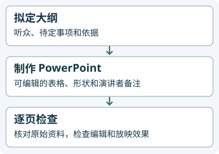

---
{
  "state": "draft",
  "language": "zh-CN",
  "translationKey": "2026-11-26-ai-powerpoint-guide",
  "title": "用 AI 做 PPT：从大纲到可编辑的 PowerPoint",
  "description": "以部署前自动检查试点为例，用三段提示词拟定大纲、制作可编辑的 PowerPoint，并逐页核对内容和排版。",
  "sourcePath": "src/content/posts/en/2026-11-26-ai-powerpoint-guide.md",
  "sourceSha256": "859efd0ceeccfc1b46a9a9b1f8bbfb0235b50e0f4eee44c55f224a6a936c87cd"
}
---

让 AI 做演示文稿时，先告诉它**谁来听，以及听众在会后需要做什么决定**。一句“帮我做个好看的 PPT”很快就能得到封面和目录，但会议要决定的事可能到最后一页才出现。先定好每页的标题和依据，再把大纲做成 .pptx，最后用实际演示的软件打开，就容易发现哪里需要修改。



## 制作 PPT 可以用哪些技能和工具

| 技能或工具 | 适用场景 | 可以交给它的工作 |
|---|---|---|
| **ai-guide-writing** | 把使用说明或培训材料改成演示文稿 | 梳理练习步骤、输入示例、预期结果和检查方法。 |
| **tech-blog-writing** | 把技术文档或运维记录改成演示文稿 | 提炼主要观点和依据，把讲解内容分配到幻灯片和演讲者备注中。 |
| **Anthropic 的 pptx 技能** | 在 Claude Code 中直接制作 PowerPoint 或修改现有模板 | 创建和编辑 .pptx，提取幻灯片内容，检查缩略图和文件结构。[官方技能](https://raw.githubusercontent.com/anthropics/skills/main/skills/pptx/SKILL.md) |
| **PptxGenJS** | 用 Codex 等编程助手制作格式相近的周报 | 根据 JavaScript 和输入数据重新生成可编辑的 .pptx。[官方入门指南](https://github.com/gitbrent/PptxGenJS#-quick-start-guide) |

ai-guide-writing 和 tech-blog-writing 是本文所用环境中已有的写作技能。要生成 PowerPoint 文件，可以使用 Claude Code 的 pptx 技能或 PptxGenJS。要在 Claude Code 中安装 Anthropic 的官方技能，请依次执行以下两行命令。安装后就可以在提示词里点名使用 pptx 技能。[Anthropic 安装说明](https://github.com/anthropics/skills#claude-code)

```text
/plugin marketplace add anthropics/skills
/plugin install document-skills@anthropic-agent-skills
```

如果平时就用 PowerPoint，可以让 **Copilot** 根据提示词或参考文件起草演示文稿。有公司模板的话，先打开模板。功能是否可用取决于订阅方案和组织设置。使用 **Google 幻灯片中的 Gemini** 时，可以生成幻灯片，再下载为 .pptx。根据 Google 的说明，生成整套演示文稿需要符合条件的方案，目前仅支持桌面端和英语。[用 Copilot 新建演示文稿](https://support.microsoft.com/en-gb/powerpoint/copilot/create-a-new-presentation-with-copilot-in-powerpoint) · [用 Gemini 生成演示文稿](https://support.google.com/docs/answer/17111393) · [下载 PPTX](https://support.google.com/a/users/answer/9310270)

## 1. 在大纲提示词里写明会议要做的决定

下面以一个虚构场景为例：向开发团队提议**试行部署前自动检查**。发言时间是 7 分钟，目的是请大家批准一个团队开展为期 2 周的试点。给出这些条件，有助于 AI 在开头就点明要做的决定，而不是泛谈自动化的好处。

```text
请为开发团队负责人和运维人员拟一份 7 分钟的演讲大纲，提议将部署前检查自动化。
共 6 页幻灯片。本次会议要决定是否批准一个团队开展为期 2 周的试点。

<资料>
- 目前在部署前由人工检查环境变量和数据库迁移情况。
- 初期自动检查只确认必需的环境变量是否存在，以及是否缺少迁移文件。
- 只记录诊断结果，不修改配置或数据库。
- 试点期间记录检查耗时、发现的遗漏数和误报数。
- 尚未测量节省的时间和失败率的降幅。
</资料>

每页给出一个直接点明结论的标题、最多 3 条屏幕文字、演讲者备注以及对应的资料条目。
首页写出需要听众决定的事项，末页列出试点结束后的评估标准。
不要编造资料里没有的数字，也不要擅自指定负责人。
```

拿到大纲后，**按顺序只读标题**。首页应点明待定事项，中间几页交代当前问题和检查范围，末页说明如何评估试点结果。把“自动化的预期收益”改成“试点期间记录检查耗时和误报数”，听众就更容易跟上思路。

## 2. 要求生成可编辑的 .pptx

如果以后还要改文字或图表，请在制作提示词里**指明哪些元素需要可编辑**。如果整页只是一张图片，在 PowerPoint 中改一句话也可能需要重做整页。

```text
根据下面贴出的定稿大纲，制作一份 16:9 的 PowerPoint 文件，
命名为 deployment-check-pilot.pptx。

- 标题、正文、表格和流程图都要能在 PowerPoint 中单独编辑。
- 每页只讲一个主要观点，较长的说明放在演讲者备注里。
- 在自动检查页，用三个形状表示“提交部署请求 → 检查两项内容 → 记录结果”。
- 没有数字的内容用表格或流程图表示，不要画统计图。
- 如果附有公司模板，请沿用标题位置、字体和配色。
- 原始资料里没有的成效或上线日期，不要写成定论。

<定稿大纲>
在此粘贴第 1 步审核过的幻灯片大纲。
</定稿大纲>
```

如果每周都用编程助手做同一种报告，可以加一句：**“请用 PptxGenJS 制作，并保留 build-deck.js 和 slides.json，方便下次重新运行。”** 下周只要替换输入数据，就可以按同样的版式重新生成。尽量把数据表和统计图保留为 PowerPoint 对象，只在需要插图时插入单独的图片，后续修改会方便得多。[PptxGenJS 文本对象文档](https://gitbrent.github.io/PptxGenJS/docs/api-text.html)

## 3. 要求审阅时注明页码和修改依据

审阅时，除了成品文件，还要提供**定稿大纲和原始资料**。如果某页写了“降低了部署失败率”，只有对照原始资料，才能判断这是实测结果，还是今后要测量的指标。

```text
请对照定稿大纲和原始资料检查完成的 PPTX。
按幻灯片页码列出问题、依据和建议替换的文字。

1. 找出没有资料支持的数字、未经确认的日期和夸大的成效。
2. 如果能渲染幻灯片，检查韩文字体是否被替换、换行是否合适、
   文字是否被截断，以及形状是否重叠。
3. 找出演讲者备注里重复屏幕文字的地方。
4. 只看最后一页，说说听众需要做什么决定。

无法直接检查的项目请标为“未核实”。
```

收到文件后，用实际演示时要用的 PowerPoint 打开，**分别检查编辑模式和放映模式**。在编辑模式中试着修改表格里的数字和形状里的文字；在放映模式中，看看坐在后排能否读清标题和关键句。如果文件由 Google 幻灯片导出，还要复查韩文字体和换行。文中的提示词用于虚构案例，各产品的生成功能依据官方文档说明。

延伸阅读 · [Claude Code 和 Codex 推荐技能 10 选及实战用法](../2026-11-18-claude-code-codex-skills-top-10/)
