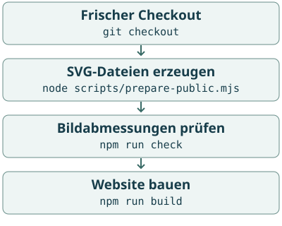

---
{
  "state": "draft",
  "language": "de",
  "translationKey": "2026-11-26-astro-clean-checkout",
  "title": "Warum die Astro-Prüfung nur in einem frischen Checkout scheiterte",
  "description": "Ein fehlendes SVG stoppte den Workflow für Nachrichtenentwürfe. Dieselbe Astro-Prüfung vor und nach dem Erzeugen der Dateien machte die Ursache sichtbar.",
  "sourcePath": "src/content/posts/en/2026-11-26-astro-clean-checkout.md",
  "sourceSha256": "7dba5eae5f82355acd4550b2c1c0881e24e8e8c82d7597021db67ee13393285f"
}
---

Der Workflow für Nachrichtenentwürfe brach mit `ENOENT` ab. Von den 4 untersuchten Fehlläufen scheiterten 3, als Astro die Bildabmessungen in bestehenden Beiträgen auslesen wollte. In einem frischen Checkout waren die referenzierten SVG-Dateien noch nicht erzeugt. Lagen sie lokal von einem früheren Build vor, konnte dieselbe Prüfung durchlaufen. [Fehlgeschlagene Prüfung eines Entwurfs](https://github.com/youdozi/youdozi.github.io/actions/runs/45548722494)

## Dieselbe Prüfung vor und nach der SVG-Erzeugung

Wir checkten den betroffenen Commit in einem separaten Verzeichnis aus. Dort endete `npm run check` mit Exitcode 1. Nachdem `node scripts/prepare-public.mjs` die öffentlichen Ressourcen im selben Verzeichnis vorbereitet hatte, endete die Prüfung mit Exitcode 0. Auch der Build bereitet die Ressourcen vor, doch in der CI lief die Prüfung zuerst.



Die CI-Abfolge lässt sich im Stammverzeichnis des Repositorys mit Node.js 24 und Python 3.11 nachvollziehen. Nach der Installation der Abhängigkeiten mit `npm ci` folgen die Befehle unten. Jeder Schritt startet erst, wenn der vorige erfolgreich war. [Pull Request mit der Korrektur](https://github.com/youdozi/youdozi.github.io/pull/198) · [Build-Ergebnis des PR](https://github.com/youdozi/youdozi.github.io/actions/runs/45734945701)

```sh
node scripts/prepare-public.mjs &&
  npm run check &&
  npm run build
```

## Ein weiterer Fehler bei der Generierung

In einem anderen Lauf antwortete Gemini während der Generierung mit HTTP 503. Seit der Korrektur wartet der Workflow vor dem ersten erneuten Versuch 1 Sekunde und vor dem zweiten 2 Sekunden. Er verwendet dasselbe Modell. Diese beiden zusätzlichen Versuche teilen sich alle Anfragen eines Laufs. [Fehlgeschlagene Generierung](https://github.com/youdozi/youdozi.github.io/actions/runs/45098322259)

Für einen Probelauf auf Koreanisch und Englisch nutzten wir einen offiziellen Spring-Beitrag. Wir simulierten nur die Modellantworten für Generierung und Review, glichen die Zitate mit dem Original ab, prüften die Links und validierten den Inhalt anhand der Schemas in Python und Astro. Der Probelauf schrieb weder Entwürfe noch Einträge in die Warteschlange. Die tatsächliche Verfügbarkeit von Gemini blieb ungeprüft.

Wenn eine Prüfung lokal durchläuft, lohnt sich ein Blick auf den ersten Befehl, der im frischen Checkout auf die fehlende Datei zugreift. Der Vergleich mit dem Schritt, der sie erzeugt, kann erklären, warum der vollständige Build gelingt und die frühere Prüfung scheitert.
