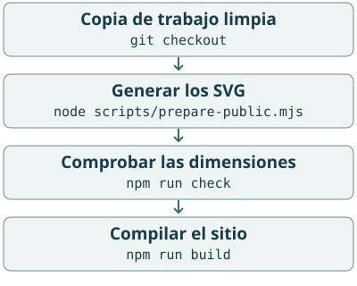

---
{
  "state": "draft",
  "language": "es",
  "translationKey": "2026-11-26-astro-clean-checkout",
  "title": "Por qué la comprobación de Astro fallaba solo en una copia de trabajo limpia",
  "description": "Un SVG ausente detuvo la preparación de un borrador de noticias. Repetir la comprobación de Astro después de generar los archivos permitió aislar la causa.",
  "sourcePath": "src/content/posts/en/2026-11-26-astro-clean-checkout.md",
  "sourceSha256": "7dba5eae5f82355acd4550b2c1c0881e24e8e8c82d7597021db67ee13393285f"
}
---

El flujo que prepara los borradores de noticias se detuvo con `ENOENT`. De los 4 fallos que investigamos, 3 se produjeron cuando Astro intentó leer las dimensiones de las imágenes de artículos existentes. Los SVG a los que apuntaban esos artículos todavía no se habían generado en la copia de trabajo limpia. Si quedaban archivos de una compilación anterior, la misma comprobación podía pasar en local. [Fallo al comprobar el borrador](https://github.com/youdozi/youdozi.github.io/actions/runs/45548722494)

## Ejecutar la misma comprobación antes y después de generar los SVG

Recuperamos el commit que fallaba en un directorio aparte. Allí, `npm run check` terminó con el código de salida 1. Tras preparar los recursos públicos con `node scripts/prepare-public.mjs` en ese mismo directorio, la comprobación terminó con el código 0. La compilación también prepara los recursos, pero la CI ejecutaba primero la comprobación.



Para reproducir la secuencia de la CI, utiliza Node.js 24 y Python 3.11 en la raíz del repositorio. Instala las dependencias con `npm ci` y ejecuta los comandos siguientes. Cada paso debe completarse con éxito para que empiece el siguiente. [Corrección en el PR](https://github.com/youdozi/youdozi.github.io/pull/198) · [Resultado de la compilación del PR](https://github.com/youdozi/youdozi.github.io/actions/runs/45734945701)

```sh
node scripts/prepare-public.mjs &&
  npm run check &&
  npm run build
```

## Otro fallo durante la generación

En otra ejecución, Gemini devolvió HTTP 503 durante la generación. Con la corrección se usa el mismo modelo y se espera 1 segundo antes del primer reintento y 2 segundos antes del segundo. Todas las solicitudes de una ejecución comparten esos dos reintentos. [Fallo en la etapa de generación](https://github.com/youdozi/youdozi.github.io/actions/runs/45098322259)

En una prueba en seco en coreano e inglés con un artículo oficial de Spring, solo simulamos las respuestas del modelo durante la generación y la revisión. Contrastamos las citas con el artículo original, comprobamos los enlaces y validamos el contenido con los esquemas de Python y Astro. La prueba no escribió nada en los borradores ni en la cola. La disponibilidad real de Gemini quedó sin comprobar.

Cuando una comprobación pasa en local, conviene localizar el primer comando que lee el archivo ausente en una copia limpia. Comparar su posición con la del paso que genera el archivo puede explicar por qué se completa toda la compilación aunque falle una comprobación anterior.
